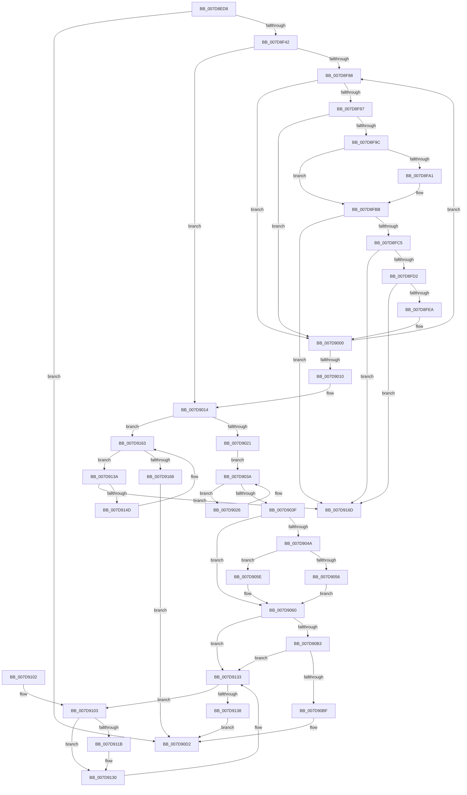

# WheapExecuteRowFailureCheck

- RVA: `0x007D8ED8`–`0x007D9174` (길이 `668` bytes)
- VA: `0x00000001407D8ED8`
- 실행 섹션: `PAGE`
- PDB 이름 있음: `예`; PDB Function 태그: `아니요`
- unwind 정보 RVA: `0x000D6060`
- 디코드: `178`개 명령, `668/668` bytes 표시
- 미해석 바이트: `0` (있으면 어셈블리에 `.byte`로 보존)

> 이 문서는 커널 이미지의 기계어와 PDB 기호를 분석해 생성했습니다. 4번과 5번은 함수 원형과 자료형을 바이너리 사용 방식에서 추정한 C 해석이며 원본 소스 복구 결과는 아닙니다.

## 1. Dependencies

- 직접 호출 지점: **7**; 고유 호출 대상: **7**
- 직접 호출자로 확인된 함수: **1**
- RIP 상대 이미지 참조: **7**

### Outgoing calls
- `0x007D9031` → [ExFreePoolWithTag](../../poolcode/B8/ExFreePoolWithTag_function_00B82870.md) (function, `0x00B82870`)
- `0x007D90A1` → [WheaLogInternalEvent](../../text/66/WheaLogInternalEvent_function_006605B0.md) (function, `0x006605B0`)
- `0x007D90A6` → [WheaGetNotifyAllOfflinesPolicy](../../text/65/WheaGetNotifyAllOfflinesPolicy_function_0065F300.md) (function, `0x0065F300`)
- `0x007D90CD` → [WheaAttemptRowOffline](../../text/65/WheaAttemptRowOffline_function_0065F050.md) (function, `0x0065F050`)
- `0x007D90DC` → [_security_check_cookie](../../text/6A/_security_check_cookie_function_006AC640.md) (function, `0x006AC640`)
- `0x007D9112` → [MmGetPageBadStatus](../../text/67/MmGetPageBadStatus_function_0067A9B0.md) (function, `0x0067A9B0`)
- `0x007D912B` → [WheaAttemptPhysicalPageOffline](WheaAttemptPhysicalPageOffline_function_007D7380.md) (function, `0x007D7380`)

### Direct callers
- [WheapPfaMemoryCheck](WheapPfaMemoryCheck_function_007D9214.md) at `0x007D9288`

### Static image references
- `0x007D8EFA` → RVA `0x00E0A740` (`.data`; read)
- `0x007D8F17` → RVA `0x00E097E8` (`.data`; read)
- `0x007D8F42` → RVA `0x00E09808` (`.data`; read)
- `0x007D8F49` → RVA `0x00EEFB28` (`.data`; read)
- `0x007D8F67` → RVA `0x00E097C8` (`.data`; read)
- `0x007D90B3` → RVA `0x00E09848` (`.data`; read)
- `0x007D9158` → RVA `0x00EEFB28` (`.data`; write)

## 2. Other-region calls and transfers

- 다른 실행 섹션으로 향하는 call: **6**
  - `0x007D9031` → [ExFreePoolWithTag](../../poolcode/B8/ExFreePoolWithTag_function_00B82870.md) (`PAGE` → `POOLCODE`)
  - `0x007D90A1` → [WheaLogInternalEvent](../../text/66/WheaLogInternalEvent_function_006605B0.md) (`PAGE` → `.text`)
  - `0x007D90A6` → [WheaGetNotifyAllOfflinesPolicy](../../text/65/WheaGetNotifyAllOfflinesPolicy_function_0065F300.md) (`PAGE` → `.text`)
  - `0x007D90CD` → [WheaAttemptRowOffline](../../text/65/WheaAttemptRowOffline_function_0065F050.md) (`PAGE` → `.text`)
  - `0x007D90DC` → [_security_check_cookie](../../text/6A/_security_check_cookie_function_006AC640.md) (`PAGE` → `.text`)
  - `0x007D9112` → [MmGetPageBadStatus](../../text/67/MmGetPageBadStatus_function_0067A9B0.md) (`PAGE` → `.text`)
- 별도 외부 분기/꼬리 이동을 확인하지 못했습니다.

## 3. Assembly (complete function range)

```asm
007D8ED8  48 89 5C 24 10                  mov qword ptr [rsp + 0x10], rbx
007D8EDD  48 89 74 24 18                  mov qword ptr [rsp + 0x18], rsi
007D8EE2  48 89 7C 24 20                  mov qword ptr [rsp + 0x20], rdi
007D8EE7  55                              push rbp
007D8EE8  41 54                           push r12
007D8EEA  41 55                           push r13
007D8EEC  41 56                           push r14
007D8EEE  41 57                           push r15
007D8EF0  48 8B EC                        mov rbp, rsp
007D8EF3  48 81 EC 80 00 00 00            sub rsp, 0x80
007D8EFA  48 8B 05 3F 18 63 00            mov rax, qword ptr [rip + 0x63183f]
007D8F01  48 33 C4                        xor rax, rsp
007D8F04  48 89 45 F8                     mov qword ptr [rbp - 8], rax
007D8F08  4C 8B 65 50                     mov r12, qword ptr [rbp + 0x50]
007D8F0C  48 8D 45 B0                     lea rax, [rbp - 0x50]
007D8F10  0F 57 C0                        xorps xmm0, xmm0
007D8F13  48 89 45 B8                     mov qword ptr [rbp - 0x48], rax
007D8F17  48 8B 05 CA 08 63 00            mov rax, qword ptr [rip + 0x6308ca]
007D8F1E  48 8D 7D B0                     lea rdi, [rbp - 0x50]
007D8F22  4C 8B C9                        mov r9, rcx
007D8F25  48 89 7D B0                     mov qword ptr [rbp - 0x50], rdi
007D8F29  33 C9                           xor ecx, ecx
007D8F2B  0F 11 45 C8                     movups xmmword ptr [rbp - 0x38], xmm0
007D8F2F  44 8A F9                        mov r15b, cl
007D8F32  0F 11 45 D8                     movups xmmword ptr [rbp - 0x28], xmm0
007D8F36  0F 11 45 E8                     movups xmmword ptr [rbp - 0x18], xmm0
007D8F3A  38 08                           cmp byte ptr [rax], cl
007D8F3C  0F 84 90 01 00 00               je 0x1407d90d2
007D8F42  48 8B 05 BF 08 63 00            mov rax, qword ptr [rip + 0x6308bf]
007D8F49  48 8D 15 D8 6B 71 00            lea rdx, [rip + 0x716bd8]
007D8F50  4C 8B 05 D1 6B 71 00            mov r8, qword ptr [rip + 0x716bd1]
007D8F57  44 8D 51 01                     lea r10d, [rcx + 1]
007D8F5B  4D 8B D9                        mov r11, r9
007D8F5E  49 8B D9                        mov rbx, r9
007D8F61  49 8B F1                        mov rsi, r9
007D8F64  44 8B 28                        mov r13d, dword ptr [rax]
007D8F67  48 8B 05 5A 08 63 00            mov rax, qword ptr [rip + 0x63085a]
007D8F6E  44 8B 30                        mov r14d, dword ptr [rax]
007D8F71  4D 2B DE                        sub r11, r14
007D8F74  4D 3B CE                        cmp r9, r14
007D8F77  4C 0F 42 D9                     cmovb r11, rcx
007D8F7B  4B 8D 04 0E                     lea rax, [r14 + r9]
007D8F7F  4C 3B C2                        cmp r8, rdx
007D8F82  0F 84 8C 00 00 00               je 0x1407d9014
007D8F88  49 8B C8                        mov rcx, r8
007D8F8B  4D 8B 00                        mov r8, qword ptr [r8]
007D8F8E  48 8B 51 28                     mov rdx, qword ptr [rcx + 0x28]
007D8F92  49 3B D3                        cmp rdx, r11
007D8F95  72 69                           jb 0x1407d9000
007D8F97  48 3B D0                        cmp rdx, rax
007D8F9A  77 64                           ja 0x1407d9000
007D8F9C  49 3B D1                        cmp rdx, r9
007D8F9F  74 1A                           je 0x1407d8fbb
007D8FA1  41 FF C2                        inc r10d
007D8FA4  48 8B C2                        mov rax, rdx
007D8FA7  48 3B D3                        cmp rdx, rbx
007D8FAA  48 0F 43 C3                     cmovae rax, rbx
007D8FAE  48 3B D6                        cmp rdx, rsi
007D8FB1  48 8B D8                        mov rbx, rax
007D8FB4  48 0F 46 D6                     cmovbe rdx, rsi
007D8FB8  48 8B F2                        mov rsi, rdx
007D8FBB  49 39 48 08                     cmp qword ptr [r8 + 8], rcx
007D8FBF  0F 85 A8 01 00 00               jne 0x1407d916d
007D8FC5  48 8B 41 08                     mov rax, qword ptr [rcx + 8]
007D8FC9  48 39 08                        cmp qword ptr [rax], rcx
007D8FCC  0F 85 9B 01 00 00               jne 0x1407d916d
007D8FD2  4C 89 00                        mov qword ptr [rax], r8
007D8FD5  48 8D 55 B0                     lea rdx, [rbp - 0x50]
007D8FD9  49 89 40 08                     mov qword ptr [r8 + 8], rax
007D8FDD  48 8B 45 B8                     mov rax, qword ptr [rbp - 0x48]
007D8FE1  48 39 10                        cmp qword ptr [rax], rdx
007D8FE4  0F 85 83 01 00 00               jne 0x1407d916d
007D8FEA  48 89 41 08                     mov qword ptr [rcx + 8], rax
007D8FEE  48 8D 55 B0                     lea rdx, [rbp - 0x50]
007D8FF2  48 89 11                        mov qword ptr [rcx], rdx
007D8FF5  48 89 08                        mov qword ptr [rax], rcx
007D8FF8  4B 8D 04 0E                     lea rax, [r14 + r9]
007D8FFC  48 89 4D B8                     mov qword ptr [rbp - 0x48], rcx
007D9000  48 8D 15 21 6B 71 00            lea rdx, [rip + 0x716b21]
007D9007  4C 3B C2                        cmp r8, rdx
007D900A  0F 85 78 FF FF FF               jne 0x1407d8f88
007D9010  48 8B 7D B0                     mov rdi, qword ptr [rbp - 0x50]
007D9014  48 8D 45 B0                     lea rax, [rbp - 0x50]
007D9018  45 3B D5                        cmp r10d, r13d
007D901B  0F 82 42 01 00 00               jb 0x1407d9163
007D9021  41 B7 01                        mov r15b, 1
007D9024  EB 14                           jmp 0x1407d903a
007D9026  48 8B CF                        mov rcx, rdi
007D9029  BA 57 68 65 61                  mov edx, 0x61656857
007D902E  48 8B 3F                        mov rdi, qword ptr [rdi]
007D9031  E8 3A 98 3A 00                  call 0x140b82870
007D9036  48 8D 45 B0                     lea rax, [rbp - 0x50]
007D903A  48 3B F8                        cmp rdi, rax
007D903D  75 E7                           jne 0x1407d9026
007D903F  48 8B C6                        mov rax, rsi
007D9042  48 2B C3                        sub rax, rbx
007D9045  49 3B C6                        cmp rax, r14
007D9048  73 16                           jae 0x1407d9060
007D904A  48 8B C6                        mov rax, rsi
007D904D  49 8D 34 1E                     lea rsi, [r14 + rbx]
007D9051  49 3B C6                        cmp rax, r14
007D9054  72 08                           jb 0x1407d905e
007D9056  48 8B D8                        mov rbx, rax
007D9059  49 2B DE                        sub rbx, r14
007D905C  EB 02                           jmp 0x1407d9060
007D905E  33 DB                           xor ebx, ebx
007D9060  83 65 D4 00                     and dword ptr [rbp - 0x2c], 0
007D9064  48 8D 4D C8                     lea rcx, [rbp - 0x38]
007D9068  C7 45 C8 57 68 4C 67            mov dword ptr [rbp - 0x38], 0x674c6857
007D906F  C7 45 CC 01 00 00 00            mov dword ptr [rbp - 0x34], 1
007D9076  C7 45 D0 30 00 00 00            mov dword ptr [rbp - 0x30], 0x30
007D907D  C7 45 DC 54 00 00 80            mov dword ptr [rbp - 0x24], 0x80000054
007D9084  C7 45 D8 4B 52 4E 4C            mov dword ptr [rbp - 0x28], 0x4c4e524b
007D908B  C7 45 E0 02 00 00 00            mov dword ptr [rbp - 0x20], 2
007D9092  C7 45 E4 10 00 00 00            mov dword ptr [rbp - 0x1c], 0x10
007D9099  48 89 5D E8                     mov qword ptr [rbp - 0x18], rbx
007D909D  48 89 75 F0                     mov qword ptr [rbp - 0x10], rsi
007D90A1  E8 0A 75 E8 FF                  call 0x1406605b0
007D90A6  E8 55 62 E8 FF                  call 0x14065f300
007D90AB  84 C0                           test al, al
007D90AD  0F 84 80 00 00 00               je 0x1407d9133
007D90B3  48 8B 05 8E 07 63 00            mov rax, qword ptr [rip + 0x63078e]
007D90BA  80 38 00                        cmp byte ptr [rax], 0
007D90BD  74 74                           je 0x1407d9133
007D90BF  2B F3                           sub esi, ebx
007D90C1  4D 8B CC                        mov r9, r12
007D90C4  33 D2                           xor edx, edx
007D90C6  48 8B CB                        mov rcx, rbx
007D90C9  44 8D 46 01                     lea r8d, [rsi + 1]
007D90CD  E8 7E 5F E8 FF                  call 0x14065f050
007D90D2  41 8A C7                        mov al, r15b
007D90D5  48 8B 4D F8                     mov rcx, qword ptr [rbp - 8]
007D90D9  48 33 CC                        xor rcx, rsp
007D90DC  E8 5F 35 ED FF                  call 0x1406ac640
007D90E1  4C 8D 9C 24 80 00 00 00         lea r11, [rsp + 0x80]
007D90E9  49 8B 5B 38                     mov rbx, qword ptr [r11 + 0x38]
007D90ED  49 8B 73 40                     mov rsi, qword ptr [r11 + 0x40]
007D90F1  49 8B 7B 48                     mov rdi, qword ptr [r11 + 0x48]
007D90F5  49 8B E3                        mov rsp, r11
007D90F8  41 5F                           pop r15
007D90FA  41 5E                           pop r14
007D90FC  41 5D                           pop r13
007D90FE  41 5C                           pop r12
007D9100  5D                              pop rbp
007D9101  C3                              ret
007D9102  CC                              int3
007D9103  48 8B C3                        mov rax, rbx
007D9106  48 8D 4D C0                     lea rcx, [rbp - 0x40]
007D910A  48 C1 E0 0C                     shl rax, 0xc
007D910E  48 89 45 C0                     mov qword ptr [rbp - 0x40], rax
007D9112  E8 99 18 EA FF                  call 0x14067a9b0
007D9117  85 C0                           test eax, eax
007D9119  75 15                           jne 0x1407d9130
007D911B  45 33 C9                        xor r9d, r9d
007D911E  4C 89 64 24 20                  mov qword ptr [rsp + 0x20], r12
007D9123  45 33 C0                        xor r8d, r8d
007D9126  33 D2                           xor edx, edx
007D9128  48 8B CB                        mov rcx, rbx
007D912B  E8 50 E2 FF FF                  call 0x1407d7380
007D9130  48 FF C3                        inc rbx
007D9133  48 3B DE                        cmp rbx, rsi
007D9136  76 CB                           jbe 0x1407d9103
007D9138  EB 98                           jmp 0x1407d90d2
007D913A  48 8B 0D E7 69 71 00            mov rcx, qword ptr [rip + 0x7169e7]
007D9141  48 8B C7                        mov rax, rdi
007D9144  48 8B 3F                        mov rdi, qword ptr [rdi]
007D9147  48 39 51 08                     cmp qword ptr [rcx + 8], rdx
007D914B  75 20                           jne 0x1407d916d
007D914D  48 89 08                        mov qword ptr [rax], rcx
007D9150  48 89 50 08                     mov qword ptr [rax + 8], rdx
007D9154  48 89 41 08                     mov qword ptr [rcx + 8], rax
007D9158  48 89 05 C9 69 71 00            mov qword ptr [rip + 0x7169c9], rax
007D915F  48 8D 45 B0                     lea rax, [rbp - 0x50]
007D9163  48 3B F8                        cmp rdi, rax
007D9166  75 D2                           jne 0x1407d913a
007D9168  E9 65 FF FF FF                  jmp 0x1407d90d2
007D916D  B9 03 00 00 00                  mov ecx, 3
007D9172  CD 29                           int 0x29
```

## 4. C-style interpretation (structured pseudocode)

```c
__int64 __fastcall WheapExecuteRowFailureCheck(__int64 a1, __int64 a2, __int64 a3, __int64 a4, __int64 a5)
{
    __int64 result;
    __int64 v_r10;
    __int64 v_r11;
    __int64 v_rbx;
    __int64 v_rsi;
    __int64 v_rsp;
    unsigned __int64 v_stack_m28;
    unsigned __int64 v_stack_m30;
    unsigned __int64 v_stack_m38;
    unsigned __int64 v_stack_m40;
    unsigned int v_stack_m44;
    unsigned int v_stack_m48;
    unsigned int v_stack_m4C;
    unsigned __int64 v_stack_m50;
    unsigned int v_stack_m54;
    unsigned int v_stack_m58;
    unsigned int v_stack_m5C;
    unsigned __int64 v_stack_m60;
    unsigned __int64 v_stack_m68;
    unsigned __int64 v_stack_m70;
    unsigned __int64 v_stack_m78;
    unsigned __int64 v_stack_p10;
    unsigned __int64 v_stack_p18;
    unsigned __int64 v_stack_p20;

    v_stack_p10 = v_rbx;
    v_stack_p18 = v_rsi;
    v_stack_p20 = v_rdi;
    v_rsp = (v_rsp) - (128);
    result = (*(unsigned __int64 *)(v_rip + 6494271)) ^ (v_rsp);
    v_stack_m30 = result;
    v_stack_m70 = v_stack_m78;
    v_stack_m78 = v_stack_m78;
    a1 = 0;
    v_stack_m60 = v_xmm0;
    v_stack_m50 = v_xmm0;
    v_stack_m40 = v_xmm0;
    if ((*(unsigned __int8 *)(*(unsigned __int64 *)(v_rip + 6490314))) == 0) goto loc_007D90D2;
    v_r11 = (0) - ((unsigned int)(*(unsigned int *)(*(unsigned __int64 *)(v_rip + 6490202))));
    if (0 < ((unsigned int)(*(unsigned int *)(*(unsigned __int64 *)(v_rip + 6490202))))) { v_r11 = 0; }
    if ((*(unsigned __int64 *)(v_rip + 7433169)) == (v_rip + 7433176)) goto loc_007D9014;
loc_007D8F88:
    if ((*(unsigned __int64 *)(*(unsigned __int64 *)(v_rip + 7433169) + 40)) < v_r11) goto loc_007D9000;
    if ((*(unsigned __int64 *)(*(unsigned __int64 *)(v_rip + 7433169) + 40)) > ((unsigned int)(*(unsigned int *)(*(unsigned __int64 *)(v_rip + 6490202))) + a1 * 1)) goto loc_007D9000;
    result = (unsigned int)(*(unsigned int *)(*(unsigned __int64 *)(v_rip + 6490202))) + a1 * 1;
    v_rbx = 0;
    v_rsi = 0;
    v_r10 = a1 + 1;
    if ((*(unsigned __int64 *)(*(unsigned __int64 *)(v_rip + 7433169) + 40)) != 0) {
        v_r10 = (unsigned int)((a1 + 1) + 1);
        result = *(unsigned __int64 *)(*(unsigned __int64 *)(v_rip + 7433169) + 40);
        if ((*(unsigned __int64 *)(*(unsigned __int64 *)(v_rip + 7433169) + 40)) >= 0) { result = 0; }
        v_rbx = result;
        a2 = *(unsigned __int64 *)(*(unsigned __int64 *)(v_rip + 7433169) + 40);
        if ((*(unsigned __int64 *)(*(unsigned __int64 *)(v_rip + 7433169) + 40)) <= 0) { a2 = 0; }
        v_rsi = a2;
    }
    if ((*(unsigned __int64 *)(*(unsigned __int64 *)(*(unsigned __int64 *)(v_rip + 7433169)) + 8)) != (*(unsigned __int64 *)(v_rip + 7433169))) goto loc_007D916D;
    if ((*(unsigned __int64 *)(*(unsigned __int64 *)(*(unsigned __int64 *)(v_rip + 7433169) + 8))) != (*(unsigned __int64 *)(v_rip + 7433169))) goto loc_007D916D;
    *(unsigned __int64 *)(*(unsigned __int64 *)(*(unsigned __int64 *)(v_rip + 7433169) + 8)) = *(unsigned __int64 *)(*(unsigned __int64 *)(v_rip + 7433169));
    *(unsigned __int64 *)(*(unsigned __int64 *)(*(unsigned __int64 *)(v_rip + 7433169)) + 8) = *(unsigned __int64 *)(*(unsigned __int64 *)(v_rip + 7433169) + 8);
    if ((*(unsigned __int64 *)(v_stack_m70)) != v_stack_m78) goto loc_007D916D;
    *(unsigned __int64 *)(*(unsigned __int64 *)(v_rip + 7433169) + 8) = v_stack_m70;
    *(unsigned __int64 *)(*(unsigned __int64 *)(v_rip + 7433169)) = v_stack_m78;
    *(unsigned __int64 *)(v_stack_m70) = *(unsigned __int64 *)(v_rip + 7433169);
    v_stack_m70 = *(unsigned __int64 *)(v_rip + 7433169);
loc_007D9000:
    if ((*(unsigned __int64 *)(*(unsigned __int64 *)(v_rip + 7433169))) != (v_rip + 7432993)) goto loc_007D8F88;
loc_007D9014:
    if (((unsigned int)(v_r10)) < ((unsigned int)((unsigned int)(*(unsigned int *)(*(unsigned __int64 *)(v_rip + 6490303)))))) goto loc_007D9163;
    goto loc_007D903A;
loc_007D9026:
    result = ExFreePoolWithTag(v_stack_m78, (unsigned int)(0x61656857ULL), *(unsigned __int64 *)(*(unsigned __int64 *)(v_rip + 7433169)), a1);
loc_007D903A:
    if ((*(unsigned __int64 *)(v_stack_m78)) != v_stack_m78) goto loc_007D9026;
    result = (v_rsi) - (v_rbx);
    if (result >= ((unsigned int)(*(unsigned int *)(*(unsigned __int64 *)(v_rip + 6490202))))) goto loc_007D9060;
    if (v_rsi < ((unsigned int)(*(unsigned int *)(*(unsigned __int64 *)(v_rip + 6490202))))) goto loc_007D905E;
    v_rbx = (v_rsi) - ((unsigned int)(*(unsigned int *)(*(unsigned __int64 *)(v_rip + 6490202))));
    goto loc_007D9060;
loc_007D905E:
    v_rbx = 0;
loc_007D9060:
    v_stack_m60 = 0x674C6857ULL;
    v_stack_m5C = 1;
    v_stack_m58 = 48;
    v_stack_m4C = 0x80000054ULL;
    v_stack_m50 = 0x4C4E524BULL;
    v_stack_m48 = 2;
    v_stack_m44 = 16;
    v_stack_m40 = 0;
    v_stack_m38 = (unsigned int)(*(unsigned int *)(*(unsigned __int64 *)(v_rip + 6490202))) + v_rbx * 1;
    result = WheaLogInternalEvent(v_stack_m60, (unsigned int)(0x61656857ULL), *(unsigned __int64 *)(*(unsigned __int64 *)(v_rip + 7433169)), a1);
    result = WheaGetNotifyAllOfflinesPolicy(v_stack_m60, (unsigned int)(0x61656857ULL), *(unsigned __int64 *)(*(unsigned __int64 *)(v_rip + 7433169)), a1);
    if ((unsigned __int8)(result) == 0) goto loc_007D9133;
    if ((*(unsigned __int8 *)(*(unsigned __int64 *)(v_rip + 6489998))) == 0) goto loc_007D9133;
    v_rsi = (unsigned int)(((unsigned int)(*(unsigned int *)(*(unsigned __int64 *)(v_rip + 6490202))) + v_rbx * 1) - (0));
    a2 = 0;
    result = WheaAttemptRowOffline(0, a2, v_rsi + 1, a5);
loc_007D90D2:
    a1 = (v_stack_m30) ^ (v_rsp);
    result = _security_check_cookie(a1, a2, v_rsi + 1, a5);
    return result;
loc_007D9103:
    result = (*(unsigned __int64 *)(v_stack_m28 + 56)) << (12);
    v_stack_m68 = result;
    result = MmGetPageBadStatus(v_stack_m68, a2, v_rsi + 1, a5);
    if ((unsigned int)(result) == 0) {
        a4 = 0;
        v_stack_m60 = a5;
        a3 = 0;
        a2 = 0;
        a1 = *(unsigned __int64 *)(v_stack_m28 + 56);
        result = WheaAttemptPhysicalPageOffline(a1, a2, a3, a4);
    }
    v_rbx = (*(unsigned __int64 *)(v_stack_m28 + 56)) + 1;
loc_007D9133:
    if (v_rbx <= (*(unsigned __int64 *)(v_stack_m28 + 64))) goto loc_007D9103;
    goto loc_007D90D2;
loc_007D913A:
    if ((*(unsigned __int64 *)(*(unsigned __int64 *)(v_rip + 7432679) + 8)) != 0) goto loc_007D916D;
    *(unsigned __int64 *)(*(unsigned __int64 *)(v_stack_m28 + 72)) = *(unsigned __int64 *)(v_rip + 7432679);
    *(unsigned __int64 *)(*(unsigned __int64 *)(v_stack_m28 + 72) + 8) = 0;
    *(unsigned __int64 *)(*(unsigned __int64 *)(v_rip + 7432679) + 8) = *(unsigned __int64 *)(v_stack_m28 + 72);
    *(unsigned __int64 *)(v_rip + 7432649) = *(unsigned __int64 *)(v_stack_m28 + 72);
loc_007D9163:
    if ((*(unsigned __int64 *)(*(unsigned __int64 *)(v_stack_m28 + 72))) != v_stack_m78) goto loc_007D913A;
    goto loc_007D90D2;
loc_007D916D:
    return v_stack_m78;
}
```

## 5. (Beta) C Style

```c
int64_t WheapExecuteRowFailureCheck(int64_t Arg1, int64_t Arg2, int64_t Arg3, int64_t Arg4, int64_t Arg5)
{
    int64_t result;
    int64_t local_r10;
    int64_t local_r11;
    int64_t local_rbx;
    int64_t local_rsi;
    int64_t local_rsp;
    uint64_t v_stack_m28;
    uint64_t v_stack_m30;
    uint64_t v_stack_m38;
    uint64_t v_stack_m40;
    uint32_t v_stack_m44;
    uint32_t v_stack_m48;
    uint32_t v_stack_m4C;
    uint64_t v_stack_m50;
    uint32_t v_stack_m54;
    uint32_t v_stack_m58;
    uint32_t v_stack_m5C;
    uint64_t v_stack_m60;
    uint64_t v_stack_m68;
    uint64_t v_stack_m70;
    uint64_t v_stack_m78;
    uint64_t v_stack_p10;
    uint64_t v_stack_p18;
    uint64_t v_stack_p20;

    v_stack_p10 = local_rbx;
    v_stack_p18 = local_rsi;
    v_stack_p20 = local_rdi;
    local_rsp = (local_rsp) - (128);
    result = (*(uint64_t *)(v_rip + 0x63183F)) ^ (local_rsp);
    v_stack_m30 = result;
    v_stack_m70 = v_stack_m78;
    v_stack_m78 = v_stack_m78;
    Arg1 = 0;
    v_stack_m60 = v_xmm0;
    v_stack_m50 = v_xmm0;
    v_stack_m40 = v_xmm0;
    if ((*(uint8_t *)(*(uint64_t *)(v_rip + 0x6308CA))) == 0) goto loc_007D90D2;
    local_r11 = (0) - ((uint32_t)(*(uint32_t *)(*(uint64_t *)(v_rip + 0x63085A))));
    if (0 < ((uint32_t)(*(uint32_t *)(*(uint64_t *)(v_rip + 0x63085A))))) { local_r11 = 0; }
    if ((*(uint64_t *)(v_rip + 0x716BD1)) == (v_rip + 7433176)) goto loc_007D9014;
loc_007D8F88:
    if ((*(uint64_t *)(*(uint64_t *)(v_rip + 0x716BD1) + 0x28)) < local_r11) goto loc_007D9000;
    if ((*(uint64_t *)(*(uint64_t *)(v_rip + 0x716BD1) + 0x28)) > ((uint32_t)(*(uint32_t *)(*(uint64_t *)(v_rip + 0x63085A))) + Arg1 * 1)) goto loc_007D9000;
    result = (uint32_t)(*(uint32_t *)(*(uint64_t *)(v_rip + 0x63085A))) + Arg1 * 1;
    local_rbx = 0;
    local_rsi = 0;
    local_r10 = Arg1 + 1;
    if ((*(uint64_t *)(*(uint64_t *)(v_rip + 0x716BD1) + 0x28)) != 0) {
        local_r10 = (uint32_t)((Arg1 + 1) + 1);
        result = *(uint64_t *)(*(uint64_t *)(v_rip + 0x716BD1) + 0x28);
        if ((*(uint64_t *)(*(uint64_t *)(v_rip + 0x716BD1) + 0x28)) >= 0) { result = 0; }
        local_rbx = result;
        Arg2 = *(uint64_t *)(*(uint64_t *)(v_rip + 0x716BD1) + 0x28);
        if ((*(uint64_t *)(*(uint64_t *)(v_rip + 0x716BD1) + 0x28)) <= 0) { Arg2 = 0; }
        local_rsi = Arg2;
    }
    if ((*(uint64_t *)(*(uint64_t *)(*(uint64_t *)(v_rip + 0x716BD1)) + 0x8)) != (*(uint64_t *)(v_rip + 0x716BD1))) goto loc_007D916D;
    if ((*(uint64_t *)(*(uint64_t *)(*(uint64_t *)(v_rip + 0x716BD1) + 0x8))) != (*(uint64_t *)(v_rip + 0x716BD1))) goto loc_007D916D;
    *(uint64_t *)(*(uint64_t *)(*(uint64_t *)(v_rip + 0x716BD1) + 0x8)) = *(uint64_t *)(*(uint64_t *)(v_rip + 0x716BD1));
    *(uint64_t *)(*(uint64_t *)(*(uint64_t *)(v_rip + 0x716BD1)) + 0x8) = *(uint64_t *)(*(uint64_t *)(v_rip + 0x716BD1) + 0x8);
    if ((*(uint64_t *)(v_stack_m70)) != v_stack_m78) goto loc_007D916D;
    *(uint64_t *)(*(uint64_t *)(v_rip + 0x716BD1) + 0x8) = v_stack_m70;
    *(uint64_t *)(*(uint64_t *)(v_rip + 0x716BD1)) = v_stack_m78;
    *(uint64_t *)(v_stack_m70) = *(uint64_t *)(v_rip + 0x716BD1);
    v_stack_m70 = *(uint64_t *)(v_rip + 0x716BD1);
loc_007D9000:
    if ((*(uint64_t *)(*(uint64_t *)(v_rip + 0x716BD1))) != (v_rip + 7432993)) goto loc_007D8F88;
loc_007D9014:
    if (((uint32_t)(local_r10)) < ((uint32_t)((uint32_t)(*(uint32_t *)(*(uint64_t *)(v_rip + 0x6308BF)))))) goto loc_007D9163;
    goto loc_007D903A;
loc_007D9026:
    result = ExFreePoolWithTag(v_stack_m78, (uint32_t)(0x61656857ULL), *(uint64_t *)(*(uint64_t *)(v_rip + 0x716BD1)), Arg1);
loc_007D903A:
    if ((*(uint64_t *)(v_stack_m78)) != v_stack_m78) goto loc_007D9026;
    result = (local_rsi) - (local_rbx);
    if (result >= ((uint32_t)(*(uint32_t *)(*(uint64_t *)(v_rip + 0x63085A))))) goto loc_007D9060;
    if (local_rsi < ((uint32_t)(*(uint32_t *)(*(uint64_t *)(v_rip + 0x63085A))))) goto loc_007D905E;
    local_rbx = (local_rsi) - ((uint32_t)(*(uint32_t *)(*(uint64_t *)(v_rip + 0x63085A))));
    goto loc_007D9060;
loc_007D905E:
    local_rbx = 0;
loc_007D9060:
    v_stack_m60 = 0x674C6857ULL;
    v_stack_m5C = 1;
    v_stack_m58 = 48;
    v_stack_m4C = 0x80000054ULL;
    v_stack_m50 = 0x4C4E524BULL;
    v_stack_m48 = 2;
    v_stack_m44 = 16;
    v_stack_m40 = 0;
    v_stack_m38 = (uint32_t)(*(uint32_t *)(*(uint64_t *)(v_rip + 0x63085A))) + local_rbx * 1;
    result = WheaLogInternalEvent(v_stack_m60, (uint32_t)(0x61656857ULL), *(uint64_t *)(*(uint64_t *)(v_rip + 0x716BD1)), Arg1);
    result = WheaGetNotifyAllOfflinesPolicy(v_stack_m60, (uint32_t)(0x61656857ULL), *(uint64_t *)(*(uint64_t *)(v_rip + 0x716BD1)), Arg1);
    if ((uint8_t)(result) == 0) goto loc_007D9133;
    if ((*(uint8_t *)(*(uint64_t *)(v_rip + 0x63078E))) == 0) goto loc_007D9133;
    local_rsi = (uint32_t)(((uint32_t)(*(uint32_t *)(*(uint64_t *)(v_rip + 0x63085A))) + local_rbx * 1) - (0));
    Arg2 = 0;
    result = WheaAttemptRowOffline(0, Arg2, local_rsi + 1, Arg5);
loc_007D90D2:
    Arg1 = (v_stack_m30) ^ (local_rsp);
    result = _security_check_cookie(Arg1, Arg2, local_rsi + 1, Arg5);
    return result;
loc_007D9103:
    result = (*(uint64_t *)(v_stack_m28 + 0x38)) << (12);
    v_stack_m68 = result;
    result = MmGetPageBadStatus(v_stack_m68, Arg2, local_rsi + 1, Arg5);
    if ((uint32_t)(result) == 0) {
        Arg4 = 0;
        v_stack_m60 = Arg5;
        Arg3 = 0;
        Arg2 = 0;
        Arg1 = *(uint64_t *)(v_stack_m28 + 0x38);
        result = WheaAttemptPhysicalPageOffline(Arg1, Arg2, Arg3, Arg4);
    }
    local_rbx = (*(uint64_t *)(v_stack_m28 + 0x38)) + 1;
loc_007D9133:
    if (local_rbx <= (*(uint64_t *)(v_stack_m28 + 0x40))) goto loc_007D9103;
    goto loc_007D90D2;
loc_007D913A:
    if ((*(uint64_t *)(*(uint64_t *)(v_rip + 0x7169E7) + 0x8)) != 0) goto loc_007D916D;
    *(uint64_t *)(*(uint64_t *)(v_stack_m28 + 0x48)) = *(uint64_t *)(v_rip + 0x7169E7);
    *(uint64_t *)(*(uint64_t *)(v_stack_m28 + 0x48) + 0x8) = 0;
    *(uint64_t *)(*(uint64_t *)(v_rip + 0x7169E7) + 0x8) = *(uint64_t *)(v_stack_m28 + 0x48);
    *(uint64_t *)(v_rip + 0x7169C9) = *(uint64_t *)(v_stack_m28 + 0x48);
loc_007D9163:
    if ((*(uint64_t *)(*(uint64_t *)(v_stack_m28 + 0x48))) != v_stack_m78) goto loc_007D913A;
    goto loc_007D90D2;
loc_007D916D:
    return v_stack_m78;
}
```

## 6. Execution-region graph

[열기: 2D/3D 그래프와 함수 탐색 컨트롤 패널](../../../control-panel.html?section=page&rva=0x007D8ED8&view=graph)

- 2D 그래프는 위에서 아래로 흐르고, 3D 그래프는 빈 공간을 드래그해 회전합니다. Shift+드래그는 이동, 휠은 확대·축소, 함수 노드 선택은 대상 보고서 이동입니다.

### Static fallback


