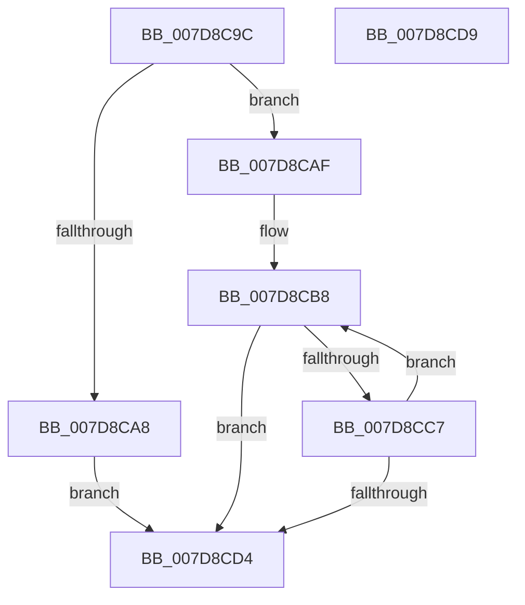

# WheapGetAllPolicyValues

- RVA: `0x007D8C9C`–`0x007D8CDA` (길이 `62` bytes)
- VA: `0x00000001407D8C9C`
- 실행 섹션: `PAGE`
- PDB 이름 있음: `예`; PDB Function 태그: `아니요`
- unwind 정보 RVA: `0x0005C788`
- 디코드: `20`개 명령, `62/62` bytes 표시
- 미해석 바이트: `0` (있으면 어셈블리에 `.byte`로 보존)

> 이 문서는 커널 이미지의 기계어와 PDB 기호를 분석해 생성했습니다. 4번과 5번은 함수 원형과 자료형을 바이너리 사용 방식에서 추정한 C 해석이며 원본 소스 복구 결과는 아닙니다.

## 1. Dependencies

- 직접 호출 지점: **1**; 고유 호출 대상: **1**
- 직접 호출자로 확인된 함수: **1**
- RIP 상대 이미지 참조: **0**

### Outgoing calls
- `0x007D8CBE` → [WheapGetPolicyValue](WheapGetPolicyValue_function_007D8CE0.md) (function, `0x007D8CE0`)

### Direct callers
- [WheapWmiExecutePolicyManagementMethod](../../text/66/WheapWmiExecutePolicyManagementMethod_function_00661B8C.md) at `0x00661C75`

### Static image references
- 디코드된 RIP-relative 메모리 참조가 없습니다.

## 2. Other-region calls and transfers

- 다른 실행 섹션으로 향하는 call: **0**
- 별도 외부 분기/꼬리 이동을 확인하지 못했습니다.

## 3. Assembly (complete function range)

```asm
007D8C9C  48 83 EC 28                     sub rsp, 0x28
007D8CA0  4D 8B C8                        mov r9, r8
007D8CA3  83 FA 58                        cmp edx, 0x58
007D8CA6  73 07                           jae 0x1407d8caf
007D8CA8  B8 23 00 00 C0                  mov eax, 0xc0000023
007D8CAD  EB 25                           jmp 0x1407d8cd4
007D8CAF  C7 01 16 00 00 00               mov dword ptr [rcx], 0x16
007D8CB5  45 33 C0                        xor r8d, r8d
007D8CB8  49 8B D1                        mov rdx, r9
007D8CBB  41 8B C8                        mov ecx, r8d
007D8CBE  E8 1D 00 00 00                  call 0x1407d8ce0
007D8CC3  85 C0                           test eax, eax
007D8CC5  78 0D                           js 0x1407d8cd4
007D8CC7  49 83 C1 04                     add r9, 4
007D8CCB  41 FF C0                        inc r8d
007D8CCE  41 83 F8 16                     cmp r8d, 0x16
007D8CD2  72 E4                           jb 0x1407d8cb8
007D8CD4  48 83 C4 28                     add rsp, 0x28
007D8CD8  C3                              ret
007D8CD9  CC                              int3
```

## 4. C-style interpretation (structured pseudocode)

```c
__int64 __fastcall WheapGetAllPolicyValues(__int64 a1, int a2, __int64 a3)
{
    __int64 result;
    __int64 v_rsp;

    v_rsp = (v_rsp) - (40);
    if (a2 >= 88) goto loc_007D8CAF;
    goto loc_007D8CD4;
loc_007D8CAF:
    *(unsigned int *)(a1) = 22;
    a3 = 0;
loc_007D8CB8:
    result = WheapGetPolicyValue(0, 0, a3, a3);
    if (sign_flag) goto loc_007D8CD4;
    a4 = (a3) + (4);
    a3 = (unsigned int)((a3) + 1);
    if (((unsigned int)(a3)) < 22) goto loc_007D8CB8;
loc_007D8CD4:
    v_rsp = (v_rsp) + (40);
    return result;
}
```

## 5. (Beta) C Style

```c
int64_t WheapGetAllPolicyValues(void *Arg1, int32_t Arg2, int64_t Arg3)
{
    uint8_t *arg1 = (uint8_t *)Arg1;

    int64_t result;
    int64_t local_rsp;

    local_rsp = (local_rsp) - (40);
    if (Arg2 >= 88) goto loc_007D8CAF;
    goto loc_007D8CD4;
loc_007D8CAF:
    *(uint32_t *)(arg1) = 22;
    Arg3 = 0;
loc_007D8CB8:
    result = WheapGetPolicyValue(0, 0, Arg3, Arg3);
    if (sign_flag) goto loc_007D8CD4;
    a4 = (Arg3) + (4);
    Arg3 = (uint32_t)((Arg3) + 1);
    if (((uint32_t)(Arg3)) < 22) goto loc_007D8CB8;
loc_007D8CD4:
    local_rsp = (local_rsp) + (40);
    return result;
}
```

### 관측된 메모리 오프셋

구조체 형식이 확인되지 않은 접근은 인자 기준의 오프셋으로만 기록했습니다.

| 기준 인자 | 오프셋 표현 | 폭 (bit) | 접근 |
|---|---:|---:|---|
| `Arg1` | `+ 0x0` | `32` | `W` |

## 6. Execution-region graph

[열기: 2D/3D 그래프와 함수 탐색 컨트롤 패널](../../../control-panel.html?section=page&rva=0x007D8C9C&view=graph)

- 2D 그래프는 위에서 아래로 흐르고, 3D 그래프는 빈 공간을 드래그해 회전합니다. Shift+드래그는 이동, 휠은 확대·축소, 함수 노드 선택은 대상 보고서 이동입니다.

### Static fallback


