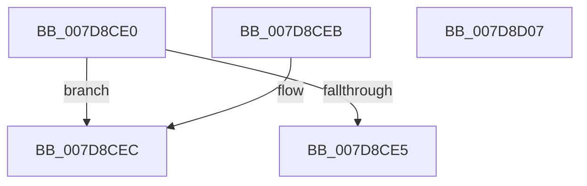

# WheapGetPolicyValue

- RVA: `0x007D8CE0`–`0x007D8D08` (길이 `40` bytes)
- VA: `0x00000001407D8CE0`
- 실행 섹션: `PAGE`
- PDB 이름 있음: `예`; PDB Function 태그: `아니요`
- unwind 정보 RVA: `0x000DB714`
- 디코드: `15`개 명령, `40/40` bytes 표시
- 미해석 바이트: `0` (있으면 어셈블리에 `.byte`로 보존)

> 이 문서는 커널 이미지의 기계어와 PDB 기호를 분석해 생성했습니다. 4번과 5번은 함수 원형과 자료형을 바이너리 사용 방식에서 추정한 C 해석이며 원본 소스 복구 결과는 아닙니다.

## 1. Dependencies

- 직접 호출 지점: **0**; 고유 호출 대상: **0**
- 직접 호출자로 확인된 함수: **2**
- RIP 상대 이미지 참조: **1**

### Outgoing calls
- 직접 디코드된 call 명령이 없습니다.

### Direct callers
- [WheapWmiExecutePolicyManagementMethod](../../text/66/WheapWmiExecutePolicyManagementMethod_function_00661B8C.md) at `0x00661C3C`
- [WheapGetAllPolicyValues](WheapGetAllPolicyValues_function_007D8C9C.md) at `0x007D8CBE`

### Static image references
- `0x007D8CF1` → RVA `0x00E095A8` (`.data`; read)

## 2. Other-region calls and transfers

- 다른 실행 섹션으로 향하는 call: **0**
- 별도 외부 분기/꼬리 이동을 확인하지 못했습니다.

## 3. Assembly (complete function range)

```asm
007D8CE0  83 F9 16                        cmp ecx, 0x16
007D8CE3  72 07                           jb 0x1407d8cec
007D8CE5  B8 0D 00 00 C0                  mov eax, 0xc000000d
007D8CEA  C3                              ret
007D8CEB  CC                              int3
007D8CEC  0F AE E8                        lfence
007D8CEF  8B C1                           mov eax, ecx
007D8CF1  48 8D 0D B0 08 63 00            lea rcx, [rip + 0x6308b0]
007D8CF8  48 C1 E0 05                     shl rax, 5
007D8CFC  48 8B 04 08                     mov rax, qword ptr [rax + rcx]
007D8D00  8B 08                           mov ecx, dword ptr [rax]
007D8D02  33 C0                           xor eax, eax
007D8D04  89 0A                           mov dword ptr [rdx], ecx
007D8D06  C3                              ret
007D8D07  CC                              int3
```

## 4. C-style interpretation (structured pseudocode)

```c
__int64 __fastcall WheapGetPolicyValue(int a1, __int64 a2)
{
    __int64 result;

    if (a1 < 22) goto loc_007D8CEC;
    return (unsigned int)(0xC000000DULL);
loc_007D8CEC:
    result = ((unsigned int)(a1)) << (5);
    result = 0;
    *(unsigned int *)(a2) = (unsigned int)((unsigned int)(*(unsigned int *)(*(unsigned __int64 *)(result + v_rip + 6490288 * 1))));
    return result;
}
```

## 5. (Beta) C Style

```c
int64_t WheapGetPolicyValue(int32_t Arg1, void *Arg2)
{
    uint8_t *arg2 = (uint8_t *)Arg2;

    int64_t result;

    if (Arg1 < 22) goto loc_007D8CEC;
    return (uint32_t)(0xC000000DULL);
loc_007D8CEC:
    result = ((uint32_t)(Arg1)) << (5);
    result = 0;
    *(uint32_t *)(arg2) = (uint32_t)((uint32_t)(*(uint32_t *)(*(uint64_t *)(result + v_rip + 0x6308B0 * 1))));
    return result;
}
```

### 관측된 메모리 오프셋

구조체 형식이 확인되지 않은 접근은 인자 기준의 오프셋으로만 기록했습니다.

| 기준 인자 | 오프셋 표현 | 폭 (bit) | 접근 |
|---|---:|---:|---|
| `Arg2` | `+ 0x0` | `32` | `W` |

## 6. Execution-region graph

[열기: 2D/3D 그래프와 함수 탐색 컨트롤 패널](../../../control-panel.html?section=page&rva=0x007D8CE0&view=graph)

- 2D 그래프는 위에서 아래로 흐르고, 3D 그래프는 빈 공간을 드래그해 회전합니다. Shift+드래그는 이동, 휠은 확대·축소, 함수 노드 선택은 대상 보고서 이동입니다.

### Static fallback


