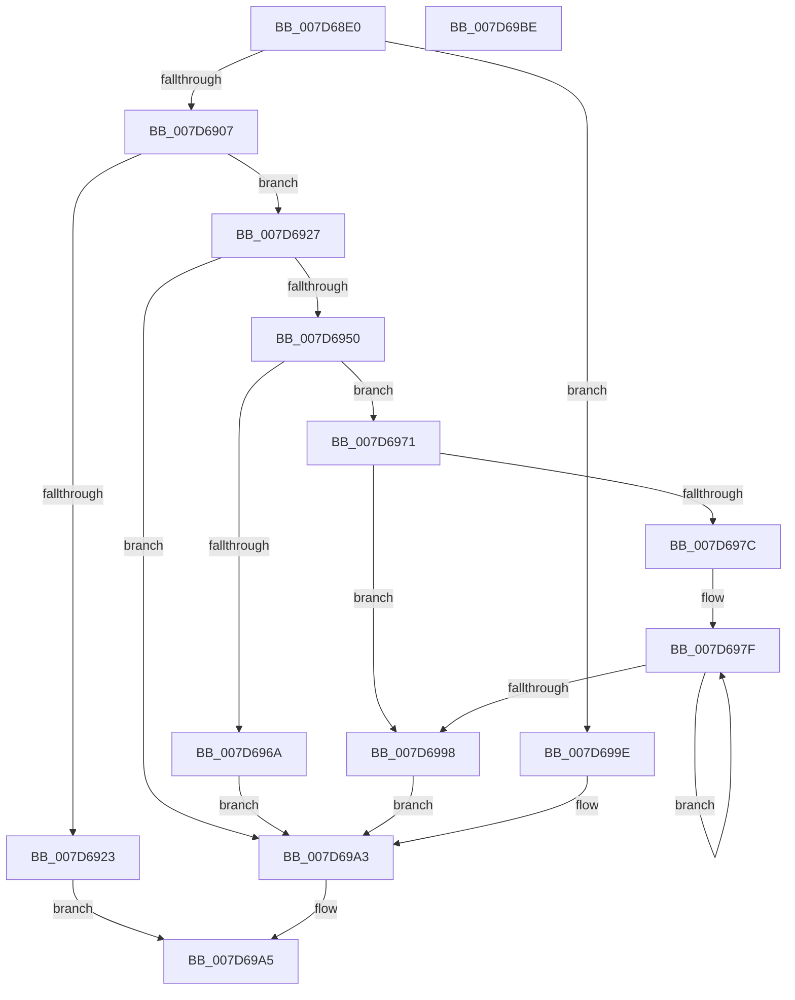

# WheapInitializeErrorSource

- RVA: `0x007D68E0`–`0x007D69BF` (길이 `223` bytes)
- VA: `0x00000001407D68E0`
- 실행 섹션: `PAGE`
- PDB 이름 있음: `예`; PDB Function 태그: `아니요`
- unwind 정보 RVA: `0x00060300`
- 디코드: `70`개 명령, `223/223` bytes 표시
- 미해석 바이트: `0` (있으면 어셈블리에 `.byte`로 보존)

> 이 문서는 커널 이미지의 기계어와 PDB 기호를 분석해 생성했습니다. 4번과 5번은 함수 원형과 자료형을 바이너리 사용 방식에서 추정한 C 해석이며 원본 소스 복구 결과는 아닙니다.

## 1. Dependencies

- 직접 호출 지점: **3**; 고유 호출 대상: **3**
- 직접 호출자로 확인된 함수: **3**
- RIP 상대 이미지 참조: **0**

### Outgoing calls
- `0x007D6918` → [WheapCallErrorSourceCorrect](../../text/65/WheapCallErrorSourceCorrect_function_0065FBD4.md) (function, `0x0065FBD4`)
- `0x007D695D` → [ExAllocatePool2](../../poolcode/B8/ExAllocatePool2_function_00B820F0.md) (function, `0x00B820F0`)
- `0x007D6987` → [WheapInitializeErrorRecordWrapper](../../text/65/WheapInitializeErrorRecordWrapper_function_0065DE2C.md) (function, `0x0065DE2C`)

### Direct callers
- [WheapInitializeDeferredErrorSources](../../text/65/WheapInitializeDeferredErrorSources_function_0065DDA0.md) at `0x0065DDD8`
- [WheaAddErrorSource](WheaAddErrorSource_function_007D69D0.md) at `0x007D6AF3`
- [WheapInitializeErrorSourceTable](../../init/C5/WheapInitializeErrorSourceTable_function_00C55304.md) at `0x00C553FC`

### Static image references
- 디코드된 RIP-relative 메모리 참조가 없습니다.

## 2. Other-region calls and transfers

- 다른 실행 섹션으로 향하는 call: **3**
  - `0x007D6918` → [WheapCallErrorSourceCorrect](../../text/65/WheapCallErrorSourceCorrect_function_0065FBD4.md) (`PAGE` → `.text`)
  - `0x007D695D` → [ExAllocatePool2](../../poolcode/B8/ExAllocatePool2_function_00B820F0.md) (`PAGE` → `POOLCODE`)
  - `0x007D6987` → [WheapInitializeErrorRecordWrapper](../../text/65/WheapInitializeErrorRecordWrapper_function_0065DE2C.md) (`PAGE` → `.text`)
- 별도 외부 분기/꼬리 이동을 확인하지 못했습니다.

## 3. Assembly (complete function range)

```asm
007D68E0  48 89 5C 24 08                  mov qword ptr [rsp + 8], rbx
007D68E5  48 89 6C 24 10                  mov qword ptr [rsp + 0x10], rbp
007D68EA  48 89 74 24 18                  mov qword ptr [rsp + 0x18], rsi
007D68EF  57                              push rdi
007D68F0  41 56                           push r14
007D68F2  41 57                           push r15
007D68F4  48 83 EC 20                     sub rsp, 0x20
007D68F8  8B 41 68                        mov eax, dword ptr [rcx + 0x68]
007D68FB  48 8B D9                        mov rbx, rcx
007D68FE  83 F8 12                        cmp eax, 0x12
007D6901  0F 87 97 00 00 00               ja 0x1407d699e
007D6907  89 41 28                        mov dword ptr [rcx + 0x28], eax
007D690A  BD 57 68 65 61                  mov ebp, 0x61656857
007D690F  89 69 24                        mov dword ptr [rcx + 0x24], ebp
007D6912  8B 41 78                        mov eax, dword ptr [rcx + 0x78]
007D6915  89 41 40                        mov dword ptr [rcx + 0x40], eax
007D6918  E8 B7 92 E8 FF                  call 0x14065fbd4
007D691D  33 FF                           xor edi, edi
007D691F  85 C0                           test eax, eax
007D6921  79 04                           jns 0x1407d6927
007D6923  33 C0                           xor eax, eax
007D6925  EB 7E                           jmp 0x1407d69a5
007D6927  8B 83 80 00 00 00               mov eax, dword ptr [rbx + 0x80]
007D692D  8B 73 44                        mov esi, dword ptr [rbx + 0x44]
007D6930  83 C6 48                        add esi, 0x48
007D6933  89 43 14                        mov dword ptr [rbx + 0x14], eax
007D6936  8B 43 74                        mov eax, dword ptr [rbx + 0x74]
007D6939  89 43 1C                        mov dword ptr [rbx + 0x1c], eax
007D693C  0F AF 73 78                     imul esi, dword ptr [rbx + 0x78]
007D6940  81 C6 AF 00 00 00               add esi, 0xaf
007D6946  83 E6 F8                        and esi, 0xfffffff8
007D6949  89 73 20                        mov dword ptr [rbx + 0x20], esi
007D694C  85 C0                           test eax, eax
007D694E  74 53                           je 0x1407d69a3
007D6950  0F AF C6                        imul eax, esi
007D6953  44 8B C5                        mov r8d, ebp
007D6956  B9 40 00 00 00                  mov ecx, 0x40
007D695B  8B D0                           mov edx, eax
007D695D  E8 8E B7 3A 00                  call 0x140b820f0
007D6962  4C 8B D8                        mov r11, rax
007D6965  48 85 C0                        test rax, rax
007D6968  75 07                           jne 0x1407d6971
007D696A  BF 9A 00 00 C0                  mov edi, 0xc000009a
007D696F  EB 32                           jmp 0x1407d69a3
007D6971  49 8B EB                        mov rbp, r11
007D6974  44 8B F7                        mov r14d, edi
007D6977  39 7B 1C                        cmp dword ptr [rbx + 0x1c], edi
007D697A  76 1C                           jbe 0x1407d6998
007D697C  44 8B FE                        mov r15d, esi
007D697F  4C 8B C3                        mov r8, rbx
007D6982  8B D6                           mov edx, esi
007D6984  48 8B CD                        mov rcx, rbp
007D6987  E8 A0 74 E8 FF                  call 0x14065de2c
007D698C  49 03 EF                        add rbp, r15
007D698F  41 FF C6                        inc r14d
007D6992  44 3B 73 1C                     cmp r14d, dword ptr [rbx + 0x1c]
007D6996  72 E7                           jb 0x1407d697f
007D6998  4C 89 5B 30                     mov qword ptr [rbx + 0x30], r11
007D699C  EB 05                           jmp 0x1407d69a3
007D699E  BF 0D 00 00 C0                  mov edi, 0xc000000d
007D69A3  8B C7                           mov eax, edi
007D69A5  48 8B 5C 24 40                  mov rbx, qword ptr [rsp + 0x40]
007D69AA  48 8B 6C 24 48                  mov rbp, qword ptr [rsp + 0x48]
007D69AF  48 8B 74 24 50                  mov rsi, qword ptr [rsp + 0x50]
007D69B4  48 83 C4 20                     add rsp, 0x20
007D69B8  41 5F                           pop r15
007D69BA  41 5E                           pop r14
007D69BC  5F                              pop rdi
007D69BD  C3                              ret
007D69BE  CC                              int3
```

## 4. C-style interpretation (structured pseudocode)

```c
__int64 __fastcall WheapInitializeErrorSource(__int64 a1)
{
    __int64 result;
    __int64 v_r14;
    __int64 v_rbp;
    __int64 v_rdi;
    __int64 v_rsi;
    __int64 v_rsp;
    unsigned __int64 v_stack_p10;
    unsigned __int64 v_stack_p18;
    unsigned __int64 v_stack_p8;

    v_stack_p8 = v_rbx;
    v_stack_p10 = v_rbp;
    v_stack_p18 = v_rsi;
    v_rsp = (v_rsp) - (32);
    if (((unsigned int)((unsigned int)(*(unsigned int *)(a1 + 104)))) > 18) goto loc_007D699E;
    *(unsigned int *)(a1 + 40) = (unsigned int)((unsigned int)(*(unsigned int *)(a1 + 104)));
    *(unsigned int *)(a1 + 36) = (unsigned int)((unsigned int)(0x61656857ULL));
    *(unsigned int *)(a1 + 64) = (unsigned int)((unsigned int)(*(unsigned int *)(a1 + 120)));
    result = WheapCallErrorSourceCorrect(a1, a2, a3, a4);
    v_rdi = 0;
    if (!sign_flag) goto loc_007D6927;
    result = 0;
    goto loc_007D69A5;
loc_007D6927:
    v_rsi = (unsigned int)(((unsigned int)(*(unsigned int *)(a1 + 68))) + (72));
    *(unsigned int *)(a1 + 20) = (unsigned int)((unsigned int)(*(unsigned int *)(a1 + 128)));
    *(unsigned int *)(a1 + 28) = (unsigned int)((unsigned int)(*(unsigned int *)(a1 + 116)));
    v_rsi = (unsigned int)((v_rsi) * (*(unsigned int *)(a1 + 120)));
    v_rsi = (unsigned int)((v_rsi) + (175));
    v_rsi = (unsigned int)((v_rsi) & (0xFFFFFFF8ULL));
    *(unsigned int *)(a1 + 32) = (unsigned int)(v_rsi);
    if ((unsigned int)((unsigned int)(*(unsigned int *)(a1 + 116))) == 0) goto loc_007D69A3;
    result = (unsigned int)(((unsigned int)(*(unsigned int *)(a1 + 116))) * ((unsigned int)(v_rsi)));
    result = ExAllocatePool2(64, (unsigned int)((unsigned int)(result)), (unsigned int)((unsigned int)((unsigned int)(0x61656857ULL))), a4);
    if (result != 0) goto loc_007D6971;
    goto loc_007D69A3;
loc_007D6971:
    if ((*(unsigned int *)(a1 + 28)) <= ((unsigned int)((unsigned int)(0xC000009AULL)))) goto loc_007D6998;
loc_007D697F:
    result = WheapInitializeErrorRecordWrapper(result, (unsigned int)((unsigned int)(v_rsi)), a1, a4);
    v_rbp = (result) + ((unsigned int)((unsigned int)(v_rsi)));
    v_r14 = (unsigned int)(((unsigned int)((unsigned int)((unsigned int)(0xC000009AULL)))) + 1);
    if (((unsigned int)(v_r14)) < (*(unsigned int *)(a1 + 28))) goto loc_007D697F;
loc_007D6998:
    *(unsigned __int64 *)(a1 + 48) = result;
    goto loc_007D69A3;
loc_007D699E:
loc_007D69A3:
loc_007D69A5:
    v_rsp = (v_rsp) + (32);
    return (unsigned int)((unsigned int)((unsigned int)(0xC000000DULL)));
}
```

## 5. (Beta) C Style

```c
int64_t WheapInitializeErrorSource(void *Arg1)
{
    uint8_t *arg1 = (uint8_t *)Arg1;

    int64_t result;
    int64_t local_r14;
    int64_t local_rbp;
    int64_t local_rdi;
    int64_t local_rsi;
    int64_t local_rsp;
    uint64_t v_stack_p10;
    uint64_t v_stack_p18;
    uint64_t v_stack_p8;

    v_stack_p8 = local_rbx;
    v_stack_p10 = local_rbp;
    v_stack_p18 = local_rsi;
    local_rsp = (local_rsp) - (32);
    if (((uint32_t)((uint32_t)(*(uint32_t *)(arg1 + 0x68)))) > 18) goto loc_007D699E;
    *(uint32_t *)(arg1 + 0x28) = (uint32_t)((uint32_t)(*(uint32_t *)(arg1 + 0x68)));
    *(uint32_t *)(arg1 + 0x24) = (uint32_t)((uint32_t)(0x61656857ULL));
    *(uint32_t *)(arg1 + 0x40) = (uint32_t)((uint32_t)(*(uint32_t *)(arg1 + 0x78)));
    result = WheapCallErrorSourceCorrect(Arg1, a2, a3, a4);
    local_rdi = 0;
    if (!sign_flag) goto loc_007D6927;
    result = 0;
    goto loc_007D69A5;
loc_007D6927:
    local_rsi = (uint32_t)(((uint32_t)(*(uint32_t *)(arg1 + 0x44))) + (72));
    *(uint32_t *)(arg1 + 0x14) = (uint32_t)((uint32_t)(*(uint32_t *)(arg1 + 0x80)));
    *(uint32_t *)(arg1 + 0x1C) = (uint32_t)((uint32_t)(*(uint32_t *)(arg1 + 0x74)));
    local_rsi = (uint32_t)((local_rsi) * (*(uint32_t *)(arg1 + 0x78)));
    local_rsi = (uint32_t)((local_rsi) + (175));
    local_rsi = (uint32_t)((local_rsi) & (0xFFFFFFF8ULL));
    *(uint32_t *)(arg1 + 0x20) = (uint32_t)(local_rsi);
    if ((uint32_t)((uint32_t)(*(uint32_t *)(arg1 + 0x74))) == 0) goto loc_007D69A3;
    result = (uint32_t)(((uint32_t)(*(uint32_t *)(arg1 + 0x74))) * ((uint32_t)(local_rsi)));
    result = ExAllocatePool2(64, (uint32_t)((uint32_t)(result)), (uint32_t)((uint32_t)((uint32_t)(0x61656857ULL))), a4);
    if (result != 0) goto loc_007D6971;
    goto loc_007D69A3;
loc_007D6971:
    if ((*(uint32_t *)(arg1 + 0x1C)) <= ((uint32_t)((uint32_t)(0xC000009AULL)))) goto loc_007D6998;
loc_007D697F:
    result = WheapInitializeErrorRecordWrapper(result, (uint32_t)((uint32_t)(local_rsi)), Arg1, a4);
    local_rbp = (result) + ((uint32_t)((uint32_t)(local_rsi)));
    local_r14 = (uint32_t)(((uint32_t)((uint32_t)((uint32_t)(0xC000009AULL)))) + 1);
    if (((uint32_t)(local_r14)) < (*(uint32_t *)(arg1 + 0x1C))) goto loc_007D697F;
loc_007D6998:
    *(uint64_t *)(arg1 + 0x30) = result;
    goto loc_007D69A3;
loc_007D699E:
loc_007D69A3:
loc_007D69A5:
    local_rsp = (local_rsp) + (32);
    return (uint32_t)((uint32_t)((uint32_t)(0xC000000DULL)));
}
```

### 관측된 메모리 오프셋

구조체 형식이 확인되지 않은 접근은 인자 기준의 오프셋으로만 기록했습니다.

| 기준 인자 | 오프셋 표현 | 폭 (bit) | 접근 |
|---|---:|---:|---|
| `Arg1` | `+ 0x14` | `32` | `W` |
| `Arg1` | `+ 0x1C` | `32` | `R` |
| `Arg1` | `+ 0x1C` | `32` | `W` |
| `Arg1` | `+ 0x20` | `32` | `W` |
| `Arg1` | `+ 0x24` | `32` | `W` |
| `Arg1` | `+ 0x28` | `32` | `W` |
| `Arg1` | `+ 0x30` | `64` | `W` |
| `Arg1` | `+ 0x40` | `32` | `W` |
| `Arg1` | `+ 0x44` | `32` | `R` |
| `Arg1` | `+ 0x68` | `32` | `R` |
| `Arg1` | `+ 0x74` | `32` | `R` |
| `Arg1` | `+ 0x78` | `32` | `R` |
| `Arg1` | `+ 0x80` | `32` | `R` |

## 6. Execution-region graph

[열기: 2D/3D 그래프와 함수 탐색 컨트롤 패널](../../../control-panel.html?section=page&rva=0x007D68E0&view=graph)

- 2D 그래프는 위에서 아래로 흐르고, 3D 그래프는 빈 공간을 드래그해 회전합니다. Shift+드래그는 이동, 휠은 확대·축소, 함수 노드 선택은 대상 보고서 이동입니다.

### Static fallback


