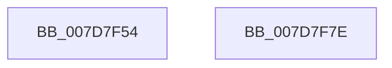

# WheapInitializeInUsePageOfflineNotifications

- RVA: `0x007D7F54`–`0x007D7F7F` (길이 `43` bytes)
- VA: `0x00000001407D7F54`
- 실행 섹션: `PAGE`
- PDB 이름 있음: `예`; PDB Function 태그: `아니요`
- unwind 정보 RVA: `0x000DB714`
- 디코드: `8`개 명령, `43/43` bytes 표시
- 미해석 바이트: `0` (있으면 어셈블리에 `.byte`로 보존)

> 이 문서는 커널 이미지의 기계어와 PDB 기호를 분석해 생성했습니다. 4번과 5번은 함수 원형과 자료형을 바이너리 사용 방식에서 추정한 C 해석이며 원본 소스 복구 결과는 아닙니다.

## 1. Dependencies

- 직접 호출 지점: **0**; 고유 호출 대상: **0**
- 직접 호출자로 확인된 함수: **1**
- RIP 상대 이미지 참조: **5**

### Outgoing calls
- 직접 디코드된 call 명령이 없습니다.

### Direct callers
- [WheaInitializeServices](../../init/C5/WheaInitializeServices_function_00C5516C.md) at `0x00C55250`

### Static image references
- `0x007D7F54` → RVA `0x00EEF060` (`.data`; read/write)
- `0x007D7F5C` → RVA `0x00EEF068` (`.data`; read)
- `0x007D7F63` → RVA `0x00EEF070` (`.data`; write)
- `0x007D7F6A` → RVA `0x00EEF068` (`.data`; write)
- `0x007D7F76` → RVA `0x00EEF058` (`.data`; write)

## 2. Other-region calls and transfers

- 다른 실행 섹션으로 향하는 call: **0**
- 별도 외부 분기/꼬리 이동을 확인하지 못했습니다.

## 3. Assembly (complete function range)

```asm
007D7F54  48 83 25 04 71 71 00 00         and qword ptr [rip + 0x717104], 0
007D7F5C  48 8D 05 05 71 71 00            lea rax, [rip + 0x717105]
007D7F63  48 89 05 06 71 71 00            mov qword ptr [rip + 0x717106], rax
007D7F6A  48 89 05 F7 70 71 00            mov qword ptr [rip + 0x7170f7], rax
007D7F71  F0 83 0C 24 00                  lock or dword ptr [rsp], 0
007D7F76  C6 05 DB 70 71 00 01            mov byte ptr [rip + 0x7170db], 1
007D7F7D  C3                              ret
007D7F7E  CC                              int3
```

## 4. C-style interpretation (structured pseudocode)

```c
__int64 __fastcall WheapInitializeInUsePageOfflineNotifications(void)
{
    unsigned int v_stack_p0;

    *(unsigned __int64 *)(v_rip + 7434502) = v_rip + 7434501;
    *(unsigned __int64 *)(v_rip + 7434487) = v_rip + 7434501;
    *(unsigned __int8 *)(v_rip + 7434459) = 1;
    return v_rip + 7434501;
}
```

## 5. (Beta) C Style

```c
void WheapInitializeInUsePageOfflineNotifications(void)
{
    uint32_t v_stack_p0;

    *(uint64_t *)(v_rip + 0x717106) = v_rip + 7434501;
    *(uint64_t *)(v_rip + 0x7170F7) = v_rip + 7434501;
    *(uint8_t *)(v_rip + 0x7170DB) = 1;
    return v_rip + 7434501;
}
```

## 6. Execution-region graph

[열기: 2D/3D 그래프와 함수 탐색 컨트롤 패널](../../../control-panel.html?section=page&rva=0x007D7F54&view=graph)

- 2D 그래프는 위에서 아래로 흐르고, 3D 그래프는 빈 공간을 드래그해 회전합니다. Shift+드래그는 이동, 휠은 확대·축소, 함수 노드 선택은 대상 보고서 이동입니다.

### Static fallback


