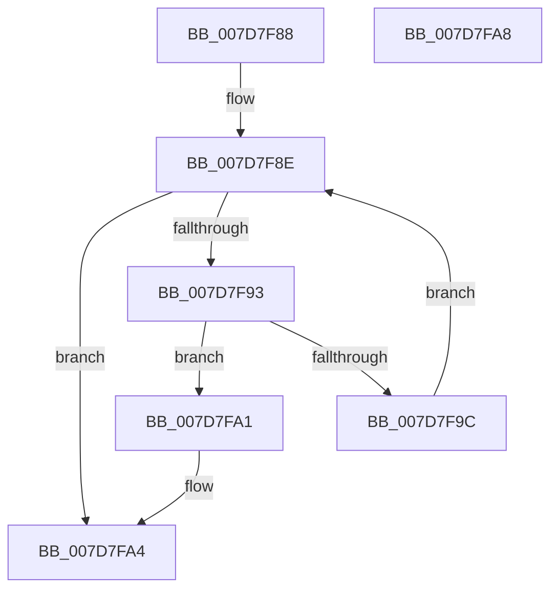

# WheapIsPageInList

- RVA: `0x007D7F88`–`0x007D7FA9` (길이 `33` bytes)
- VA: `0x00000001407D7F88`
- 실행 섹션: `PAGE`
- PDB 이름 있음: `예`; PDB Function 태그: `아니요`
- unwind 정보 RVA: `0x000DB714`
- 디코드: `13`개 명령, `33/33` bytes 표시
- 미해석 바이트: `0` (있으면 어셈블리에 `.byte`로 보존)

> 이 문서는 커널 이미지의 기계어와 PDB 기호를 분석해 생성했습니다. 4번과 5번은 함수 원형과 자료형을 바이너리 사용 방식에서 추정한 C 해석이며 원본 소스 복구 결과는 아닙니다.

## 1. Dependencies

- 직접 호출 지점: **0**; 고유 호출 대상: **0**
- 직접 호출자로 확인된 함수: **1**
- RIP 상대 이미지 참조: **0**

### Outgoing calls
- 직접 디코드된 call 명령이 없습니다.

### Direct callers
- [WheaPersistBadPageToBcd](../../text/65/WheaPersistBadPageToBcd_function_0065F3D0.md) at `0x0065F4E5`

### Static image references
- 디코드된 RIP-relative 메모리 참조가 없습니다.

## 2. Other-region calls and transfers

- 다른 실행 섹션으로 향하는 call: **0**
- 별도 외부 분기/꼬리 이동을 확인하지 못했습니다.

## 3. Assembly (complete function range)

```asm
007D7F88  45 33 D2                        xor r10d, r10d
007D7F8B  45 8B CA                        mov r9d, r10d
007D7F8E  44 3B CA                        cmp r9d, edx
007D7F91  73 11                           jae 0x1407d7fa4
007D7F93  41 8B C1                        mov eax, r9d
007D7F96  4C 39 04 C1                     cmp qword ptr [rcx + rax*8], r8
007D7F9A  74 05                           je 0x1407d7fa1
007D7F9C  41 FF C1                        inc r9d
007D7F9F  EB ED                           jmp 0x1407d7f8e
007D7FA1  41 B2 01                        mov r10b, 1
007D7FA4  41 8A C2                        mov al, r10b
007D7FA7  C3                              ret
007D7FA8  CC                              int3
```

## 4. C-style interpretation (structured pseudocode)

```c
__int64 __fastcall WheapIsPageInList(__int64 a1, int a2, __int64 a3)
{
    __int64 v_r10;

    v_r10 = 0;
loc_007D7F8E:
    if (0 >= a2) goto loc_007D7FA4;
    if ((*(unsigned __int64 *)(a1 + 0 * 8)) == a3) goto loc_007D7FA1;
    a4 = (unsigned int)((0) + 1);
    goto loc_007D7F8E;
loc_007D7FA1:
loc_007D7FA4:
    return 1;
}
```

## 5. (Beta) C Style

```c
int64_t WheapIsPageInList(void *Arg1, int32_t Arg2, int64_t Arg3)
{
    uint8_t *arg1 = (uint8_t *)Arg1;

    int64_t local_r10;

    local_r10 = 0;
loc_007D7F8E:
    if (0 >= Arg2) goto loc_007D7FA4;
    if ((*(uint64_t *)(arg1 + 0x0 * 8)) == Arg3) goto loc_007D7FA1;
    a4 = (uint32_t)((0) + 1);
    goto loc_007D7F8E;
loc_007D7FA1:
loc_007D7FA4:
    return 1;
}
```

### 관측된 메모리 오프셋

구조체 형식이 확인되지 않은 접근은 인자 기준의 오프셋으로만 기록했습니다.

| 기준 인자 | 오프셋 표현 | 폭 (bit) | 접근 |
|---|---:|---:|---|
| `Arg1` | `+ 0x0 + rax*8` | `64` | `R` |

## 6. Execution-region graph

[열기: 2D/3D 그래프와 함수 탐색 컨트롤 패널](../../../control-panel.html?section=page&rva=0x007D7F88&view=graph)

- 2D 그래프는 위에서 아래로 흐르고, 3D 그래프는 빈 공간을 드래그해 회전합니다. Shift+드래그는 이동, 휠은 확대·축소, 함수 노드 선택은 대상 보고서 이동입니다.

### Static fallback


