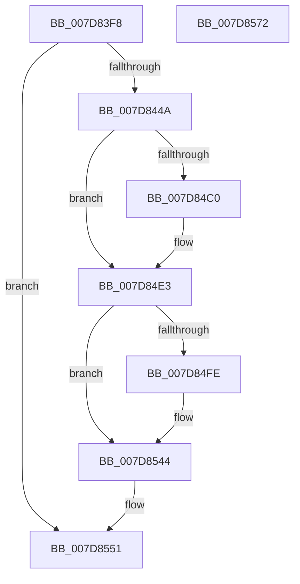

# WheapLogInitEvent

- RVA: `0x007D83F8`–`0x007D8573` (길이 `379` bytes)
- VA: `0x00000001407D83F8`
- 실행 섹션: `PAGE`
- PDB 이름 있음: `예`; PDB Function 태그: `아니요`
- unwind 정보 RVA: `0x000BAAA4`
- 디코드: `84`개 명령, `379/379` bytes 표시
- 미해석 바이트: `0` (있으면 어셈블리에 `.byte`로 보존)

> 이 문서는 커널 이미지의 기계어와 PDB 기호를 분석해 생성했습니다. 4번과 5번은 함수 원형과 자료형을 바이너리 사용 방식에서 추정한 C 해석이며 원본 소스 복구 결과는 아닙니다.

## 1. Dependencies

- 직접 호출 지점: **9**; 고유 호출 대상: **7**
- 직접 호출자로 확인된 함수: **1**
- RIP 상대 이미지 참조: **4**

### Outgoing calls
- `0x007D8439` → [ExAllocatePool2](../../poolcode/B8/ExAllocatePool2_function_00B820F0.md) (function, `0x00B820F0`)
- `0x007D8453` → [memset](../../text/6C/memset_function_006C6C40.md) (function, `0x006C6C40`)
- `0x007D84B7` → [EtwEventEnabled](../../text/39/EtwEventEnabled_function_00392450.md) (function, `0x00392450`)
- `0x007D84DE` → [EtwWrite](../../text/41/EtwWrite_function_0041C720.md) (function, `0x0041C720`)
- `0x007D84F1` → [ExAllocatePool2](../../poolcode/B8/ExAllocatePool2_function_00B820F0.md) (function, `0x00B820F0`)
- `0x007D8532` → [WheaLogInternalEvent](../../text/66/WheaLogInternalEvent_function_006605B0.md) (function, `0x006605B0`)
- `0x007D853F` → [ExFreePoolWithTag](../../poolcode/B8/ExFreePoolWithTag_function_00B82870.md) (function, `0x00B82870`)
- `0x007D854C` → [ExFreePoolWithTag](../../poolcode/B8/ExFreePoolWithTag_function_00B82870.md) (function, `0x00B82870`)
- `0x007D8558` → [_security_check_cookie](../../text/6A/_security_check_cookie_function_006AC640.md) (function, `0x006AC640`)

### Direct callers
- [WheaInitialize](../../init/C5/WheaInitialize_function_00C54C08.md) at `0x00C550F4`

### Static image references
- `0x007D840F` → RVA `0x00E0A740` (`.data`; read)
- `0x007D841D` → RVA `0x00EEF01C` (`.data`; read)
- `0x007D8458` → RVA `0x00EF9EF0` (`.data`; read)
- `0x007D846A` → RVA `0x00039620` (`.rdata`; read)

## 2. Other-region calls and transfers

- 다른 실행 섹션으로 향하는 call: **9**
  - `0x007D8439` → [ExAllocatePool2](../../poolcode/B8/ExAllocatePool2_function_00B820F0.md) (`PAGE` → `POOLCODE`)
  - `0x007D8453` → [memset](../../text/6C/memset_function_006C6C40.md) (`PAGE` → `.text`)
  - `0x007D84B7` → [EtwEventEnabled](../../text/39/EtwEventEnabled_function_00392450.md) (`PAGE` → `.text`)
  - `0x007D84DE` → [EtwWrite](../../text/41/EtwWrite_function_0041C720.md) (`PAGE` → `.text`)
  - `0x007D84F1` → [ExAllocatePool2](../../poolcode/B8/ExAllocatePool2_function_00B820F0.md) (`PAGE` → `POOLCODE`)
  - `0x007D8532` → [WheaLogInternalEvent](../../text/66/WheaLogInternalEvent_function_006605B0.md) (`PAGE` → `.text`)
  - `0x007D853F` → [ExFreePoolWithTag](../../poolcode/B8/ExFreePoolWithTag_function_00B82870.md) (`PAGE` → `POOLCODE`)
  - `0x007D854C` → [ExFreePoolWithTag](../../poolcode/B8/ExFreePoolWithTag_function_00B82870.md) (`PAGE` → `POOLCODE`)
  - `0x007D8558` → [_security_check_cookie](../../text/6A/_security_check_cookie_function_006AC640.md) (`PAGE` → `.text`)
- 별도 외부 분기/꼬리 이동을 확인하지 못했습니다.

## 3. Assembly (complete function range)

```asm
007D83F8  48 89 5C 24 08                  mov qword ptr [rsp + 8], rbx
007D83FD  48 89 7C 24 10                  mov qword ptr [rsp + 0x10], rdi
007D8402  55                              push rbp
007D8403  48 8D 6C 24 A9                  lea rbp, [rsp - 0x57]
007D8408  48 81 EC 90 00 00 00            sub rsp, 0x90
007D840F  48 8B 05 2A 23 63 00            mov rax, qword ptr [rip + 0x63232a]
007D8416  48 33 C4                        xor rax, rsp
007D8419  48 89 45 47                     mov qword ptr [rbp + 0x47], rax
007D841D  69 05 F5 6B 71 00 30 04 00 00   imul eax, dword ptr [rip + 0x716bf5], 0x430
007D8427  BB 42 00 00 00                  mov ebx, 0x42
007D842C  41 B8 57 68 65 61               mov r8d, 0x61656857
007D8432  8B CB                           mov ecx, ebx
007D8434  8B D0                           mov edx, eax
007D8436  89 45 F7                        mov dword ptr [rbp - 9], eax
007D8439  E8 B2 9C 3A 00                  call 0x140b820f0
007D843E  48 8B F8                        mov rdi, rax
007D8441  48 85 C0                        test rax, rax
007D8444  0F 84 07 01 00 00               je 0x1407d8551
007D844A  44 8B 45 F7                     mov r8d, dword ptr [rbp - 9]
007D844E  33 D2                           xor edx, edx
007D8450  48 8B C8                        mov rcx, rax
007D8453  E8 E8 E7 EE FF                  call 0x1406c6c40
007D8458  48 8B 0D 91 1A 72 00            mov rcx, qword ptr [rip + 0x721a91]
007D845F  48 8D 05 B6 6B 71 00            lea rax, [rip + 0x716bb6]
007D8466  83 65 13 00                     and dword ptr [rbp + 0x13], 0
007D846A  48 8D 15 AF 11 86 FF            lea rdx, [rip - 0x79ee51]
007D8471  83 65 23 00                     and dword ptr [rbp + 0x23], 0
007D8475  83 65 33 00                     and dword ptr [rbp + 0x33], 0
007D8479  83 65 43 00                     and dword ptr [rbp + 0x43], 0
007D847D  48 89 45 07                     mov qword ptr [rbp + 7], rax
007D8481  48 8D 45 FB                     lea rax, [rbp - 5]
007D8485  48 89 45 17                     mov qword ptr [rbp + 0x17], rax
007D8489  48 8D 45 F7                     lea rax, [rbp - 9]
007D848D  48 89 45 27                     mov qword ptr [rbp + 0x27], rax
007D8491  8B 45 F7                        mov eax, dword ptr [rbp - 9]
007D8494  89 45 3F                        mov dword ptr [rbp + 0x3f], eax
007D8497  C7 45 0F 04 00 00 00            mov dword ptr [rbp + 0xf], 4
007D849E  C7 45 FB 0A 00 00 00            mov dword ptr [rbp - 5], 0xa
007D84A5  C7 45 1F 04 00 00 00            mov dword ptr [rbp + 0x1f], 4
007D84AC  C7 45 2F 04 00 00 00            mov dword ptr [rbp + 0x2f], 4
007D84B3  48 89 7D 37                     mov qword ptr [rbp + 0x37], rdi
007D84B7  E8 94 9F BB FF                  call 0x140392450
007D84BC  3C 01                           cmp al, 1
007D84BE  75 23                           jne 0x1407d84e3
007D84C0  48 8B 0D 29 1A 72 00            mov rcx, qword ptr [rip + 0x721a29]
007D84C7  48 8D 45 07                     lea rax, [rbp + 7]
007D84CB  44 8D 4B C2                     lea r9d, [rbx - 0x3e]
007D84CF  48 89 44 24 20                  mov qword ptr [rsp + 0x20], rax
007D84D4  45 33 C0                        xor r8d, r8d
007D84D7  48 8D 15 42 11 86 FF            lea rdx, [rip - 0x79eebe]
007D84DE  E8 3D 42 C4 FF                  call 0x14041c720
007D84E3  BA 20 00 00 00                  mov edx, 0x20
007D84E8  41 B8 57 68 65 61               mov r8d, 0x61656857
007D84EE  48 8B CB                        mov rcx, rbx
007D84F1  E8 FA 9B 3A 00                  call 0x140b820f0
007D84F6  48 8B D8                        mov rbx, rax
007D84F9  48 85 C0                        test rax, rax
007D84FC  74 46                           je 0x1407d8544
007D84FE  83 60 0C 00                     and dword ptr [rax + 0xc], 0
007D8502  48 8B C8                        mov rcx, rax
007D8505  83 60 1C 00                     and dword ptr [rax + 0x1c], 0
007D8509  C7 00 57 68 4C 67               mov dword ptr [rax], 0x674c6857
007D850F  C7 40 04 01 00 00 00            mov dword ptr [rax + 4], 1
007D8516  C7 40 08 20 00 00 00            mov dword ptr [rax + 8], 0x20
007D851D  C7 40 14 02 00 00 80            mov dword ptr [rax + 0x14], 0x80000002
007D8524  C7 40 10 4B 52 4E 4C            mov dword ptr [rax + 0x10], 0x4c4e524b
007D852B  C7 40 18 02 00 00 00            mov dword ptr [rax + 0x18], 2
007D8532  E8 79 80 E8 FF                  call 0x1406605b0
007D8537  BA 57 68 65 61                  mov edx, 0x61656857
007D853C  48 8B CB                        mov rcx, rbx
007D853F  E8 2C A3 3A 00                  call 0x140b82870
007D8544  BA 57 68 65 61                  mov edx, 0x61656857
007D8549  48 8B CF                        mov rcx, rdi
007D854C  E8 1F A3 3A 00                  call 0x140b82870
007D8551  48 8B 4D 47                     mov rcx, qword ptr [rbp + 0x47]
007D8555  48 33 CC                        xor rcx, rsp
007D8558  E8 E3 40 ED FF                  call 0x1406ac640
007D855D  4C 8D 9C 24 90 00 00 00         lea r11, [rsp + 0x90]
007D8565  49 8B 5B 10                     mov rbx, qword ptr [r11 + 0x10]
007D8569  49 8B 7B 18                     mov rdi, qword ptr [r11 + 0x18]
007D856D  49 8B E3                        mov rsp, r11
007D8570  5D                              pop rbp
007D8571  C3                              ret
007D8572  CC                              int3
```

## 4. C-style interpretation (structured pseudocode)

```c
__int64 __fastcall WheapLogInitEvent(void)
{
    __int64 result;
    __int64 v_rsp;
    unsigned __int64 v_stack_m18;
    unsigned int v_stack_m1C;
    unsigned int v_stack_m20;
    unsigned __int64 v_stack_m28;
    unsigned int v_stack_m2C;
    unsigned int v_stack_m30;
    unsigned __int64 v_stack_m38;
    unsigned int v_stack_m3C;
    unsigned int v_stack_m40;
    unsigned __int64 v_stack_m48;
    unsigned int v_stack_m4C;
    unsigned int v_stack_m50;
    unsigned __int64 v_stack_m58;
    unsigned __int64 v_stack_m5F;
    unsigned __int64 v_stack_m64;
    unsigned int v_stack_m68;
    unsigned __int64 v_stack_m78;
    unsigned __int64 v_stack_m8;
    unsigned __int64 v_stack_p10;
    unsigned __int64 v_stack_p8;

    v_stack_p8 = v_rbx;
    v_stack_p10 = v_rdi;
    v_rsp = (v_rsp) - (144);
    result = (*(unsigned __int64 *)(v_rip + 6497066)) ^ (v_rsp);
    v_stack_m18 = result;
    result = (unsigned int)((result) * (*(unsigned int *)(v_rip + 7433205)));
    v_stack_m68 = (unsigned int)(result);
    result = ExAllocatePool2(66, (unsigned int)((unsigned int)(result)), (unsigned int)(0x61656857ULL), a4);
    if (result == 0) goto loc_007D8551;
    a2 = 0;
    result = memset(result, a2, (unsigned int)(v_stack_m68), a4);
    v_stack_m58 = v_rip + 7433142;
    v_stack_m48 = v_stack_m64;
    v_stack_m38 = v_stack_m68;
    v_stack_m20 = (unsigned int)((unsigned int)(v_stack_m68));
    v_stack_m50 = 4;
    v_stack_m64 = 10;
    v_stack_m40 = 4;
    v_stack_m30 = 4;
    v_stack_m28 = result;
    result = EtwEventEnabled(*(unsigned __int64 *)(v_rip + 7477905), v_rip - 7990865, (unsigned int)(v_stack_m68), a4);
    if (((unsigned __int8)(result)) == 1) {
        a1 = *(unsigned __int64 *)(v_rip + 7477801);
        result = v_stack_m58;
        a4 = 66 - 62;
        v_stack_m78 = result;
        a3 = 0;
        a2 = v_rip - 7990974;
        result = EtwWrite(a1, a2, a3, a4);
    }
    result = ExAllocatePool2(66, 32, (unsigned int)(0x61656857ULL), a4);
    if (result != 0) {
        a1 = result;
        *(unsigned int *)(result) = 0x674C6857ULL;
        *(unsigned int *)(result + 4) = 1;
        *(unsigned int *)(result + 8) = 32;
        *(unsigned int *)(result + 20) = 0x80000002ULL;
        *(unsigned int *)(result + 16) = 0x4C4E524BULL;
        *(unsigned int *)(result + 24) = 2;
        result = WheaLogInternalEvent(a1, 32, (unsigned int)(0x61656857ULL), a4);
        a2 = 0x61656857ULL;
        a1 = result;
        result = ExFreePoolWithTag(a1, a2, (unsigned int)(0x61656857ULL), a4);
    }
    result = ExFreePoolWithTag(result, (unsigned int)(0x61656857ULL), (unsigned int)(0x61656857ULL), a4);
loc_007D8551:
    a1 = (v_stack_m18) ^ (v_rsp);
    result = _security_check_cookie(a1, (unsigned int)(0x61656857ULL), (unsigned int)(0x61656857ULL), a4);
    return result;
}
```

## 5. (Beta) C Style

```c
void WheapLogInitEvent(void)
{
    int64_t result;
    int64_t local_rsp;
    uint64_t v_stack_m18;
    uint32_t v_stack_m1C;
    uint32_t v_stack_m20;
    uint64_t v_stack_m28;
    uint32_t v_stack_m2C;
    uint32_t v_stack_m30;
    uint64_t v_stack_m38;
    uint32_t v_stack_m3C;
    uint32_t v_stack_m40;
    uint64_t v_stack_m48;
    uint32_t v_stack_m4C;
    uint32_t v_stack_m50;
    uint64_t v_stack_m58;
    uint64_t v_stack_m5F;
    uint64_t v_stack_m64;
    uint32_t v_stack_m68;
    uint64_t v_stack_m78;
    uint64_t v_stack_m8;
    uint64_t v_stack_p10;
    uint64_t v_stack_p8;

    v_stack_p8 = local_rbx;
    v_stack_p10 = local_rdi;
    local_rsp = (local_rsp) - (144);
    result = (*(uint64_t *)(v_rip + 0x63232A)) ^ (local_rsp);
    v_stack_m18 = result;
    result = (uint32_t)((result) * (*(uint32_t *)(v_rip + 0x716BF5)));
    v_stack_m68 = (uint32_t)(result);
    result = ExAllocatePool2(66, (uint32_t)((uint32_t)(result)), (uint32_t)(0x61656857ULL), a4);
    if (result == 0) goto loc_007D8551;
    a2 = 0;
    result = memset(result, a2, (uint32_t)(v_stack_m68), a4);
    v_stack_m58 = v_rip + 7433142;
    v_stack_m48 = v_stack_m64;
    v_stack_m38 = v_stack_m68;
    v_stack_m20 = (uint32_t)((uint32_t)(v_stack_m68));
    v_stack_m50 = 4;
    v_stack_m64 = 10;
    v_stack_m40 = 4;
    v_stack_m30 = 4;
    v_stack_m28 = result;
    result = EtwEventEnabled(*(uint64_t *)(v_rip + 0x721A91), v_rip - 7990865, (uint32_t)(v_stack_m68), a4);
    if (((uint8_t)(result)) == 1) {
        a1 = *(uint64_t *)(v_rip + 0x721A29);
        result = v_stack_m58;
        a4 = 66 - 62;
        v_stack_m78 = result;
        a3 = 0;
        a2 = v_rip - 7990974;
        result = EtwWrite(a1, a2, a3, a4);
    }
    result = ExAllocatePool2(66, 32, (uint32_t)(0x61656857ULL), a4);
    if (result != 0) {
        a1 = result;
        *(uint32_t *)(result) = 0x674C6857ULL;
        *(uint32_t *)(result + 0x4) = 1;
        *(uint32_t *)(result + 0x8) = 32;
        *(uint32_t *)(result + 0x14) = 0x80000002ULL;
        *(uint32_t *)(result + 0x10) = 0x4C4E524BULL;
        *(uint32_t *)(result + 0x18) = 2;
        result = WheaLogInternalEvent(a1, 32, (uint32_t)(0x61656857ULL), a4);
        a2 = 0x61656857ULL;
        a1 = result;
        result = ExFreePoolWithTag(a1, a2, (uint32_t)(0x61656857ULL), a4);
    }
    result = ExFreePoolWithTag(result, (uint32_t)(0x61656857ULL), (uint32_t)(0x61656857ULL), a4);
loc_007D8551:
    a1 = (v_stack_m18) ^ (local_rsp);
    result = _security_check_cookie(a1, (uint32_t)(0x61656857ULL), (uint32_t)(0x61656857ULL), a4);
    return result;
}
```

## 6. Execution-region graph

[열기: 2D/3D 그래프와 함수 탐색 컨트롤 패널](../../../control-panel.html?section=page&rva=0x007D83F8&view=graph)

- 2D 그래프는 위에서 아래로 흐르고, 3D 그래프는 빈 공간을 드래그해 회전합니다. Shift+드래그는 이동, 휠은 확대·축소, 함수 노드 선택은 대상 보고서 이동입니다.

### Static fallback


