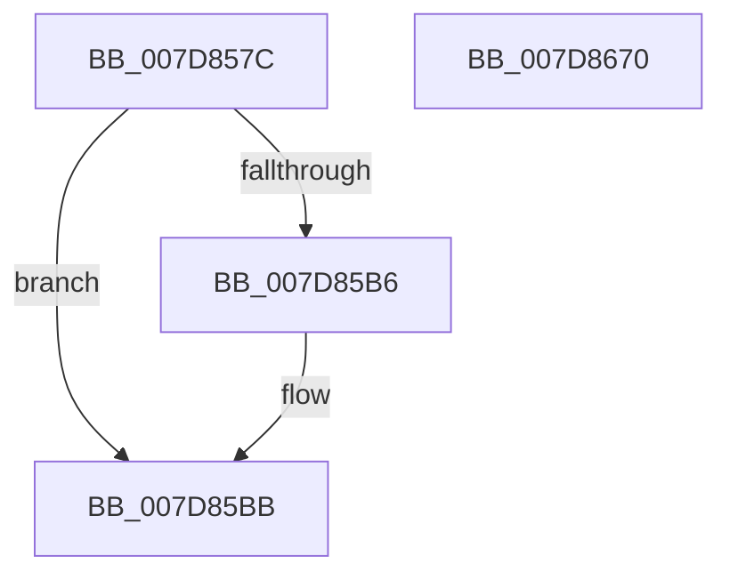

# WheapLogPageOfflineAttemptEvent

- RVA: `0x007D857C`–`0x007D8671` (길이 `245` bytes)
- VA: `0x00000001407D857C`
- 실행 섹션: `PAGE`
- PDB 이름 있음: `예`; PDB Function 태그: `아니요`
- unwind 정보 RVA: `0x000D5F50`
- 디코드: `59`개 명령, `245/245` bytes 표시
- 미해석 바이트: `0` (있으면 어셈블리에 `.byte`로 보존)

> 이 문서는 커널 이미지의 기계어와 PDB 기호를 분석해 생성했습니다. 4번과 5번은 함수 원형과 자료형을 바이너리 사용 방식에서 추정한 C 해석이며 원본 소스 복구 결과는 아닙니다.

## 1. Dependencies

- 직접 호출 지점: **3**; 고유 호출 대상: **3**
- 직접 호출자로 확인된 함수: **2**
- RIP 상대 이미지 참조: **3**

### Outgoing calls
- `0x007D85B6` → [WheapTrackPendingPage](WheapTrackPendingPage_function_007D9624.md) (function, `0x007D9624`)
- `0x007D8646` → [EtwWrite](../../text/41/EtwWrite_function_0041C720.md) (function, `0x0041C720`)
- `0x007D8652` → [_security_check_cookie](../../text/6A/_security_check_cookie_function_006AC640.md) (function, `0x006AC640`)

### Direct callers
- [WheaAttemptRowOffline](../../text/65/WheaAttemptRowOffline_function_0065F050.md) at `0x0065F212`
- [WheapAttemptPhysicalPageOffline](WheapAttemptPhysicalPageOffline_function_007D79AC.md) at `0x007D7B8E`

### Static image references
- `0x007D859B` → RVA `0x00E0A740` (`.data`; read)
- `0x007D85DF` → RVA `0x000395F0` (`.rdata`; read)
- `0x007D8601` → RVA `0x00EF9EF0` (`.data`; read)

## 2. Other-region calls and transfers

- 다른 실행 섹션으로 향하는 call: **2**
  - `0x007D8646` → [EtwWrite](../../text/41/EtwWrite_function_0041C720.md) (`PAGE` → `.text`)
  - `0x007D8652` → [_security_check_cookie](../../text/6A/_security_check_cookie_function_006AC640.md) (`PAGE` → `.text`)
- 별도 외부 분기/꼬리 이동을 확인하지 못했습니다.

## 3. Assembly (complete function range)

```asm
007D857C  48 8B C4                        mov rax, rsp
007D857F  48 89 58 10                     mov qword ptr [rax + 0x10], rbx
007D8583  48 89 70 18                     mov qword ptr [rax + 0x18], rsi
007D8587  48 89 78 20                     mov qword ptr [rax + 0x20], rdi
007D858B  48 89 48 08                     mov qword ptr [rax + 8], rcx
007D858F  55                              push rbp
007D8590  48 8D 68 A9                     lea rbp, [rax - 0x57]
007D8594  48 81 EC A0 00 00 00            sub rsp, 0xa0
007D859B  48 8B 05 9E 21 63 00            mov rax, qword ptr [rip + 0x63219e]
007D85A2  48 33 C4                        xor rax, rsp
007D85A5  48 89 45 3F                     mov qword ptr [rbp + 0x3f], rax
007D85A9  41 8A F9                        mov dil, r9b
007D85AC  41 8A F0                        mov sil, r8b
007D85AF  8A DA                           mov bl, dl
007D85B1  80 FA 01                        cmp dl, 1
007D85B4  75 05                           jne 0x1407d85bb
007D85B6  E8 69 10 00 00                  call 0x1407d9624
007D85BB  33 C9                           xor ecx, ecx
007D85BD  48 C7 45 F7 08 00 00 00         mov qword ptr [rbp - 9], 8
007D85C5  84 DB                           test bl, bl
007D85C7  48 C7 45 07 01 00 00 00         mov qword ptr [rbp + 7], 1
007D85CF  48 8D 45 5F                     lea rax, [rbp + 0x5f]
007D85D3  48 C7 45 17 01 00 00 00         mov qword ptr [rbp + 0x17], 1
007D85DB  48 89 45 EF                     mov qword ptr [rbp - 0x11], rax
007D85DF  48 8D 15 0A 10 86 FF            lea rdx, [rip - 0x79eff6]
007D85E6  0F 95 45 DF                     setne byte ptr [rbp - 0x21]
007D85EA  48 C7 45 27 01 00 00 00         mov qword ptr [rbp + 0x27], 1
007D85F2  38 4D 7F                        cmp byte ptr [rbp + 0x7f], cl
007D85F5  48 8D 45 DF                     lea rax, [rbp - 0x21]
007D85F9  48 89 45 FF                     mov qword ptr [rbp - 1], rax
007D85FD  44 8D 49 05                     lea r9d, [rcx + 5]
007D8601  48 8B 0D E8 18 72 00            mov rcx, qword ptr [rip + 0x7218e8]
007D8608  48 8D 45 E0                     lea rax, [rbp - 0x20]
007D860C  0F 95 45 E0                     setne byte ptr [rbp - 0x20]
007D8610  48 89 45 0F                     mov qword ptr [rbp + 0xf], rax
007D8614  40 84 F6                        test sil, sil
007D8617  48 C7 45 37 01 00 00 00         mov qword ptr [rbp + 0x37], 1
007D861F  48 8D 45 E1                     lea rax, [rbp - 0x1f]
007D8623  0F 95 45 E1                     setne byte ptr [rbp - 0x1f]
007D8627  48 89 45 1F                     mov qword ptr [rbp + 0x1f], rax
007D862B  40 84 FF                        test dil, dil
007D862E  48 8D 45 E2                     lea rax, [rbp - 0x1e]
007D8632  48 89 45 2F                     mov qword ptr [rbp + 0x2f], rax
007D8636  48 8D 45 EF                     lea rax, [rbp - 0x11]
007D863A  0F 95 45 E2                     setne byte ptr [rbp - 0x1e]
007D863E  48 89 44 24 20                  mov qword ptr [rsp + 0x20], rax
007D8643  45 33 C0                        xor r8d, r8d
007D8646  E8 D5 40 C4 FF                  call 0x14041c720
007D864B  48 8B 4D 3F                     mov rcx, qword ptr [rbp + 0x3f]
007D864F  48 33 CC                        xor rcx, rsp
007D8652  E8 E9 3F ED FF                  call 0x1406ac640
007D8657  4C 8D 9C 24 A0 00 00 00         lea r11, [rsp + 0xa0]
007D865F  49 8B 5B 18                     mov rbx, qword ptr [r11 + 0x18]
007D8663  49 8B 73 20                     mov rsi, qword ptr [r11 + 0x20]
007D8667  49 8B 7B 28                     mov rdi, qword ptr [r11 + 0x28]
007D866B  49 8B E3                        mov rsp, r11
007D866E  5D                              pop rbp
007D866F  C3                              ret
007D8670  CC                              int3
```

## 4. C-style interpretation (structured pseudocode)

```c
__int64 __fastcall WheapLogPageOfflineAttemptEvent(__int64 a1, unsigned __int8 a2, int a3, unsigned __int8 a4)
{
    __int64 result;
    __int64 v_rsp;
    unsigned __int64 v_stack_m8;
    unsigned __int64 v_stack_m88;

    *(unsigned __int64 *)(v_rsp + 16) = v_rbx;
    *(unsigned __int64 *)(v_rsp + 24) = v_rsi;
    *(unsigned __int64 *)(v_rsp + 32) = v_rdi;
    *(unsigned __int64 *)(v_rsp + 8) = a1;
    v_rsp = (v_rsp) - (160);
    result = (*(unsigned __int64 *)(v_rip + 6496670)) ^ (v_rsp);
    *(unsigned __int64 *)(v_rsp - 87 + 63) = result;
    if (a2 == 1) {
        result = WheapTrackPendingPage(a1, a2, a3, a4);
    }
    a1 = 0;
    *(unsigned __int64 *)(v_rsp - 87 - 9) = 8;
    *(unsigned __int64 *)(v_rsp - 87 + 7) = 1;
    *(unsigned __int64 *)(v_rsp - 87 + 23) = 1;
    *(unsigned __int64 *)(v_rsp - 87 - 17) = v_rsp - 87 + 95;
    *(unsigned __int64 *)(v_rsp - 87 + 39) = 1;
    *(unsigned __int64 *)(v_rsp - 87 - 1) = v_rsp - 87 - 33;
    *(unsigned __int64 *)(v_rsp - 87 + 15) = v_rsp - 87 - 32;
    *(unsigned __int64 *)(v_rsp - 87 + 55) = 1;
    *(unsigned __int64 *)(v_rsp - 87 + 31) = v_rsp - 87 - 31;
    *(unsigned __int64 *)(v_rsp - 87 + 47) = v_rsp - 87 - 30;
    v_stack_m88 = v_rsp - 87 - 17;
    a3 = 0;
    result = EtwWrite(*(unsigned __int64 *)(v_rip + 7477480), v_rip - 7991286, a3, a1 + 5);
    a1 = (*(unsigned __int64 *)(v_rsp - 87 + 63)) ^ (v_rsp);
    result = _security_check_cookie(a1, v_rip - 7991286, a3, a1 + 5);
    return result;
}
```

## 5. (Beta) C Style

```c
int64_t WheapLogPageOfflineAttemptEvent(int64_t Arg1, uint8_t Arg2, int32_t Arg3, uint8_t Arg4)
{
    int64_t result;
    int64_t local_rsp;
    uint64_t v_stack_m8;
    uint64_t v_stack_m88;

    *(uint64_t *)(local_rsp + 0x10) = local_rbx;
    *(uint64_t *)(local_rsp + 0x18) = local_rsi;
    *(uint64_t *)(local_rsp + 0x20) = local_rdi;
    *(uint64_t *)(local_rsp + 0x8) = Arg1;
    local_rsp = (local_rsp) - (160);
    result = (*(uint64_t *)(v_rip + 0x63219E)) ^ (local_rsp);
    *(uint64_t *)(local_rsp - 0x57 + 0x3F) = result;
    if (Arg2 == 1) {
        result = WheapTrackPendingPage(Arg1, Arg2, Arg3, Arg4);
    }
    Arg1 = 0;
    *(uint64_t *)(local_rsp - 0x57 - 0x9) = 8;
    *(uint64_t *)(local_rsp - 0x57 + 0x7) = 1;
    *(uint64_t *)(local_rsp - 0x57 + 0x17) = 1;
    *(uint64_t *)(local_rsp - 0x57 - 0x11) = local_rsp - 87 + 95;
    *(uint64_t *)(local_rsp - 0x57 + 0x27) = 1;
    *(uint64_t *)(local_rsp - 0x57 - 0x1) = local_rsp - 87 - 33;
    *(uint64_t *)(local_rsp - 0x57 + 0xF) = local_rsp - 87 - 32;
    *(uint64_t *)(local_rsp - 0x57 + 0x37) = 1;
    *(uint64_t *)(local_rsp - 0x57 + 0x1F) = local_rsp - 87 - 31;
    *(uint64_t *)(local_rsp - 0x57 + 0x2F) = local_rsp - 87 - 30;
    v_stack_m88 = local_rsp - 87 - 17;
    Arg3 = 0;
    result = EtwWrite(*(uint64_t *)(v_rip + 0x7218E8), v_rip - 7991286, Arg3, Arg1 + 5);
    Arg1 = (*(uint64_t *)(local_rsp - 0x57 + 0x3F)) ^ (local_rsp);
    result = _security_check_cookie(Arg1, v_rip - 7991286, Arg3, Arg1 + 5);
    return result;
}
```

## 6. Execution-region graph

[열기: 2D/3D 그래프와 함수 탐색 컨트롤 패널](../../../control-panel.html?section=page&rva=0x007D857C&view=graph)

- 2D 그래프는 위에서 아래로 흐르고, 3D 그래프는 빈 공간을 드래그해 회전합니다. Shift+드래그는 이동, 휠은 확대·축소, 함수 노드 선택은 대상 보고서 이동입니다.

### Static fallback


