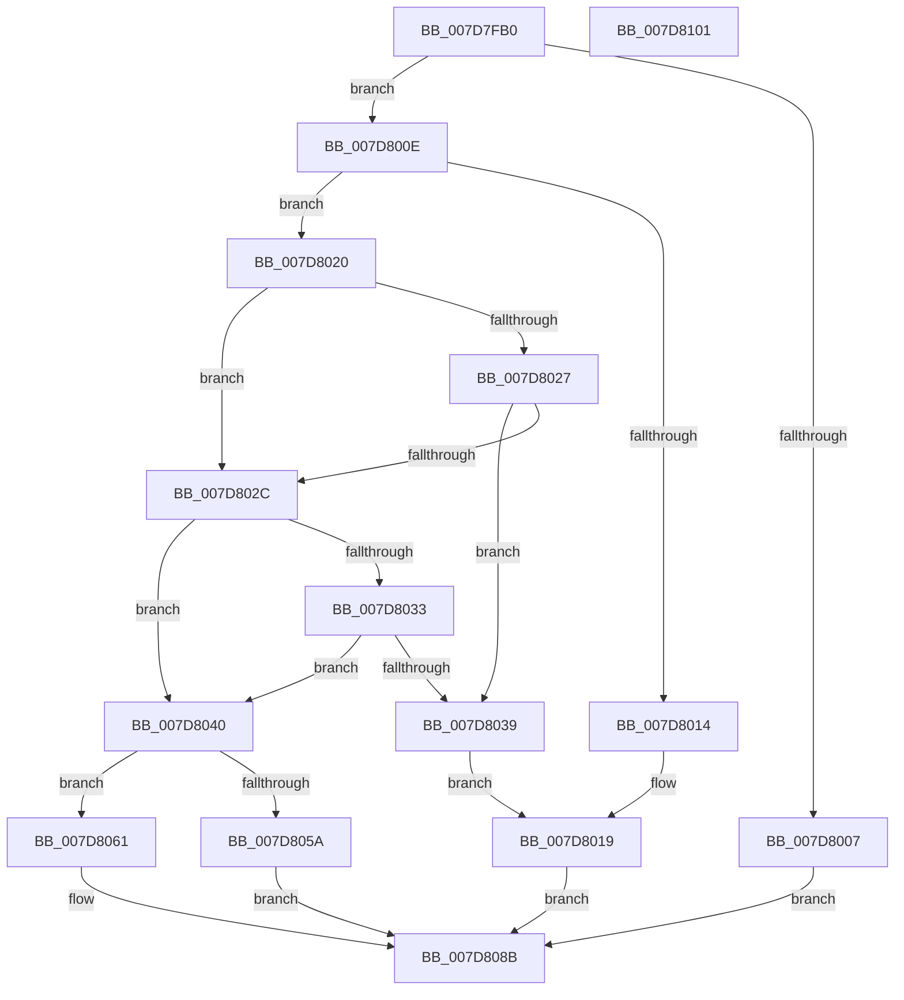

# WheapOfflinePage

- RVA: `0x007D7FB0`–`0x007D8102` (길이 `338` bytes)
- VA: `0x00000001407D7FB0`
- 실행 섹션: `PAGE`
- PDB 이름 있음: `예`; PDB Function 태그: `아니요`
- unwind 정보 RVA: `0x000D5ECC`
- 디코드: `88`개 명령, `338/338` bytes 표시
- 미해석 바이트: `0` (있으면 어셈블리에 `.byte`로 보존)

> 이 문서는 커널 이미지의 기계어와 PDB 기호를 분석해 생성했습니다. 4번과 5번은 함수 원형과 자료형을 바이너리 사용 방식에서 추정한 C 해석이며 원본 소스 복구 결과는 아닙니다.

## 1. Dependencies

- 직접 호출 지점: **5**; 고유 호출 대상: **5**
- 직접 호출자로 확인된 함수: **1**
- RIP 상대 이미지 참조: **3**

### Outgoing calls
- `0x007D7FF5` → `PSHED.dll!PshedGetMemoryDetails` (import, 간접 대상; import `PSHED.dll!PshedGetMemoryDetails`)
- `0x007D8048` → `PSHED.dll!PshedTranslateDimmAddress` (import, 간접 대상; import `PSHED.dll!PshedTranslateDimmAddress`)
- `0x007D8086` → [WheapAttemptPhysicalPageOffline](WheapAttemptPhysicalPageOffline_function_007D79AC.md) (function, `0x007D79AC`)
- `0x007D80D6` → [WheaLogInternalEvent](../../text/66/WheaLogInternalEvent_function_006605B0.md) (function, `0x006605B0`)
- `0x007D80E4` → [_security_check_cookie](../../text/6A/_security_check_cookie_function_006AC640.md) (function, `0x006AC640`)

### Direct callers
- [WheaPageOfflineAndPersist](WheaPageOfflineAndPersist_function_007D7594.md) at `0x007D765A`

### Static image references
- `0x007D7FCA` → RVA `0x00E0A740` (`.data`; read)
- `0x007D7FF5` → RVA `0x00151118` (`PSHED.dll!PshedGetMemoryDetails (IAT)`; read)
- `0x007D8048` → RVA `0x001510D0` (`PSHED.dll!PshedTranslateDimmAddress (IAT)`; read)

## 2. Other-region calls and transfers

- 다른 실행 섹션으로 향하는 call: **2**
  - `0x007D80D6` → [WheaLogInternalEvent](../../text/66/WheaLogInternalEvent_function_006605B0.md) (`PAGE` → `.text`)
  - `0x007D80E4` → [_security_check_cookie](../../text/6A/_security_check_cookie_function_006AC640.md) (`PAGE` → `.text`)
- 별도 외부 분기/꼬리 이동을 확인하지 못했습니다.

## 3. Assembly (complete function range)

```asm
007D7FB0  48 89 5C 24 18                  mov qword ptr [rsp + 0x18], rbx
007D7FB5  48 89 74 24 20                  mov qword ptr [rsp + 0x20], rsi
007D7FBA  55                              push rbp
007D7FBB  57                              push rdi
007D7FBC  41 56                           push r14
007D7FBE  48 8D 6C 24 B9                  lea rbp, [rsp - 0x47]
007D7FC3  48 81 EC A0 00 00 00            sub rsp, 0xa0
007D7FCA  48 8B 05 6F 27 63 00            mov rax, qword ptr [rip + 0x63276f]
007D7FD1  48 33 C4                        xor rax, rsp
007D7FD4  48 89 45 37                     mov qword ptr [rbp + 0x37], rax
007D7FD8  48 83 4D E7 FF                  or qword ptr [rbp - 0x19], 0xffffffffffffffff
007D7FDD  48 8B F1                        mov rsi, rcx
007D7FE0  0F 57 C0                        xorps xmm0, xmm0
007D7FE3  48 8D 4D EF                     lea rcx, [rbp - 0x11]
007D7FE7  33 C0                           xor eax, eax
007D7FE9  4C 8B F2                        mov r14, rdx
007D7FEC  0F 11 45 EF                     movups xmmword ptr [rbp - 0x11], xmm0
007D7FF0  88 45 FF                        mov byte ptr [rbp - 1], al
007D7FF3  33 FF                           xor edi, edi
007D7FF5  48 FF 15 1C 91 97 FF            call qword ptr [rip - 0x686ee4]
007D7FFC  0F 1F 44 00 00                  nop dword ptr [rax + rax]
007D8001  8B D8                           mov ebx, eax
007D8003  85 C0                           test eax, eax
007D8005  79 07                           jns 0x1407d800e
007D8007  BF 01 00 00 00                  mov edi, 1
007D800C  EB 7D                           jmp 0x1407d808b
007D800E  F6 45 F1 01                     test byte ptr [rbp - 0xf], 1
007D8012  75 0C                           jne 0x1407d8020
007D8014  BF 07 00 00 00                  mov edi, 7
007D8019  BB 01 00 00 C0                  mov ebx, 0xc0000001
007D801E  EB 6B                           jmp 0x1407d808b
007D8020  66 83 7D F5 04                  cmp word ptr [rbp - 0xb], 4
007D8025  75 05                           jne 0x1407d802c
007D8027  39 7E 20                        cmp dword ptr [rsi + 0x20], edi
007D802A  75 0D                           jne 0x1407d8039
007D802C  66 83 7D F5 05                  cmp word ptr [rbp - 0xb], 5
007D8031  75 0D                           jne 0x1407d8040
007D8033  83 7E 20 02                     cmp dword ptr [rsi + 0x20], 2
007D8037  74 07                           je 0x1407d8040
007D8039  BF 0A 00 00 00                  mov edi, 0xa
007D803E  EB D9                           jmp 0x1407d8019
007D8040  48 8D 4E 04                     lea rcx, [rsi + 4]
007D8044  48 8D 55 E7                     lea rdx, [rbp - 0x19]
007D8048  48 FF 15 81 90 97 FF            call qword ptr [rip - 0x686f7f]
007D804F  0F 1F 44 00 00                  nop dword ptr [rax + rax]
007D8054  8B D8                           mov ebx, eax
007D8056  85 C0                           test eax, eax
007D8058  79 07                           jns 0x1407d8061
007D805A  BF 02 00 00 00                  mov edi, 2
007D805F  EB 2A                           jmp 0x1407d808b
007D8061  48 8B 4D E7                     mov rcx, qword ptr [rbp - 0x19]
007D8065  41 B1 01                        mov r9b, 1
007D8068  4C 89 74 24 38                  mov qword ptr [rsp + 0x38], r14
007D806D  48 8B D1                        mov rdx, rcx
007D8070  40 88 7C 24 30                  mov byte ptr [rsp + 0x30], dil
007D8075  4C 8B C6                        mov r8, rsi
007D8078  48 C1 FA 0C                     sar rdx, 0xc
007D807C  40 88 7C 24 28                  mov byte ptr [rsp + 0x28], dil
007D8081  40 88 7C 24 20                  mov byte ptr [rsp + 0x20], dil
007D8086  E8 21 F9 FF FF                  call 0x1407d79ac
007D808B  48 8B 45 E7                     mov rax, qword ptr [rbp - 0x19]
007D808F  48 8D 4D 07                     lea rcx, [rbp + 7]
007D8093  83 65 13 00                     and dword ptr [rbp + 0x13], 0
007D8097  48 C1 E8 0C                     shr rax, 0xc
007D809B  48 89 45 27                     mov qword ptr [rbp + 0x27], rax
007D809F  C7 45 07 57 68 4C 67            mov dword ptr [rbp + 7], 0x674c6857
007D80A6  C7 45 0B 01 00 00 00            mov dword ptr [rbp + 0xb], 1
007D80AD  C7 45 0F 30 00 00 00            mov dword ptr [rbp + 0xf], 0x30
007D80B4  C7 45 1B 65 00 00 80            mov dword ptr [rbp + 0x1b], 0x80000065
007D80BB  C7 45 17 4B 52 4E 4C            mov dword ptr [rbp + 0x17], 0x4c4e524b
007D80C2  C7 45 1F 02 00 00 00            mov dword ptr [rbp + 0x1f], 2
007D80C9  C7 45 23 10 00 00 00            mov dword ptr [rbp + 0x23], 0x10
007D80D0  89 5D 2F                        mov dword ptr [rbp + 0x2f], ebx
007D80D3  89 7D 33                        mov dword ptr [rbp + 0x33], edi
007D80D6  E8 D5 84 E8 FF                  call 0x1406605b0
007D80DB  8B C3                           mov eax, ebx
007D80DD  48 8B 4D 37                     mov rcx, qword ptr [rbp + 0x37]
007D80E1  48 33 CC                        xor rcx, rsp
007D80E4  E8 57 45 ED FF                  call 0x1406ac640
007D80E9  4C 8D 9C 24 A0 00 00 00         lea r11, [rsp + 0xa0]
007D80F1  49 8B 5B 30                     mov rbx, qword ptr [r11 + 0x30]
007D80F5  49 8B 73 38                     mov rsi, qword ptr [r11 + 0x38]
007D80F9  49 8B E3                        mov rsp, r11
007D80FC  41 5E                           pop r14
007D80FE  5F                              pop rdi
007D80FF  5D                              pop rbp
007D8100  C3                              ret
007D8101  CC                              int3
```

## 4. C-style interpretation (structured pseudocode)

```c
__int64 __fastcall WheapOfflinePage(__int64 a1, __int64 a2)
{
    __int64 result;
    __int64 v_rdi;
    __int64 v_rsp;
    unsigned __int64 v_stack_m18;
    unsigned __int64 v_stack_m28;
    unsigned int v_stack_m2C;
    unsigned int v_stack_m30;
    unsigned __int64 v_stack_m38;
    unsigned int v_stack_m3C;
    unsigned int v_stack_m40;
    unsigned int v_stack_m44;
    unsigned int v_stack_m48;
    unsigned int v_stack_m4C;
    unsigned int v_stack_m50;
    unsigned int v_stack_m54;
    unsigned __int64 v_stack_m58;
    unsigned __int64 v_stack_m5F;
    unsigned __int8 v_stack_m60;
    unsigned __int16 v_stack_m6A;
    unsigned __int8 v_stack_m6E;
    unsigned __int64 v_stack_m70;
    unsigned __int64 v_stack_m78;
    unsigned __int64 v_stack_m80;
    unsigned __int8 v_stack_m88;
    unsigned __int8 v_stack_m90;
    unsigned __int8 v_stack_m98;
    unsigned __int64 v_stack_p18;
    unsigned __int64 v_stack_p20;

    v_stack_p18 = v_rbx;
    v_stack_p20 = v_rsi;
    v_rsp = (v_rsp) - (160);
    result = (*(unsigned __int64 *)(v_rip + 6498159)) ^ (v_rsp);
    v_stack_m28 = result;
    result = 0;
    v_stack_m70 = v_xmm0;
    v_stack_m60 = 0;
    v_rdi = 0;
    result = PSHED_dll_PshedGetMemoryDetails(v_stack_m70, a2, a3, a4);
    if (!sign_flag) goto loc_007D800E;
    goto loc_007D808B;
loc_007D800E:
    if (((v_stack_m6E) & (1)) != 0) goto loc_007D8020;
loc_007D8019:
    goto loc_007D808B;
loc_007D8020:
    if (v_stack_m6A != 4) goto loc_007D802C;
    if ((*(unsigned int *)(a1 + 32)) != 7) goto loc_007D8039;
loc_007D802C:
    if (v_stack_m6A != 5) goto loc_007D8040;
    if ((*(unsigned int *)(a1 + 32)) == 2) goto loc_007D8040;
loc_007D8039:
    goto loc_007D8019;
loc_007D8040:
    result = PSHED_dll_PshedTranslateDimmAddress(a1 + 4, v_stack_m78, a3, a4);
    if (!sign_flag) goto loc_007D8061;
    goto loc_007D808B;
loc_007D8061:
    v_stack_m80 = a2;
    v_stack_m88 = 2;
    a2 = (v_stack_m78) >> (12);
    v_stack_m90 = 2;
    v_stack_m98 = 2;
    result = WheapAttemptPhysicalPageOffline(v_stack_m78, a2, a1, 1);
loc_007D808B:
    result = (v_stack_m78) >> (12);
    v_stack_m38 = result;
    v_stack_m58 = 0x674C6857ULL;
    v_stack_m54 = 1;
    v_stack_m50 = 48;
    v_stack_m44 = 0x80000065ULL;
    v_stack_m48 = 0x4C4E524BULL;
    v_stack_m40 = 2;
    v_stack_m3C = 16;
    v_stack_m30 = (unsigned int)((unsigned int)((unsigned int)(result)));
    v_stack_m2C = 2;
    result = WheaLogInternalEvent(v_stack_m58, a2, a1, 1);
    a1 = (v_stack_m28) ^ (v_rsp);
    result = _security_check_cookie(a1, a2, a1, 1);
    return result;
}
```

## 5. (Beta) C Style

```c
int64_t WheapOfflinePage(void *Arg1, int64_t Arg2)
{
    uint8_t *arg1 = (uint8_t *)Arg1;

    int64_t result;
    int64_t local_rdi;
    int64_t local_rsp;
    uint64_t v_stack_m18;
    uint64_t v_stack_m28;
    uint32_t v_stack_m2C;
    uint32_t v_stack_m30;
    uint64_t v_stack_m38;
    uint32_t v_stack_m3C;
    uint32_t v_stack_m40;
    uint32_t v_stack_m44;
    uint32_t v_stack_m48;
    uint32_t v_stack_m4C;
    uint32_t v_stack_m50;
    uint32_t v_stack_m54;
    uint64_t v_stack_m58;
    uint64_t v_stack_m5F;
    uint8_t v_stack_m60;
    uint16_t v_stack_m6A;
    uint8_t v_stack_m6E;
    uint64_t v_stack_m70;
    uint64_t v_stack_m78;
    uint64_t v_stack_m80;
    uint8_t v_stack_m88;
    uint8_t v_stack_m90;
    uint8_t v_stack_m98;
    uint64_t v_stack_p18;
    uint64_t v_stack_p20;

    v_stack_p18 = local_rbx;
    v_stack_p20 = local_rsi;
    local_rsp = (local_rsp) - (160);
    result = (*(uint64_t *)(v_rip + 0x63276F)) ^ (local_rsp);
    v_stack_m28 = result;
    result = 0;
    v_stack_m70 = v_xmm0;
    v_stack_m60 = 0;
    local_rdi = 0;
    result = kernel_indirect_call(v_stack_m70, Arg2, a3, a4);
    if (!sign_flag) goto loc_007D800E;
    goto loc_007D808B;
loc_007D800E:
    if (((v_stack_m6E) & (1)) != 0) goto loc_007D8020;
loc_007D8019:
    goto loc_007D808B;
loc_007D8020:
    if (v_stack_m6A != 4) goto loc_007D802C;
    if ((*(uint32_t *)(arg1 + 0x20)) != 7) goto loc_007D8039;
loc_007D802C:
    if (v_stack_m6A != 5) goto loc_007D8040;
    if ((*(uint32_t *)(arg1 + 0x20)) == 2) goto loc_007D8040;
loc_007D8039:
    goto loc_007D8019;
loc_007D8040:
    result = kernel_indirect_call(Arg1 + 4, v_stack_m78, a3, a4);
    if (!sign_flag) goto loc_007D8061;
    goto loc_007D808B;
loc_007D8061:
    v_stack_m80 = Arg2;
    v_stack_m88 = 2;
    Arg2 = (v_stack_m78) >> (12);
    v_stack_m90 = 2;
    v_stack_m98 = 2;
    result = WheapAttemptPhysicalPageOffline(v_stack_m78, Arg2, Arg1, 1);
loc_007D808B:
    result = (v_stack_m78) >> (12);
    v_stack_m38 = result;
    v_stack_m58 = 0x674C6857ULL;
    v_stack_m54 = 1;
    v_stack_m50 = 48;
    v_stack_m44 = 0x80000065ULL;
    v_stack_m48 = 0x4C4E524BULL;
    v_stack_m40 = 2;
    v_stack_m3C = 16;
    v_stack_m30 = (uint32_t)((uint32_t)((uint32_t)(result)));
    v_stack_m2C = 2;
    result = WheaLogInternalEvent(v_stack_m58, Arg2, Arg1, 1);
    Arg1 = (v_stack_m28) ^ (local_rsp);
    result = _security_check_cookie(Arg1, Arg2, Arg1, 1);
    return result;
}
```

### 관측된 메모리 오프셋

구조체 형식이 확인되지 않은 접근은 인자 기준의 오프셋으로만 기록했습니다.

| 기준 인자 | 오프셋 표현 | 폭 (bit) | 접근 |
|---|---:|---:|---|
| `Arg1` | `+ 0x4` | `64` | `R` |
| `Arg1` | `+ 0x20` | `32` | `R` |

## 6. Execution-region graph

[열기: 2D/3D 그래프와 함수 탐색 컨트롤 패널](../../../control-panel.html?section=page&rva=0x007D7FB0&view=graph)

- 2D 그래프는 위에서 아래로 흐르고, 3D 그래프는 빈 공간을 드래그해 회전합니다. Shift+드래그는 이동, 휠은 확대·축소, 함수 노드 선택은 대상 보고서 이동입니다.

### Static fallback


