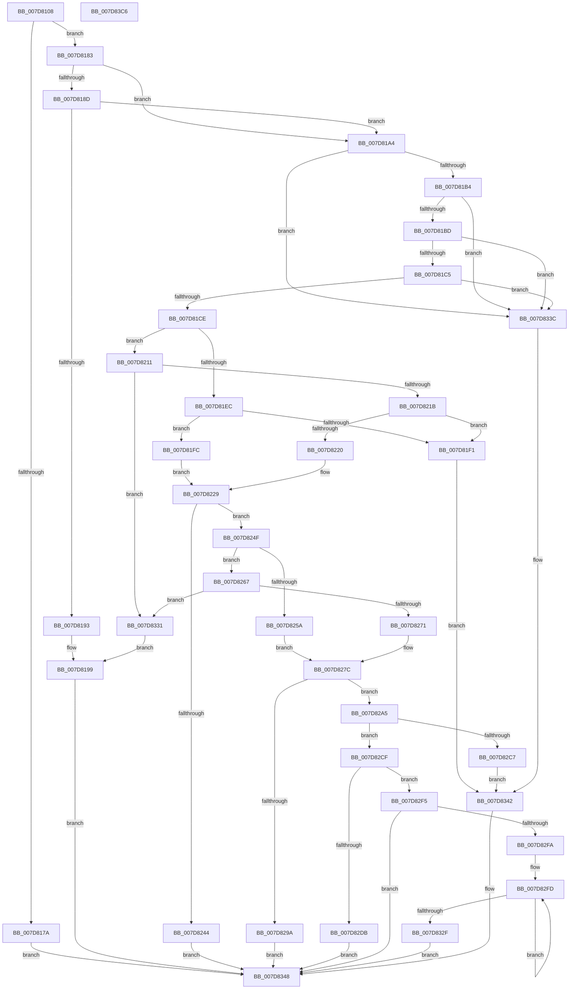

# WheapOfflineRow

- RVA: `0x007D8108`–`0x007D83C7` (길이 `703` bytes)
- VA: `0x00000001407D8108`
- 실행 섹션: `PAGE`
- PDB 이름 있음: `예`; PDB Function 태그: `아니요`
- unwind 정보 RVA: `0x000D5EF0`
- 디코드: `184`개 명령, `703/703` bytes 표시
- 미해석 바이트: `0` (있으면 어셈블리에 `.byte`로 보존)

> 이 문서는 커널 이미지의 기계어와 PDB 기호를 분석해 생성했습니다. 4번과 5번은 함수 원형과 자료형을 바이너리 사용 방식에서 추정한 C 해석이며 원본 소스 복구 결과는 아닙니다.

## 1. Dependencies

- 직접 호출 지점: **7**; 고유 호출 대상: **6**
- 직접 호출자로 확인된 함수: **1**
- RIP 상대 이미지 참조: **4**

### Outgoing calls
- `0x007D8167` → `PSHED.dll!PshedGetMemoryDetails` (import, 간접 대상; import `PSHED.dll!PshedGetMemoryDetails`)
- `0x007D8231` → `PSHED.dll!PshedTranslateDimmAddress` (import, 간접 대상; import `PSHED.dll!PshedTranslateDimmAddress`)
- `0x007D8287` → `PSHED.dll!PshedTranslateDimmAddress` (import, 간접 대상; import `PSHED.dll!PshedTranslateDimmAddress`)
- `0x007D82EE` → [WheaAttemptRowOffline](../../text/65/WheaAttemptRowOffline_function_0065F050.md) (function, `0x0065F050`)
- `0x007D8322` → [WheapAttemptPhysicalPageOffline](WheapAttemptPhysicalPageOffline_function_007D79AC.md) (function, `0x007D79AC`)
- `0x007D8396` → [WheaLogInternalEvent](../../text/66/WheaLogInternalEvent_function_006605B0.md) (function, `0x006605B0`)
- `0x007D83A5` → [_security_check_cookie](../../text/6A/_security_check_cookie_function_006AC640.md) (function, `0x006AC640`)

### Direct callers
- [WheaPageOfflineAndPersist](WheaPageOfflineAndPersist_function_007D7594.md) at `0x007D7669`

### Static image references
- `0x007D8126` → RVA `0x00E0A740` (`.data`; read)
- `0x007D8167` → RVA `0x00151118` (`PSHED.dll!PshedGetMemoryDetails (IAT)`; read)
- `0x007D8231` → RVA `0x001510D0` (`PSHED.dll!PshedTranslateDimmAddress (IAT)`; read)
- `0x007D82CF` → RVA `0x00E09848` (`.data`; read)

## 2. Other-region calls and transfers

- 다른 실행 섹션으로 향하는 call: **3**
  - `0x007D82EE` → [WheaAttemptRowOffline](../../text/65/WheaAttemptRowOffline_function_0065F050.md) (`PAGE` → `.text`)
  - `0x007D8396` → [WheaLogInternalEvent](../../text/66/WheaLogInternalEvent_function_006605B0.md) (`PAGE` → `.text`)
  - `0x007D83A5` → [_security_check_cookie](../../text/6A/_security_check_cookie_function_006AC640.md) (`PAGE` → `.text`)
- 별도 외부 분기/꼬리 이동을 확인하지 못했습니다.

## 3. Assembly (complete function range)

```asm
007D8108  48 89 5C 24 18                  mov qword ptr [rsp + 0x18], rbx
007D810D  48 89 74 24 20                  mov qword ptr [rsp + 0x20], rsi
007D8112  55                              push rbp
007D8113  57                              push rdi
007D8114  41 54                           push r12
007D8116  41 56                           push r14
007D8118  41 57                           push r15
007D811A  48 8D 6C 24 C9                  lea rbp, [rsp - 0x37]
007D811F  48 81 EC E0 00 00 00            sub rsp, 0xe0
007D8126  48 8B 05 13 26 63 00            mov rax, qword ptr [rip + 0x632613]
007D812D  48 33 C4                        xor rax, rsp
007D8130  48 89 45 27                     mov qword ptr [rbp + 0x27], rax
007D8134  33 C0                           xor eax, eax
007D8136  0F 57 C0                        xorps xmm0, xmm0
007D8139  48 21 45 97                     and qword ptr [rbp - 0x69], rax
007D813D  48 8B F1                        mov rsi, rcx
007D8140  48 21 45 9F                     and qword ptr [rbp - 0x61], rax
007D8144  48 8D 4D A7                     lea rcx, [rbp - 0x59]
007D8148  48 83 CF FF                     or rdi, 0xffffffffffffffff
007D814C  89 45 DF                        mov dword ptr [rbp - 0x21], eax
007D814F  0F 11 45 BF                     movups xmmword ptr [rbp - 0x41], xmm0
007D8153  48 8B DF                        mov rbx, rdi
007D8156  88 45 B7                        mov byte ptr [rbp - 0x49], al
007D8159  0F 11 45 CF                     movups xmmword ptr [rbp - 0x31], xmm0
007D815D  4C 8B E2                        mov r12, rdx
007D8160  45 33 FF                        xor r15d, r15d
007D8163  0F 11 45 A7                     movups xmmword ptr [rbp - 0x59], xmm0
007D8167  48 FF 15 AA 8F 97 FF            call qword ptr [rip - 0x687056]
007D816E  0F 1F 44 00 00                  nop dword ptr [rax + rax]
007D8173  44 8B F0                        mov r14d, eax
007D8176  85 C0                           test eax, eax
007D8178  79 09                           jns 0x1407d8183
007D817A  44 8D 7F 02                     lea r15d, [rdi + 2]
007D817E  E9 C5 01 00 00                  jmp 0x1407d8348
007D8183  8B 45 A9                        mov eax, dword ptr [rbp - 0x57]
007D8186  D1 E8                           shr eax, 1
007D8188  83 E0 01                        and eax, 1
007D818B  74 17                           je 0x1407d81a4
007D818D  44 38 7D AF                     cmp byte ptr [rbp - 0x51], r15b
007D8191  74 11                           je 0x1407d81a4
007D8193  41 BF 05 00 00 00               mov r15d, 5
007D8199  41 BE BB 00 00 C0               mov r14d, 0xc00000bb
007D819F  E9 A4 01 00 00                  jmp 0x1407d8348
007D81A4  8A 4D A9                        mov cl, byte ptr [rbp - 0x57]
007D81A7  BA 04 00 00 00                  mov edx, 4
007D81AC  84 CA                           test dl, cl
007D81AE  0F 84 88 01 00 00               je 0x1407d833c
007D81B4  F6 C1 08                        test cl, 8
007D81B7  0F 84 7F 01 00 00               je 0x1407d833c
007D81BD  85 C0                           test eax, eax
007D81BF  0F 84 77 01 00 00               je 0x1407d833c
007D81C5  F6 C1 01                        test cl, 1
007D81C8  0F 84 6E 01 00 00               je 0x1407d833c
007D81CE  0F 10 06                        movups xmm0, xmmword ptr [rsi]
007D81D1  8B 46 20                        mov eax, dword ptr [rsi + 0x20]
007D81D4  0F 10 4E 10                     movups xmm1, xmmword ptr [rsi + 0x10]
007D81D8  8D 72 01                        lea esi, [rdx + 1]
007D81DB  89 45 DF                        mov dword ptr [rbp - 0x21], eax
007D81DE  0F 11 45 BF                     movups xmmword ptr [rbp - 0x41], xmm0
007D81E2  0F 11 4D CF                     movups xmmword ptr [rbp - 0x31], xmm1
007D81E6  66 39 55 AD                     cmp word ptr [rbp - 0x53], dx
007D81EA  75 25                           jne 0x1407d8211
007D81EC  83 F8 01                        cmp eax, 1
007D81EF  74 0B                           je 0x1407d81fc
007D81F1  41 BF 0A 00 00 00               mov r15d, 0xa
007D81F7  E9 46 01 00 00                  jmp 0x1407d8342
007D81FC  48 8B 45 D7                     mov rax, qword ptr [rbp - 0x29]
007D8200  44 21 7D CF                     and dword ptr [rbp - 0x31], r15d
007D8204  48 C1 E8 20                     shr rax, 0x20
007D8208  0F BA E8 0A                     bts eax, 0xa
007D820C  89 45 DB                        mov dword ptr [rbp - 0x25], eax
007D820F  EB 18                           jmp 0x1407d8229
007D8211  66 39 75 AD                     cmp word ptr [rbp - 0x53], si
007D8215  0F 85 16 01 00 00               jne 0x1407d8331
007D821B  83 F8 03                        cmp eax, 3
007D821E  75 D1                           jne 0x1407d81f1
007D8220  44 21 7D CF                     and dword ptr [rbp - 0x31], r15d
007D8224  0F BA 6D DB 0B                  bts dword ptr [rbp - 0x25], 0xb
007D8229  48 8D 55 97                     lea rdx, [rbp - 0x69]
007D822D  48 8D 4D C3                     lea rcx, [rbp - 0x3d]
007D8231  48 FF 15 98 8E 97 FF            call qword ptr [rip - 0x687168]
007D8238  0F 1F 44 00 00                  nop dword ptr [rax + rax]
007D823D  44 8B F0                        mov r14d, eax
007D8240  85 C0                           test eax, eax
007D8242  79 0B                           jns 0x1407d824f
007D8244  41 BF 03 00 00 00               mov r15d, 3
007D824A  E9 F9 00 00 00                  jmp 0x1407d8348
007D824F  B8 04 00 00 00                  mov eax, 4
007D8254  66 39 45 AD                     cmp word ptr [rbp - 0x53], ax
007D8258  75 0D                           jne 0x1407d8267
007D825A  0F B7 45 B0                     movzx eax, word ptr [rbp - 0x50]
007D825E  FF C8                           dec eax
007D8260  0F BA 6D DB 0A                  bts dword ptr [rbp - 0x25], 0xa
007D8265  EB 15                           jmp 0x1407d827c
007D8267  66 39 75 AD                     cmp word ptr [rbp - 0x53], si
007D826B  0F 85 C0 00 00 00               jne 0x1407d8331
007D8271  0F B7 45 B0                     movzx eax, word ptr [rbp - 0x50]
007D8275  FF C8                           dec eax
007D8277  0F BA 6D DB 0B                  bts dword ptr [rbp - 0x25], 0xb
007D827C  48 8D 55 9F                     lea rdx, [rbp - 0x61]
007D8280  89 45 CF                        mov dword ptr [rbp - 0x31], eax
007D8283  48 8D 4D C3                     lea rcx, [rbp - 0x3d]
007D8287  48 FF 15 42 8E 97 FF            call qword ptr [rip - 0x6871be]
007D828E  0F 1F 44 00 00                  nop dword ptr [rax + rax]
007D8293  44 8B F0                        mov r14d, eax
007D8296  85 C0                           test eax, eax
007D8298  79 0B                           jns 0x1407d82a5
007D829A  41 BF 04 00 00 00               mov r15d, 4
007D82A0  E9 A3 00 00 00                  jmp 0x1407d8348
007D82A5  48 8B 5D 9F                     mov rbx, qword ptr [rbp - 0x61]
007D82A9  48 8B 7D 97                     mov rdi, qword ptr [rbp - 0x69]
007D82AD  0F B7 45 B2                     movzx eax, word ptr [rbp - 0x4e]
007D82B1  48 C1 FB 0C                     sar rbx, 0xc
007D82B5  48 C1 FF 0C                     sar rdi, 0xc
007D82B9  48 8B CB                        mov rcx, rbx
007D82BC  48 2B CF                        sub rcx, rdi
007D82BF  48 FF C1                        inc rcx
007D82C2  48 3B C8                        cmp rcx, rax
007D82C5  7E 08                           jle 0x1407d82cf
007D82C7  41 BF 06 00 00 00               mov r15d, 6
007D82CD  EB 73                           jmp 0x1407d8342
007D82CF  48 8B 05 72 15 63 00            mov rax, qword ptr [rip + 0x631572]
007D82D6  44 38 38                        cmp byte ptr [rax], r15b
007D82D9  74 1A                           je 0x1407d82f5
007D82DB  44 8B C3                        mov r8d, ebx
007D82DE  48 8D 55 BF                     lea rdx, [rbp - 0x41]
007D82E2  44 2B C7                        sub r8d, edi
007D82E5  4D 8B CC                        mov r9, r12
007D82E8  41 FF C0                        inc r8d
007D82EB  48 8B CF                        mov rcx, rdi
007D82EE  E8 5D 6D E8 FF                  call 0x14065f050
007D82F3  EB 53                           jmp 0x1407d8348
007D82F5  48 3B FB                        cmp rdi, rbx
007D82F8  7F 4E                           jg 0x1407d8348
007D82FA  48 8B F7                        mov rsi, rdi
007D82FD  4C 89 64 24 38                  mov qword ptr [rsp + 0x38], r12
007D8302  4C 8D 45 BF                     lea r8, [rbp - 0x41]
007D8306  44 88 7C 24 30                  mov byte ptr [rsp + 0x30], r15b
007D830B  48 8B CE                        mov rcx, rsi
007D830E  48 C1 E1 0C                     shl rcx, 0xc
007D8312  41 B1 01                        mov r9b, 1
007D8315  44 88 7C 24 28                  mov byte ptr [rsp + 0x28], r15b
007D831A  48 8B D6                        mov rdx, rsi
007D831D  44 88 7C 24 20                  mov byte ptr [rsp + 0x20], r15b
007D8322  E8 85 F6 FF FF                  call 0x1407d79ac
007D8327  48 FF C6                        inc rsi
007D832A  48 3B F3                        cmp rsi, rbx
007D832D  7E CE                           jle 0x1407d82fd
007D832F  EB 17                           jmp 0x1407d8348
007D8331  41 BF 09 00 00 00               mov r15d, 9
007D8337  E9 5D FE FF FF                  jmp 0x1407d8199
007D833C  41 BF 07 00 00 00               mov r15d, 7
007D8342  41 BE 01 00 00 C0               mov r14d, 0xc0000001
007D8348  83 65 F3 00                     and dword ptr [rbp - 0xd], 0
007D834C  48 8D 4D E7                     lea rcx, [rbp - 0x19]
007D8350  48 89 5D 0F                     mov qword ptr [rbp + 0xf], rbx
007D8354  2B DF                           sub ebx, edi
007D8356  89 5D 17                        mov dword ptr [rbp + 0x17], ebx
007D8359  C7 45 E7 57 68 4C 67            mov dword ptr [rbp - 0x19], 0x674c6857
007D8360  C7 45 EB 01 00 00 00            mov dword ptr [rbp - 0x15], 1
007D8367  C7 45 EF 3C 00 00 00            mov dword ptr [rbp - 0x11], 0x3c
007D836E  C7 45 FB 64 00 00 80            mov dword ptr [rbp - 5], 0x80000064
007D8375  C7 45 F7 4B 52 4E 4C            mov dword ptr [rbp - 9], 0x4c4e524b
007D837C  C7 45 FF 02 00 00 00            mov dword ptr [rbp - 1], 2
007D8383  C7 45 03 1C 00 00 00            mov dword ptr [rbp + 3], 0x1c
007D838A  48 89 7D 07                     mov qword ptr [rbp + 7], rdi
007D838E  44 89 75 1B                     mov dword ptr [rbp + 0x1b], r14d
007D8392  44 89 7D 1F                     mov dword ptr [rbp + 0x1f], r15d
007D8396  E8 15 82 E8 FF                  call 0x1406605b0
007D839B  41 8B C6                        mov eax, r14d
007D839E  48 8B 4D 27                     mov rcx, qword ptr [rbp + 0x27]
007D83A2  48 33 CC                        xor rcx, rsp
007D83A5  E8 96 42 ED FF                  call 0x1406ac640
007D83AA  4C 8D 9C 24 E0 00 00 00         lea r11, [rsp + 0xe0]
007D83B2  49 8B 5B 40                     mov rbx, qword ptr [r11 + 0x40]
007D83B6  49 8B 73 48                     mov rsi, qword ptr [r11 + 0x48]
007D83BA  49 8B E3                        mov rsp, r11
007D83BD  41 5F                           pop r15
007D83BF  41 5E                           pop r14
007D83C1  41 5C                           pop r12
007D83C3  5F                              pop rdi
007D83C4  5D                              pop rbp
007D83C5  C3                              ret
007D83C6  CC                              int3
```

## 4. C-style interpretation (structured pseudocode)

```c
__int64 __fastcall WheapOfflineRow(__int64 a1, __int64 a2)
{
    __int64 result;
    __int64 v_r15;
    __int64 v_rbx;
    __int64 v_rdi;
    __int64 v_rsi;
    __int64 v_rsp;
    unsigned __int64 v_stack_m28;
    unsigned __int64 v_stack_m38;
    unsigned int v_stack_m40;
    unsigned int v_stack_m44;
    unsigned int v_stack_m48;
    unsigned __int64 v_stack_m50;
    unsigned __int64 v_stack_m58;
    unsigned int v_stack_m5C;
    unsigned __int64 v_stack_m5F;
    unsigned int v_stack_m60;
    unsigned int v_stack_m64;
    unsigned int v_stack_m68;
    unsigned int v_stack_m6C;
    unsigned int v_stack_m70;
    unsigned int v_stack_m74;
    unsigned __int64 v_stack_m78;
    unsigned int v_stack_m80;
    unsigned int v_stack_m84;
    unsigned __int64 v_stack_m88;
    unsigned __int64 v_stack_m90;
    unsigned __int64 v_stack_m9C;
    unsigned __int64 v_stack_mA0;
    unsigned __int8 v_stack_mA8;
    unsigned __int16 v_stack_mAD;
    unsigned __int16 v_stack_mAF;
    unsigned __int8 v_stack_mB0;
    unsigned __int16 v_stack_mB2;
    unsigned int v_stack_mB6;
    unsigned __int64 v_stack_mB8;
    unsigned __int64 v_stack_mC0;
    unsigned __int64 v_stack_mC8;
    unsigned __int64 v_stack_mD0;
    unsigned __int8 v_stack_mD8;
    unsigned __int8 v_stack_mE0;
    unsigned __int8 v_stack_mE8;
    unsigned __int64 v_stack_p18;
    unsigned __int64 v_stack_p20;

    v_stack_p18 = v_rbx;
    v_stack_p20 = v_rsi;
    v_rsp = (v_rsp) - (224);
    result = (*(unsigned __int64 *)(v_rip + 6497811)) ^ (v_rsp);
    v_stack_m38 = result;
    result = 0;
    v_rdi = (v_rdi) | (-1);
    v_stack_m80 = 0;
    v_stack_mA0 = v_xmm0;
    v_stack_mA8 = 0;
    v_stack_m90 = v_xmm0;
    v_r15 = 0;
    v_stack_mB8 = v_xmm0;
    result = PSHED_dll_PshedGetMemoryDetails(v_stack_mB8, a2, a3, a4);
    if (!sign_flag) goto loc_007D8183;
    goto loc_007D8348;
loc_007D8183:
    result = (unsigned int)(((unsigned int)(v_stack_mB6)) >> (1));
    result = (unsigned int)((result) & (1));
    if (condition_is_equal) goto loc_007D81A4;
    if (v_stack_mB0 == ((unsigned __int8)(v_rdi + 2))) goto loc_007D81A4;
loc_007D8199:
    goto loc_007D8348;
loc_007D81A4:
    if (((4) & ((unsigned __int8)(v_stack_mB6))) == 0) goto loc_007D833C;
    if ((((unsigned __int8)(v_stack_mB6)) & (8)) == 0) goto loc_007D833C;
    if ((unsigned int)(result) == 0) goto loc_007D833C;
    if ((((unsigned __int8)(v_stack_mB6)) & (1)) == 0) goto loc_007D833C;
    v_stack_m80 = (unsigned int)((unsigned int)(*(unsigned int *)(a1 + 32)));
    v_stack_mA0 = v_xmm0;
    v_stack_m90 = v_xmm1;
    if (v_stack_mB2 != 4) goto loc_007D8211;
    if (((unsigned int)((unsigned int)(*(unsigned int *)(a1 + 32)))) == 1) goto loc_007D81FC;
loc_007D81F1:
    goto loc_007D8342;
loc_007D81FC:
    result = (v_stack_m88) >> (32);
    v_stack_m84 = (unsigned int)(result);
    goto loc_007D8229;
loc_007D8211:
    if (v_stack_mB2 != ((unsigned __int16)(4 + 1))) goto loc_007D8331;
    if (((unsigned int)(result)) != 3) goto loc_007D81F1;
loc_007D8229:
    result = PSHED_dll_PshedTranslateDimmAddress(v_stack_m9C, v_stack_mC8, a3, a4);
    if (!sign_flag) goto loc_007D824F;
    goto loc_007D8348;
loc_007D824F:
    if (v_stack_mB2 != 4) goto loc_007D8267;
    result = (unsigned int)((v_stack_mAF) - 1);
    goto loc_007D827C;
loc_007D8267:
    if (v_stack_mB2 != ((unsigned __int16)(4 + 1))) goto loc_007D8331;
    result = (unsigned int)((v_stack_mAF) - 1);
loc_007D827C:
    v_stack_m90 = (unsigned int)(result);
    result = PSHED_dll_PshedTranslateDimmAddress(v_stack_m9C, v_stack_mC0, a3, a4);
    if (!sign_flag) goto loc_007D82A5;
    goto loc_007D8348;
loc_007D82A5:
    v_rbx = (v_stack_mC0) >> (12);
    v_rdi = (v_stack_mC8) >> (12);
    a1 = (v_rbx) - (v_rdi);
    a1 = (a1) + 1;
    if (a1 <= v_stack_mAD) goto loc_007D82CF;
    goto loc_007D8342;
loc_007D82CF:
    if ((*(unsigned __int8 *)(*(unsigned __int64 *)(v_rip + 6493554))) == 6) goto loc_007D82F5;
    a3 = (unsigned int)(((unsigned int)((unsigned int)(v_rbx))) - ((unsigned int)(v_rdi)));
    a3 = (unsigned int)((a3) + 1);
    result = WheaAttemptRowOffline(v_rdi, v_stack_mA0, a3, a2);
    goto loc_007D8348;
loc_007D82F5:
    if (v_rdi > v_rbx) goto loc_007D8348;
loc_007D82FD:
    v_stack_mD0 = a2;
    v_stack_mD8 = 6;
    a1 = (v_rdi) << (12);
    v_stack_mE0 = 6;
    v_stack_mE8 = 6;
    result = WheapAttemptPhysicalPageOffline(a1, v_rdi, v_stack_mA0, 1);
    v_rsi = (v_rdi) + 1;
    if (v_rsi <= v_rbx) goto loc_007D82FD;
    goto loc_007D8348;
loc_007D8331:
    goto loc_007D8199;
loc_007D833C:
loc_007D8342:
loc_007D8348:
    v_stack_m50 = v_rbx;
    v_rbx = (unsigned int)((v_rbx) - ((unsigned int)(v_rdi)));
    v_stack_m48 = (unsigned int)(v_rbx);
    v_stack_m78 = 0x674C6857ULL;
    v_stack_m74 = 1;
    v_stack_m70 = 60;
    v_stack_m64 = 0x80000064ULL;
    v_stack_m68 = 0x4C4E524BULL;
    v_stack_m60 = 2;
    v_stack_m5C = 28;
    v_stack_m58 = v_rdi;
    v_stack_m44 = (unsigned int)((unsigned int)(0xC0000001ULL));
    v_stack_m40 = 7;
    result = WheaLogInternalEvent(v_stack_m78, v_rdi, v_stack_mA0, 1);
    a1 = (v_stack_m38) ^ (v_rsp);
    result = _security_check_cookie(a1, v_rdi, v_stack_mA0, 1);
    return result;
}
```

## 5. (Beta) C Style

```c
int64_t WheapOfflineRow(void *Arg1, int64_t Arg2)
{
    uint8_t *arg1 = (uint8_t *)Arg1;

    int64_t result;
    int64_t local_r15;
    int64_t local_rbx;
    int64_t local_rdi;
    int64_t local_rsi;
    int64_t local_rsp;
    uint64_t v_stack_m28;
    uint64_t v_stack_m38;
    uint32_t v_stack_m40;
    uint32_t v_stack_m44;
    uint32_t v_stack_m48;
    uint64_t v_stack_m50;
    uint64_t v_stack_m58;
    uint32_t v_stack_m5C;
    uint64_t v_stack_m5F;
    uint32_t v_stack_m60;
    uint32_t v_stack_m64;
    uint32_t v_stack_m68;
    uint32_t v_stack_m6C;
    uint32_t v_stack_m70;
    uint32_t v_stack_m74;
    uint64_t v_stack_m78;
    uint32_t v_stack_m80;
    uint32_t v_stack_m84;
    uint64_t v_stack_m88;
    uint64_t v_stack_m90;
    uint64_t v_stack_m9C;
    uint64_t v_stack_mA0;
    uint8_t v_stack_mA8;
    uint16_t v_stack_mAD;
    uint16_t v_stack_mAF;
    uint8_t v_stack_mB0;
    uint16_t v_stack_mB2;
    uint32_t v_stack_mB6;
    uint64_t v_stack_mB8;
    uint64_t v_stack_mC0;
    uint64_t v_stack_mC8;
    uint64_t v_stack_mD0;
    uint8_t v_stack_mD8;
    uint8_t v_stack_mE0;
    uint8_t v_stack_mE8;
    uint64_t v_stack_p18;
    uint64_t v_stack_p20;

    v_stack_p18 = local_rbx;
    v_stack_p20 = local_rsi;
    local_rsp = (local_rsp) - (224);
    result = (*(uint64_t *)(v_rip + 0x632613)) ^ (local_rsp);
    v_stack_m38 = result;
    result = 0;
    local_rdi = (local_rdi) | (-1);
    v_stack_m80 = 0;
    v_stack_mA0 = v_xmm0;
    v_stack_mA8 = 0;
    v_stack_m90 = v_xmm0;
    local_r15 = 0;
    v_stack_mB8 = v_xmm0;
    result = kernel_indirect_call(v_stack_mB8, Arg2, a3, a4);
    if (!sign_flag) goto loc_007D8183;
    goto loc_007D8348;
loc_007D8183:
    result = (uint32_t)(((uint32_t)(v_stack_mB6)) >> (1));
    result = (uint32_t)((result) & (1));
    if (condition_is_equal) goto loc_007D81A4;
    if (v_stack_mB0 == ((uint8_t)(local_rdi + 2))) goto loc_007D81A4;
loc_007D8199:
    goto loc_007D8348;
loc_007D81A4:
    if (((4) & ((uint8_t)(v_stack_mB6))) == 0) goto loc_007D833C;
    if ((((uint8_t)(v_stack_mB6)) & (8)) == 0) goto loc_007D833C;
    if ((uint32_t)(result) == 0) goto loc_007D833C;
    if ((((uint8_t)(v_stack_mB6)) & (1)) == 0) goto loc_007D833C;
    v_stack_m80 = (uint32_t)((uint32_t)(*(uint32_t *)(arg1 + 0x20)));
    v_stack_mA0 = v_xmm0;
    v_stack_m90 = v_xmm1;
    if (v_stack_mB2 != 4) goto loc_007D8211;
    if (((uint32_t)((uint32_t)(*(uint32_t *)(arg1 + 0x20)))) == 1) goto loc_007D81FC;
loc_007D81F1:
    goto loc_007D8342;
loc_007D81FC:
    result = (v_stack_m88) >> (32);
    v_stack_m84 = (uint32_t)(result);
    goto loc_007D8229;
loc_007D8211:
    if (v_stack_mB2 != ((uint16_t)(4 + 1))) goto loc_007D8331;
    if (((uint32_t)(result)) != 3) goto loc_007D81F1;
loc_007D8229:
    result = kernel_indirect_call(v_stack_m9C, v_stack_mC8, a3, a4);
    if (!sign_flag) goto loc_007D824F;
    goto loc_007D8348;
loc_007D824F:
    if (v_stack_mB2 != 4) goto loc_007D8267;
    result = (uint32_t)((v_stack_mAF) - 1);
    goto loc_007D827C;
loc_007D8267:
    if (v_stack_mB2 != ((uint16_t)(4 + 1))) goto loc_007D8331;
    result = (uint32_t)((v_stack_mAF) - 1);
loc_007D827C:
    v_stack_m90 = (uint32_t)(result);
    result = kernel_indirect_call(v_stack_m9C, v_stack_mC0, a3, a4);
    if (!sign_flag) goto loc_007D82A5;
    goto loc_007D8348;
loc_007D82A5:
    local_rbx = (v_stack_mC0) >> (12);
    local_rdi = (v_stack_mC8) >> (12);
    Arg1 = (local_rbx) - (local_rdi);
    Arg1 = (Arg1) + 1;
    if (Arg1 <= v_stack_mAD) goto loc_007D82CF;
    goto loc_007D8342;
loc_007D82CF:
    if ((*(uint8_t *)(*(uint64_t *)(v_rip + 0x631572))) == 6) goto loc_007D82F5;
    a3 = (uint32_t)(((uint32_t)((uint32_t)(local_rbx))) - ((uint32_t)(local_rdi)));
    a3 = (uint32_t)((a3) + 1);
    result = WheaAttemptRowOffline(local_rdi, v_stack_mA0, a3, Arg2);
    goto loc_007D8348;
loc_007D82F5:
    if (local_rdi > local_rbx) goto loc_007D8348;
loc_007D82FD:
    v_stack_mD0 = Arg2;
    v_stack_mD8 = 6;
    Arg1 = (local_rdi) << (12);
    v_stack_mE0 = 6;
    v_stack_mE8 = 6;
    result = WheapAttemptPhysicalPageOffline(Arg1, local_rdi, v_stack_mA0, 1);
    local_rsi = (local_rdi) + 1;
    if (local_rsi <= local_rbx) goto loc_007D82FD;
    goto loc_007D8348;
loc_007D8331:
    goto loc_007D8199;
loc_007D833C:
loc_007D8342:
loc_007D8348:
    v_stack_m50 = local_rbx;
    local_rbx = (uint32_t)((local_rbx) - ((uint32_t)(local_rdi)));
    v_stack_m48 = (uint32_t)(local_rbx);
    v_stack_m78 = 0x674C6857ULL;
    v_stack_m74 = 1;
    v_stack_m70 = 60;
    v_stack_m64 = 0x80000064ULL;
    v_stack_m68 = 0x4C4E524BULL;
    v_stack_m60 = 2;
    v_stack_m5C = 28;
    v_stack_m58 = local_rdi;
    v_stack_m44 = (uint32_t)((uint32_t)(0xC0000001ULL));
    v_stack_m40 = 7;
    result = WheaLogInternalEvent(v_stack_m78, local_rdi, v_stack_mA0, 1);
    Arg1 = (v_stack_m38) ^ (local_rsp);
    result = _security_check_cookie(Arg1, local_rdi, v_stack_mA0, 1);
    return result;
}
```

### 관측된 메모리 오프셋

구조체 형식이 확인되지 않은 접근은 인자 기준의 오프셋으로만 기록했습니다.

| 기준 인자 | 오프셋 표현 | 폭 (bit) | 접근 |
|---|---:|---:|---|
| `Arg1` | `+ 0x0` | `128` | `R` |
| `Arg1` | `+ 0x10` | `128` | `R` |
| `Arg1` | `+ 0x20` | `32` | `R` |

## 6. Execution-region graph

[열기: 2D/3D 그래프와 함수 탐색 컨트롤 패널](../../../control-panel.html?section=page&rva=0x007D8108&view=graph)

- 2D 그래프는 위에서 아래로 흐르고, 3D 그래프는 빈 공간을 드래그해 회전합니다. Shift+드래그는 이동, 휠은 확대·축소, 함수 노드 선택은 대상 보고서 이동입니다.

### Static fallback


