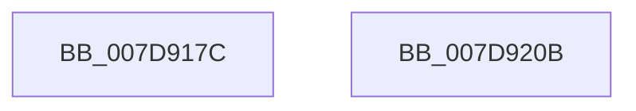

# WheapPfaLogPageMonitorRemoval

- RVA: `0x007D917C`–`0x007D920C` (길이 `144` bytes)
- VA: `0x00000001407D917C`
- 실행 섹션: `PAGE`
- PDB 이름 있음: `예`; PDB Function 태그: `아니요`
- unwind 정보 RVA: `0x000BDE20`
- 디코드: `33`개 명령, `144/144` bytes 표시
- 미해석 바이트: `0` (있으면 어셈블리에 `.byte`로 보존)

> 이 문서는 커널 이미지의 기계어와 PDB 기호를 분석해 생성했습니다. 4번과 5번은 함수 원형과 자료형을 바이너리 사용 방식에서 추정한 C 해석이며 원본 소스 복구 결과는 아닙니다.

## 1. Dependencies

- 직접 호출 지점: **2**; 고유 호출 대상: **2**
- 직접 호출자로 확인된 함수: **2**
- RIP 상대 이미지 참조: **1**

### Outgoing calls
- `0x007D91F4` → [WheaLogInternalEvent](../../text/66/WheaLogInternalEvent_function_006605B0.md) (function, `0x006605B0`)
- `0x007D9200` → [_security_check_cookie](../../text/6A/_security_check_cookie_function_006AC640.md) (function, `0x006AC640`)

### Direct callers
- [WheapPfaMemoryCheck](WheapPfaMemoryCheck_function_007D9214.md) at `0x007D9352`
- [WheapPfaMemoryCheck](WheapPfaMemoryCheck_function_007D9214.md) at `0x007D93B9`
- [WheapPfaRetireExpiredMemoryEntries](WheapPfaRetireExpiredMemoryEntries_function_007D94DC.md) at `0x007D9554`

### Static image references
- `0x007D9185` → RVA `0x00E0A740` (`.data`; read)

## 2. Other-region calls and transfers

- 다른 실행 섹션으로 향하는 call: **2**
  - `0x007D91F4` → [WheaLogInternalEvent](../../text/66/WheaLogInternalEvent_function_006605B0.md) (`PAGE` → `.text`)
  - `0x007D9200` → [_security_check_cookie](../../text/6A/_security_check_cookie_function_006AC640.md) (`PAGE` → `.text`)
- 별도 외부 분기/꼬리 이동을 확인하지 못했습니다.

## 3. Assembly (complete function range)

```asm
007D917C  40 55                           push rbp
007D917E  48 8B EC                        mov rbp, rsp
007D9181  48 83 EC 60                     sub rsp, 0x60
007D9185  48 8B 05 B4 15 63 00            mov rax, qword ptr [rip + 0x6315b4]
007D918C  48 33 C4                        xor rax, rsp
007D918F  48 89 45 F0                     mov qword ptr [rbp - 0x10], rax
007D9193  4C 2B 41 18                     sub r8, qword ptr [rcx + 0x18]
007D9197  48 B8 BD 42 7A E5 D5 94 BF D6   movabs rax, 0xd6bf94d5e57a42bd
007D91A1  83 65 CC 00                     and dword ptr [rbp - 0x34], 0
007D91A5  89 55 E0                        mov dword ptr [rbp - 0x20], edx
007D91A8  49 F7 E0                        mul r8
007D91AB  0F B7 41 10                     movzx eax, word ptr [rcx + 0x10]
007D91AF  89 45 E8                        mov dword ptr [rbp - 0x18], eax
007D91B2  8B 41 28                        mov eax, dword ptr [rcx + 0x28]
007D91B5  48 8D 4D C0                     lea rcx, [rbp - 0x40]
007D91B9  48 C1 EA 17                     shr rdx, 0x17
007D91BD  89 55 E4                        mov dword ptr [rbp - 0x1c], edx
007D91C0  C7 45 C0 57 68 4C 67            mov dword ptr [rbp - 0x40], 0x674c6857
007D91C7  C7 45 C4 01 00 00 00            mov dword ptr [rbp - 0x3c], 1
007D91CE  C7 45 C8 30 00 00 00            mov dword ptr [rbp - 0x38], 0x30
007D91D5  C7 45 D4 07 00 00 80            mov dword ptr [rbp - 0x2c], 0x80000007
007D91DC  C7 45 D0 4B 52 4E 4C            mov dword ptr [rbp - 0x30], 0x4c4e524b
007D91E3  C7 45 D8 02 00 00 00            mov dword ptr [rbp - 0x28], 2
007D91EA  C7 45 DC 10 00 00 00            mov dword ptr [rbp - 0x24], 0x10
007D91F1  89 45 EC                        mov dword ptr [rbp - 0x14], eax
007D91F4  E8 B7 73 E8 FF                  call 0x1406605b0
007D91F9  48 8B 4D F0                     mov rcx, qword ptr [rbp - 0x10]
007D91FD  48 33 CC                        xor rcx, rsp
007D9200  E8 3B 34 ED FF                  call 0x1406ac640
007D9205  48 83 C4 60                     add rsp, 0x60
007D9209  5D                              pop rbp
007D920A  C3                              ret
007D920B  CC                              int3
```

## 4. C-style interpretation (structured pseudocode)

```c
__int64 __fastcall WheapPfaLogPageMonitorRemoval(__int64 a1, __int64 a2, __int64 a3)
{
    __int64 result;
    __int64 v_rsp;
    unsigned __int64 v_stack_m18;
    unsigned int v_stack_m1C;
    unsigned int v_stack_m20;
    unsigned int v_stack_m24;
    unsigned int v_stack_m28;
    unsigned int v_stack_m2C;
    unsigned int v_stack_m30;
    unsigned int v_stack_m34;
    unsigned int v_stack_m38;
    unsigned int v_stack_m3C;
    unsigned int v_stack_m40;
    unsigned int v_stack_m44;
    unsigned __int64 v_stack_m48;

    v_rsp = (v_rsp) - (96);
    result = (*(unsigned __int64 *)(v_rip + 6493620)) ^ (v_rsp);
    v_stack_m18 = result;
    a3 = (a3) - (*(unsigned __int64 *)(a1 + 24));
    v_stack_m28 = (unsigned int)(a2);
    v_stack_m20 = (unsigned int)(*(unsigned __int16 *)(a1 + 16));
    a2 = (a2) >> (23);
    v_stack_m24 = (unsigned int)(a2);
    v_stack_m48 = 0x674C6857ULL;
    v_stack_m44 = 1;
    v_stack_m40 = 48;
    v_stack_m34 = 0x80000007ULL;
    v_stack_m38 = 0x4C4E524BULL;
    v_stack_m30 = 2;
    v_stack_m2C = 16;
    v_stack_m1C = (unsigned int)((unsigned int)(*(unsigned int *)(a1 + 40)));
    result = WheaLogInternalEvent(v_stack_m48, a2, a3, a4);
    a1 = (v_stack_m18) ^ (v_rsp);
    result = _security_check_cookie(a1, a2, a3, a4);
    v_rsp = (v_rsp) + (96);
    return result;
}
```

## 5. (Beta) C Style

```c
int64_t WheapPfaLogPageMonitorRemoval(void *Arg1, int64_t Arg2, int64_t Arg3)
{
    uint8_t *arg1 = (uint8_t *)Arg1;

    int64_t result;
    int64_t local_rsp;
    uint64_t v_stack_m18;
    uint32_t v_stack_m1C;
    uint32_t v_stack_m20;
    uint32_t v_stack_m24;
    uint32_t v_stack_m28;
    uint32_t v_stack_m2C;
    uint32_t v_stack_m30;
    uint32_t v_stack_m34;
    uint32_t v_stack_m38;
    uint32_t v_stack_m3C;
    uint32_t v_stack_m40;
    uint32_t v_stack_m44;
    uint64_t v_stack_m48;

    local_rsp = (local_rsp) - (96);
    result = (*(uint64_t *)(v_rip + 0x6315B4)) ^ (local_rsp);
    v_stack_m18 = result;
    Arg3 = (Arg3) - (*(uint64_t *)(arg1 + 0x18));
    v_stack_m28 = (uint32_t)(Arg2);
    v_stack_m20 = (uint32_t)(*(uint16_t *)(arg1 + 0x10));
    Arg2 = (Arg2) >> (23);
    v_stack_m24 = (uint32_t)(Arg2);
    v_stack_m48 = 0x674C6857ULL;
    v_stack_m44 = 1;
    v_stack_m40 = 48;
    v_stack_m34 = 0x80000007ULL;
    v_stack_m38 = 0x4C4E524BULL;
    v_stack_m30 = 2;
    v_stack_m2C = 16;
    v_stack_m1C = (uint32_t)((uint32_t)(*(uint32_t *)(arg1 + 0x28)));
    result = WheaLogInternalEvent(v_stack_m48, Arg2, Arg3, a4);
    Arg1 = (v_stack_m18) ^ (local_rsp);
    result = _security_check_cookie(Arg1, Arg2, Arg3, a4);
    local_rsp = (local_rsp) + (96);
    return result;
}
```

### 관측된 메모리 오프셋

구조체 형식이 확인되지 않은 접근은 인자 기준의 오프셋으로만 기록했습니다.

| 기준 인자 | 오프셋 표현 | 폭 (bit) | 접근 |
|---|---:|---:|---|
| `Arg1` | `+ 0x10` | `16` | `R` |
| `Arg1` | `+ 0x18` | `64` | `R` |
| `Arg1` | `+ 0x28` | `32` | `R` |

## 6. Execution-region graph

[열기: 2D/3D 그래프와 함수 탐색 컨트롤 패널](../../../control-panel.html?section=page&rva=0x007D917C&view=graph)

- 2D 그래프는 위에서 아래로 흐르고, 3D 그래프는 빈 공간을 드래그해 회전합니다. Shift+드래그는 이동, 휠은 확대·축소, 함수 노드 선택은 대상 보고서 이동입니다.

### Static fallback


