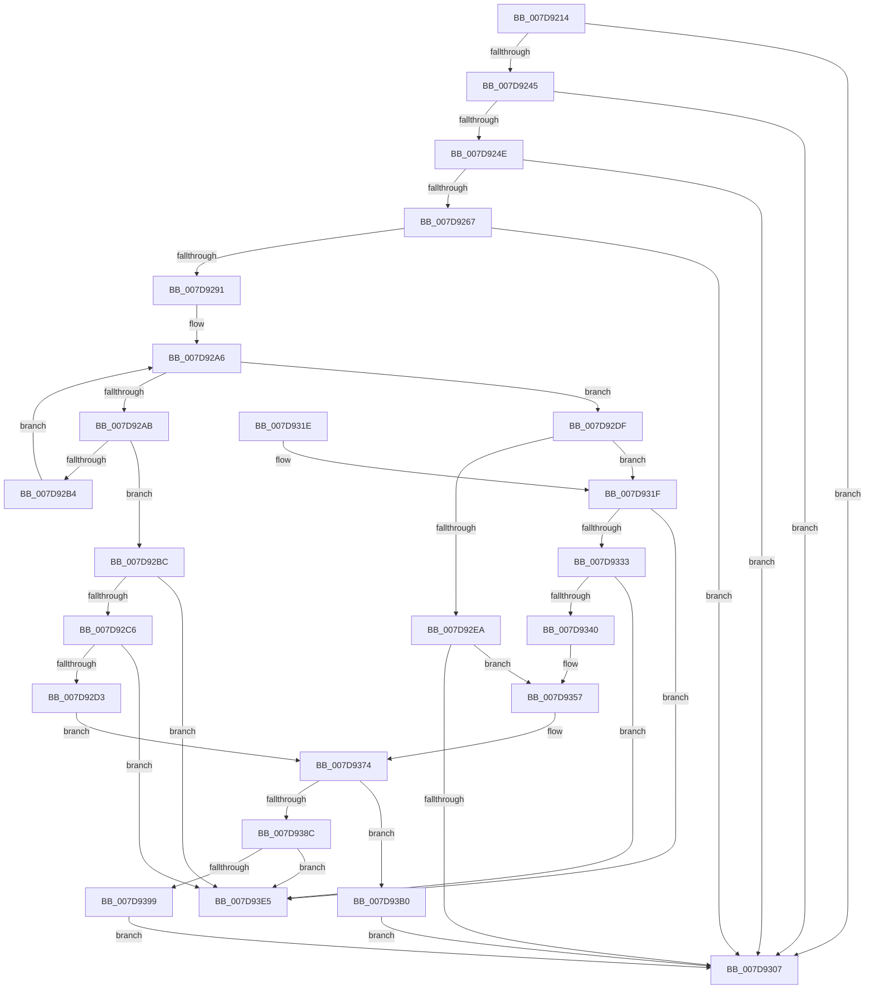

# WheapPfaMemoryCheck

- RVA: `0x007D9214`–`0x007D93EC` (길이 `472` bytes)
- VA: `0x00000001407D9214`
- 실행 섹션: `PAGE`
- PDB 이름 있음: `예`; PDB Function 태그: `아니요`
- unwind 정보 RVA: `0x000D6044`
- 디코드: `123`개 명령, `472/472` bytes 표시
- 미해석 바이트: `0` (있으면 어셈블리에 `.byte`로 보존)

> 이 문서는 커널 이미지의 기계어와 PDB 기호를 분석해 생성했습니다. 4번과 5번은 함수 원형과 자료형을 바이너리 사용 방식에서 추정한 C 해석이며 원본 소스 복구 결과는 아닙니다.

## 1. Dependencies

- 직접 호출 지점: **8**; 고유 호출 대상: **7**
- 직접 호출자로 확인된 함수: **1**
- RIP 상대 이미지 참조: **6**

### Outgoing calls
- `0x007D925A` → [MmGetPageBadStatus](../../text/67/MmGetPageBadStatus_function_0067A9B0.md) (function, `0x0067A9B0`)
- `0x007D927B` → [WheapPfaRetireExpiredMemoryEntries](WheapPfaRetireExpiredMemoryEntries_function_007D94DC.md) (function, `0x007D94DC`)
- `0x007D9288` → [WheapExecuteRowFailureCheck](WheapExecuteRowFailureCheck_function_007D8ED8.md) (function, `0x007D8ED8`)
- `0x007D92FA` → [ExAllocatePool2](../../poolcode/B8/ExAllocatePool2_function_00B820F0.md) (function, `0x00B820F0`)
- `0x007D9352` → [WheapPfaLogPageMonitorRemoval](WheapPfaLogPageMonitorRemoval_function_007D917C.md) (function, `0x007D917C`)
- `0x007D93B9` → [WheapPfaLogPageMonitorRemoval](WheapPfaLogPageMonitorRemoval_function_007D917C.md) (function, `0x007D917C`)
- `0x007D93CE` → [WheaAttemptPhysicalPageOffline](WheaAttemptPhysicalPageOffline_function_007D7380.md) (function, `0x007D7380`)
- `0x007D93DB` → [ExFreePoolWithTag](../../poolcode/B8/ExFreePoolWithTag_function_00B82870.md) (function, `0x00B82870`)

### Direct callers
- [sub_00B3D756](../B3/Unknown_function_00B3D756.md) at `0x00B3D7A7`

### Static image references
- `0x007D922F` → RVA `0x00E095E8` (`.data`; read)
- `0x007D9291` → RVA `0x00EEFB28` (`.data`; read)
- `0x007D92DF` → RVA `0x00E09608` (`.data`; read)
- `0x007D931F` → RVA `0x00EEFB30` (`.data`; read)
- `0x007D9381` → RVA `0x00E09628` (`.data`; read)
- `0x007D93A4` → RVA `0x00EEFB28` (`.data`; write)

## 2. Other-region calls and transfers

- 다른 실행 섹션으로 향하는 call: **3**
  - `0x007D925A` → [MmGetPageBadStatus](../../text/67/MmGetPageBadStatus_function_0067A9B0.md) (`PAGE` → `.text`)
  - `0x007D92FA` → [ExAllocatePool2](../../poolcode/B8/ExAllocatePool2_function_00B820F0.md) (`PAGE` → `POOLCODE`)
  - `0x007D93DB` → [ExFreePoolWithTag](../../poolcode/B8/ExFreePoolWithTag_function_00B82870.md) (`PAGE` → `POOLCODE`)
- 별도 외부 분기/꼬리 이동을 확인하지 못했습니다.

## 3. Assembly (complete function range)

```asm
007D9214  4C 8B DC                        mov r11, rsp
007D9217  49 89 5B 10                     mov qword ptr [r11 + 0x10], rbx
007D921B  49 89 6B 18                     mov qword ptr [r11 + 0x18], rbp
007D921F  49 89 4B 08                     mov qword ptr [r11 + 8], rcx
007D9223  56                              push rsi
007D9224  57                              push rdi
007D9225  41 54                           push r12
007D9227  41 56                           push r14
007D9229  41 57                           push r15
007D922B  48 83 EC 30                     sub rsp, 0x30
007D922F  48 8B 05 B2 03 63 00            mov rax, qword ptr [rip + 0x6303b2]
007D9236  45 33 F6                        xor r14d, r14d
007D9239  49 8B E8                        mov rbp, r8
007D923C  44 38 30                        cmp byte ptr [rax], r14b
007D923F  0F 85 C2 00 00 00               jne 0x1407d9307
007D9245  F6 02 02                        test byte ptr [rdx], 2
007D9248  0F 84 B9 00 00 00               je 0x1407d9307
007D924E  48 8B 7A 10                     mov rdi, qword ptr [rdx + 0x10]
007D9252  49 8D 4B 08                     lea rcx, [r11 + 8]
007D9256  49 89 7B 08                     mov qword ptr [r11 + 8], rdi
007D925A  E8 51 17 EA FF                  call 0x14067a9b0
007D925F  85 C0                           test eax, eax
007D9261  0F 85 A0 00 00 00               jne 0x1407d9307
007D9267  48 BE 08 00 00 00 80 F7 FF FF   movabs rsi, 0xfffff78000000008
007D9271  48 C1 EF 0C                     shr rdi, 0xc
007D9275  48 8B 36                        mov rsi, qword ptr [rsi]
007D9278  48 8B CE                        mov rcx, rsi
007D927B  E8 5C 02 00 00                  call 0x1407d94dc
007D9280  48 8B CF                        mov rcx, rdi
007D9283  48 89 6C 24 20                  mov qword ptr [rsp + 0x20], rbp
007D9288  E8 4B FC FF FF                  call 0x1407d8ed8
007D928D  84 C0                           test al, al
007D928F  75 76                           jne 0x1407d9307
007D9291  48 8B 1D 90 68 71 00            mov rbx, qword ptr [rip + 0x716890]
007D9298  4C 8D 3D 89 68 71 00            lea r15, [rip + 0x716889]
007D929F  41 8B CE                        mov ecx, r14d
007D92A2  45 8D 66 01                     lea r12d, [r14 + 1]
007D92A6  49 3B DF                        cmp rbx, r15
007D92A9  74 34                           je 0x1407d92df
007D92AB  48 8B 03                        mov rax, qword ptr [rbx]
007D92AE  48 39 7B 28                     cmp qword ptr [rbx + 0x28], rdi
007D92B2  74 08                           je 0x1407d92bc
007D92B4  41 03 CC                        add ecx, r12d
007D92B7  48 8B D8                        mov rbx, rax
007D92BA  EB EA                           jmp 0x1407d92a6
007D92BC  48 39 58 08                     cmp qword ptr [rax + 8], rbx
007D92C0  0F 85 1F 01 00 00               jne 0x1407d93e5
007D92C6  48 8B 4B 08                     mov rcx, qword ptr [rbx + 8]
007D92CA  48 39 19                        cmp qword ptr [rcx], rbx
007D92CD  0F 85 12 01 00 00               jne 0x1407d93e5
007D92D3  48 89 01                        mov qword ptr [rcx], rax
007D92D6  48 89 48 08                     mov qword ptr [rax + 8], rcx
007D92DA  E9 95 00 00 00                  jmp 0x1407d9374
007D92DF  48 8B 05 22 03 63 00            mov rax, qword ptr [rip + 0x630322]
007D92E6  3B 08                           cmp ecx, dword ptr [rax]
007D92E8  73 35                           jae 0x1407d931f
007D92EA  BA 30 00 00 00                  mov edx, 0x30
007D92EF  B9 02 01 00 00                  mov ecx, 0x102
007D92F4  41 B8 57 68 65 61               mov r8d, 0x61656857
007D92FA  E8 F1 8D 3A 00                  call 0x140b820f0
007D92FF  48 8B D8                        mov rbx, rax
007D9302  48 85 C0                        test rax, rax
007D9305  75 50                           jne 0x1407d9357
007D9307  48 8B 5C 24 68                  mov rbx, qword ptr [rsp + 0x68]
007D930C  48 8B 6C 24 70                  mov rbp, qword ptr [rsp + 0x70]
007D9311  48 83 C4 30                     add rsp, 0x30
007D9315  41 5F                           pop r15
007D9317  41 5E                           pop r14
007D9319  41 5C                           pop r12
007D931B  5F                              pop rdi
007D931C  5E                              pop rsi
007D931D  C3                              ret
007D931E  CC                              int3
007D931F  48 8B 1D 0A 68 71 00            mov rbx, qword ptr [rip + 0x71680a]
007D9326  48 8B 0B                        mov rcx, qword ptr [rbx]
007D9329  48 39 59 08                     cmp qword ptr [rcx + 8], rbx
007D932D  0F 85 B2 00 00 00               jne 0x1407d93e5
007D9333  48 8B 43 08                     mov rax, qword ptr [rbx + 8]
007D9337  48 39 18                        cmp qword ptr [rax], rbx
007D933A  0F 85 A5 00 00 00               jne 0x1407d93e5
007D9340  48 89 08                        mov qword ptr [rax], rcx
007D9343  4C 8B C6                        mov r8, rsi
007D9346  48 89 41 08                     mov qword ptr [rcx + 8], rax
007D934A  BA 03 00 00 00                  mov edx, 3
007D934F  48 8B CB                        mov rcx, rbx
007D9352  E8 25 FE FF FF                  call 0x1407d917c
007D9357  4C 89 33                        mov qword ptr [rbx], r14
007D935A  4C 89 73 08                     mov qword ptr [rbx + 8], r14
007D935E  44 89 73 12                     mov dword ptr [rbx + 0x12], r14d
007D9362  66 44 89 73 16                  mov word ptr [rbx + 0x16], r14w
007D9367  66 44 89 73 10                  mov word ptr [rbx + 0x10], r14w
007D936C  48 89 73 18                     mov qword ptr [rbx + 0x18], rsi
007D9370  48 89 7B 28                     mov qword ptr [rbx + 0x28], rdi
007D9374  66 44 01 63 10                  add word ptr [rbx + 0x10], r12w
007D9379  0F B7 4B 10                     movzx ecx, word ptr [rbx + 0x10]
007D937D  48 89 73 20                     mov qword ptr [rbx + 0x20], rsi
007D9381  48 8B 05 A0 02 63 00            mov rax, qword ptr [rip + 0x6302a0]
007D9388  3B 08                           cmp ecx, dword ptr [rax]
007D938A  73 24                           jae 0x1407d93b0
007D938C  48 8B 05 95 67 71 00            mov rax, qword ptr [rip + 0x716795]
007D9393  4C 39 78 08                     cmp qword ptr [rax + 8], r15
007D9397  75 4C                           jne 0x1407d93e5
007D9399  48 89 03                        mov qword ptr [rbx], rax
007D939C  4C 89 7B 08                     mov qword ptr [rbx + 8], r15
007D93A0  48 89 58 08                     mov qword ptr [rax + 8], rbx
007D93A4  48 89 1D 7D 67 71 00            mov qword ptr [rip + 0x71677d], rbx
007D93AB  E9 57 FF FF FF                  jmp 0x1407d9307
007D93B0  4C 8B C6                        mov r8, rsi
007D93B3  41 8B D4                        mov edx, r12d
007D93B6  48 8B CB                        mov rcx, rbx
007D93B9  E8 BE FD FF FF                  call 0x1407d917c
007D93BE  45 33 C9                        xor r9d, r9d
007D93C1  48 89 6C 24 20                  mov qword ptr [rsp + 0x20], rbp
007D93C6  45 33 C0                        xor r8d, r8d
007D93C9  33 D2                           xor edx, edx
007D93CB  48 8B CF                        mov rcx, rdi
007D93CE  E8 AD DF FF FF                  call 0x1407d7380
007D93D3  BA 57 68 65 61                  mov edx, 0x61656857
007D93D8  48 8B CB                        mov rcx, rbx
007D93DB  E8 90 94 3A 00                  call 0x140b82870
007D93E0  E9 22 FF FF FF                  jmp 0x1407d9307
007D93E5  B9 03 00 00 00                  mov ecx, 3
007D93EA  CD 29                           int 0x29
```

## 4. C-style interpretation (structured pseudocode)

```c
__int64 __fastcall WheapPfaMemoryCheck(__int64 a1, __int64 a2, __int64 a3, int a4)
{
    __int64 result;
    __int64 v_r14;
    __int64 v_rdi;
    __int64 v_rsp;
    unsigned __int64 v_stack_m38;
    unsigned __int64 v_stack_p10;
    unsigned __int64 v_stack_p18;
    unsigned __int64 v_stack_p20;

    *(unsigned __int64 *)(v_rsp + 16) = v_rbx;
    *(unsigned __int64 *)(v_rsp + 24) = v_rbp;
    *(unsigned __int64 *)(v_rsp + 8) = a1;
    v_rsp = (v_rsp) - (48);
    v_r14 = 0;
    if ((*(unsigned __int8 *)(*(unsigned __int64 *)(v_rip + 6489010))) != 0) goto loc_007D9307;
    if (((*(unsigned __int8 *)(a2)) & (2)) == 0) goto loc_007D9307;
    *(unsigned __int64 *)(v_rsp + 8) = *(unsigned __int64 *)(a2 + 16);
    result = MmGetPageBadStatus(v_rsp + 8, a2, a3, a4);
    if ((unsigned int)(result) != 0) goto loc_007D9307;
    v_rdi = (*(unsigned __int64 *)(a2 + 16)) >> (12);
    result = WheapPfaRetireExpiredMemoryEntries(*(unsigned __int64 *)(v_rsi), a2, a3, a4);
    v_stack_m38 = a3;
    result = WheapExecuteRowFailureCheck(v_rdi, a2, a3, a4);
    if ((unsigned __int8)(result) != 0) goto loc_007D9307;
loc_007D92A6:
    if ((*(unsigned __int64 *)(v_rip + 7432336)) == (v_rip + 7432329)) goto loc_007D92DF;
    if ((*(unsigned __int64 *)(*(unsigned __int64 *)(v_rip + 7432336) + 40)) == v_rdi) goto loc_007D92BC;
    a1 = (unsigned int)((0) + ((unsigned int)(v_r14 + 1)));
    goto loc_007D92A6;
loc_007D92BC:
    if ((*(unsigned __int64 *)(*(unsigned __int64 *)(*(unsigned __int64 *)(v_rip + 7432336)) + 8)) != (*(unsigned __int64 *)(*(unsigned __int64 *)(v_rip + 7432336)))) goto loc_007D93E5;
    if ((*(unsigned __int64 *)(*(unsigned __int64 *)(*(unsigned __int64 *)(*(unsigned __int64 *)(v_rip + 7432336)) + 8))) != (*(unsigned __int64 *)(*(unsigned __int64 *)(v_rip + 7432336)))) goto loc_007D93E5;
    *(unsigned __int64 *)(*(unsigned __int64 *)(*(unsigned __int64 *)(*(unsigned __int64 *)(v_rip + 7432336)) + 8)) = *(unsigned __int64 *)(*(unsigned __int64 *)(v_rip + 7432336));
    *(unsigned __int64 *)(*(unsigned __int64 *)(*(unsigned __int64 *)(v_rip + 7432336)) + 8) = *(unsigned __int64 *)(*(unsigned __int64 *)(*(unsigned __int64 *)(v_rip + 7432336)) + 8);
    goto loc_007D9374;
loc_007D92DF:
    if (((unsigned int)(*(unsigned __int64 *)(*(unsigned __int64 *)(*(unsigned __int64 *)(v_rip + 7432336)) + 8))) >= (*(unsigned int *)(*(unsigned __int64 *)(v_rip + 6488866)))) goto loc_007D931F;
    result = ExAllocatePool2(258, 48, (unsigned int)(0x61656857ULL), a4);
    if (result != 0) goto loc_007D9357;
loc_007D9307:
    v_rsp = (v_rsp) + (48);
    return result;
loc_007D931F:
    if ((*(unsigned __int64 *)(*(unsigned __int64 *)(*(unsigned __int64 *)(v_rip + 7432202)) + 8)) != (*(unsigned __int64 *)(v_rip + 7432202))) goto loc_007D93E5;
    if ((*(unsigned __int64 *)(*(unsigned __int64 *)(*(unsigned __int64 *)(v_rip + 7432202) + 8))) != (*(unsigned __int64 *)(v_rip + 7432202))) goto loc_007D93E5;
    *(unsigned __int64 *)(*(unsigned __int64 *)(*(unsigned __int64 *)(v_rip + 7432202) + 8)) = *(unsigned __int64 *)(*(unsigned __int64 *)(v_rip + 7432202));
    *(unsigned __int64 *)(*(unsigned __int64 *)(*(unsigned __int64 *)(v_rip + 7432202)) + 8) = *(unsigned __int64 *)(*(unsigned __int64 *)(v_rip + 7432202) + 8);
    result = WheapPfaLogPageMonitorRemoval(*(unsigned __int64 *)(v_rip + 7432202), 3, *(unsigned __int64 *)(v_rsi), a4);
loc_007D9357:
    *(unsigned __int64 *)(*(unsigned __int64 *)(v_rip + 7432202)) = 0;
    *(unsigned __int64 *)(*(unsigned __int64 *)(v_rip + 7432202) + 8) = 0;
    *(unsigned int *)(*(unsigned __int64 *)(v_rip + 7432202) + 18) = 0;
    *(unsigned __int16 *)(*(unsigned __int64 *)(v_rip + 7432202) + 22) = 0;
    *(unsigned __int16 *)(*(unsigned __int64 *)(v_rip + 7432202) + 16) = 0;
    *(unsigned __int64 *)(*(unsigned __int64 *)(v_rip + 7432202) + 24) = *(unsigned __int64 *)(v_rsi);
    *(unsigned __int64 *)(*(unsigned __int64 *)(v_rip + 7432202) + 40) = v_rdi;
loc_007D9374:
    *(unsigned __int64 *)(*(unsigned __int64 *)(v_rip + 7432202) + 32) = *(unsigned __int64 *)(v_rsi);
    if (((unsigned int)(*(unsigned __int16 *)(*(unsigned __int64 *)(v_rip + 7432202) + 16))) >= (*(unsigned int *)(*(unsigned __int64 *)(v_rip + 6488736)))) goto loc_007D93B0;
    if ((*(unsigned __int64 *)(*(unsigned __int64 *)(v_rip + 7432085) + 8)) != (v_rip + 7432329)) goto loc_007D93E5;
    *(unsigned __int64 *)(*(unsigned __int64 *)(v_rip + 7432202)) = *(unsigned __int64 *)(v_rip + 7432085);
    *(unsigned __int64 *)(*(unsigned __int64 *)(v_rip + 7432202) + 8) = v_rip + 7432329;
    *(unsigned __int64 *)(*(unsigned __int64 *)(v_rip + 7432085) + 8) = *(unsigned __int64 *)(v_rip + 7432202);
    *(unsigned __int64 *)(v_rip + 7432061) = *(unsigned __int64 *)(v_rip + 7432202);
    goto loc_007D9307;
loc_007D93B0:
    result = WheapPfaLogPageMonitorRemoval(*(unsigned __int64 *)(v_rip + 7432202), (unsigned int)((unsigned int)(v_r14 + 1)), *(unsigned __int64 *)(v_rsi), a4);
    a4 = 0;
    v_stack_p20 = v_stack_p18;
    a3 = 0;
    a2 = 0;
    result = WheaAttemptPhysicalPageOffline(v_rdi, a2, a3, a4);
    result = ExFreePoolWithTag(*(unsigned __int64 *)(v_rip + 7432202), (unsigned int)(0x61656857ULL), a3, a4);
    goto loc_007D9307;
loc_007D93E5:
    return result;
}
```

## 5. (Beta) C Style

```c
int64_t WheapPfaMemoryCheck(int64_t Arg1, void *Arg2, int64_t Arg3, int32_t Arg4)
{
    uint8_t *arg2 = (uint8_t *)Arg2;

    int64_t result;
    int64_t local_r14;
    int64_t local_rdi;
    int64_t local_rsp;
    uint64_t v_stack_m38;
    uint64_t v_stack_p10;
    uint64_t v_stack_p18;
    uint64_t v_stack_p20;

    *(uint64_t *)(local_rsp + 0x10) = local_rbx;
    *(uint64_t *)(local_rsp + 0x18) = local_rbp;
    *(uint64_t *)(local_rsp + 0x8) = Arg1;
    local_rsp = (local_rsp) - (48);
    local_r14 = 0;
    if ((*(uint8_t *)(*(uint64_t *)(v_rip + 0x6303B2))) != 0) goto loc_007D9307;
    if (((*(uint8_t *)(arg2)) & (2)) == 0) goto loc_007D9307;
    *(uint64_t *)(local_rsp + 0x8) = *(uint64_t *)(arg2 + 0x10);
    result = MmGetPageBadStatus(local_rsp + 8, Arg2, Arg3, Arg4);
    if ((uint32_t)(result) != 0) goto loc_007D9307;
    local_rdi = (*(uint64_t *)(arg2 + 0x10)) >> (12);
    result = WheapPfaRetireExpiredMemoryEntries(*(uint64_t *)(local_rsi), Arg2, Arg3, Arg4);
    v_stack_m38 = Arg3;
    result = WheapExecuteRowFailureCheck(local_rdi, Arg2, Arg3, Arg4);
    if ((uint8_t)(result) != 0) goto loc_007D9307;
loc_007D92A6:
    if ((*(uint64_t *)(v_rip + 0x716890)) == (v_rip + 7432329)) goto loc_007D92DF;
    if ((*(uint64_t *)(*(uint64_t *)(v_rip + 0x716890) + 0x28)) == local_rdi) goto loc_007D92BC;
    Arg1 = (uint32_t)((0) + ((uint32_t)(local_r14 + 1)));
    goto loc_007D92A6;
loc_007D92BC:
    if ((*(uint64_t *)(*(uint64_t *)(*(uint64_t *)(v_rip + 0x716890)) + 0x8)) != (*(uint64_t *)(*(uint64_t *)(v_rip + 0x716890)))) goto loc_007D93E5;
    if ((*(uint64_t *)(*(uint64_t *)(*(uint64_t *)(*(uint64_t *)(v_rip + 0x716890)) + 0x8))) != (*(uint64_t *)(*(uint64_t *)(v_rip + 0x716890)))) goto loc_007D93E5;
    *(uint64_t *)(*(uint64_t *)(*(uint64_t *)(*(uint64_t *)(v_rip + 0x716890)) + 0x8)) = *(uint64_t *)(*(uint64_t *)(v_rip + 0x716890));
    *(uint64_t *)(*(uint64_t *)(*(uint64_t *)(v_rip + 0x716890)) + 0x8) = *(uint64_t *)(*(uint64_t *)(*(uint64_t *)(v_rip + 0x716890)) + 0x8);
    goto loc_007D9374;
loc_007D92DF:
    if (((uint32_t)(*(uint64_t *)(*(uint64_t *)(*(uint64_t *)(v_rip + 0x716890)) + 0x8))) >= (*(uint32_t *)(*(uint64_t *)(v_rip + 0x630322)))) goto loc_007D931F;
    result = ExAllocatePool2(258, 48, (uint32_t)(0x61656857ULL), Arg4);
    if (result != 0) goto loc_007D9357;
loc_007D9307:
    local_rsp = (local_rsp) + (48);
    return result;
loc_007D931F:
    if ((*(uint64_t *)(*(uint64_t *)(*(uint64_t *)(v_rip + 0x71680A)) + 0x8)) != (*(uint64_t *)(v_rip + 0x71680A))) goto loc_007D93E5;
    if ((*(uint64_t *)(*(uint64_t *)(*(uint64_t *)(v_rip + 0x71680A) + 0x8))) != (*(uint64_t *)(v_rip + 0x71680A))) goto loc_007D93E5;
    *(uint64_t *)(*(uint64_t *)(*(uint64_t *)(v_rip + 0x71680A) + 0x8)) = *(uint64_t *)(*(uint64_t *)(v_rip + 0x71680A));
    *(uint64_t *)(*(uint64_t *)(*(uint64_t *)(v_rip + 0x71680A)) + 0x8) = *(uint64_t *)(*(uint64_t *)(v_rip + 0x71680A) + 0x8);
    result = WheapPfaLogPageMonitorRemoval(*(uint64_t *)(v_rip + 0x71680A), 3, *(uint64_t *)(local_rsi), Arg4);
loc_007D9357:
    *(uint64_t *)(*(uint64_t *)(v_rip + 0x71680A)) = 0;
    *(uint64_t *)(*(uint64_t *)(v_rip + 0x71680A) + 0x8) = 0;
    *(uint32_t *)(*(uint64_t *)(v_rip + 0x71680A) + 0x12) = 0;
    *(uint16_t *)(*(uint64_t *)(v_rip + 0x71680A) + 0x16) = 0;
    *(uint16_t *)(*(uint64_t *)(v_rip + 0x71680A) + 0x10) = 0;
    *(uint64_t *)(*(uint64_t *)(v_rip + 0x71680A) + 0x18) = *(uint64_t *)(local_rsi);
    *(uint64_t *)(*(uint64_t *)(v_rip + 0x71680A) + 0x28) = local_rdi;
loc_007D9374:
    *(uint64_t *)(*(uint64_t *)(v_rip + 0x71680A) + 0x20) = *(uint64_t *)(local_rsi);
    if (((uint32_t)(*(uint16_t *)(*(uint64_t *)(v_rip + 0x71680A) + 0x10))) >= (*(uint32_t *)(*(uint64_t *)(v_rip + 0x6302A0)))) goto loc_007D93B0;
    if ((*(uint64_t *)(*(uint64_t *)(v_rip + 0x716795) + 0x8)) != (v_rip + 7432329)) goto loc_007D93E5;
    *(uint64_t *)(*(uint64_t *)(v_rip + 0x71680A)) = *(uint64_t *)(v_rip + 0x716795);
    *(uint64_t *)(*(uint64_t *)(v_rip + 0x71680A) + 0x8) = v_rip + 7432329;
    *(uint64_t *)(*(uint64_t *)(v_rip + 0x716795) + 0x8) = *(uint64_t *)(v_rip + 0x71680A);
    *(uint64_t *)(v_rip + 0x71677D) = *(uint64_t *)(v_rip + 0x71680A);
    goto loc_007D9307;
loc_007D93B0:
    result = WheapPfaLogPageMonitorRemoval(*(uint64_t *)(v_rip + 0x71680A), (uint32_t)((uint32_t)(local_r14 + 1)), *(uint64_t *)(local_rsi), Arg4);
    Arg4 = 0;
    v_stack_p20 = v_stack_p18;
    Arg3 = 0;
    Arg2 = 0;
    result = WheaAttemptPhysicalPageOffline(local_rdi, Arg2, Arg3, Arg4);
    result = ExFreePoolWithTag(*(uint64_t *)(v_rip + 0x71680A), (uint32_t)(0x61656857ULL), Arg3, Arg4);
    goto loc_007D9307;
loc_007D93E5:
    return result;
}
```

### 관측된 메모리 오프셋

구조체 형식이 확인되지 않은 접근은 인자 기준의 오프셋으로만 기록했습니다.

| 기준 인자 | 오프셋 표현 | 폭 (bit) | 접근 |
|---|---:|---:|---|
| `Arg2` | `+ 0x0` | `8` | `R` |
| `Arg2` | `+ 0x10` | `64` | `R` |

## 6. Execution-region graph

[열기: 2D/3D 그래프와 함수 탐색 컨트롤 패널](../../../control-panel.html?section=page&rva=0x007D9214&view=graph)

- 2D 그래프는 위에서 아래로 흐르고, 3D 그래프는 빈 공간을 드래그해 회전합니다. Shift+드래그는 이동, 휠은 확대·축소, 함수 노드 선택은 대상 보고서 이동입니다.

### Static fallback


