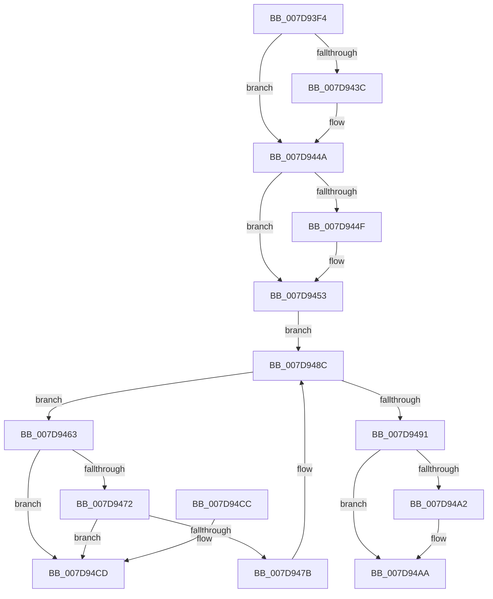

# WheapPfaReset

- RVA: `0x007D93F4`–`0x007D94D4` (길이 `224` bytes)
- VA: `0x00000001407D93F4`
- 실행 섹션: `PAGE`
- PDB 이름 있음: `예`; PDB Function 태그: `아니요`
- unwind 정보 RVA: `0x00069AD0`
- 디코드: `59`개 명령, `224/224` bytes 표시
- 미해석 바이트: `0` (있으면 어셈블리에 `.byte`로 보존)

> 이 문서는 커널 이미지의 기계어와 PDB 기호를 분석해 생성했습니다. 4번과 5번은 함수 원형과 자료형을 바이너리 사용 방식에서 추정한 C 해석이며 원본 소스 복구 결과는 아닙니다.

## 1. Dependencies

- 직접 호출 지점: **6**; 고유 호출 대상: **6**
- 직접 호출자로 확인된 함수: **1**
- RIP 상대 이미지 참조: **3**

### Outgoing calls
- `0x007D942C` → [KeAbPreAcquire](../../text/21/KeAbPreAcquire_function_00210230.md) (function, `0x00210230`)
- `0x007D9445` → [ExfAcquirePushLockExclusiveEx](../../text/20/ExfAcquirePushLockExclusiveEx_function_0020FC90.md) (function, `0x0020FC90`)
- `0x007D9487` → [ExFreePoolWithTag](../../poolcode/B8/ExFreePoolWithTag_function_00B82870.md) (function, `0x00B82870`)
- `0x007D94A5` → [ExfTryToWakePushLock](../../text/26/ExfTryToWakePushLock_function_00265DD0.md) (function, `0x00265DD0`)
- `0x007D94AD` → [KeAbPostRelease](../../text/2E/KeAbPostRelease_function_002E1600.md) (function, `0x002E1600`)
- `0x007D94B2` → [KeLeaveCriticalRegion](../../text/25/KeLeaveCriticalRegion_function_0025D8B0.md) (function, `0x0025D8B0`)

### Direct callers
- [WheaRegChangeNotifyCallback](WheaRegChangeNotifyCallback_function_007D8A50.md) at `0x007D8BE3`

### Static image references
- `0x007D9411` → RVA `0x00EEFB18` (`.data`; read)
- `0x007D9453` → RVA `0x00EEFB28` (`.data`; read)
- `0x007D9491` → RVA `0x00EEFB18` (`.data`; read/write)

## 2. Other-region calls and transfers

- 다른 실행 섹션으로 향하는 call: **6**
  - `0x007D942C` → [KeAbPreAcquire](../../text/21/KeAbPreAcquire_function_00210230.md) (`PAGE` → `.text`)
  - `0x007D9445` → [ExfAcquirePushLockExclusiveEx](../../text/20/ExfAcquirePushLockExclusiveEx_function_0020FC90.md) (`PAGE` → `.text`)
  - `0x007D9487` → [ExFreePoolWithTag](../../poolcode/B8/ExFreePoolWithTag_function_00B82870.md) (`PAGE` → `POOLCODE`)
  - `0x007D94A5` → [ExfTryToWakePushLock](../../text/26/ExfTryToWakePushLock_function_00265DD0.md) (`PAGE` → `.text`)
  - `0x007D94AD` → [KeAbPostRelease](../../text/2E/KeAbPostRelease_function_002E1600.md) (`PAGE` → `.text`)
  - `0x007D94B2` → [KeLeaveCriticalRegion](../../text/25/KeLeaveCriticalRegion_function_0025D8B0.md) (`PAGE` → `.text`)
- 별도 외부 분기/꼬리 이동을 확인하지 못했습니다.

## 3. Assembly (complete function range)

```asm
007D93F4  48 89 5C 24 08                  mov qword ptr [rsp + 8], rbx
007D93F9  48 89 6C 24 10                  mov qword ptr [rsp + 0x10], rbp
007D93FE  48 89 74 24 18                  mov qword ptr [rsp + 0x18], rsi
007D9403  57                              push rdi
007D9404  48 83 EC 20                     sub rsp, 0x20
007D9408  65 48 8B 04 25 88 01 00 00      mov rax, qword ptr gs:[0x188]
007D9411  48 8D 35 00 67 71 00            lea rsi, [rip + 0x716700]
007D9418  48 83 CB FF                     or rbx, 0xffffffffffffffff
007D941C  45 33 C0                        xor r8d, r8d
007D941F  33 D2                           xor edx, edx
007D9421  48 8B CE                        mov rcx, rsi
007D9424  66 01 98 E4 01 00 00            add word ptr [rax + 0x1e4], bx
007D942B  90                              nop
007D942C  E8 FF 6D A3 FF                  call 0x140210230
007D9431  F0 48 0F BA 2E 00               lock bts qword ptr [rsi], 0
007D9437  48 8B F8                        mov rdi, rax
007D943A  73 0E                           jae 0x1407d944a
007D943C  4C 8B C6                        mov r8, rsi
007D943F  48 8B D0                        mov rdx, rax
007D9442  48 8B CE                        mov rcx, rsi
007D9445  E8 46 68 A3 FF                  call 0x14020fc90
007D944A  48 85 FF                        test rdi, rdi
007D944D  74 04                           je 0x1407d9453
007D944F  C6 47 0A 01                     mov byte ptr [rdi + 0xa], 1
007D9453  48 8B 3D CE 66 71 00            mov rdi, qword ptr [rip + 0x7166ce]
007D945A  48 8D 2D C7 66 71 00            lea rbp, [rip + 0x7166c7]
007D9461  EB 29                           jmp 0x1407d948c
007D9463  48 8B 07                        mov rax, qword ptr [rdi]
007D9466  48 8B CF                        mov rcx, rdi
007D9469  48 8B F8                        mov rdi, rax
007D946C  48 39 48 08                     cmp qword ptr [rax + 8], rcx
007D9470  75 5B                           jne 0x1407d94cd
007D9472  48 8B 51 08                     mov rdx, qword ptr [rcx + 8]
007D9476  48 39 0A                        cmp qword ptr [rdx], rcx
007D9479  75 52                           jne 0x1407d94cd
007D947B  48 89 02                        mov qword ptr [rdx], rax
007D947E  48 89 50 08                     mov qword ptr [rax + 8], rdx
007D9482  BA 57 68 65 61                  mov edx, 0x61656857
007D9487  E8 E4 93 3A 00                  call 0x140b82870
007D948C  48 3B FD                        cmp rdi, rbp
007D948F  75 D2                           jne 0x1407d9463
007D9491  F0 48 0F C1 1D 7E 66 71 00      lock xadd qword ptr [rip + 0x71667e], rbx
007D949A  80 E3 06                        and bl, 6
007D949D  80 FB 02                        cmp bl, 2
007D94A0  75 08                           jne 0x1407d94aa
007D94A2  48 8B CE                        mov rcx, rsi
007D94A5  E8 26 C9 A8 FF                  call 0x140265dd0
007D94AA  48 8B CE                        mov rcx, rsi
007D94AD  E8 4E 81 B0 FF                  call 0x1402e1600
007D94B2  E8 F9 43 A8 FF                  call 0x14025d8b0
007D94B7  48 8B 5C 24 30                  mov rbx, qword ptr [rsp + 0x30]
007D94BC  48 8B 6C 24 38                  mov rbp, qword ptr [rsp + 0x38]
007D94C1  48 8B 74 24 40                  mov rsi, qword ptr [rsp + 0x40]
007D94C6  48 83 C4 20                     add rsp, 0x20
007D94CA  5F                              pop rdi
007D94CB  C3                              ret
007D94CC  CC                              int3
007D94CD  B9 03 00 00 00                  mov ecx, 3
007D94D2  CD 29                           int 0x29
```

## 4. C-style interpretation (structured pseudocode)

```c
__int64 __fastcall WheapPfaReset(__int64 a1, int a2, int a3)
{
    __int64 result;
    __int64 v_rbx;
    __int64 v_rsp;
    unsigned __int64 v_stack_p10;
    unsigned __int64 v_stack_p18;
    unsigned __int64 v_stack_p8;

    v_stack_p8 = v_rbx;
    v_stack_p10 = v_rbp;
    v_stack_p18 = v_rsi;
    v_rsp = (v_rsp) - (32);
    v_rbx = (v_rbx) | (-1);
    a3 = 0;
    a2 = 0;
    result = KeAbPreAcquire(v_rip + 7431936, a2, a3, a4);
    if (!(condition_is_above_or_equal)) {
        a3 = v_rip + 7431936;
        a2 = result;
        a1 = v_rip + 7431936;
        result = ExfAcquirePushLockExclusiveEx(a1, a2, a3, a4);
    }
    if (result != 0) {
        *(unsigned __int8 *)(result + 10) = 1;
    }
    goto loc_007D948C;
loc_007D9463:
    if ((*(unsigned __int64 *)(*(unsigned __int64 *)(*(unsigned __int64 *)(v_rip + 7431886)) + 8)) != (*(unsigned __int64 *)(v_rip + 7431886))) goto loc_007D94CD;
    if ((*(unsigned __int64 *)(*(unsigned __int64 *)(*(unsigned __int64 *)(v_rip + 7431886) + 8))) != (*(unsigned __int64 *)(v_rip + 7431886))) goto loc_007D94CD;
    *(unsigned __int64 *)(*(unsigned __int64 *)(*(unsigned __int64 *)(v_rip + 7431886) + 8)) = *(unsigned __int64 *)(*(unsigned __int64 *)(v_rip + 7431886));
    *(unsigned __int64 *)(*(unsigned __int64 *)(*(unsigned __int64 *)(v_rip + 7431886)) + 8) = *(unsigned __int64 *)(*(unsigned __int64 *)(v_rip + 7431886) + 8);
    result = ExFreePoolWithTag(*(unsigned __int64 *)(v_rip + 7431886), (unsigned int)(0x61656857ULL), a3, a4);
loc_007D948C:
    if ((*(unsigned __int64 *)(*(unsigned __int64 *)(v_rip + 7431886))) != (v_rip + 7431879)) goto loc_007D9463;
    v_rbx = (unsigned __int8)((v_rbx) & (6));
    if (((unsigned __int8)(v_rbx)) == 2) {
        a1 = v_rip + 7431936;
        result = ExfTryToWakePushLock(a1, (unsigned int)(0x61656857ULL), a3, a4);
    }
    result = KeAbPostRelease(v_rip + 7431936, (unsigned int)(0x61656857ULL), a3, a4);
    result = KeLeaveCriticalRegion(v_rip + 7431936, (unsigned int)(0x61656857ULL), a3, a4);
    v_rsp = (v_rsp) + (32);
    return result;
loc_007D94CD:
    return result;
}
```

## 5. (Beta) C Style

```c
int64_t WheapPfaReset(int64_t Arg1, int32_t Arg2, int32_t Arg3)
{
    int64_t result;
    int64_t local_rbx;
    int64_t local_rsp;
    uint64_t v_stack_p10;
    uint64_t v_stack_p18;
    uint64_t v_stack_p8;

    v_stack_p8 = local_rbx;
    v_stack_p10 = local_rbp;
    v_stack_p18 = local_rsi;
    local_rsp = (local_rsp) - (32);
    local_rbx = (local_rbx) | (-1);
    Arg3 = 0;
    Arg2 = 0;
    result = KeAbPreAcquire(v_rip + 7431936, Arg2, Arg3, a4);
    if (!(condition_is_above_or_equal)) {
        Arg3 = v_rip + 7431936;
        Arg2 = result;
        Arg1 = v_rip + 7431936;
        result = ExfAcquirePushLockExclusiveEx(Arg1, Arg2, Arg3, a4);
    }
    if (result != 0) {
        *(uint8_t *)(result + 0xA) = 1;
    }
    goto loc_007D948C;
loc_007D9463:
    if ((*(uint64_t *)(*(uint64_t *)(*(uint64_t *)(v_rip + 0x7166CE)) + 0x8)) != (*(uint64_t *)(v_rip + 0x7166CE))) goto loc_007D94CD;
    if ((*(uint64_t *)(*(uint64_t *)(*(uint64_t *)(v_rip + 0x7166CE) + 0x8))) != (*(uint64_t *)(v_rip + 0x7166CE))) goto loc_007D94CD;
    *(uint64_t *)(*(uint64_t *)(*(uint64_t *)(v_rip + 0x7166CE) + 0x8)) = *(uint64_t *)(*(uint64_t *)(v_rip + 0x7166CE));
    *(uint64_t *)(*(uint64_t *)(*(uint64_t *)(v_rip + 0x7166CE)) + 0x8) = *(uint64_t *)(*(uint64_t *)(v_rip + 0x7166CE) + 0x8);
    result = ExFreePoolWithTag(*(uint64_t *)(v_rip + 0x7166CE), (uint32_t)(0x61656857ULL), Arg3, a4);
loc_007D948C:
    if ((*(uint64_t *)(*(uint64_t *)(v_rip + 0x7166CE))) != (v_rip + 7431879)) goto loc_007D9463;
    local_rbx = (uint8_t)((local_rbx) & (6));
    if (((uint8_t)(local_rbx)) == 2) {
        Arg1 = v_rip + 7431936;
        result = ExfTryToWakePushLock(Arg1, (uint32_t)(0x61656857ULL), Arg3, a4);
    }
    result = KeAbPostRelease(v_rip + 7431936, (uint32_t)(0x61656857ULL), Arg3, a4);
    result = KeLeaveCriticalRegion(v_rip + 7431936, (uint32_t)(0x61656857ULL), Arg3, a4);
    local_rsp = (local_rsp) + (32);
    return result;
loc_007D94CD:
    return result;
}
```

## 6. Execution-region graph

[열기: 2D/3D 그래프와 함수 탐색 컨트롤 패널](../../../control-panel.html?section=page&rva=0x007D93F4&view=graph)

- 2D 그래프는 위에서 아래로 흐르고, 3D 그래프는 빈 공간을 드래그해 회전합니다. Shift+드래그는 이동, 휠은 확대·축소, 함수 노드 선택은 대상 보고서 이동입니다.

### Static fallback


