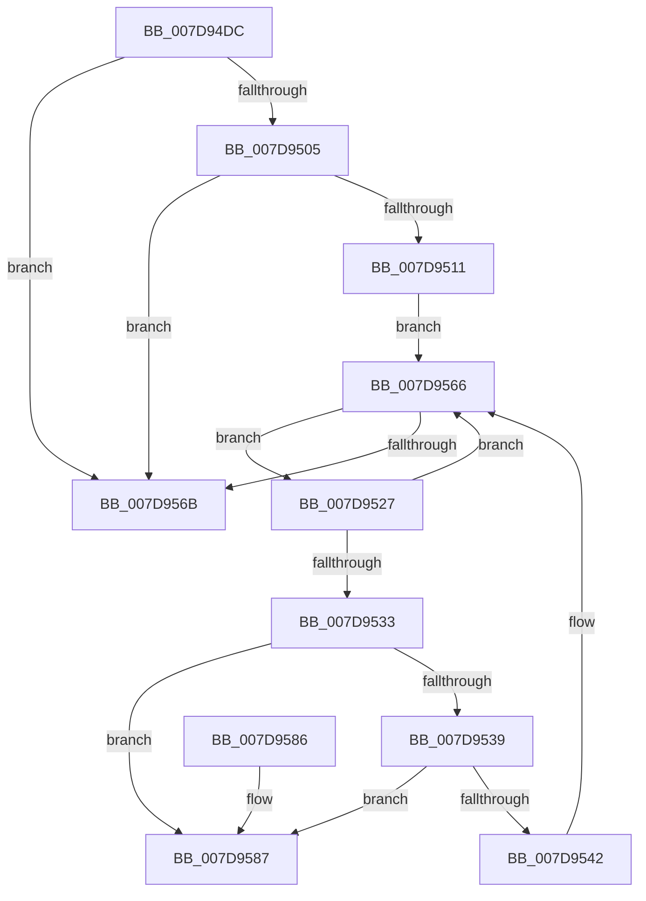

# WheapPfaRetireExpiredMemoryEntries

- RVA: `0x007D94DC`–`0x007D958E` (길이 `178` bytes)
- VA: `0x00000001407D94DC`
- 실행 섹션: `PAGE`
- PDB 이름 있음: `예`; PDB Function 태그: `아니요`
- unwind 정보 RVA: `0x0006B020`
- 디코드: `50`개 명령, `178/178` bytes 표시
- 미해석 바이트: `0` (있으면 어셈블리에 `.byte`로 보존)

> 이 문서는 커널 이미지의 기계어와 PDB 기호를 분석해 생성했습니다. 4번과 5번은 함수 원형과 자료형을 바이너리 사용 방식에서 추정한 C 해석이며 원본 소스 복구 결과는 아닙니다.

## 1. Dependencies

- 직접 호출 지점: **2**; 고유 호출 대상: **2**
- 직접 호출자로 확인된 함수: **1**
- RIP 상대 이미지 참조: **2**

### Outgoing calls
- `0x007D9554` → [WheapPfaLogPageMonitorRemoval](WheapPfaLogPageMonitorRemoval_function_007D917C.md) (function, `0x007D917C`)
- `0x007D9561` → [ExFreePoolWithTag](../../poolcode/B8/ExFreePoolWithTag_function_00B82870.md) (function, `0x00B82870`)

### Direct callers
- [WheapPfaMemoryCheck](WheapPfaMemoryCheck_function_007D9214.md) at `0x007D927B`

### Static image references
- `0x007D94F5` → RVA `0x00E09648` (`.data`; read)
- `0x007D9511` → RVA `0x00EEFB28` (`.data`; read)

## 2. Other-region calls and transfers

- 다른 실행 섹션으로 향하는 call: **1**
  - `0x007D9561` → [ExFreePoolWithTag](../../poolcode/B8/ExFreePoolWithTag_function_00B82870.md) (`PAGE` → `POOLCODE`)
- 별도 외부 분기/꼬리 이동을 확인하지 못했습니다.

## 3. Assembly (complete function range)

```asm
007D94DC  48 8B C4                        mov rax, rsp
007D94DF  48 89 58 08                     mov qword ptr [rax + 8], rbx
007D94E3  48 89 68 10                     mov qword ptr [rax + 0x10], rbp
007D94E7  48 89 70 18                     mov qword ptr [rax + 0x18], rsi
007D94EB  48 89 78 20                     mov qword ptr [rax + 0x20], rdi
007D94EF  41 56                           push r14
007D94F1  48 83 EC 20                     sub rsp, 0x20
007D94F5  48 8B 05 4C 01 63 00            mov rax, qword ptr [rip + 0x63014c]
007D94FC  48 8B F1                        mov rsi, rcx
007D94FF  8B 10                           mov edx, dword ptr [rax]
007D9501  85 D2                           test edx, edx
007D9503  74 66                           je 0x1407d956b
007D9505  48 69 D2 80 96 98 00            imul rdx, rdx, 0x989680
007D950C  48 3B CA                        cmp rcx, rdx
007D950F  72 5A                           jb 0x1407d956b
007D9511  48 8B 1D 10 66 71 00            mov rbx, qword ptr [rip + 0x716610]
007D9518  4C 8D 35 09 66 71 00            lea r14, [rip + 0x716609]
007D951F  48 8B E9                        mov rbp, rcx
007D9522  48 2B EA                        sub rbp, rdx
007D9525  EB 3F                           jmp 0x1407d9566
007D9527  48 8B FB                        mov rdi, rbx
007D952A  48 8B 1B                        mov rbx, qword ptr [rbx]
007D952D  48 39 6F 20                     cmp qword ptr [rdi + 0x20], rbp
007D9531  77 33                           ja 0x1407d9566
007D9533  48 39 7B 08                     cmp qword ptr [rbx + 8], rdi
007D9537  75 4E                           jne 0x1407d9587
007D9539  48 8B 47 08                     mov rax, qword ptr [rdi + 8]
007D953D  48 39 38                        cmp qword ptr [rax], rdi
007D9540  75 45                           jne 0x1407d9587
007D9542  48 89 18                        mov qword ptr [rax], rbx
007D9545  4C 8B C6                        mov r8, rsi
007D9548  BA 02 00 00 00                  mov edx, 2
007D954D  48 89 43 08                     mov qword ptr [rbx + 8], rax
007D9551  48 8B CF                        mov rcx, rdi
007D9554  E8 23 FC FF FF                  call 0x1407d917c
007D9559  BA 57 68 65 61                  mov edx, 0x61656857
007D955E  48 8B CF                        mov rcx, rdi
007D9561  E8 0A 93 3A 00                  call 0x140b82870
007D9566  49 3B DE                        cmp rbx, r14
007D9569  75 BC                           jne 0x1407d9527
007D956B  48 8B 5C 24 30                  mov rbx, qword ptr [rsp + 0x30]
007D9570  48 8B 6C 24 38                  mov rbp, qword ptr [rsp + 0x38]
007D9575  48 8B 74 24 40                  mov rsi, qword ptr [rsp + 0x40]
007D957A  48 8B 7C 24 48                  mov rdi, qword ptr [rsp + 0x48]
007D957F  48 83 C4 20                     add rsp, 0x20
007D9583  41 5E                           pop r14
007D9585  C3                              ret
007D9586  CC                              int3
007D9587  B9 03 00 00 00                  mov ecx, 3
007D958C  CD 29                           int 0x29
```

## 4. C-style interpretation (structured pseudocode)

```c
__int64 __fastcall WheapPfaRetireExpiredMemoryEntries(__int64 a1)
{
    __int64 result;
    __int64 v_rbp;
    __int64 v_rsp;
    unsigned __int64 v_stack_p10;
    unsigned __int64 v_stack_p18;
    unsigned __int64 v_stack_p20;
    unsigned __int64 v_stack_p8;

    *(unsigned __int64 *)(v_rsp + 8) = v_rbx;
    *(unsigned __int64 *)(v_rsp + 16) = v_rbp;
    *(unsigned __int64 *)(v_rsp + 24) = v_rsi;
    *(unsigned __int64 *)(v_rsp + 32) = v_rdi;
    v_rsp = (v_rsp) - (32);
    if ((unsigned int)((unsigned int)(*(unsigned int *)(*(unsigned __int64 *)(v_rip + 6488396)))) == 0) goto loc_007D956B;
    a2 = ((unsigned int)(*(unsigned int *)(*(unsigned __int64 *)(v_rip + 6488396)))) * ((unsigned int)(*(unsigned int *)(*(unsigned __int64 *)(v_rip + 6488396))));
    if (a1 < a2) goto loc_007D956B;
    v_rbp = (a1) - (a2);
    goto loc_007D9566;
loc_007D9527:
    if ((*(unsigned __int64 *)(*(unsigned __int64 *)(v_rip + 7431696) + 32)) > v_rbp) goto loc_007D9566;
    if ((*(unsigned __int64 *)(*(unsigned __int64 *)(*(unsigned __int64 *)(v_rip + 7431696)) + 8)) != (*(unsigned __int64 *)(v_rip + 7431696))) goto loc_007D9587;
    if ((*(unsigned __int64 *)(*(unsigned __int64 *)(*(unsigned __int64 *)(v_rip + 7431696) + 8))) != (*(unsigned __int64 *)(v_rip + 7431696))) goto loc_007D9587;
    *(unsigned __int64 *)(*(unsigned __int64 *)(*(unsigned __int64 *)(v_rip + 7431696) + 8)) = *(unsigned __int64 *)(*(unsigned __int64 *)(v_rip + 7431696));
    *(unsigned __int64 *)(*(unsigned __int64 *)(*(unsigned __int64 *)(v_rip + 7431696)) + 8) = *(unsigned __int64 *)(*(unsigned __int64 *)(v_rip + 7431696) + 8);
    result = WheapPfaLogPageMonitorRemoval(*(unsigned __int64 *)(v_rip + 7431696), 2, a1, a4);
    result = ExFreePoolWithTag(*(unsigned __int64 *)(v_rip + 7431696), (unsigned int)(0x61656857ULL), a1, a4);
loc_007D9566:
    if ((*(unsigned __int64 *)(*(unsigned __int64 *)(v_rip + 7431696))) != (v_rip + 7431689)) goto loc_007D9527;
loc_007D956B:
    v_rsp = (v_rsp) + (32);
    return result;
loc_007D9587:
    return result;
}
```

## 5. (Beta) C Style

```c
int64_t WheapPfaRetireExpiredMemoryEntries(int64_t Arg1)
{
    int64_t result;
    int64_t local_rbp;
    int64_t local_rsp;
    uint64_t v_stack_p10;
    uint64_t v_stack_p18;
    uint64_t v_stack_p20;
    uint64_t v_stack_p8;

    *(uint64_t *)(local_rsp + 0x8) = local_rbx;
    *(uint64_t *)(local_rsp + 0x10) = local_rbp;
    *(uint64_t *)(local_rsp + 0x18) = local_rsi;
    *(uint64_t *)(local_rsp + 0x20) = local_rdi;
    local_rsp = (local_rsp) - (32);
    if ((uint32_t)((uint32_t)(*(uint32_t *)(*(uint64_t *)(v_rip + 0x63014C)))) == 0) goto loc_007D956B;
    a2 = ((uint32_t)(*(uint32_t *)(*(uint64_t *)(v_rip + 0x63014C)))) * ((uint32_t)(*(uint32_t *)(*(uint64_t *)(v_rip + 0x63014C))));
    if (Arg1 < a2) goto loc_007D956B;
    local_rbp = (Arg1) - (a2);
    goto loc_007D9566;
loc_007D9527:
    if ((*(uint64_t *)(*(uint64_t *)(v_rip + 0x716610) + 0x20)) > local_rbp) goto loc_007D9566;
    if ((*(uint64_t *)(*(uint64_t *)(*(uint64_t *)(v_rip + 0x716610)) + 0x8)) != (*(uint64_t *)(v_rip + 0x716610))) goto loc_007D9587;
    if ((*(uint64_t *)(*(uint64_t *)(*(uint64_t *)(v_rip + 0x716610) + 0x8))) != (*(uint64_t *)(v_rip + 0x716610))) goto loc_007D9587;
    *(uint64_t *)(*(uint64_t *)(*(uint64_t *)(v_rip + 0x716610) + 0x8)) = *(uint64_t *)(*(uint64_t *)(v_rip + 0x716610));
    *(uint64_t *)(*(uint64_t *)(*(uint64_t *)(v_rip + 0x716610)) + 0x8) = *(uint64_t *)(*(uint64_t *)(v_rip + 0x716610) + 0x8);
    result = WheapPfaLogPageMonitorRemoval(*(uint64_t *)(v_rip + 0x716610), 2, Arg1, a4);
    result = ExFreePoolWithTag(*(uint64_t *)(v_rip + 0x716610), (uint32_t)(0x61656857ULL), Arg1, a4);
loc_007D9566:
    if ((*(uint64_t *)(*(uint64_t *)(v_rip + 0x716610))) != (v_rip + 7431689)) goto loc_007D9527;
loc_007D956B:
    local_rsp = (local_rsp) + (32);
    return result;
loc_007D9587:
    return result;
}
```

## 6. Execution-region graph

[열기: 2D/3D 그래프와 함수 탐색 컨트롤 패널](../../../control-panel.html?section=page&rva=0x007D94DC&view=graph)

- 2D 그래프는 위에서 아래로 흐르고, 3D 그래프는 빈 공간을 드래그해 회전합니다. Shift+드래그는 이동, 휠은 확대·축소, 함수 노드 선택은 대상 보고서 이동입니다.

### Static fallback


