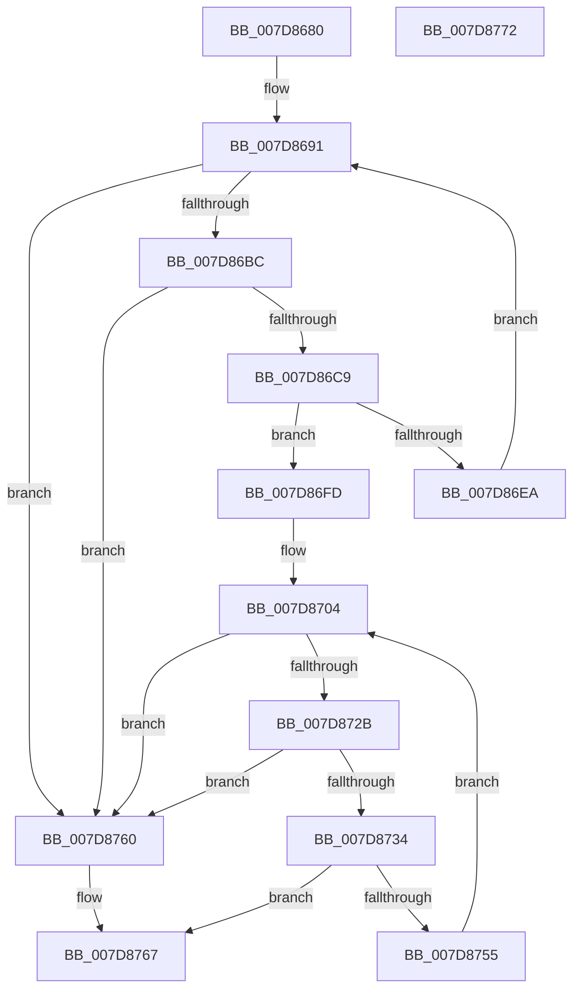

# WheapProcessWaitingETWEvents

- RVA: `0x007D8680`–`0x007D8773` (길이 `243` bytes)
- VA: `0x00000001407D8680`
- 실행 섹션: `PAGE`
- PDB 이름 있음: `예`; PDB Function 태그: `아니요`
- unwind 정보 RVA: `0x0006E5F8`
- 디코드: `60`개 명령, `243/243` bytes 표시
- 미해석 바이트: `0` (있으면 어셈블리에 `.byte`로 보존)

> 이 문서는 커널 이미지의 기계어와 PDB 기호를 분석해 생성했습니다. 4번과 5번은 함수 원형과 자료형을 바이너리 사용 방식에서 추정한 C 해석이며 원본 소스 복구 결과는 아닙니다.

## 1. Dependencies

- 직접 호출 지점: **7**; 고유 호출 대상: **5**
- 직접 호출자로 확인된 함수: **2**
- RIP 상대 이미지 참조: **6**

### Outgoing calls
- `0x007D86A6` → [KeWaitForSingleObject](../../text/20/KeWaitForSingleObject_function_0020E6B0.md) (function, `0x0020E6B0`)
- `0x007D86E0` → [KeSetEvent](../../text/33/KeSetEvent_function_0033F310.md) (function, `0x0033F310`)
- `0x007D86EE` → [WheapGenerateETWEvents](../../text/48/WheapGenerateETWEvents_function_0048494C.md) (function, `0x0048494C`)
- `0x007D86F6` → [WheapFreeErrorRecord](../../text/48/WheapFreeErrorRecord_function_0048491C.md) (function, `0x0048491C`)
- `0x007D8719` → [KeWaitForSingleObject](../../text/20/KeWaitForSingleObject_function_0020E6B0.md) (function, `0x0020E6B0`)
- `0x007D874B` → [KeSetEvent](../../text/33/KeSetEvent_function_0033F310.md) (function, `0x0033F310`)
- `0x007D8759` → [WheaLogInternalEvent](../../text/66/WheaLogInternalEvent_function_006605B0.md) (function, `0x006605B0`)

### Direct callers
- [WheaProcessWaitingETWEvents](../../text/66/WheaProcessWaitingETWEvents_function_006607A0.md) at `0x006607AC`
- [WheapEtwEnableCallback](WheapEtwEnableCallback_function_007D83D0.md) at `0x007D83E4`

### Static image references
- `0x007D868A` → RVA `0x00EF9F40` (`.data`; read)
- `0x007D8697` → RVA `0x00EF9F20` (`.data`; read)
- `0x007D86C9` → RVA `0x00EF9F40` (`.data`; write)
- `0x007D86FD` → RVA `0x00EF9EE0` (`.data`; read)
- `0x007D870A` → RVA `0x00EF7E40` (`.data`; read)
- `0x007D8734` → RVA `0x00EF9EE0` (`.data`; write)

## 2. Other-region calls and transfers

- 다른 실행 섹션으로 향하는 call: **7**
  - `0x007D86A6` → [KeWaitForSingleObject](../../text/20/KeWaitForSingleObject_function_0020E6B0.md) (`PAGE` → `.text`)
  - `0x007D86E0` → [KeSetEvent](../../text/33/KeSetEvent_function_0033F310.md) (`PAGE` → `.text`)
  - `0x007D86EE` → [WheapGenerateETWEvents](../../text/48/WheapGenerateETWEvents_function_0048494C.md) (`PAGE` → `.text`)
  - `0x007D86F6` → [WheapFreeErrorRecord](../../text/48/WheapFreeErrorRecord_function_0048491C.md) (`PAGE` → `.text`)
  - `0x007D8719` → [KeWaitForSingleObject](../../text/20/KeWaitForSingleObject_function_0020E6B0.md) (`PAGE` → `.text`)
  - `0x007D874B` → [KeSetEvent](../../text/33/KeSetEvent_function_0033F310.md) (`PAGE` → `.text`)
  - `0x007D8759` → [WheaLogInternalEvent](../../text/66/WheaLogInternalEvent_function_006605B0.md) (`PAGE` → `.text`)
- 별도 외부 분기/꼬리 이동을 확인하지 못했습니다.

## 3. Assembly (complete function range)

```asm
007D8680  48 89 5C 24 08                  mov qword ptr [rsp + 8], rbx
007D8685  57                              push rdi
007D8686  48 83 EC 30                     sub rsp, 0x30
007D868A  48 8D 3D AF 18 72 00            lea rdi, [rip + 0x7218af]
007D8691  48 83 64 24 20 00               and qword ptr [rsp + 0x20], 0
007D8697  48 8D 0D 82 18 72 00            lea rcx, [rip + 0x721882]
007D869E  45 33 C9                        xor r9d, r9d
007D86A1  45 33 C0                        xor r8d, r8d
007D86A4  33 D2                           xor edx, edx
007D86A6  E8 05 60 A3 FF                  call 0x14020e6b0
007D86AB  48 8B 1D 8E 18 72 00            mov rbx, qword ptr [rip + 0x72188e]
007D86B2  48 39 7B 08                     cmp qword ptr [rbx + 8], rdi
007D86B6  0F 85 A4 00 00 00               jne 0x1407d8760
007D86BC  48 8B 03                        mov rax, qword ptr [rbx]
007D86BF  48 39 58 08                     cmp qword ptr [rax + 8], rbx
007D86C3  0F 85 97 00 00 00               jne 0x1407d8760
007D86C9  48 89 05 70 18 72 00            mov qword ptr [rip + 0x721870], rax
007D86D0  48 8D 0D 49 18 72 00            lea rcx, [rip + 0x721849]
007D86D7  45 33 C0                        xor r8d, r8d
007D86DA  48 89 78 08                     mov qword ptr [rax + 8], rdi
007D86DE  33 D2                           xor edx, edx
007D86E0  E8 2B 6C B6 FF                  call 0x14033f310
007D86E5  48 3B DF                        cmp rbx, rdi
007D86E8  74 13                           je 0x1407d86fd
007D86EA  48 8D 4B 28                     lea rcx, [rbx + 0x28]
007D86EE  E8 59 C2 CA FF                  call 0x14048494c
007D86F3  48 8B CB                        mov rcx, rbx
007D86F6  E8 21 C2 CA FF                  call 0x14048491c
007D86FB  EB 94                           jmp 0x1407d8691
007D86FD  48 8D 3D DC 17 72 00            lea rdi, [rip + 0x7217dc]
007D8704  48 83 64 24 20 00               and qword ptr [rsp + 0x20], 0
007D870A  48 8D 0D 2F F7 71 00            lea rcx, [rip + 0x71f72f]
007D8711  45 33 C9                        xor r9d, r9d
007D8714  45 33 C0                        xor r8d, r8d
007D8717  33 D2                           xor edx, edx
007D8719  E8 92 5F A3 FF                  call 0x14020e6b0
007D871E  48 8B 1D BB 17 72 00            mov rbx, qword ptr [rip + 0x7217bb]
007D8725  48 39 7B 08                     cmp qword ptr [rbx + 8], rdi
007D8729  75 35                           jne 0x1407d8760
007D872B  48 8B 03                        mov rax, qword ptr [rbx]
007D872E  48 39 58 08                     cmp qword ptr [rax + 8], rbx
007D8732  75 2C                           jne 0x1407d8760
007D8734  48 89 05 A5 17 72 00            mov qword ptr [rip + 0x7217a5], rax
007D873B  48 8D 0D FE F6 71 00            lea rcx, [rip + 0x71f6fe]
007D8742  45 33 C0                        xor r8d, r8d
007D8745  48 89 78 08                     mov qword ptr [rax + 8], rdi
007D8749  33 D2                           xor edx, edx
007D874B  E8 C0 6B B6 FF                  call 0x14033f310
007D8750  48 3B DF                        cmp rbx, rdi
007D8753  74 12                           je 0x1407d8767
007D8755  48 8D 4B 10                     lea rcx, [rbx + 0x10]
007D8759  E8 52 7E E8 FF                  call 0x1406605b0
007D875E  EB A4                           jmp 0x1407d8704
007D8760  B9 03 00 00 00                  mov ecx, 3
007D8765  CD 29                           int 0x29
007D8767  48 8B 5C 24 40                  mov rbx, qword ptr [rsp + 0x40]
007D876C  48 83 C4 30                     add rsp, 0x30
007D8770  5F                              pop rdi
007D8771  C3                              ret
007D8772  CC                              int3
```

## 4. C-style interpretation (structured pseudocode)

```c
__int64 __fastcall WheapProcessWaitingETWEvents(__int64 a1, int a2, int a3, int a4)
{
    __int64 result;
    __int64 v_rsp;
    unsigned __int64 v_stack_m18;
    unsigned __int64 v_stack_p8;

    v_stack_p8 = v_rbx;
    v_rsp = (v_rsp) - (48);
loc_007D8691:
    a4 = 0;
    a3 = 0;
    a2 = 0;
    result = KeWaitForSingleObject(v_rip + 7477378, a2, a3, a4);
    if ((*(unsigned __int64 *)(*(unsigned __int64 *)(v_rip + 7477390) + 8)) != (v_rip + 7477423)) goto loc_007D8760;
    if ((*(unsigned __int64 *)(*(unsigned __int64 *)(*(unsigned __int64 *)(v_rip + 7477390)) + 8)) != (*(unsigned __int64 *)(v_rip + 7477390))) goto loc_007D8760;
    *(unsigned __int64 *)(v_rip + 7477360) = *(unsigned __int64 *)(*(unsigned __int64 *)(v_rip + 7477390));
    a3 = 0;
    *(unsigned __int64 *)(*(unsigned __int64 *)(*(unsigned __int64 *)(v_rip + 7477390)) + 8) = v_rip + 7477423;
    a2 = 0;
    result = KeSetEvent(v_rip + 7477321, a2, a3, a4);
    if ((*(unsigned __int64 *)(v_rip + 7477390)) == (v_rip + 7477423)) goto loc_007D86FD;
    result = WheapGenerateETWEvents(*(unsigned __int64 *)(v_rip + 7477390) + 40, a2, a3, a4);
    result = WheapFreeErrorRecord(*(unsigned __int64 *)(v_rip + 7477390), a2, a3, a4);
    goto loc_007D8691;
loc_007D86FD:
loc_007D8704:
    a4 = 0;
    a3 = 0;
    a2 = 0;
    result = KeWaitForSingleObject(v_rip + 7468847, a2, a3, a4);
    if ((*(unsigned __int64 *)(*(unsigned __int64 *)(v_rip + 7477179) + 8)) != (v_rip + 7477212)) goto loc_007D8760;
    if ((*(unsigned __int64 *)(*(unsigned __int64 *)(*(unsigned __int64 *)(v_rip + 7477179)) + 8)) != (*(unsigned __int64 *)(v_rip + 7477179))) goto loc_007D8760;
    *(unsigned __int64 *)(v_rip + 7477157) = *(unsigned __int64 *)(*(unsigned __int64 *)(v_rip + 7477179));
    a3 = 0;
    *(unsigned __int64 *)(*(unsigned __int64 *)(*(unsigned __int64 *)(v_rip + 7477179)) + 8) = v_rip + 7477212;
    a2 = 0;
    result = KeSetEvent(v_rip + 7468798, a2, a3, a4);
    if ((*(unsigned __int64 *)(v_rip + 7477179)) == (v_rip + 7477212)) goto loc_007D8767;
    result = WheaLogInternalEvent(*(unsigned __int64 *)(v_rip + 7477179) + 16, a2, a3, a4);
    goto loc_007D8704;
loc_007D8760:
loc_007D8767:
    v_rsp = (v_rsp) + (48);
    return result;
}
```

## 5. (Beta) C Style

```c
int64_t WheapProcessWaitingETWEvents(int64_t Arg1, int32_t Arg2, int32_t Arg3, int32_t Arg4)
{
    int64_t result;
    int64_t local_rsp;
    uint64_t v_stack_m18;
    uint64_t v_stack_p8;

    v_stack_p8 = local_rbx;
    local_rsp = (local_rsp) - (48);
loc_007D8691:
    Arg4 = 0;
    Arg3 = 0;
    Arg2 = 0;
    result = KeWaitForSingleObject(v_rip + 7477378, Arg2, Arg3, Arg4);
    if ((*(uint64_t *)(*(uint64_t *)(v_rip + 0x72188E) + 0x8)) != (v_rip + 7477423)) goto loc_007D8760;
    if ((*(uint64_t *)(*(uint64_t *)(*(uint64_t *)(v_rip + 0x72188E)) + 0x8)) != (*(uint64_t *)(v_rip + 0x72188E))) goto loc_007D8760;
    *(uint64_t *)(v_rip + 0x721870) = *(uint64_t *)(*(uint64_t *)(v_rip + 0x72188E));
    Arg3 = 0;
    *(uint64_t *)(*(uint64_t *)(*(uint64_t *)(v_rip + 0x72188E)) + 0x8) = v_rip + 7477423;
    Arg2 = 0;
    result = KeSetEvent(v_rip + 7477321, Arg2, Arg3, Arg4);
    if ((*(uint64_t *)(v_rip + 0x72188E)) == (v_rip + 7477423)) goto loc_007D86FD;
    result = WheapGenerateETWEvents(*(uint64_t *)(v_rip + 0x72188E) + 40, Arg2, Arg3, Arg4);
    result = WheapFreeErrorRecord(*(uint64_t *)(v_rip + 0x72188E), Arg2, Arg3, Arg4);
    goto loc_007D8691;
loc_007D86FD:
loc_007D8704:
    Arg4 = 0;
    Arg3 = 0;
    Arg2 = 0;
    result = KeWaitForSingleObject(v_rip + 7468847, Arg2, Arg3, Arg4);
    if ((*(uint64_t *)(*(uint64_t *)(v_rip + 0x7217BB) + 0x8)) != (v_rip + 7477212)) goto loc_007D8760;
    if ((*(uint64_t *)(*(uint64_t *)(*(uint64_t *)(v_rip + 0x7217BB)) + 0x8)) != (*(uint64_t *)(v_rip + 0x7217BB))) goto loc_007D8760;
    *(uint64_t *)(v_rip + 0x7217A5) = *(uint64_t *)(*(uint64_t *)(v_rip + 0x7217BB));
    Arg3 = 0;
    *(uint64_t *)(*(uint64_t *)(*(uint64_t *)(v_rip + 0x7217BB)) + 0x8) = v_rip + 7477212;
    Arg2 = 0;
    result = KeSetEvent(v_rip + 7468798, Arg2, Arg3, Arg4);
    if ((*(uint64_t *)(v_rip + 0x7217BB)) == (v_rip + 7477212)) goto loc_007D8767;
    result = WheaLogInternalEvent(*(uint64_t *)(v_rip + 0x7217BB) + 16, Arg2, Arg3, Arg4);
    goto loc_007D8704;
loc_007D8760:
loc_007D8767:
    local_rsp = (local_rsp) + (48);
    return result;
}
```

## 6. Execution-region graph

[열기: 2D/3D 그래프와 함수 탐색 컨트롤 패널](../../../control-panel.html?section=page&rva=0x007D8680&view=graph)

- 2D 그래프는 위에서 아래로 흐르고, 3D 그래프는 빈 공간을 드래그해 회전합니다. Shift+드래그는 이동, 휠은 확대·축소, 함수 노드 선택은 대상 보고서 이동입니다.

### Static fallback


