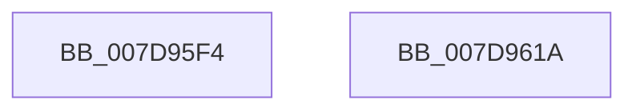

# WheapPushPendingOfflineWrapper

- RVA: `0x007D95F4`–`0x007D961B` (길이 `39` bytes)
- VA: `0x00000001407D95F4`
- 실행 섹션: `PAGE`
- PDB 이름 있음: `예`; PDB Function 태그: `아니요`
- unwind 정보 RVA: `0x0005C788`
- 디코드: `9`개 명령, `39/39` bytes 표시
- 미해석 바이트: `0` (있으면 어셈블리에 `.byte`로 보존)

> 이 문서는 커널 이미지의 기계어와 PDB 기호를 분석해 생성했습니다. 4번과 5번은 함수 원형과 자료형을 바이너리 사용 방식에서 추정한 C 해석이며 원본 소스 복구 결과는 아닙니다.

## 1. Dependencies

- 직접 호출 지점: **1**; 고유 호출 대상: **1**
- 직접 호출자로 확인된 함수: **2**
- RIP 상대 이미지 참조: **3**

### Outgoing calls
- `0x007D9609` → [ExInterlockedPushEntryList](../../text/65/ExInterlockedPushEntryList_function_0065A300.md) (function, `0x0065A300`)

### Direct callers
- [WheapProcessOfflineList](../../text/66/WheapProcessOfflineList_function_00661D70.md) at `0x00661E87`
- [WheapTrackPendingPage](WheapTrackPendingPage_function_007D9624.md) at `0x007D968B`

### Static image references
- `0x007D95FB` → RVA `0x00EF7D08` (`.data`; read)
- `0x007D9602` → RVA `0x00EF7D00` (`.data`; read)
- `0x007D960E` → RVA `0x00EF7D10` (`.data`; read/write)

## 2. Other-region calls and transfers

- 다른 실행 섹션으로 향하는 call: **1**
  - `0x007D9609` → [ExInterlockedPushEntryList](../../text/65/ExInterlockedPushEntryList_function_0065A300.md) (`PAGE` → `.text`)
- 별도 외부 분기/꼬리 이동을 확인하지 못했습니다.

## 3. Assembly (complete function range)

```asm
007D95F4  48 83 EC 28                     sub rsp, 0x28
007D95F8  48 8B D1                        mov rdx, rcx
007D95FB  4C 8D 05 06 E7 71 00            lea r8, [rip + 0x71e706]
007D9602  48 8D 0D F7 E6 71 00            lea rcx, [rip + 0x71e6f7]
007D9609  E8 F2 0C E8 FF                  call 0x14065a300
007D960E  F0 FF 05 FB E6 71 00            lock inc dword ptr [rip + 0x71e6fb]
007D9615  48 83 C4 28                     add rsp, 0x28
007D9619  C3                              ret
007D961A  CC                              int3
```

## 4. C-style interpretation (structured pseudocode)

```c
__int64 __fastcall WheapPushPendingOfflineWrapper(__int64 a1)
{
    __int64 result;
    __int64 v_rsp;

    v_rsp = (v_rsp) - (40);
    result = ExInterlockedPushEntryList(v_rip + 7464695, a1, v_rip + 7464710, a4);
    v_rsp = (v_rsp) + (40);
    return result;
}
```

## 5. (Beta) C Style

```c
int64_t WheapPushPendingOfflineWrapper(int64_t Arg1)
{
    int64_t result;
    int64_t local_rsp;

    local_rsp = (local_rsp) - (40);
    result = ExInterlockedPushEntryList(v_rip + 7464695, Arg1, v_rip + 7464710, a4);
    local_rsp = (local_rsp) + (40);
    return result;
}
```

## 6. Execution-region graph

[열기: 2D/3D 그래프와 함수 탐색 컨트롤 패널](../../../control-panel.html?section=page&rva=0x007D95F4&view=graph)

- 2D 그래프는 위에서 아래로 흐르고, 3D 그래프는 빈 공간을 드래그해 회전합니다. Shift+드래그는 이동, 휠은 확대·축소, 함수 노드 선택은 대상 보고서 이동입니다.

### Static fallback


