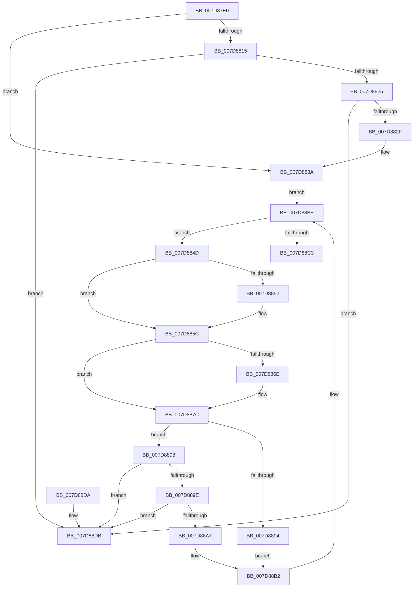

# WheapReportDeferredLiveDumps

- RVA: `0x007D87E0`–`0x007D88E2` (길이 `258` bytes)
- VA: `0x00000001407D87E0`
- 실행 섹션: `PAGE`
- PDB 이름 있음: `예`; PDB Function 태그: `아니요`
- unwind 정보 RVA: `0x00069AD0`
- 디코드: `67`개 명령, `258/258` bytes 표시
- 미해석 바이트: `0` (있으면 어셈블리에 `.byte`로 보존)

> 이 문서는 커널 이미지의 기계어와 PDB 기호를 분석해 생성했습니다. 4번과 5번은 함수 원형과 자료형을 바이너리 사용 방식에서 추정한 C 해석이며 원본 소스 복구 결과는 아닙니다.

## 1. Dependencies

- 직접 호출 지점: **6**; 고유 호출 대상: **4**
- 직접 호출자로 확인된 함수: **1**
- RIP 상대 이미지 참조: **3**

### Outgoing calls
- `0x007D87FD` → [ExAcquireFastMutex](../../text/20/ExAcquireFastMutex_function_0020E5A0.md) (function, `0x0020E5A0`)
- `0x007D8841` → [ExReleaseFastMutex](../../text/25/ExReleaseFastMutex_function_002519C0.md) (function, `0x002519C0`)
- `0x007D8855` → [WheapReportLiveDump](WheapReportLiveDump_function_007D88E8.md) (function, `0x007D88E8`)
- `0x007D8864` → [ExFreePoolWithTag](../../poolcode/B8/ExFreePoolWithTag_function_00B82870.md) (function, `0x00B82870`)
- `0x007D8883` → [ExAcquireFastMutex](../../text/20/ExAcquireFastMutex_function_0020E5A0.md) (function, `0x0020E5A0`)
- `0x007D88B9` → [ExReleaseFastMutex](../../text/25/ExReleaseFastMutex_function_002519C0.md) (function, `0x002519C0`)

### Direct callers
- [WheaCrashDumpInitializationComplete](WheaCrashDumpInitializationComplete_function_007D877C.md) at `0x007D87C2`

### Static image references
- `0x007D87F4` → RVA `0x00EF7DA0` (`.data`; read)
- `0x007D8802` → RVA `0x00EF7DE0` (`.data`; read)
- `0x007D882F` → RVA `0x00EF7DE0` (`.data`; write)

## 2. Other-region calls and transfers

- 다른 실행 섹션으로 향하는 call: **5**
  - `0x007D87FD` → [ExAcquireFastMutex](../../text/20/ExAcquireFastMutex_function_0020E5A0.md) (`PAGE` → `.text`)
  - `0x007D8841` → [ExReleaseFastMutex](../../text/25/ExReleaseFastMutex_function_002519C0.md) (`PAGE` → `.text`)
  - `0x007D8864` → [ExFreePoolWithTag](../../poolcode/B8/ExFreePoolWithTag_function_00B82870.md) (`PAGE` → `POOLCODE`)
  - `0x007D8883` → [ExAcquireFastMutex](../../text/20/ExAcquireFastMutex_function_0020E5A0.md) (`PAGE` → `.text`)
  - `0x007D88B9` → [ExReleaseFastMutex](../../text/25/ExReleaseFastMutex_function_002519C0.md) (`PAGE` → `.text`)
- 별도 외부 분기/꼬리 이동을 확인하지 못했습니다.

## 3. Assembly (complete function range)

```asm
007D87E0  48 89 5C 24 08                  mov qword ptr [rsp + 8], rbx
007D87E5  48 89 6C 24 10                  mov qword ptr [rsp + 0x10], rbp
007D87EA  48 89 74 24 18                  mov qword ptr [rsp + 0x18], rsi
007D87EF  57                              push rdi
007D87F0  48 83 EC 20                     sub rsp, 0x20
007D87F4  48 8D 0D A5 F5 71 00            lea rcx, [rip + 0x71f5a5]
007D87FB  33 DB                           xor ebx, ebx
007D87FD  E8 9E 5D A3 FF                  call 0x14020e5a0
007D8802  48 8B 05 D7 F5 71 00            mov rax, qword ptr [rip + 0x71f5d7]
007D8809  48 8D 2D D0 F5 71 00            lea rbp, [rip + 0x71f5d0]
007D8810  48 3B C5                        cmp rax, rbp
007D8813  74 25                           je 0x1407d883a
007D8815  48 8B D8                        mov rbx, rax
007D8818  48 8B 00                        mov rax, qword ptr [rax]
007D881B  48 39 6B 08                     cmp qword ptr [rbx + 8], rbp
007D881F  0F 85 B6 00 00 00               jne 0x1407d88db
007D8825  48 39 58 08                     cmp qword ptr [rax + 8], rbx
007D8829  0F 85 AC 00 00 00               jne 0x1407d88db
007D882F  48 89 05 AA F5 71 00            mov qword ptr [rip + 0x71f5aa], rax
007D8836  48 89 68 08                     mov qword ptr [rax + 8], rbp
007D883A  48 8D 0D 5F F5 71 00            lea rcx, [rip + 0x71f55f]
007D8841  E8 7A 91 A7 FF                  call 0x1402519c0
007D8846  40 32 FF                        xor dil, dil
007D8849  33 F6                           xor esi, esi
007D884B  EB 71                           jmp 0x1407d88be
007D884D  40 84 FF                        test dil, dil
007D8850  75 0A                           jne 0x1407d885c
007D8852  48 8B CB                        mov rcx, rbx
007D8855  E8 8E 00 00 00                  call 0x1407d88e8
007D885A  8B F0                           mov esi, eax
007D885C  BA 57 68 65 61                  mov edx, 0x61656857
007D8861  48 8B CB                        mov rcx, rbx
007D8864  E8 07 A0 3A 00                  call 0x140b82870
007D8869  40 84 FF                        test dil, dil
007D886C  75 0E                           jne 0x1407d887c
007D886E  85 F6                           test esi, esi
007D8870  40 0F B6 FF                     movzx edi, dil
007D8874  B8 01 00 00 00                  mov eax, 1
007D8879  0F 45 F8                        cmovne edi, eax
007D887C  48 8D 0D 1D F5 71 00            lea rcx, [rip + 0x71f51d]
007D8883  E8 18 5D A3 FF                  call 0x14020e5a0
007D8888  48 8B 1D 51 F5 71 00            mov rbx, qword ptr [rip + 0x71f551]
007D888F  48 3B DD                        cmp rbx, rbp
007D8892  75 04                           jne 0x1407d8898
007D8894  33 DB                           xor ebx, ebx
007D8896  EB 1A                           jmp 0x1407d88b2
007D8898  48 39 6B 08                     cmp qword ptr [rbx + 8], rbp
007D889C  75 3D                           jne 0x1407d88db
007D889E  48 8B 03                        mov rax, qword ptr [rbx]
007D88A1  48 39 58 08                     cmp qword ptr [rax + 8], rbx
007D88A5  75 34                           jne 0x1407d88db
007D88A7  48 89 05 32 F5 71 00            mov qword ptr [rip + 0x71f532], rax
007D88AE  48 89 68 08                     mov qword ptr [rax + 8], rbp
007D88B2  48 8D 0D E7 F4 71 00            lea rcx, [rip + 0x71f4e7]
007D88B9  E8 02 91 A7 FF                  call 0x1402519c0
007D88BE  48 85 DB                        test rbx, rbx
007D88C1  75 8A                           jne 0x1407d884d
007D88C3  48 8B 5C 24 30                  mov rbx, qword ptr [rsp + 0x30]
007D88C8  8B C6                           mov eax, esi
007D88CA  48 8B 74 24 40                  mov rsi, qword ptr [rsp + 0x40]
007D88CF  48 8B 6C 24 38                  mov rbp, qword ptr [rsp + 0x38]
007D88D4  48 83 C4 20                     add rsp, 0x20
007D88D8  5F                              pop rdi
007D88D9  C3                              ret
007D88DA  CC                              int3
007D88DB  B9 03 00 00 00                  mov ecx, 3
007D88E0  CD 29                           int 0x29
```

## 4. C-style interpretation (structured pseudocode)

```c
__int64 __fastcall WheapReportDeferredLiveDumps(void)
{
    __int64 result;
    __int64 v_rbx;
    __int64 v_rdi;
    __int64 v_rsi;
    __int64 v_rsp;
    unsigned __int64 v_stack_p10;
    unsigned __int64 v_stack_p18;
    unsigned __int64 v_stack_p8;

    v_stack_p8 = v_rbx;
    v_stack_p10 = v_rbp;
    v_stack_p18 = v_rsi;
    v_rsp = (v_rsp) - (32);
    v_rbx = 0;
    result = ExAcquireFastMutex(v_rip + 7468453, a2, a3, a4);
    if ((*(unsigned __int64 *)(v_rip + 7468503)) == (v_rip + 7468496)) goto loc_007D883A;
    if ((*(unsigned __int64 *)(*(unsigned __int64 *)(v_rip + 7468503) + 8)) != (v_rip + 7468496)) goto loc_007D88DB;
    if ((*(unsigned __int64 *)(*(unsigned __int64 *)(*(unsigned __int64 *)(v_rip + 7468503)) + 8)) != (*(unsigned __int64 *)(v_rip + 7468503))) goto loc_007D88DB;
    *(unsigned __int64 *)(v_rip + 7468458) = *(unsigned __int64 *)(*(unsigned __int64 *)(v_rip + 7468503));
    *(unsigned __int64 *)(*(unsigned __int64 *)(*(unsigned __int64 *)(v_rip + 7468503)) + 8) = v_rip + 7468496;
loc_007D883A:
    result = ExReleaseFastMutex(v_rip + 7468383, a2, a3, a4);
    v_rdi = 0;
    v_rsi = 0;
    goto loc_007D88BE;
loc_007D884D:
    if (0 == 0) {
        a1 = *(unsigned __int64 *)(v_rip + 7468503);
        result = WheapReportLiveDump(a1, a2, a3, a4);
        v_rsi = (unsigned int)(result);
    }
    result = ExFreePoolWithTag(*(unsigned __int64 *)(v_rip + 7468503), (unsigned int)(0x61656857ULL), a3, a4);
    if (0 == 0) {
        v_rdi = 0;
        result = 1;
        if ((unsigned int)(v_rsi) != 0) { v_rdi = (unsigned int)(result); }
    }
    result = ExAcquireFastMutex(v_rip + 7468317, (unsigned int)(0x61656857ULL), a3, a4);
    if ((*(unsigned __int64 *)(v_rip + 7468369)) != (v_rip + 7468496)) goto loc_007D8898;
    v_rbx = 0;
    goto loc_007D88B2;
loc_007D8898:
    if ((*(unsigned __int64 *)(v_rbx + 8)) != (v_rip + 7468496)) goto loc_007D88DB;
    if ((*(unsigned __int64 *)(*(unsigned __int64 *)(v_rbx) + 8)) != 0) goto loc_007D88DB;
    *(unsigned __int64 *)(v_rip + 7468338) = *(unsigned __int64 *)(v_rbx);
    *(unsigned __int64 *)(*(unsigned __int64 *)(v_rbx) + 8) = v_rip + 7468496;
loc_007D88B2:
    result = ExReleaseFastMutex(v_rip + 7468263, (unsigned int)(0x61656857ULL), a3, a4);
loc_007D88BE:
    if (0 != 0) goto loc_007D884D;
    v_rsp = (v_rsp) + (32);
    return (unsigned int)((unsigned int)(v_rsi));
loc_007D88DB:
    return (unsigned int)((unsigned int)(v_rsi));
}
```

## 5. (Beta) C Style

```c
void WheapReportDeferredLiveDumps(void)
{
    int64_t result;
    int64_t local_rbx;
    int64_t local_rdi;
    int64_t local_rsi;
    int64_t local_rsp;
    uint64_t v_stack_p10;
    uint64_t v_stack_p18;
    uint64_t v_stack_p8;

    v_stack_p8 = local_rbx;
    v_stack_p10 = local_rbp;
    v_stack_p18 = local_rsi;
    local_rsp = (local_rsp) - (32);
    local_rbx = 0;
    result = ExAcquireFastMutex(v_rip + 7468453, a2, a3, a4);
    if ((*(uint64_t *)(v_rip + 0x71F5D7)) == (v_rip + 7468496)) goto loc_007D883A;
    if ((*(uint64_t *)(*(uint64_t *)(v_rip + 0x71F5D7) + 0x8)) != (v_rip + 7468496)) goto loc_007D88DB;
    if ((*(uint64_t *)(*(uint64_t *)(*(uint64_t *)(v_rip + 0x71F5D7)) + 0x8)) != (*(uint64_t *)(v_rip + 0x71F5D7))) goto loc_007D88DB;
    *(uint64_t *)(v_rip + 0x71F5AA) = *(uint64_t *)(*(uint64_t *)(v_rip + 0x71F5D7));
    *(uint64_t *)(*(uint64_t *)(*(uint64_t *)(v_rip + 0x71F5D7)) + 0x8) = v_rip + 7468496;
loc_007D883A:
    result = ExReleaseFastMutex(v_rip + 7468383, a2, a3, a4);
    local_rdi = 0;
    local_rsi = 0;
    goto loc_007D88BE;
loc_007D884D:
    if (0 == 0) {
        a1 = *(uint64_t *)(v_rip + 0x71F5D7);
        result = WheapReportLiveDump(a1, a2, a3, a4);
        local_rsi = (uint32_t)(result);
    }
    result = ExFreePoolWithTag(*(uint64_t *)(v_rip + 0x71F5D7), (uint32_t)(0x61656857ULL), a3, a4);
    if (0 == 0) {
        local_rdi = 0;
        result = 1;
        if ((uint32_t)(local_rsi) != 0) { local_rdi = (uint32_t)(result); }
    }
    result = ExAcquireFastMutex(v_rip + 7468317, (uint32_t)(0x61656857ULL), a3, a4);
    if ((*(uint64_t *)(v_rip + 0x71F551)) != (v_rip + 7468496)) goto loc_007D8898;
    local_rbx = 0;
    goto loc_007D88B2;
loc_007D8898:
    if ((*(uint64_t *)(local_rbx + 0x8)) != (v_rip + 7468496)) goto loc_007D88DB;
    if ((*(uint64_t *)(*(uint64_t *)(local_rbx) + 0x8)) != 0) goto loc_007D88DB;
    *(uint64_t *)(v_rip + 0x71F532) = *(uint64_t *)(local_rbx);
    *(uint64_t *)(*(uint64_t *)(local_rbx) + 0x8) = v_rip + 7468496;
loc_007D88B2:
    result = ExReleaseFastMutex(v_rip + 7468263, (uint32_t)(0x61656857ULL), a3, a4);
loc_007D88BE:
    if (0 != 0) goto loc_007D884D;
    local_rsp = (local_rsp) + (32);
    return (uint32_t)((uint32_t)(local_rsi));
loc_007D88DB:
    return (uint32_t)((uint32_t)(local_rsi));
}
```

## 6. Execution-region graph

[열기: 2D/3D 그래프와 함수 탐색 컨트롤 패널](../../../control-panel.html?section=page&rva=0x007D87E0&view=graph)

- 2D 그래프는 위에서 아래로 흐르고, 3D 그래프는 빈 공간을 드래그해 회전합니다. Shift+드래그는 이동, 휠은 확대·축소, 함수 노드 선택은 대상 보고서 이동입니다.

### Static fallback


