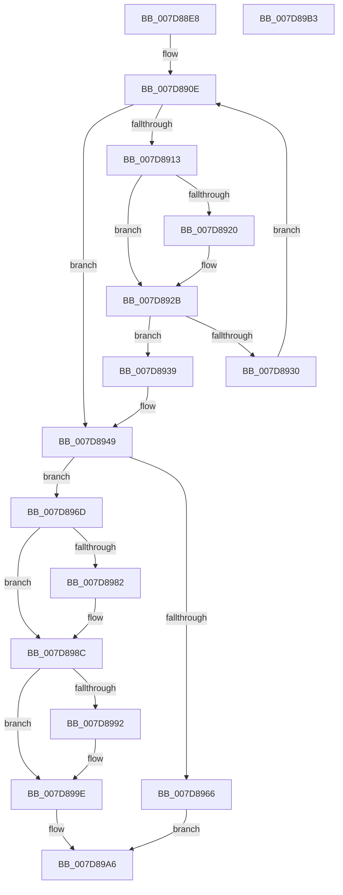

# WheapReportLiveDump

- RVA: `0x007D88E8`–`0x007D89B4` (길이 `204` bytes)
- VA: `0x00000001407D88E8`
- 실행 섹션: `PAGE`
- PDB 이름 있음: `예`; PDB Function 태그: `아니요`
- unwind 정보 RVA: `0x0006E5F8`
- 디코드: `59`개 명령, `204/204` bytes 표시
- 미해석 바이트: `0` (있으면 어셈블리에 `.byte`로 보존)

> 이 문서는 커널 이미지의 기계어와 PDB 기호를 분석해 생성했습니다. 4번과 5번은 함수 원형과 자료형을 바이너리 사용 방식에서 추정한 C 해석이며 원본 소스 복구 결과는 아닙니다.

## 1. Dependencies

- 직접 호출 지점: **5**; 고유 호출 대상: **4**
- 직접 호출자로 확인된 함수: **2**
- RIP 상대 이미지 참조: **2**

### Outgoing calls
- `0x007D8959` → [LkmdTelCreateReport](../84/LkmdTelCreateReport_function_008414CC.md) (function, `0x008414CC`)
- `0x007D8977` → [LkmdTelInsertTriageDataBlock](../../text/6A/LkmdTelInsertTriageDataBlock_function_006AB190.md) (function, `0x006AB190`)
- `0x007D8985` → [LkmdTelSubmitReport](../84/LkmdTelSubmitReport_function_008416E4.md) (function, `0x008416E4`)
- `0x007D8995` → [LkmdTelpFreeMem](../84/LkmdTelpFreeMem_function_008417BC.md) (function, `0x008417BC`)
- `0x007D89A1` → [LkmdTelpFreeMem](../84/LkmdTelpFreeMem_function_008417BC.md) (function, `0x008417BC`)

### Direct callers
- [WheapReportDeferredLiveDumps](WheapReportDeferredLiveDumps_function_007D87E0.md) at `0x007D8855`
- [WheapCreateLiveDumpFromPreviousSession](../../pagelk/B7/WheapCreateLiveDumpFromPreviousSession_function_00B73698.md) at `0x00B7370B`

### Static image references
- `0x007D8917` → RVA `0x00024DA8` (`.rdata`; read)
- `0x007D8924` → RVA `0x00024DB0` (`.rdata`; read)

## 2. Other-region calls and transfers

- 다른 실행 섹션으로 향하는 call: **1**
  - `0x007D8977` → [LkmdTelInsertTriageDataBlock](../../text/6A/LkmdTelInsertTriageDataBlock_function_006AB190.md) (`PAGE` → `.text`)
- 별도 외부 분기/꼬리 이동을 확인하지 못했습니다.

## 3. Assembly (complete function range)

```asm
007D88E8  48 89 5C 24 08                  mov qword ptr [rsp + 8], rbx
007D88ED  57                              push rdi
007D88EE  48 83 EC 30                     sub rsp, 0x30
007D88F2  48 8B 79 18                     mov rdi, qword ptr [rcx + 0x18]
007D88F6  33 D2                           xor edx, edx
007D88F8  4C 63 59 10                     movsxd r11, dword ptr [rcx + 0x10]
007D88FC  45 33 C9                        xor r9d, r9d
007D88FF  45 33 C0                        xor r8d, r8d
007D8902  44 0F B7 57 0A                  movzx r10d, word ptr [rdi + 0xa]
007D8907  48 8D 87 80 00 00 00            lea rax, [rdi + 0x80]
007D890E  45 3B C2                        cmp r8d, r10d
007D8911  73 36                           jae 0x1407d8949
007D8913  48 8B 48 10                     mov rcx, qword ptr [rax + 0x10]
007D8917  48 2B 0D 8A C4 84 FF            sub rcx, qword ptr [rip - 0x7b3b76]
007D891E  75 0B                           jne 0x1407d892b
007D8920  48 8B 48 18                     mov rcx, qword ptr [rax + 0x18]
007D8924  48 2B 0D 85 C4 84 FF            sub rcx, qword ptr [rip - 0x7b3b7b]
007D892B  48 85 C9                        test rcx, rcx
007D892E  74 09                           je 0x1407d8939
007D8930  48 83 C0 48                     add rax, 0x48
007D8934  41 FF C0                        inc r8d
007D8937  EB D5                           jmp 0x1407d890e
007D8939  8B 00                           mov eax, dword ptr [rax]
007D893B  48 8B 54 38 28                  mov rdx, qword ptr [rax + rdi + 0x28]
007D8940  44 8B 4C 38 28                  mov r9d, dword ptr [rax + rdi + 0x28]
007D8945  48 C1 EA 20                     shr rdx, 0x20
007D8949  4C 89 4C 24 28                  mov qword ptr [rsp + 0x28], r9
007D894E  4D 8B C3                        mov r8, r11
007D8951  4C 8B CF                        mov r9, rdi
007D8954  48 89 54 24 20                  mov qword ptr [rsp + 0x20], rdx
007D8959  E8 6E 8B 06 00                  call 0x1408414cc
007D895E  48 8B D8                        mov rbx, rax
007D8961  48 85 C0                        test rax, rax
007D8964  75 07                           jne 0x1407d896d
007D8966  BF 9A 00 00 C0                  mov edi, 0xc000009a
007D896B  EB 39                           jmp 0x1407d89a6
007D896D  44 8B 47 14                     mov r8d, dword ptr [rdi + 0x14]
007D8971  48 8B D7                        mov rdx, rdi
007D8974  48 8B CB                        mov rcx, rbx
007D8977  E8 14 28 ED FF                  call 0x1406ab190
007D897C  8B F8                           mov edi, eax
007D897E  85 C0                           test eax, eax
007D8980  78 0A                           js 0x1407d898c
007D8982  48 8B CB                        mov rcx, rbx
007D8985  E8 5A 8D 06 00                  call 0x1408416e4
007D898A  8B F8                           mov edi, eax
007D898C  83 7B 08 00                     cmp dword ptr [rbx + 8], 0
007D8990  76 0C                           jbe 0x1407d899e
007D8992  48 8B 0B                        mov rcx, qword ptr [rbx]
007D8995  E8 22 8E 06 00                  call 0x1408417bc
007D899A  83 63 08 00                     and dword ptr [rbx + 8], 0
007D899E  48 8B CB                        mov rcx, rbx
007D89A1  E8 16 8E 06 00                  call 0x1408417bc
007D89A6  48 8B 5C 24 40                  mov rbx, qword ptr [rsp + 0x40]
007D89AB  8B C7                           mov eax, edi
007D89AD  48 83 C4 30                     add rsp, 0x30
007D89B1  5F                              pop rdi
007D89B2  C3                              ret
007D89B3  CC                              int3
```

## 4. C-style interpretation (structured pseudocode)

```c
__int64 __fastcall WheapReportLiveDump(__int64 a1, int a2, int a3, int a4)
{
    __int64 result;
    __int64 v_rdi;
    __int64 v_rsp;
    unsigned __int64 v_stack_m10;
    unsigned __int64 v_stack_m18;
    unsigned __int64 v_stack_p8;

    v_stack_p8 = v_rbx;
    v_rsp = (v_rsp) - (48);
    a2 = 0;
    a4 = 0;
    a3 = 0;
loc_007D890E:
    if (0 >= ((unsigned int)(*(unsigned __int16 *)(*(unsigned __int64 *)(a1 + 24) + 10)))) goto loc_007D8949;
    a1 = (*(unsigned __int64 *)(*(unsigned __int64 *)(a1 + 24) + 128 + 16)) - (*(unsigned __int64 *)(v_rip - 8076150));
    if (!(condition_is_not_equal)) {
        a1 = *(unsigned __int64 *)(*(unsigned __int64 *)(a1 + 24) + 128 + 24);
        a1 = (a1) - (*(unsigned __int64 *)(v_rip - 8076155));
    }
    if (a1 == 0) goto loc_007D8939;
    result = (*(unsigned __int64 *)(a1 + 24) + 128) + (72);
    a3 = (unsigned int)((a3) + 1);
    goto loc_007D890E;
loc_007D8939:
    a2 = (*(unsigned __int64 *)((unsigned int)(*(unsigned int *)(result)) + *(unsigned __int64 *)(a1 + 24) * 1 + 40)) >> (32);
loc_007D8949:
    v_stack_m10 = (unsigned int)(*(unsigned int *)((unsigned int)(*(unsigned int *)(result)) + *(unsigned __int64 *)(a1 + 24) * 1 + 40));
    v_stack_m18 = a2;
    result = LkmdTelCreateReport(a1, a2, (int)(*(unsigned int *)(a1 + 16)), *(unsigned __int64 *)(a1 + 24));
    if (result != 0) goto loc_007D896D;
    goto loc_007D89A6;
loc_007D896D:
    result = LkmdTelInsertTriageDataBlock(result, (unsigned int)(0xC000009AULL), (unsigned int)(*(unsigned int *)((unsigned int)(0xC000009AULL) + 20)), *(unsigned __int64 *)(a1 + 24));
    v_rdi = (unsigned int)((unsigned int)(result));
    if (!(sign_flag)) {
        a1 = result;
        result = LkmdTelSubmitReport(a1, (unsigned int)(0xC000009AULL), (unsigned int)(*(unsigned int *)((unsigned int)(0xC000009AULL) + 20)), *(unsigned __int64 *)(a1 + 24));
        v_rdi = (unsigned int)(result);
    }
    if ((*(unsigned int *)(result + 8)) >= = 0) {
        a1 = *(unsigned __int64 *)(result);
        result = LkmdTelpFreeMem(a1, (unsigned int)(0xC000009AULL), (unsigned int)(*(unsigned int *)((unsigned int)(0xC000009AULL) + 20)), *(unsigned __int64 *)(a1 + 24));
    }
    result = LkmdTelpFreeMem(result, (unsigned int)(0xC000009AULL), (unsigned int)(*(unsigned int *)((unsigned int)(0xC000009AULL) + 20)), *(unsigned __int64 *)(a1 + 24));
loc_007D89A6:
    v_rsp = (v_rsp) + (48);
    return (unsigned int)((unsigned int)(v_rdi));
}
```

## 5. (Beta) C Style

```c
int64_t WheapReportLiveDump(void *Arg1, int32_t Arg2, int32_t Arg3, int32_t Arg4)
{
    uint8_t *arg1 = (uint8_t *)Arg1;

    int64_t result;
    int64_t local_rdi;
    int64_t local_rsp;
    uint64_t v_stack_m10;
    uint64_t v_stack_m18;
    uint64_t v_stack_p8;

    v_stack_p8 = local_rbx;
    local_rsp = (local_rsp) - (48);
    Arg2 = 0;
    Arg4 = 0;
    Arg3 = 0;
loc_007D890E:
    if (0 >= ((uint32_t)(*(uint16_t *)(*(uint64_t *)(arg1 + 0x18) + 0xA)))) goto loc_007D8949;
    Arg1 = (*(uint64_t *)(*(uint64_t *)(arg1 + 0x18) + 0x80 + 0x10)) - (*(uint64_t *)(v_rip - 0x7B3B76));
    if (!(condition_is_not_equal)) {
        Arg1 = *(uint64_t *)(*(uint64_t *)(arg1 + 0x18) + 0x80 + 0x18);
        Arg1 = (Arg1) - (*(uint64_t *)(v_rip - 0x7B3B7B));
    }
    if (Arg1 == NULL) goto loc_007D8939;
    result = (*(uint64_t *)(arg1 + 0x18) + 128) + (72);
    Arg3 = (uint32_t)((Arg3) + 1);
    goto loc_007D890E;
loc_007D8939:
    Arg2 = (*(uint64_t *)((uint32_t)(*(uint32_t *)(result)) + *(uint64_t *)(arg1 + 0x18) * 1 + 0x28)) >> (32);
loc_007D8949:
    v_stack_m10 = (uint32_t)(*(uint32_t *)((uint32_t)(*(uint32_t *)(result)) + *(uint64_t *)(arg1 + 0x18) * 1 + 0x28));
    v_stack_m18 = Arg2;
    result = LkmdTelCreateReport(Arg1, Arg2, (int32_t)(*(uint32_t *)(arg1 + 0x10)), *(uint64_t *)(arg1 + 0x18));
    if (result != 0) goto loc_007D896D;
    goto loc_007D89A6;
loc_007D896D:
    result = LkmdTelInsertTriageDataBlock(result, (uint32_t)(0xC000009AULL), (uint32_t)(*(uint32_t *)((uint32_t)(0xC000009AULL) + 0x14)), *(uint64_t *)(arg1 + 0x18));
    local_rdi = (uint32_t)((uint32_t)(result));
    if (!(sign_flag)) {
        Arg1 = result;
        result = LkmdTelSubmitReport(Arg1, (uint32_t)(0xC000009AULL), (uint32_t)(*(uint32_t *)((uint32_t)(0xC000009AULL) + 0x14)), *(uint64_t *)(arg1 + 0x18));
        local_rdi = (uint32_t)(result);
    }
    if ((*(uint32_t *)(result + 0x8)) >= = 0) {
        Arg1 = *(uint64_t *)(result);
        result = LkmdTelpFreeMem(Arg1, (uint32_t)(0xC000009AULL), (uint32_t)(*(uint32_t *)((uint32_t)(0xC000009AULL) + 0x14)), *(uint64_t *)(arg1 + 0x18));
    }
    result = LkmdTelpFreeMem(result, (uint32_t)(0xC000009AULL), (uint32_t)(*(uint32_t *)((uint32_t)(0xC000009AULL) + 0x14)), *(uint64_t *)(arg1 + 0x18));
loc_007D89A6:
    local_rsp = (local_rsp) + (48);
    return (uint32_t)((uint32_t)(local_rdi));
}
```

### 관측된 메모리 오프셋

구조체 형식이 확인되지 않은 접근은 인자 기준의 오프셋으로만 기록했습니다.

| 기준 인자 | 오프셋 표현 | 폭 (bit) | 접근 |
|---|---:|---:|---|
| `Arg1` | `+ 0x10` | `32` | `R` |
| `Arg1` | `+ 0x18` | `64` | `R` |

## 6. Execution-region graph

[열기: 2D/3D 그래프와 함수 탐색 컨트롤 패널](../../../control-panel.html?section=page&rva=0x007D88E8&view=graph)

- 2D 그래프는 위에서 아래로 흐르고, 3D 그래프는 빈 공간을 드래그해 회전합니다. Shift+드래그는 이동, 휠은 확대·축소, 함수 노드 선택은 대상 보고서 이동입니다.

### Static fallback


