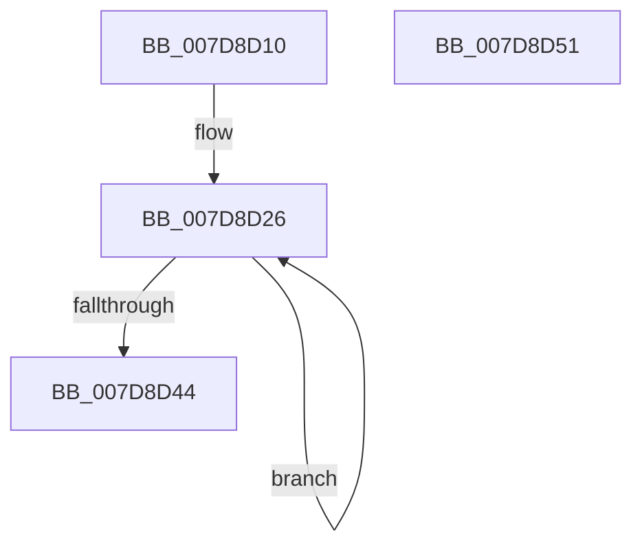

# WheapResetPolicyDefaults

- RVA: `0x007D8D10`–`0x007D8D52` (길이 `66` bytes)
- VA: `0x00000001407D8D10`
- 실행 섹션: `PAGE`
- PDB 이름 있음: `예`; PDB Function 태그: `아니요`
- unwind 정보 RVA: `0x0005CAAC`
- 디코드: `18`개 명령, `66/66` bytes 표시
- 미해석 바이트: `0` (있으면 어셈블리에 `.byte`로 보존)

> 이 문서는 커널 이미지의 기계어와 PDB 기호를 분석해 생성했습니다. 4번과 5번은 함수 원형과 자료형을 바이너리 사용 방식에서 추정한 C 해석이며 원본 소스 복구 결과는 아닙니다.

## 1. Dependencies

- 직접 호출 지점: **1**; 고유 호출 대상: **1**
- 직접 호출자로 확인된 함수: **1**
- RIP 상대 이미지 참조: **2**

### Outgoing calls
- `0x007D8D35` → [RtlDeleteRegistryValue](../AD/RtlDeleteRegistryValue_function_00ADA1B0.md) (function, `0x00ADA1B0`)

### Direct callers
- [WheapWmiExecutePolicyManagementMethod](../../text/66/WheapWmiExecutePolicyManagementMethod_function_00661B8C.md) at `0x00661BDD`

### Static image references
- `0x007D8D1A` → RVA `0x00E095A0` (`.data`; read)
- `0x007D8D29` → RVA `0x00B08EE0` (` ?? ::NNGAKEGL::`string'`; read)

## 2. Other-region calls and transfers

- 다른 실행 섹션으로 향하는 call: **0**
- 별도 외부 분기/꼬리 이동을 확인하지 못했습니다.

## 3. Assembly (complete function range)

```asm
007D8D10  48 89 5C 24 08                  mov qword ptr [rsp + 8], rbx
007D8D15  57                              push rdi
007D8D16  48 83 EC 20                     sub rsp, 0x20
007D8D1A  48 8D 1D 7F 08 63 00            lea rbx, [rip + 0x63087f]
007D8D21  BF 16 00 00 00                  mov edi, 0x16
007D8D26  4C 8B 03                        mov r8, qword ptr [rbx]
007D8D29  48 8D 15 B0 01 33 00            lea rdx, [rip + 0x3301b0]
007D8D30  B9 02 00 00 00                  mov ecx, 2
007D8D35  E8 76 14 30 00                  call 0x140ada1b0
007D8D3A  48 8D 5B 20                     lea rbx, [rbx + 0x20]
007D8D3E  48 83 EF 01                     sub rdi, 1
007D8D42  75 E2                           jne 0x1407d8d26
007D8D44  48 8B 5C 24 30                  mov rbx, qword ptr [rsp + 0x30]
007D8D49  33 C0                           xor eax, eax
007D8D4B  48 83 C4 20                     add rsp, 0x20
007D8D4F  5F                              pop rdi
007D8D50  C3                              ret
007D8D51  CC                              int3
```

## 4. C-style interpretation (structured pseudocode)

```c
__int64 __fastcall WheapResetPolicyDefaults(void)
{
    __int64 result;
    __int64 v_rdi;
    __int64 v_rsp;
    unsigned __int64 v_stack_p8;

    v_stack_p8 = v_rbx;
    v_rsp = (v_rsp) - (32);
loc_007D8D26:
    result = RtlDeleteRegistryValue(2, v_rip + 3342768, *(unsigned __int64 *)(v_rip + 6490239), a4);
    v_rdi = (22) - (1);
    if (condition_is_not_equal) goto loc_007D8D26;
    result = 0;
    v_rsp = (v_rsp) + (32);
    return result;
}
```

## 5. (Beta) C Style

```c
void WheapResetPolicyDefaults(void)
{
    int64_t result;
    int64_t local_rdi;
    int64_t local_rsp;
    uint64_t v_stack_p8;

    v_stack_p8 = local_rbx;
    local_rsp = (local_rsp) - (32);
loc_007D8D26:
    result = RtlDeleteRegistryValue(2, v_rip + 3342768, *(uint64_t *)(v_rip + 0x63087F), a4);
    local_rdi = (22) - (1);
    if (condition_is_not_equal) goto loc_007D8D26;
    result = 0;
    local_rsp = (local_rsp) + (32);
    return result;
}
```

## 6. Execution-region graph

[열기: 2D/3D 그래프와 함수 탐색 컨트롤 패널](../../../control-panel.html?section=page&rva=0x007D8D10&view=graph)

- 2D 그래프는 위에서 아래로 흐르고, 3D 그래프는 빈 공간을 드래그해 회전합니다. Shift+드래그는 이동, 휠은 확대·축소, 함수 노드 선택은 대상 보고서 이동입니다.

### Static fallback


