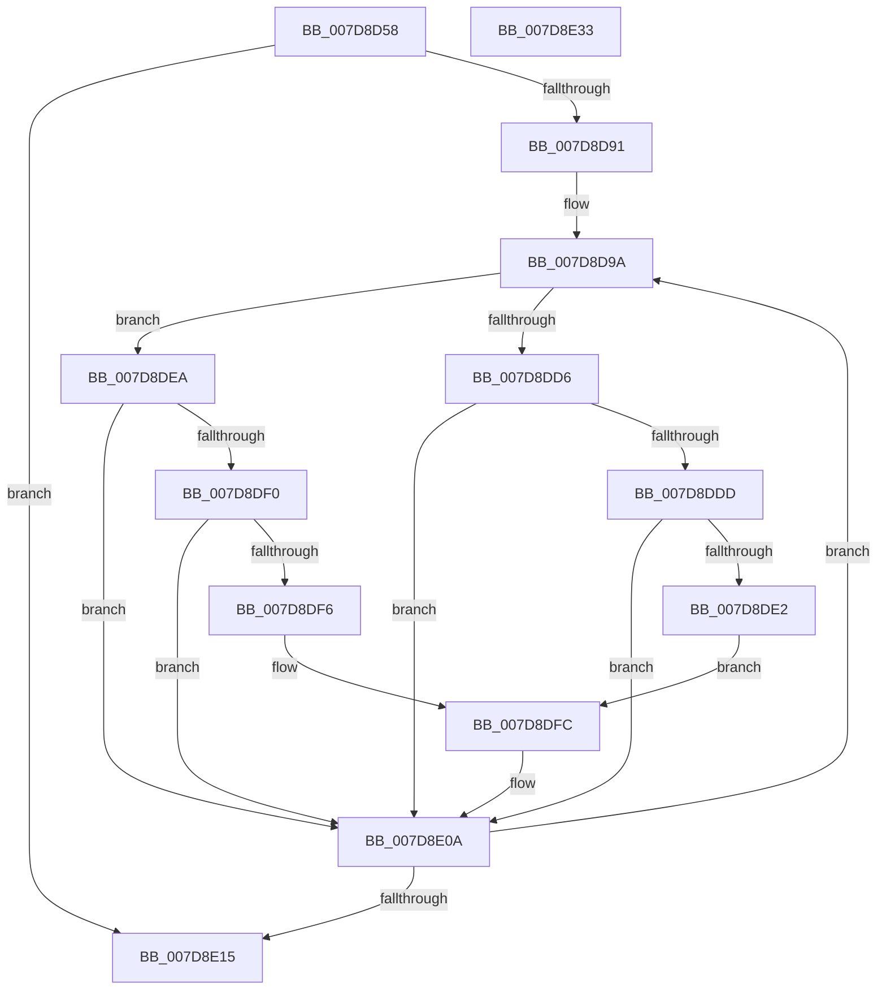

# WheapScanRegistryForPolicyChanges

- RVA: `0x007D8D58`–`0x007D8E34` (길이 `220` bytes)
- VA: `0x00000001407D8D58`
- 실행 섹션: `PAGE`
- PDB 이름 있음: `예`; PDB Function 태그: `아니요`
- unwind 정보 RVA: `0x000D6028`
- 디코드: `59`개 명령, `220/220` bytes 표시
- 미해석 바이트: `0` (있으면 어셈블리에 `.byte`로 보존)

> 이 문서는 커널 이미지의 기계어와 PDB 기호를 분석해 생성했습니다. 4번과 5번은 함수 원형과 자료형을 바이너리 사용 방식에서 추정한 C 해석이며 원본 소스 복구 결과는 아닙니다.

## 1. Dependencies

- 직접 호출 지점: **4**; 고유 호출 대상: **4**
- 직접 호출자로 확인된 함수: **2**
- RIP 상대 이미지 참조: **3**

### Outgoing calls
- `0x007D8DA2` → [RtlInitUnicodeString](../../text/42/RtlInitUnicodeString_function_0042A780.md) (function, `0x0042A780`)
- `0x007D8DCD` → [ZwQueryValueKey](../../text/6A/ZwQueryValueKey_function_006AD3B0.md) (function, `0x006AD3B0`)
- `0x007D8E05` → [WheapSetPolicyValue](WheapSetPolicyValue_function_007D8E3C.md) (function, `0x007D8E3C`)
- `0x007D8E1C` → [_security_check_cookie](../../text/6A/_security_check_cookie_function_006AC640.md) (function, `0x006AC640`)

### Direct callers
- [WheaRegChangeNotifyCallback](WheaRegChangeNotifyCallback_function_007D8A50.md) at `0x007D8B07`
- [WheapLoadPolicy](../../init/C5/WheapLoadPolicy_function_00C5574C.md) at `0x00C557A3`

### Static image references
- `0x007D8D6A` → RVA `0x00E0A740` (`.data`; read)
- `0x007D8D7F` → RVA `0x00EF7D38` (`.data`; read)
- `0x007D8D93` → RVA `0x00E095BC` (`.data`; read)

## 2. Other-region calls and transfers

- 다른 실행 섹션으로 향하는 call: **3**
  - `0x007D8DA2` → [RtlInitUnicodeString](../../text/42/RtlInitUnicodeString_function_0042A780.md) (`PAGE` → `.text`)
  - `0x007D8DCD` → [ZwQueryValueKey](../../text/6A/ZwQueryValueKey_function_006AD3B0.md) (`PAGE` → `.text`)
  - `0x007D8E1C` → [_security_check_cookie](../../text/6A/_security_check_cookie_function_006AC640.md) (`PAGE` → `.text`)
- 별도 외부 분기/꼬리 이동을 확인하지 못했습니다.

## 3. Assembly (complete function range)

```asm
007D8D58  48 89 5C 24 08                  mov qword ptr [rsp + 8], rbx
007D8D5D  48 89 7C 24 10                  mov qword ptr [rsp + 0x10], rdi
007D8D62  55                              push rbp
007D8D63  48 8B EC                        mov rbp, rsp
007D8D66  48 83 EC 70                     sub rsp, 0x70
007D8D6A  48 8B 05 CF 19 63 00            mov rax, qword ptr [rip + 0x6319cf]
007D8D71  48 33 C4                        xor rax, rsp
007D8D74  48 89 45 F0                     mov qword ptr [rbp - 0x10], rax
007D8D78  83 65 C4 00                     and dword ptr [rbp - 0x3c], 0
007D8D7C  0F 57 C0                        xorps xmm0, xmm0
007D8D7F  48 83 3D B1 EF 71 00 00         cmp qword ptr [rip + 0x71efb1], 0
007D8D87  0F 11 45 C8                     movups xmmword ptr [rbp - 0x38], xmm0
007D8D8B  0F 84 84 00 00 00               je 0x1407d8e15
007D8D91  33 FF                           xor edi, edi
007D8D93  48 8D 1D 22 08 63 00            lea rbx, [rip + 0x630822]
007D8D9A  48 8B 53 E4                     mov rdx, qword ptr [rbx - 0x1c]
007D8D9E  48 8D 4D C8                     lea rcx, [rbp - 0x38]
007D8DA2  E8 D9 19 C5 FF                  call 0x14042a780
007D8DA7  48 8B 0D 8A EF 71 00            mov rcx, qword ptr [rip + 0x71ef8a]
007D8DAE  48 8D 45 C4                     lea rax, [rbp - 0x3c]
007D8DB2  48 89 44 24 28                  mov qword ptr [rsp + 0x28], rax
007D8DB7  4C 8D 4D D8                     lea r9, [rbp - 0x28]
007D8DBB  41 B8 02 00 00 00               mov r8d, 2
007D8DC1  C7 44 24 20 13 00 00 00         mov dword ptr [rsp + 0x20], 0x13
007D8DC9  48 8D 55 C8                     lea rdx, [rbp - 0x38]
007D8DCD  E8 DE 45 ED FF                  call 0x1406ad3b0
007D8DD2  85 C0                           test eax, eax
007D8DD4  79 14                           jns 0x1407d8dea
007D8DD6  3D 34 00 00 C0                  cmp eax, 0xc0000034
007D8DDB  75 2D                           jne 0x1407d8e0a
007D8DDD  80 3B 00                        cmp byte ptr [rbx], 0
007D8DE0  74 28                           je 0x1407d8e0a
007D8DE2  8B 43 FC                        mov eax, dword ptr [rbx - 4]
007D8DE5  C6 03 00                        mov byte ptr [rbx], 0
007D8DE8  EB 12                           jmp 0x1407d8dfc
007D8DEA  83 7D DC 04                     cmp dword ptr [rbp - 0x24], 4
007D8DEE  75 1A                           jne 0x1407d8e0a
007D8DF0  83 7D E0 04                     cmp dword ptr [rbp - 0x20], 4
007D8DF4  75 14                           jne 0x1407d8e0a
007D8DF6  8B 45 E4                        mov eax, dword ptr [rbp - 0x1c]
007D8DF9  C6 03 01                        mov byte ptr [rbx], 1
007D8DFC  48 8D 55 C0                     lea rdx, [rbp - 0x40]
007D8E00  89 45 C0                        mov dword ptr [rbp - 0x40], eax
007D8E03  8B CF                           mov ecx, edi
007D8E05  E8 32 00 00 00                  call 0x1407d8e3c
007D8E0A  FF C7                           inc edi
007D8E0C  48 83 C3 20                     add rbx, 0x20
007D8E10  83 FF 16                        cmp edi, 0x16
007D8E13  72 85                           jb 0x1407d8d9a
007D8E15  48 8B 4D F0                     mov rcx, qword ptr [rbp - 0x10]
007D8E19  48 33 CC                        xor rcx, rsp
007D8E1C  E8 1F 38 ED FF                  call 0x1406ac640
007D8E21  4C 8D 5C 24 70                  lea r11, [rsp + 0x70]
007D8E26  49 8B 5B 10                     mov rbx, qword ptr [r11 + 0x10]
007D8E2A  49 8B 7B 18                     mov rdi, qword ptr [r11 + 0x18]
007D8E2E  49 8B E3                        mov rsp, r11
007D8E31  5D                              pop rbp
007D8E32  C3                              ret
007D8E33  CC                              int3
```

## 4. C-style interpretation (structured pseudocode)

```c
__int64 __fastcall WheapScanRegistryForPolicyChanges(void)
{
    __int64 result;
    __int64 v_rbx;
    __int64 v_rdi;
    __int64 v_rsp;
    unsigned __int64 v_stack_m18;
    unsigned int v_stack_m24;
    unsigned int v_stack_m28;
    unsigned int v_stack_m2C;
    unsigned __int64 v_stack_m30;
    unsigned __int64 v_stack_m40;
    unsigned int v_stack_m44;
    unsigned __int64 v_stack_m48;
    unsigned __int64 v_stack_m50;
    unsigned int v_stack_m58;
    unsigned __int64 v_stack_m8;
    unsigned __int64 v_stack_p10;
    unsigned __int64 v_stack_p8;

    v_stack_p8 = v_rbx;
    v_stack_p10 = v_rdi;
    v_rsp = (v_rsp) - (112);
    result = (*(unsigned __int64 *)(v_rip + 6494671)) ^ (v_rsp);
    v_stack_m18 = result;
    v_stack_m40 = v_xmm0;
    if ((*(unsigned __int64 *)(v_rip + 7466929)) == 0) goto loc_007D8E15;
    v_rdi = 0;
loc_007D8D9A:
    result = RtlInitUnicodeString(v_stack_m40, *(unsigned __int64 *)(v_rip + 6490146 - 28), a3, a4);
    v_stack_m50 = v_stack_m44;
    v_stack_m58 = 19;
    result = ZwQueryValueKey(*(unsigned __int64 *)(v_rip + 7466890), v_stack_m40, 2, v_stack_m30);
    if (!sign_flag) goto loc_007D8DEA;
    if (((unsigned int)(result)) != 0xC0000034ULL) goto loc_007D8E0A;
    if ((*(unsigned __int8 *)(v_rip + 6490146)) == 0) goto loc_007D8E0A;
    *(unsigned __int8 *)(v_rip + 6490146) = 0;
    goto loc_007D8DFC;
loc_007D8DEA:
    if (v_stack_m2C != 4) goto loc_007D8E0A;
    if (v_stack_m28 != 4) goto loc_007D8E0A;
    *(unsigned __int8 *)(v_rip + 6490146) = 1;
loc_007D8DFC:
    v_stack_m48 = (unsigned int)((unsigned int)(v_stack_m24));
    result = WheapSetPolicyValue(0, v_stack_m48, 2, v_stack_m30);
loc_007D8E0A:
    v_rdi = (unsigned int)((v_rdi) + 1);
    v_rbx = (v_rip + 6490146) + (32);
    if (((unsigned int)(v_rdi)) < 22) goto loc_007D8D9A;
loc_007D8E15:
    a1 = (v_stack_m18) ^ (v_rsp);
    result = _security_check_cookie(a1, v_stack_m48, 2, v_stack_m30);
    return result;
}
```

## 5. (Beta) C Style

```c
void WheapScanRegistryForPolicyChanges(void)
{
    int64_t result;
    int64_t local_rbx;
    int64_t local_rdi;
    int64_t local_rsp;
    uint64_t v_stack_m18;
    uint32_t v_stack_m24;
    uint32_t v_stack_m28;
    uint32_t v_stack_m2C;
    uint64_t v_stack_m30;
    uint64_t v_stack_m40;
    uint32_t v_stack_m44;
    uint64_t v_stack_m48;
    uint64_t v_stack_m50;
    uint32_t v_stack_m58;
    uint64_t v_stack_m8;
    uint64_t v_stack_p10;
    uint64_t v_stack_p8;

    v_stack_p8 = local_rbx;
    v_stack_p10 = local_rdi;
    local_rsp = (local_rsp) - (112);
    result = (*(uint64_t *)(v_rip + 0x6319CF)) ^ (local_rsp);
    v_stack_m18 = result;
    v_stack_m40 = v_xmm0;
    if ((*(uint64_t *)(v_rip + 0x71EFB1)) == 0) goto loc_007D8E15;
    local_rdi = 0;
loc_007D8D9A:
    result = RtlInitUnicodeString(v_stack_m40, *(uint64_t *)(v_rip + 0x630822 - 0x1C), a3, a4);
    v_stack_m50 = v_stack_m44;
    v_stack_m58 = 19;
    result = ZwQueryValueKey(*(uint64_t *)(v_rip + 0x71EF8A), v_stack_m40, 2, v_stack_m30);
    if (!sign_flag) goto loc_007D8DEA;
    if (((uint32_t)(result)) != 0xC0000034ULL) goto loc_007D8E0A;
    if ((*(uint8_t *)(v_rip + 0x630822)) == 0) goto loc_007D8E0A;
    *(uint8_t *)(v_rip + 0x630822) = 0;
    goto loc_007D8DFC;
loc_007D8DEA:
    if (v_stack_m2C != 4) goto loc_007D8E0A;
    if (v_stack_m28 != 4) goto loc_007D8E0A;
    *(uint8_t *)(v_rip + 0x630822) = 1;
loc_007D8DFC:
    v_stack_m48 = (uint32_t)((uint32_t)(v_stack_m24));
    result = WheapSetPolicyValue(0, v_stack_m48, 2, v_stack_m30);
loc_007D8E0A:
    local_rdi = (uint32_t)((local_rdi) + 1);
    local_rbx = (v_rip + 6490146) + (32);
    if (((uint32_t)(local_rdi)) < 22) goto loc_007D8D9A;
loc_007D8E15:
    a1 = (v_stack_m18) ^ (local_rsp);
    result = _security_check_cookie(a1, v_stack_m48, 2, v_stack_m30);
    return result;
}
```

## 6. Execution-region graph

[열기: 2D/3D 그래프와 함수 탐색 컨트롤 패널](../../../control-panel.html?section=page&rva=0x007D8D58&view=graph)

- 2D 그래프는 위에서 아래로 흐르고, 3D 그래프는 빈 공간을 드래그해 회전합니다. Shift+드래그는 이동, 휠은 확대·축소, 함수 노드 선택은 대상 보고서 이동입니다.

### Static fallback


