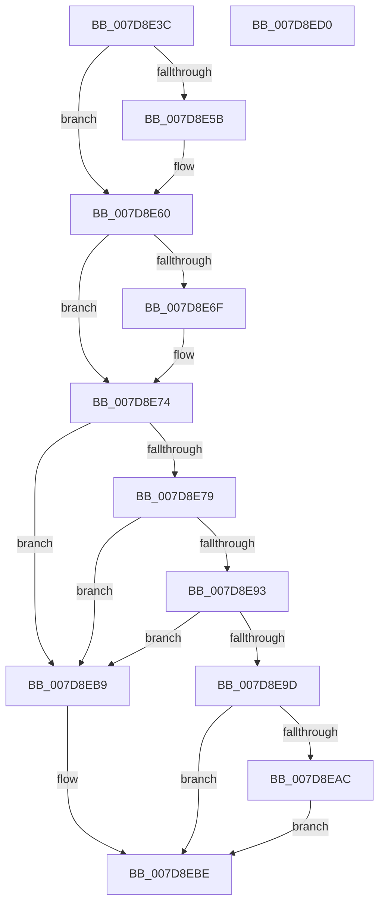

# WheapSetPolicyValue

- RVA: `0x007D8E3C`–`0x007D8ED1` (길이 `149` bytes)
- VA: `0x00000001407D8E3C`
- 실행 섹션: `PAGE`
- PDB 이름 있음: `예`; PDB Function 태그: `아니요`
- unwind 정보 RVA: `0x00060BC4`
- 디코드: `39`개 명령, `149/149` bytes 표시
- 미해석 바이트: `0` (있으면 어셈블리에 `.byte`로 보존)

> 이 문서는 커널 이미지의 기계어와 PDB 기호를 분석해 생성했습니다. 4번과 5번은 함수 원형과 자료형을 바이너리 사용 방식에서 추정한 C 해석이며 원본 소스 복구 결과는 아닙니다.

## 1. Dependencies

- 직접 호출 지점: **2**; 고유 호출 대상: **2**
- 직접 호출자로 확인된 함수: **1**
- RIP 상대 이미지 참조: **3**

### Outgoing calls
- `0x007D8E5B` → [WheapOpenPolicyRegistryKey](../../init/C5/WheapOpenPolicyRegistryKey_function_00C55840.md) (function, `0x00C55840`)
- `0x007D8E6F` → [WheaInitializeRegChangeNotify](WheaInitializeRegChangeNotify_function_007D89BC.md) (function, `0x007D89BC`)

### Direct callers
- [WheapScanRegistryForPolicyChanges](WheapScanRegistryForPolicyChanges_function_007D8D58.md) at `0x007D8E05`

### Static image references
- `0x007D8E4F` → RVA `0x00EF7D38` (`.data`; read)
- `0x007D8E65` → RVA `0x00EF7D30` (`.data`; read)
- `0x007D8E7B` → RVA `0x00000000` (`image boundary/outside`; read)

## 2. Other-region calls and transfers

- 다른 실행 섹션으로 향하는 call: **1**
  - `0x007D8E5B` → [WheapOpenPolicyRegistryKey](../../init/C5/WheapOpenPolicyRegistryKey_function_00C55840.md) (`PAGE` → `INIT`)
- 별도 외부 분기/꼬리 이동을 확인하지 못했습니다.

## 3. Assembly (complete function range)

```asm
007D8E3C  48 89 5C 24 08                  mov qword ptr [rsp + 8], rbx
007D8E41  48 89 74 24 10                  mov qword ptr [rsp + 0x10], rsi
007D8E46  57                              push rdi
007D8E47  48 83 EC 20                     sub rsp, 0x20
007D8E4B  33 DB                           xor ebx, ebx
007D8E4D  8B F9                           mov edi, ecx
007D8E4F  48 39 1D E2 EE 71 00            cmp qword ptr [rip + 0x71eee2], rbx
007D8E56  48 8B F2                        mov rsi, rdx
007D8E59  75 05                           jne 0x1407d8e60
007D8E5B  E8 E0 C9 47 00                  call 0x140c55840
007D8E60  B8 01 00 00 00                  mov eax, 1
007D8E65  F0 0F B1 1D C3 EE 71 00         lock cmpxchg dword ptr [rip + 0x71eec3], ebx
007D8E6D  75 05                           jne 0x1407d8e74
007D8E6F  E8 48 FB FF FF                  call 0x1407d89bc
007D8E74  83 FF 16                        cmp edi, 0x16
007D8E77  73 40                           jae 0x1407d8eb9
007D8E79  8B 06                           mov eax, dword ptr [rsi]
007D8E7B  4C 8D 0D 7E 71 82 FF            lea r9, [rip - 0x7d8e82]
007D8E82  48 8B CF                        mov rcx, rdi
007D8E85  48 C1 E1 05                     shl rcx, 5
007D8E89  42 3B 84 09 B0 95 E0 00         cmp eax, dword ptr [rcx + r9 + 0xe095b0]
007D8E91  72 26                           jb 0x1407d8eb9
007D8E93  42 3B 84 09 B4 95 E0 00         cmp eax, dword ptr [rcx + r9 + 0xe095b4]
007D8E9B  77 1C                           ja 0x1407d8eb9
007D8E9D  0F AE E8                        lfence
007D8EA0  4A 8B 94 09 A8 95 E0 00         mov rdx, qword ptr [rcx + r9 + 0xe095a8]
007D8EA8  39 02                           cmp dword ptr [rdx], eax
007D8EAA  74 12                           je 0x1407d8ebe
007D8EAC  89 02                           mov dword ptr [rdx], eax
007D8EAE  42 C6 84 0F 00 FB EE 00 01      mov byte ptr [rdi + r9 + 0xeefb00], 1
007D8EB7  EB 05                           jmp 0x1407d8ebe
007D8EB9  BB 0D 00 00 C0                  mov ebx, 0xc000000d
007D8EBE  48 8B 74 24 38                  mov rsi, qword ptr [rsp + 0x38]
007D8EC3  8B C3                           mov eax, ebx
007D8EC5  48 8B 5C 24 30                  mov rbx, qword ptr [rsp + 0x30]
007D8ECA  48 83 C4 20                     add rsp, 0x20
007D8ECE  5F                              pop rdi
007D8ECF  C3                              ret
007D8ED0  CC                              int3
```

## 4. C-style interpretation (structured pseudocode)

```c
__int64 __fastcall WheapSetPolicyValue(int a1, __int64 a2)
{
    __int64 result;
    __int64 v_rbx;
    __int64 v_rsp;
    unsigned __int64 v_stack_p10;
    unsigned __int64 v_stack_p8;

    v_stack_p8 = v_rbx;
    v_stack_p10 = v_rsi;
    v_rsp = (v_rsp) - (32);
    v_rbx = 0;
    if ((*(unsigned __int64 *)(v_rip + 7466722)) == 0) {
        result = WheapOpenPolicyRegistryKey(a1, a2, a3, a4);
    }
    result = 1;
    if ((*(unsigned __int64 *)(v_rip + 7466722)) == 0) {
        result = WheaInitializeRegChangeNotify(a1, a2, a3, a4);
    }
    if (((unsigned int)((unsigned int)(a1))) >= 22) goto loc_007D8EB9;
    a1 = ((unsigned int)(a1)) << (5);
    if (((unsigned int)((unsigned int)(*(unsigned int *)(a2)))) < (*(unsigned int *)(a1 + v_rip - 8228482 * 1 + 14718384))) goto loc_007D8EB9;
    if (((unsigned int)((unsigned int)(*(unsigned int *)(a2)))) > (*(unsigned int *)(a1 + v_rip - 8228482 * 1 + 14718388))) goto loc_007D8EB9;
    if ((*(unsigned int *)(*(unsigned __int64 *)(a1 + v_rip - 8228482 * 1 + 14718376))) == ((unsigned int)((unsigned int)(*(unsigned int *)(a2))))) goto loc_007D8EBE;
    *(unsigned int *)(*(unsigned __int64 *)(a1 + v_rip - 8228482 * 1 + 14718376)) = (unsigned int)((unsigned int)(*(unsigned int *)(a2)));
    *(unsigned __int8 *)((unsigned int)(a1) + v_rip - 8228482 * 1 + 15661824) = 1;
    goto loc_007D8EBE;
loc_007D8EB9:
loc_007D8EBE:
    v_rsp = (v_rsp) + (32);
    return (unsigned int)((unsigned int)((unsigned int)(0xC000000DULL)));
}
```

## 5. (Beta) C Style

```c
int64_t WheapSetPolicyValue(int32_t Arg1, void *Arg2)
{
    uint8_t *arg2 = (uint8_t *)Arg2;

    int64_t result;
    int64_t local_rbx;
    int64_t local_rsp;
    uint64_t v_stack_p10;
    uint64_t v_stack_p8;

    v_stack_p8 = local_rbx;
    v_stack_p10 = local_rsi;
    local_rsp = (local_rsp) - (32);
    local_rbx = 0;
    if ((*(uint64_t *)(v_rip + 0x71EEE2)) == 0) {
        result = WheapOpenPolicyRegistryKey(Arg1, Arg2, a3, a4);
    }
    result = 1;
    if ((*(uint64_t *)(v_rip + 0x71EEE2)) == 0) {
        result = WheaInitializeRegChangeNotify(Arg1, Arg2, a3, a4);
    }
    if (((uint32_t)((uint32_t)(Arg1))) >= 22) goto loc_007D8EB9;
    Arg1 = ((uint32_t)(Arg1)) << (5);
    if (((uint32_t)((uint32_t)(*(uint32_t *)(arg2)))) < (*(uint32_t *)(Arg1 + v_rip - 0x7D8E82 * 1 + 0xE095B0))) goto loc_007D8EB9;
    if (((uint32_t)((uint32_t)(*(uint32_t *)(arg2)))) > (*(uint32_t *)(Arg1 + v_rip - 0x7D8E82 * 1 + 0xE095B4))) goto loc_007D8EB9;
    if ((*(uint32_t *)(*(uint64_t *)(Arg1 + v_rip - 0x7D8E82 * 1 + 0xE095A8))) == ((uint32_t)((uint32_t)(*(uint32_t *)(arg2))))) goto loc_007D8EBE;
    *(uint32_t *)(*(uint64_t *)(Arg1 + v_rip - 0x7D8E82 * 1 + 0xE095A8)) = (uint32_t)((uint32_t)(*(uint32_t *)(arg2)));
    *(uint8_t *)((uint32_t)(Arg1) + v_rip - 0x7D8E82 * 1 + 0xEEFB00) = 1;
    goto loc_007D8EBE;
loc_007D8EB9:
loc_007D8EBE:
    local_rsp = (local_rsp) + (32);
    return (uint32_t)((uint32_t)((uint32_t)(0xC000000DULL)));
}
```

### 관측된 메모리 오프셋

구조체 형식이 확인되지 않은 접근은 인자 기준의 오프셋으로만 기록했습니다.

| 기준 인자 | 오프셋 표현 | 폭 (bit) | 접근 |
|---|---:|---:|---|
| `Arg2` | `+ 0x0` | `32` | `R` |

## 6. Execution-region graph

[열기: 2D/3D 그래프와 함수 탐색 컨트롤 패널](../../../control-panel.html?section=page&rva=0x007D8E3C&view=graph)

- 2D 그래프는 위에서 아래로 흐르고, 3D 그래프는 빈 공간을 드래그해 회전합니다. Shift+드래그는 이동, 휠은 확대·축소, 함수 노드 선택은 대상 보고서 이동입니다.

### Static fallback


