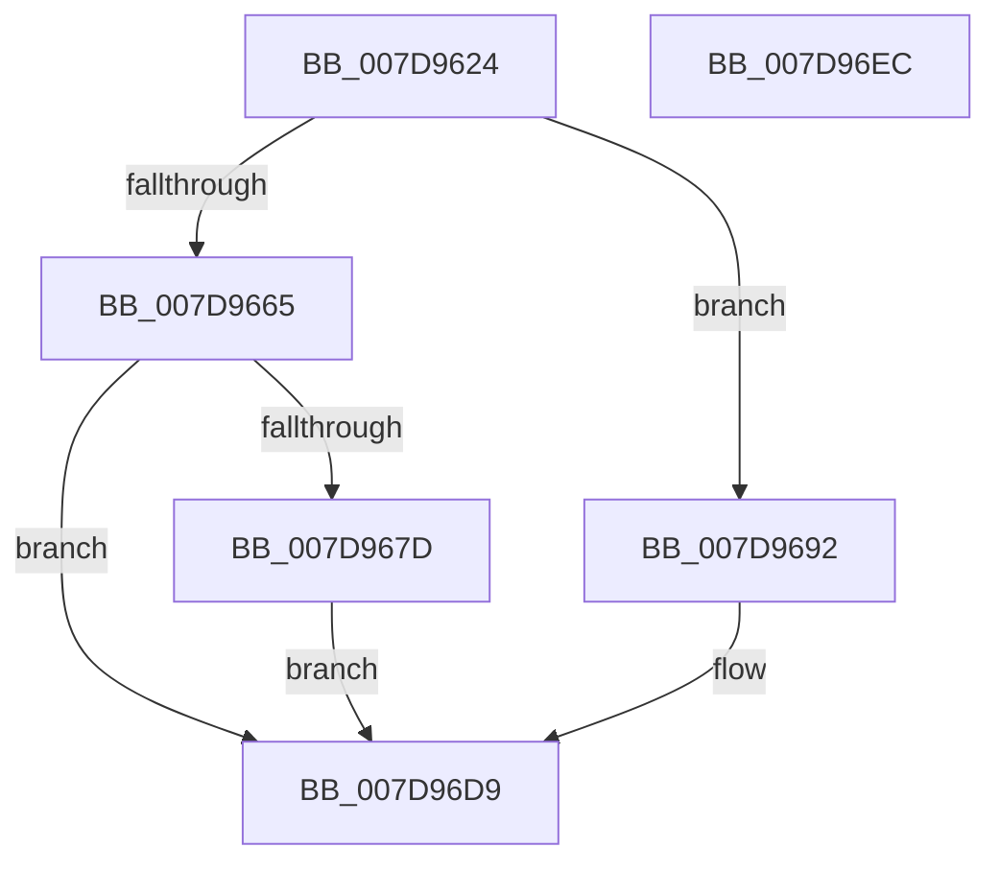

# WheapTrackPendingPage

- RVA: `0x007D9624`–`0x007D96ED` (길이 `201` bytes)
- VA: `0x00000001407D9624`
- 실행 섹션: `PAGE`
- PDB 이름 있음: `예`; PDB Function 태그: `아니요`
- unwind 정보 RVA: `0x000606C0`
- 디코드: `45`개 명령, `201/201` bytes 표시
- 미해석 바이트: `0` (있으면 어셈블리에 `.byte`로 보존)

> 이 문서는 커널 이미지의 기계어와 PDB 기호를 분석해 생성했습니다. 4번과 5번은 함수 원형과 자료형을 바이너리 사용 방식에서 추정한 C 해석이며 원본 소스 복구 결과는 아닙니다.

## 1. Dependencies

- 직접 호출 지점: **4**; 고유 호출 대상: **4**
- 직접 호출자로 확인된 함수: **1**
- RIP 상대 이미지 참조: **4**

### Outgoing calls
- `0x007D9673` → [ExAllocatePool2](../../poolcode/B8/ExAllocatePool2_function_00B820F0.md) (function, `0x00B820F0`)
- `0x007D968B` → [WheapPushPendingOfflineWrapper](WheapPushPendingOfflineWrapper_function_007D95F4.md) (function, `0x007D95F4`)
- `0x007D96D4` → [WheaLogInternalEvent](../../text/66/WheaLogInternalEvent_function_006605B0.md) (function, `0x006605B0`)
- `0x007D96E1` → [_security_check_cookie](../../text/6A/_security_check_cookie_function_006AC640.md) (function, `0x006AC640`)

### Direct callers
- [WheapLogPageOfflineAttemptEvent](WheapLogPageOfflineAttemptEvent_function_007D857C.md) at `0x007D85B6`

### Static image references
- `0x007D962A` → RVA `0x00E0A740` (`.data`; read)
- `0x007D9639` → RVA `0x00E09748` (`.data`; read)
- `0x007D9655` → RVA `0x00EF7D20` (`.data`; read)
- `0x007D967D` → RVA `0x00EF7D20` (`.data`; read/write)

## 2. Other-region calls and transfers

- 다른 실행 섹션으로 향하는 call: **3**
  - `0x007D9673` → [ExAllocatePool2](../../poolcode/B8/ExAllocatePool2_function_00B820F0.md) (`PAGE` → `POOLCODE`)
  - `0x007D96D4` → [WheaLogInternalEvent](../../text/66/WheaLogInternalEvent_function_006605B0.md) (`PAGE` → `.text`)
  - `0x007D96E1` → [_security_check_cookie](../../text/6A/_security_check_cookie_function_006AC640.md) (`PAGE` → `.text`)
- 별도 외부 분기/꼬리 이동을 확인하지 못했습니다.

## 3. Assembly (complete function range)

```asm
007D9624  40 53                           push rbx
007D9626  48 83 EC 50                     sub rsp, 0x50
007D962A  48 8B 05 0F 11 63 00            mov rax, qword ptr [rip + 0x63110f]
007D9631  48 33 C4                        xor rax, rsp
007D9634  48 89 44 24 40                  mov qword ptr [rsp + 0x40], rax
007D9639  48 8B 05 08 01 63 00            mov rax, qword ptr [rip + 0x630108]
007D9640  48 8B D9                        mov rbx, rcx
007D9643  8B 10                           mov edx, dword ptr [rax]
007D9645  B8 00 00 A0 00                  mov eax, 0xa00000
007D964A  C1 E2 0C                        shl edx, 0xc
007D964D  3B D0                           cmp edx, eax
007D964F  0F 47 D0                        cmova edx, eax
007D9652  44 8B C2                        mov r8d, edx
007D9655  48 63 15 C4 E6 71 00            movsxd rdx, dword ptr [rip + 0x71e6c4]
007D965C  48 C1 E2 04                     shl rdx, 4
007D9660  49 3B D0                        cmp rdx, r8
007D9663  73 2D                           jae 0x1407d9692
007D9665  BA 10 00 00 00                  mov edx, 0x10
007D966A  41 B8 57 68 65 61               mov r8d, 0x61656857
007D9670  8D 4A 30                        lea ecx, [rdx + 0x30]
007D9673  E8 78 8A 3A 00                  call 0x140b820f0
007D9678  48 85 C0                        test rax, rax
007D967B  74 5C                           je 0x1407d96d9
007D967D  F0 FF 05 9C E6 71 00            lock inc dword ptr [rip + 0x71e69c]
007D9684  48 8B C8                        mov rcx, rax
007D9687  48 89 58 08                     mov qword ptr [rax + 8], rbx
007D968B  E8 64 FF FF FF                  call 0x1407d95f4
007D9690  EB 47                           jmp 0x1407d96d9
007D9692  83 64 24 3C 00                  and dword ptr [rsp + 0x3c], 0
007D9697  48 8D 4C 24 20                  lea rcx, [rsp + 0x20]
007D969C  C7 44 24 20 57 68 4C 67         mov dword ptr [rsp + 0x20], 0x674c6857
007D96A4  C7 44 24 24 01 00 00 00         mov dword ptr [rsp + 0x24], 1
007D96AC  C7 44 24 28 20 00 00 00         mov dword ptr [rsp + 0x28], 0x20
007D96B4  C7 44 24 2C 01 00 00 00         mov dword ptr [rsp + 0x2c], 1
007D96BC  C7 44 24 34 33 00 00 80         mov dword ptr [rsp + 0x34], 0x80000033
007D96C4  C7 44 24 30 4B 52 4E 4C         mov dword ptr [rsp + 0x30], 0x4c4e524b
007D96CC  C7 44 24 38 02 00 00 00         mov dword ptr [rsp + 0x38], 2
007D96D4  E8 D7 6E E8 FF                  call 0x1406605b0
007D96D9  48 8B 4C 24 40                  mov rcx, qword ptr [rsp + 0x40]
007D96DE  48 33 CC                        xor rcx, rsp
007D96E1  E8 5A 2F ED FF                  call 0x1406ac640
007D96E6  48 83 C4 50                     add rsp, 0x50
007D96EA  5B                              pop rbx
007D96EB  C3                              ret
007D96EC  CC                              int3
```

## 4. C-style interpretation (structured pseudocode)

```c
__int64 __fastcall WheapTrackPendingPage(__int64 a1)
{
    __int64 result;
    __int64 v_rsp;
    unsigned __int64 v_stack_m18;
    unsigned int v_stack_m1C;
    unsigned int v_stack_m20;
    unsigned int v_stack_m24;
    unsigned int v_stack_m28;
    unsigned int v_stack_m2C;
    unsigned int v_stack_m30;
    unsigned int v_stack_m34;
    unsigned __int64 v_stack_m38;

    v_rsp = (v_rsp) - (80);
    result = (*(unsigned __int64 *)(v_rip + 6492431)) ^ (v_rsp);
    v_stack_m18 = result;
    a2 = (unsigned int)(((unsigned int)(*(unsigned int *)(*(unsigned __int64 *)(v_rip + 6488328)))) << (12));
    if (((unsigned int)(a2)) > ((unsigned int)((unsigned int)(0xA00000ULL)))) { a2 = (unsigned int)((unsigned int)(0xA00000ULL)); }
    a2 = ((int)(*(unsigned int *)(v_rip + 7464644))) << (4);
    if (a2 >= ((unsigned int)((unsigned int)(a2)))) goto loc_007D9692;
    result = ExAllocatePool2(16 + 48, 16, (unsigned int)(0x61656857ULL), a4);
    if (result == 0) goto loc_007D96D9;
    *(unsigned __int64 *)(result + 8) = a1;
    result = WheapPushPendingOfflineWrapper(result, 16, (unsigned int)(0x61656857ULL), a4);
    goto loc_007D96D9;
loc_007D9692:
    v_stack_m38 = 0x674C6857ULL;
    v_stack_m34 = 1;
    v_stack_m30 = 32;
    v_stack_m2C = 1;
    v_stack_m24 = 0x80000033ULL;
    v_stack_m28 = 0x4C4E524BULL;
    v_stack_m20 = 2;
    result = WheaLogInternalEvent(v_stack_m38, 16, (unsigned int)(0x61656857ULL), a4);
loc_007D96D9:
    a1 = (v_stack_m18) ^ (v_rsp);
    result = _security_check_cookie(a1, 16, (unsigned int)(0x61656857ULL), a4);
    v_rsp = (v_rsp) + (80);
    return result;
}
```

## 5. (Beta) C Style

```c
int64_t WheapTrackPendingPage(int64_t Arg1)
{
    int64_t result;
    int64_t local_rsp;
    uint64_t v_stack_m18;
    uint32_t v_stack_m1C;
    uint32_t v_stack_m20;
    uint32_t v_stack_m24;
    uint32_t v_stack_m28;
    uint32_t v_stack_m2C;
    uint32_t v_stack_m30;
    uint32_t v_stack_m34;
    uint64_t v_stack_m38;

    local_rsp = (local_rsp) - (80);
    result = (*(uint64_t *)(v_rip + 0x63110F)) ^ (local_rsp);
    v_stack_m18 = result;
    a2 = (uint32_t)(((uint32_t)(*(uint32_t *)(*(uint64_t *)(v_rip + 0x630108)))) << (12));
    if (((uint32_t)(a2)) > ((uint32_t)((uint32_t)(0xA00000ULL)))) { a2 = (uint32_t)((uint32_t)(0xA00000ULL)); }
    a2 = ((int32_t)(*(uint32_t *)(v_rip + 0x71E6C4))) << (4);
    if (a2 >= ((uint32_t)((uint32_t)(a2)))) goto loc_007D9692;
    result = ExAllocatePool2(16 + 48, 16, (uint32_t)(0x61656857ULL), a4);
    if (result == 0) goto loc_007D96D9;
    *(uint64_t *)(result + 0x8) = Arg1;
    result = WheapPushPendingOfflineWrapper(result, 16, (uint32_t)(0x61656857ULL), a4);
    goto loc_007D96D9;
loc_007D9692:
    v_stack_m38 = 0x674C6857ULL;
    v_stack_m34 = 1;
    v_stack_m30 = 32;
    v_stack_m2C = 1;
    v_stack_m24 = 0x80000033ULL;
    v_stack_m28 = 0x4C4E524BULL;
    v_stack_m20 = 2;
    result = WheaLogInternalEvent(v_stack_m38, 16, (uint32_t)(0x61656857ULL), a4);
loc_007D96D9:
    Arg1 = (v_stack_m18) ^ (local_rsp);
    result = _security_check_cookie(Arg1, 16, (uint32_t)(0x61656857ULL), a4);
    local_rsp = (local_rsp) + (80);
    return result;
}
```

## 6. Execution-region graph

[열기: 2D/3D 그래프와 함수 탐색 컨트롤 패널](../../../control-panel.html?section=page&rva=0x007D9624&view=graph)

- 2D 그래프는 위에서 아래로 흐르고, 3D 그래프는 빈 공간을 드래그해 회전합니다. Shift+드래그는 이동, 휠은 확대·축소, 함수 노드 선택은 대상 보고서 이동입니다.

### Static fallback


