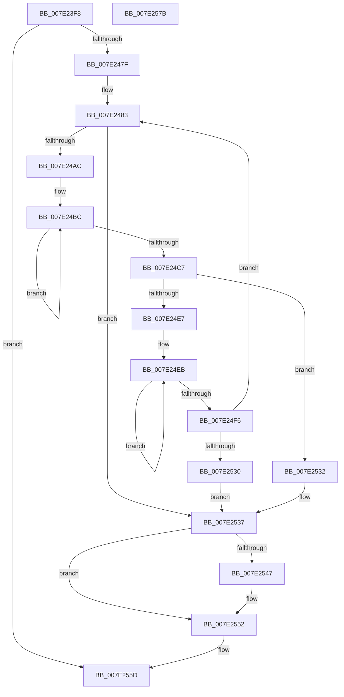

# CmDeleteKeyRecursive

- RVA: `0x007E23F8`–`0x007E257C` (길이 `388` bytes)
- VA: `0x00000001407E23F8`
- 실행 섹션: `PAGE`
- PDB 이름 있음: `예`; PDB Function 태그: `아니요`
- unwind 정보 RVA: `0x000D6A38`
- 디코드: `106`개 명령, `388/388` bytes 표시
- 미해석 바이트: `0` (있으면 어셈블리에 `.byte`로 보존)

> 이 문서는 커널 이미지의 기계어와 PDB 기호를 분석해 생성했습니다. 4번과 5번은 함수 원형과 자료형을 바이너리 사용 방식에서 추정한 C 해석이며 원본 소스 복구 결과는 아닙니다.

## 1. Dependencies

- 직접 호출 지점: **9**; 고유 호출 대상: **9**
- 직접 호출자로 확인된 함수: **3**
- RIP 상대 이미지 참조: **0**

### Outgoing calls
- `0x007E243E` → [RtlInitUnicodeString](../../text/42/RtlInitUnicodeString_function_0042A780.md) (function, `0x0042A780`)
- `0x007E2472` → [ZwOpenKey](../../text/6A/ZwOpenKey_function_006AD310.md) (function, `0x006AD310`)
- `0x007E249D` → [ZwEnumerateKey](../../text/6A/ZwEnumerateKey_function_006AD710.md) (function, `0x006AD710`)
- `0x007E24DA` → [ExAllocatePool2](../../poolcode/B8/ExAllocatePool2_function_00B820F0.md) (function, `0x00B820F0`)
- `0x007E2500` → [wcscpy_s](../../text/50/wcscpy_s_function_005064B0.md) (function, `0x005064B0`)
- `0x007E2517` → [CmDeleteKeyRecursive](CmDeleteKeyRecursive_function_007E23F8.md) (function, `0x007E23F8`)
- `0x007E2523` → [ExFreePoolWithTag](../../poolcode/B8/ExFreePoolWithTag_function_00B82870.md) (function, `0x00B82870`)
- `0x007E254B` → [ZwDeleteKey](../../text/6A/ZwDeleteKey_function_006AEC50.md) (function, `0x006AEC50`)
- `0x007E2556` → [ZwClose](../../text/6A/ZwClose_function_006AD2B0.md) (function, `0x006AD2B0`)

### Direct callers
- [CmDeleteKeyRecursive](CmDeleteKeyRecursive_function_007E23F8.md) at `0x007E2517`
- [CmpMoveBiosAliasTable](CmpMoveBiosAliasTable_function_007E4578.md) at `0x007E4B05`
- [CmpCreateHardwareProfiles](../../init/C5/CmpCreateHardwareProfiles_function_00C56EF4.md) at `0x00C574F0`

### Static image references
- 디코드된 RIP-relative 메모리 참조가 없습니다.

## 2. Other-region calls and transfers

- 다른 실행 섹션으로 향하는 call: **8**
  - `0x007E243E` → [RtlInitUnicodeString](../../text/42/RtlInitUnicodeString_function_0042A780.md) (`PAGE` → `.text`)
  - `0x007E2472` → [ZwOpenKey](../../text/6A/ZwOpenKey_function_006AD310.md) (`PAGE` → `.text`)
  - `0x007E249D` → [ZwEnumerateKey](../../text/6A/ZwEnumerateKey_function_006AD710.md) (`PAGE` → `.text`)
  - `0x007E24DA` → [ExAllocatePool2](../../poolcode/B8/ExAllocatePool2_function_00B820F0.md) (`PAGE` → `POOLCODE`)
  - `0x007E2500` → [wcscpy_s](../../text/50/wcscpy_s_function_005064B0.md) (`PAGE` → `.text`)
  - `0x007E2523` → [ExFreePoolWithTag](../../poolcode/B8/ExFreePoolWithTag_function_00B82870.md) (`PAGE` → `POOLCODE`)
  - `0x007E254B` → [ZwDeleteKey](../../text/6A/ZwDeleteKey_function_006AEC50.md) (`PAGE` → `.text`)
  - `0x007E2556` → [ZwClose](../../text/6A/ZwClose_function_006AD2B0.md) (`PAGE` → `.text`)
- 별도 외부 분기/꼬리 이동을 확인하지 못했습니다.

## 3. Assembly (complete function range)

```asm
007E23F8  48 89 5C 24 10                  mov qword ptr [rsp + 0x10], rbx
007E23FD  48 89 74 24 18                  mov qword ptr [rsp + 0x18], rsi
007E2402  48 89 7C 24 20                  mov qword ptr [rsp + 0x20], rdi
007E2407  55                              push rbp
007E2408  41 54                           push r12
007E240A  41 55                           push r13
007E240C  41 56                           push r14
007E240E  41 57                           push r15
007E2410  48 8B EC                        mov rbp, rsp
007E2413  48 83 EC 70                     sub rsp, 0x70
007E2417  45 33 E4                        xor r12d, r12d
007E241A  48 8B D9                        mov rbx, rcx
007E241D  0F 57 C0                        xorps xmm0, xmm0
007E2420  44 89 65 50                     mov dword ptr [rbp + 0x50], r12d
007E2424  48 8D 4D C0                     lea rcx, [rbp - 0x40]
007E2428  44 89 65 D4                     mov dword ptr [rbp - 0x2c], r12d
007E242C  0F 11 45 C0                     movups xmmword ptr [rbp - 0x40], xmm0
007E2430  44 89 65 EC                     mov dword ptr [rbp - 0x14], r12d
007E2434  45 8B E9                        mov r13d, r9d
007E2437  4C 89 65 30                     mov qword ptr [rbp + 0x30], r12
007E243B  49 8B F0                        mov rsi, r8
007E243E  E8 3D 83 C4 FF                  call 0x14042a780
007E2443  48 8D 45 C0                     lea rax, [rbp - 0x40]
007E2447  C7 45 D0 30 00 00 00            mov dword ptr [rbp - 0x30], 0x30
007E244E  0F 57 C0                        xorps xmm0, xmm0
007E2451  48 89 45 E0                     mov qword ptr [rbp - 0x20], rax
007E2455  4C 8D 45 D0                     lea r8, [rbp - 0x30]
007E2459  48 89 5D D8                     mov qword ptr [rbp - 0x28], rbx
007E245D  BA 3F 00 0F 00                  mov edx, 0xf003f
007E2462  C7 45 E8 40 02 00 00            mov dword ptr [rbp - 0x18], 0x240
007E2469  48 8D 4D 30                     lea rcx, [rbp + 0x30]
007E246D  F3 0F 7F 45 F0                  movdqu xmmword ptr [rbp - 0x10], xmm0
007E2472  E8 99 AE EC FF                  call 0x1406ad310
007E2477  85 C0                           test eax, eax
007E2479  0F 88 DE 00 00 00               js 0x1407e255d
007E247F  45 8D 7D FE                     lea r15d, [r13 - 2]
007E2483  48 8B 4D 30                     mov rcx, qword ptr [rbp + 0x30]
007E2487  48 8D 45 50                     lea rax, [rbp + 0x50]
007E248B  48 89 44 24 28                  mov qword ptr [rsp + 0x28], rax
007E2490  4C 8B CE                        mov r9, rsi
007E2493  45 33 C0                        xor r8d, r8d
007E2496  44 89 7C 24 20                  mov dword ptr [rsp + 0x20], r15d
007E249B  33 D2                           xor edx, edx
007E249D  E8 6E B2 EC FF                  call 0x1406ad710
007E24A2  8B F8                           mov edi, eax
007E24A4  85 C0                           test eax, eax
007E24A6  0F 88 8B 00 00 00               js 0x1407e2537
007E24AC  8B 46 0C                        mov eax, dword ptr [rsi + 0xc]
007E24AF  48 D1 E8                        shr rax, 1
007E24B2  48 83 CA FF                     or rdx, 0xffffffffffffffff
007E24B6  66 44 89 64 46 10               mov word ptr [rsi + rax*2 + 0x10], r12w
007E24BC  48 FF C2                        inc rdx
007E24BF  66 44 39 64 56 10               cmp word ptr [rsi + rdx*2 + 0x10], r12w
007E24C5  75 F5                           jne 0x1407e24bc
007E24C7  48 8D 14 55 02 00 00 00         lea rdx, [rdx*2 + 2]
007E24CF  B9 00 01 00 00                  mov ecx, 0x100
007E24D4  41 B8 43 4D 20 20               mov r8d, 0x20204d43
007E24DA  E8 11 FC 39 00                  call 0x140b820f0
007E24DF  4C 8B F0                        mov r14, rax
007E24E2  48 85 C0                        test rax, rax
007E24E5  74 4B                           je 0x1407e2532
007E24E7  48 83 CA FF                     or rdx, 0xffffffffffffffff
007E24EB  48 FF C2                        inc rdx
007E24EE  66 44 39 64 56 10               cmp word ptr [rsi + rdx*2 + 0x10], r12w
007E24F4  75 F5                           jne 0x1407e24eb
007E24F6  48 FF C2                        inc rdx
007E24F9  4C 8D 46 10                     lea r8, [rsi + 0x10]
007E24FD  49 8B CE                        mov rcx, r14
007E2500  E8 AB 3F D2 FF                  call 0x1405064b0
007E2505  48 8B 4D 30                     mov rcx, qword ptr [rbp + 0x30]
007E2509  45 8B CD                        mov r9d, r13d
007E250C  4C 8B C6                        mov r8, rsi
007E250F  C6 44 24 20 01                  mov byte ptr [rsp + 0x20], 1
007E2514  49 8B D6                        mov rdx, r14
007E2517  E8 DC FE FF FF                  call 0x1407e23f8
007E251C  33 D2                           xor edx, edx
007E251E  49 8B CE                        mov rcx, r14
007E2521  8B F8                           mov edi, eax
007E2523  E8 48 03 3A 00                  call 0x140b82870
007E2528  85 FF                           test edi, edi
007E252A  0F 89 53 FF FF FF               jns 0x1407e2483
007E2530  EB 05                           jmp 0x1407e2537
007E2532  BF 9A 00 00 C0                  mov edi, 0xc000009a
007E2537  81 FF 1A 00 00 80               cmp edi, 0x8000001a
007E253D  41 8B DC                        mov ebx, r12d
007E2540  0F 45 DF                        cmovne ebx, edi
007E2543  85 DB                           test ebx, ebx
007E2545  78 0B                           js 0x1407e2552
007E2547  48 8B 4D 30                     mov rcx, qword ptr [rbp + 0x30]
007E254B  E8 00 C7 EC FF                  call 0x1406aec50
007E2550  8B D8                           mov ebx, eax
007E2552  48 8B 4D 30                     mov rcx, qword ptr [rbp + 0x30]
007E2556  E8 55 AD EC FF                  call 0x1406ad2b0
007E255B  8B C3                           mov eax, ebx
007E255D  4C 8D 5C 24 70                  lea r11, [rsp + 0x70]
007E2562  49 8B 5B 38                     mov rbx, qword ptr [r11 + 0x38]
007E2566  49 8B 73 40                     mov rsi, qword ptr [r11 + 0x40]
007E256A  49 8B 7B 48                     mov rdi, qword ptr [r11 + 0x48]
007E256E  49 8B E3                        mov rsp, r11
007E2571  41 5F                           pop r15
007E2573  41 5E                           pop r14
007E2575  41 5D                           pop r13
007E2577  41 5C                           pop r12
007E2579  5D                              pop rbp
007E257A  C3                              ret
007E257B  CC                              int3
```

## 4. C-style interpretation (structured pseudocode)

```c
__int64 __fastcall CmDeleteKeyRecursive(__int64 a1, __int64 a2, __int64 a3, int a4, __int64 a5)
{
    __int64 result;
    __int64 v_r12;
    __int64 v_rbx;
    __int64 v_rsp;
    unsigned __int64 v_stack_m28;
    unsigned __int64 v_stack_m38;
    unsigned int v_stack_m3C;
    unsigned int v_stack_m40;
    unsigned __int64 v_stack_m48;
    unsigned __int64 v_stack_m50;
    unsigned int v_stack_m54;
    unsigned int v_stack_m58;
    unsigned __int64 v_stack_m68;
    unsigned __int64 v_stack_m70;
    unsigned int v_stack_m78;
    unsigned __int64 v_stack_p10;
    unsigned __int64 v_stack_p18;
    unsigned __int64 v_stack_p20;
    unsigned int v_stack_p28;
    unsigned __int64 v_stack_p8;

    v_stack_p10 = v_rbx;
    v_stack_p18 = v_rsi;
    v_stack_p20 = v_rdi;
    v_rsp = (v_rsp) - (112);
    v_r12 = 0;
    v_stack_p28 = 0;
    v_stack_m54 = 0;
    v_stack_m68 = v_xmm0;
    v_stack_m3C = 0;
    v_stack_p8 = 0;
    result = RtlInitUnicodeString(v_stack_m68, a2, a3, a4);
    v_stack_m58 = 48;
    v_stack_m48 = v_stack_m68;
    v_stack_m50 = a1;
    v_stack_m40 = 576;
    v_stack_m38 = v_xmm0;
    result = ZwOpenKey(v_stack_p8, (unsigned int)(0xF003FULL), v_stack_m58, a4);
    if (sign_flag) goto loc_007E255D;
loc_007E2483:
    v_stack_m70 = a5;
    a3 = 0;
    v_stack_m78 = (unsigned int)((unsigned int)(a4) - 2);
    a2 = 0;
    result = ZwEnumerateKey(v_stack_p8, a2, a3, a3);
    if (sign_flag) goto loc_007E2537;
    result = ((unsigned int)(*(unsigned int *)(a3 + 12))) >> (1);
    a2 = (a2) | (-1);
    *(unsigned __int16 *)(a3 + result * 2 + 16) = 0;
loc_007E24BC:
    a2 = (a2) + 1;
    if ((*(unsigned __int16 *)(a3 + a2 * 2 + 16)) != 0) goto loc_007E24BC;
    result = ExAllocatePool2(256, a2 * 2 + 2, (unsigned int)(0x20204D43ULL), a3);
    if (result == 0) goto loc_007E2532;
    a2 = (a2 * 2 + 2) | (-1);
loc_007E24EB:
    a2 = (a2) + 1;
    if ((*(unsigned __int16 *)(a3 + a2 * 2 + 16)) != 0) goto loc_007E24EB;
    a2 = (a2) + 1;
    result = wcscpy_s(result, a2, a3 + 16, a3);
    v_stack_m78 = 1;
    result = CmDeleteKeyRecursive(v_stack_p8, result, 0, (unsigned int)((unsigned int)((unsigned int)(a4))));
    a2 = 0;
    result = ExFreePoolWithTag(result, a2, 0, (unsigned int)((unsigned int)((unsigned int)(a4))));
    if (!sign_flag) goto loc_007E2483;
    goto loc_007E2537;
loc_007E2532:
loc_007E2537:
    v_rbx = 0;
    if (((unsigned int)((unsigned int)(0xC000009AULL))) != 0x8000001AULL) { v_rbx = (unsigned int)((unsigned int)(0xC000009AULL)); }
    if (!(sign_flag)) {
        a1 = v_stack_p8;
        result = ZwDeleteKey(a1, a2, 0, (unsigned int)((unsigned int)((unsigned int)(a4))));
        v_rbx = (unsigned int)(result);
    }
    result = ZwClose(v_stack_p8, a2, 0, (unsigned int)((unsigned int)((unsigned int)(a4))));
loc_007E255D:
    return (unsigned int)((unsigned int)(v_rbx));
}
```

## 5. (Beta) C Style

```c
int64_t CmDeleteKeyRecursive(int64_t Arg1, int64_t Arg2, void *Arg3, void *Arg4, int64_t Arg5)
{
    uint8_t *arg3 = (uint8_t *)Arg3;
    uint8_t *arg4 = (uint8_t *)Arg4;

    int64_t result;
    int64_t local_r12;
    int64_t local_rbx;
    int64_t local_rsp;
    uint64_t v_stack_m28;
    uint64_t v_stack_m38;
    uint32_t v_stack_m3C;
    uint32_t v_stack_m40;
    uint64_t v_stack_m48;
    uint64_t v_stack_m50;
    uint32_t v_stack_m54;
    uint32_t v_stack_m58;
    uint64_t v_stack_m68;
    uint64_t v_stack_m70;
    uint32_t v_stack_m78;
    uint64_t v_stack_p10;
    uint64_t v_stack_p18;
    uint64_t v_stack_p20;
    uint32_t v_stack_p28;
    uint64_t v_stack_p8;

    v_stack_p10 = local_rbx;
    v_stack_p18 = local_rsi;
    v_stack_p20 = local_rdi;
    local_rsp = (local_rsp) - (112);
    local_r12 = 0;
    v_stack_p28 = 0;
    v_stack_m54 = 0;
    v_stack_m68 = v_xmm0;
    v_stack_m3C = 0;
    v_stack_p8 = 0;
    result = RtlInitUnicodeString(v_stack_m68, Arg2, Arg3, Arg4);
    v_stack_m58 = 48;
    v_stack_m48 = v_stack_m68;
    v_stack_m50 = Arg1;
    v_stack_m40 = 576;
    v_stack_m38 = v_xmm0;
    result = ZwOpenKey(v_stack_p8, (uint32_t)(0xF003FULL), v_stack_m58, Arg4);
    if (sign_flag) goto loc_007E255D;
loc_007E2483:
    v_stack_m70 = Arg5;
    Arg3 = 0;
    v_stack_m78 = (uint32_t)((uint32_t)(Arg4) - 2);
    Arg2 = 0;
    result = ZwEnumerateKey(v_stack_p8, Arg2, Arg3, Arg3);
    if (sign_flag) goto loc_007E2537;
    result = ((uint32_t)(*(uint32_t *)(arg3 + 0xC))) >> (1);
    Arg2 = (Arg2) | (-1);
    *(uint16_t *)(arg3 + result * 2 + 0x10) = 0;
loc_007E24BC:
    Arg2 = (Arg2) + 1;
    if ((*(uint16_t *)(arg3 + Arg2 * 2 + 0x10)) != 0) goto loc_007E24BC;
    result = ExAllocatePool2(256, Arg2 * 2 + 2, (uint32_t)(0x20204D43ULL), Arg3);
    if (result == 0) goto loc_007E2532;
    Arg2 = (Arg2 * 2 + 2) | (-1);
loc_007E24EB:
    Arg2 = (Arg2) + 1;
    if ((*(uint16_t *)(arg3 + Arg2 * 2 + 0x10)) != 0) goto loc_007E24EB;
    Arg2 = (Arg2) + 1;
    result = wcscpy_s(result, Arg2, Arg3 + 16, Arg3);
    v_stack_m78 = 1;
    result = CmDeleteKeyRecursive(v_stack_p8, result, 0, (uint32_t)((uint32_t)((uint32_t)(Arg4))));
    Arg2 = 0;
    result = ExFreePoolWithTag(result, Arg2, 0, (uint32_t)((uint32_t)((uint32_t)(Arg4))));
    if (!sign_flag) goto loc_007E2483;
    goto loc_007E2537;
loc_007E2532:
loc_007E2537:
    local_rbx = 0;
    if (((uint32_t)((uint32_t)(0xC000009AULL))) != 0x8000001AULL) { local_rbx = (uint32_t)((uint32_t)(0xC000009AULL)); }
    if (!(sign_flag)) {
        Arg1 = v_stack_p8;
        result = ZwDeleteKey(Arg1, Arg2, 0, (uint32_t)((uint32_t)((uint32_t)(Arg4))));
        local_rbx = (uint32_t)(result);
    }
    result = ZwClose(v_stack_p8, Arg2, 0, (uint32_t)((uint32_t)((uint32_t)(Arg4))));
loc_007E255D:
    return (uint32_t)((uint32_t)(local_rbx));
}
```

### 관측된 메모리 오프셋

구조체 형식이 확인되지 않은 접근은 인자 기준의 오프셋으로만 기록했습니다.

| 기준 인자 | 오프셋 표현 | 폭 (bit) | 접근 |
|---|---:|---:|---|
| `Arg3` | `+ 0xC` | `32` | `R` |
| `Arg3` | `+ 0x10` | `64` | `R` |
| `Arg3` | `+ 0x10 + rax*2` | `16` | `W` |
| `Arg3` | `+ 0x10 + rdx*2` | `16` | `R` |
| `Arg4` | `- 0x2` | `32` | `R` |

## 6. Execution-region graph

[열기: 2D/3D 그래프와 함수 탐색 컨트롤 패널](../../../control-panel.html?section=page&rva=0x007E23F8&view=graph)

- 2D 그래프는 위에서 아래로 흐르고, 3D 그래프는 빈 공간을 드래그해 회전합니다. Shift+드래그는 이동, 휠은 확대·축소, 함수 노드 선택은 대상 보고서 이동입니다.

### Static fallback


