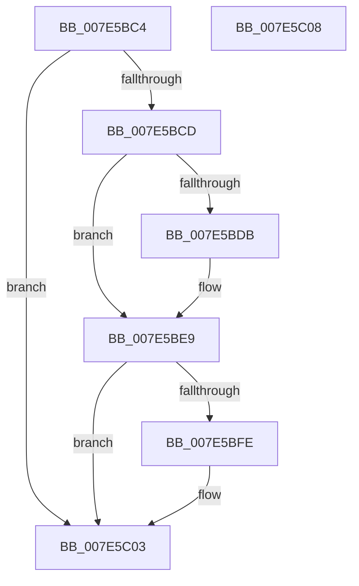

# CmFcShutdownSystem

- RVA: `0x007E5BC4`–`0x007E5C09` (길이 `69` bytes)
- VA: `0x00000001407E5BC4`
- 실행 섹션: `PAGE`
- PDB 이름 있음: `예`; PDB Function 태그: `아니요`
- unwind 정보 RVA: `0x0005C788`
- 디코드: `18`개 명령, `69/69` bytes 표시
- 미해석 바이트: `0` (있으면 어셈블리에 `.byte`로 보존)

> 이 문서는 커널 이미지의 기계어와 PDB 기호를 분석해 생성했습니다. 4번과 5번은 함수 원형과 자료형을 바이너리 사용 방식에서 추정한 C 해석이며 원본 소스 복구 결과는 아닙니다.

## 1. Dependencies

- 직접 호출 지점: **5**; 고유 호출 대상: **5**
- 직접 호출자로 확인된 함수: **3**
- RIP 상대 이미지 참조: **3**

### Outgoing calls
- `0x007E5BCD` → [CmFcManagerDrainAllFeatureUsageNotifications](../7F/CmFcManagerDrainAllFeatureUsageNotifications_function_007F439C.md) (function, `0x007F439C`)
- `0x007E5BE4` → [CmFcpManagerPublishFeatureUsageData](../AB/CmFcpManagerPublishFeatureUsageData_function_00ABC468.md) (function, `0x00ABC468`)
- `0x007E5BF0` → [TlgAggregateFlush](../../text/6A/TlgAggregateFlush_function_006A5DCC.md) (function, `0x006A5DCC`)
- `0x007E5BF5` → [Feature_CmFcCallback__private_IsEnabledDeviceUsageNoInline](../../text/66/Feature_CmFcCallback__private_IsEnabledDeviceUsageNoInline_function_0066AA58.md) (function, `0x0066AA58`)
- `0x007E5BFE` → [CmFcDebugUninitialize](../../text/66/CmFcDebugUninitialize_function_0066B750.md) (function, `0x0066B750`)

### Direct callers
- [CmShutdownSystem0](../../text/66/CmShutdownSystem0_function_0066A588.md) at `0x0066A58E`
- [CmShutdownSystem1](../../text/66/CmShutdownSystem1_function_0066A5B0.md) at `0x0066A721`
- [CmShutdownSystem2](../../text/66/CmShutdownSystem2_function_0066A7FC.md) at `0x0066A82C`

### Static image references
- `0x007E5BD2` → RVA `0x00F0C8B0` (`.data`; read)
- `0x007E5BDD` → RVA `0x00EF72E0` (`.data`; read)
- `0x007E5BE9` → RVA `0x00E09F20` (`.data`; read)

## 2. Other-region calls and transfers

- 다른 실행 섹션으로 향하는 call: **3**
  - `0x007E5BF0` → [TlgAggregateFlush](../../text/6A/TlgAggregateFlush_function_006A5DCC.md) (`PAGE` → `.text`)
  - `0x007E5BF5` → [Feature_CmFcCallback__private_IsEnabledDeviceUsageNoInline](../../text/66/Feature_CmFcCallback__private_IsEnabledDeviceUsageNoInline_function_0066AA58.md) (`PAGE` → `.text`)
  - `0x007E5BFE` → [CmFcDebugUninitialize](../../text/66/CmFcDebugUninitialize_function_0066B750.md) (`PAGE` → `.text`)
- 별도 외부 분기/꼬리 이동을 확인하지 못했습니다.

## 3. Assembly (complete function range)

```asm
007E5BC4  48 83 EC 28                     sub rsp, 0x28
007E5BC8  83 F9 01                        cmp ecx, 1
007E5BCB  75 36                           jne 0x1407e5c03
007E5BCD  E8 CA E7 00 00                  call 0x1407f439c
007E5BD2  83 3D D7 6C 72 00 00            cmp dword ptr [rip + 0x726cd7], 0
007E5BD9  75 0E                           jne 0x1407e5be9
007E5BDB  33 D2                           xor edx, edx
007E5BDD  48 8D 0D FC 16 71 00            lea rcx, [rip + 0x7116fc]
007E5BE4  E8 7F 68 2D 00                  call 0x140abc468
007E5BE9  48 8D 0D 30 43 62 00            lea rcx, [rip + 0x624330]
007E5BF0  E8 D7 01 EC FF                  call 0x1406a5dcc
007E5BF5  E8 5E 4E E8 FF                  call 0x14066aa58
007E5BFA  85 C0                           test eax, eax
007E5BFC  74 05                           je 0x1407e5c03
007E5BFE  E8 4D 5B E8 FF                  call 0x14066b750
007E5C03  48 83 C4 28                     add rsp, 0x28
007E5C07  C3                              ret
007E5C08  CC                              int3
```

## 4. C-style interpretation (structured pseudocode)

```c
__int64 __fastcall CmFcShutdownSystem(int a1, int a2)
{
    __int64 result;
    __int64 v_rsp;

    v_rsp = (v_rsp) - (40);
    if (a1 != 1) goto loc_007E5C03;
    result = CmFcManagerDrainAllFeatureUsageNotifications(a1, a2, a3, a4);
    if ((*(unsigned int *)(v_rip + 7498967)) == 0) {
        a2 = 0;
        a1 = v_rip + 7411452;
        result = CmFcpManagerPublishFeatureUsageData(a1, a2, a3, a4);
    }
    result = TlgAggregateFlush(v_rip + 6439728, a2, a3, a4);
    result = Feature_CmFcCallback__private_IsEnabledDeviceUsageNoInline(v_rip + 6439728, a2, a3, a4);
    if ((unsigned int)(result) != 0) {
        result = CmFcDebugUninitialize(v_rip + 6439728, a2, a3, a4);
    }
    v_rsp = (v_rsp) + (40);
    return result;
}
```

## 5. (Beta) C Style

```c
int64_t CmFcShutdownSystem(int32_t Arg1, int32_t Arg2)
{
    int64_t result;
    int64_t local_rsp;

    local_rsp = (local_rsp) - (40);
    if (Arg1 != 1) goto loc_007E5C03;
    result = CmFcManagerDrainAllFeatureUsageNotifications(Arg1, Arg2, a3, a4);
    if ((*(uint32_t *)(v_rip + 0x726CD7)) == 0) {
        Arg2 = 0;
        Arg1 = v_rip + 7411452;
        result = CmFcpManagerPublishFeatureUsageData(Arg1, Arg2, a3, a4);
    }
    result = TlgAggregateFlush(v_rip + 6439728, Arg2, a3, a4);
    result = Feature_CmFcCallback__private_IsEnabledDeviceUsageNoInline(v_rip + 6439728, Arg2, a3, a4);
    if ((uint32_t)(result) != 0) {
        result = CmFcDebugUninitialize(v_rip + 6439728, Arg2, a3, a4);
    }
    local_rsp = (local_rsp) + (40);
    return result;
}
```

## 6. Execution-region graph

[열기: 2D/3D 그래프와 함수 탐색 컨트롤 패널](../../../control-panel.html?section=page&rva=0x007E5BC4&view=graph)

- 2D 그래프는 위에서 아래로 흐르고, 3D 그래프는 빈 공간을 드래그해 회전합니다. Shift+드래그는 이동, 휠은 확대·축소, 함수 노드 선택은 대상 보고서 이동입니다.

### Static fallback


