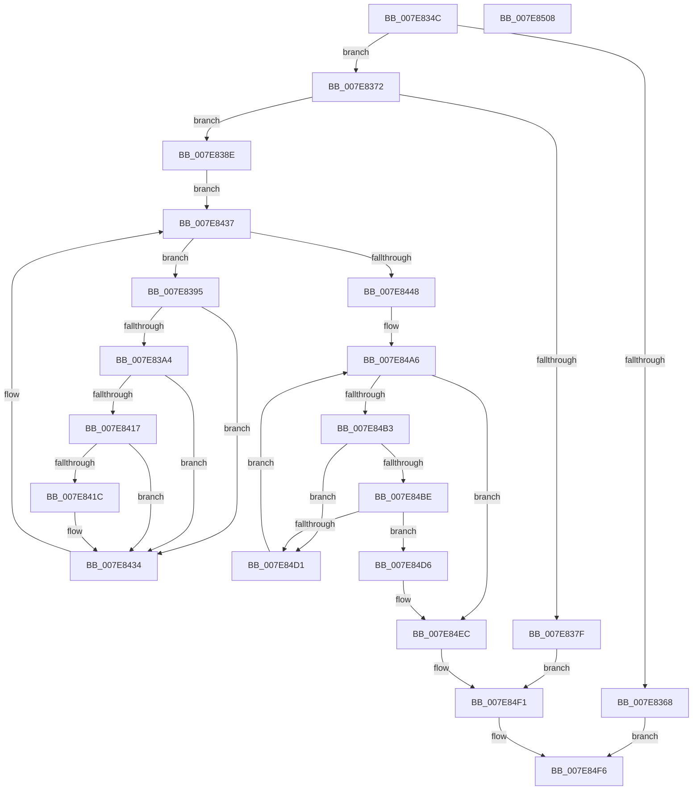

# CmFreezeRegistry

- RVA: `0x007E834C`–`0x007E8509` (길이 `445` bytes)
- VA: `0x00000001407E834C`
- 실행 섹션: `PAGE`
- PDB 이름 있음: `예`; PDB Function 태그: `아니요`
- unwind 정보 RVA: `0x000794E0`
- 디코드: `104`개 명령, `445/445` bytes 표시
- 미해석 바이트: `0` (있으면 어셈블리에 `.byte`로 보존)

> 이 문서는 커널 이미지의 기계어와 PDB 기호를 분석해 생성했습니다. 4번과 5번은 함수 원형과 자료형을 바이너리 사용 방식에서 추정한 C 해석이며 원본 소스 복구 결과는 아닙니다.

## 1. Dependencies

- 직접 호출 지점: **16**; 고유 호출 대상: **14**
- 직접 호출자로 확인된 함수: **1**
- RIP 상대 이미지 참조: **5**

### Outgoing calls
- `0x007E835F` → [CmpAcquireShutdownRundown](../../pagecmrc/BC/CmpAcquireShutdownRundown_function_00BC9400.md) (function, `0x00BC9400`)
- `0x007E8372` → [CmpLockRegistryExclusive](../84/CmpLockRegistryExclusive_function_0084F9B4.md) (function, `0x0084F9B4`)
- `0x007E8384` → [CmpUnlockRegistry](../../pagecmrc/BC/CmpUnlockRegistry_function_00BC9A84.md) (function, `0x00BC9A84`)
- `0x007E841F` → [HvLockHiveWriter](../85/HvLockHiveWriter_function_00859894.md) (function, `0x00859894`)
- `0x007E8427` → [HvMarkBaseBlockDirty](../87/HvMarkBaseBlockDirty_function_0087BD04.md) (function, `0x0087BD04`)
- `0x007E842F` → [HvUnlockHiveWriter](../85/HvUnlockHiveWriter_function_008598E4.md) (function, `0x008598E4`)
- `0x007E8437` → [CmpGetNextActiveHive](../84/CmpGetNextActiveHive_function_0084E2A0.md) (function, `0x0084E2A0`)
- `0x007E847F` → [KiSetTimerEx](../../text/23/KiSetTimerEx_function_00232CB0.md) (function, `0x00232CB0`)
- `0x007E8489` → [CmpDisableLazyFlush](../../text/4F/CmpDisableLazyFlush_function_004FC648.md) (function, `0x004FC648`)
- `0x007E848E` → [CmpUnlockRegistry](../../pagecmrc/BC/CmpUnlockRegistry_function_00BC9A84.md) (function, `0x00BC9A84`)
- `0x007E84A6` → [CmpGetNextActiveHive](../84/CmpGetNextActiveHive_function_0084E2A0.md) (function, `0x0084E2A0`)
- `0x007E84C6` → [CmpFlushHive](../9B/CmpFlushHive_function_009B3DC0.md) (function, `0x009B3DC0`)
- `0x007E84DD` → [ExReleaseRundownProtection](../../text/34/ExReleaseRundownProtection_function_00349E80.md) (function, `0x00349E80`)
- `0x007E84E2` → [CmThawRegistry](CmThawRegistry_function_007E8510.md) (function, `0x007E8510`)
- `0x007E84EC` → [KeLeaveCriticalRegion](../../text/25/KeLeaveCriticalRegion_function_0025D8B0.md) (function, `0x0025D8B0`)
- `0x007E84F1` → [CmpReleaseShutdownRundown](../../pagecmrc/BC/CmpReleaseShutdownRundown_function_00BC9880.md) (function, `0x00BC9880`)

### Direct callers
- [NtFreezeRegistry](../7D/NtFreezeRegistry_function_007DFBD0.md) at `0x007DFC53`

### Static image references
- `0x007E8377` → RVA `0x00EEFBF8` (`.data`; read)
- `0x007E8448` → RVA `0x00E0EC90` (`.data`; read)
- `0x007E844E` → RVA `0x00EF7120` (`.data`; read)
- `0x007E8457` → RVA `0x00EEFBF8` (`.data`; write)
- `0x007E8473` → RVA `0x00EF7160` (`.data`; read)

## 2. Other-region calls and transfers

- 다른 실행 섹션으로 향하는 call: **8**
  - `0x007E835F` → [CmpAcquireShutdownRundown](../../pagecmrc/BC/CmpAcquireShutdownRundown_function_00BC9400.md) (`PAGE` → `PAGECMRC`)
  - `0x007E8384` → [CmpUnlockRegistry](../../pagecmrc/BC/CmpUnlockRegistry_function_00BC9A84.md) (`PAGE` → `PAGECMRC`)
  - `0x007E847F` → [KiSetTimerEx](../../text/23/KiSetTimerEx_function_00232CB0.md) (`PAGE` → `.text`)
  - `0x007E8489` → [CmpDisableLazyFlush](../../text/4F/CmpDisableLazyFlush_function_004FC648.md) (`PAGE` → `.text`)
  - `0x007E848E` → [CmpUnlockRegistry](../../pagecmrc/BC/CmpUnlockRegistry_function_00BC9A84.md) (`PAGE` → `PAGECMRC`)
  - `0x007E84DD` → [ExReleaseRundownProtection](../../text/34/ExReleaseRundownProtection_function_00349E80.md) (`PAGE` → `.text`)
  - `0x007E84EC` → [KeLeaveCriticalRegion](../../text/25/KeLeaveCriticalRegion_function_0025D8B0.md) (`PAGE` → `.text`)
  - `0x007E84F1` → [CmpReleaseShutdownRundown](../../pagecmrc/BC/CmpReleaseShutdownRundown_function_00BC9880.md) (`PAGE` → `PAGECMRC`)
- 별도 외부 분기/꼬리 이동을 확인하지 못했습니다.

## 3. Assembly (complete function range)

```asm
007E834C  48 89 5C 24 08                  mov qword ptr [rsp + 8], rbx
007E8351  48 89 74 24 10                  mov qword ptr [rsp + 0x10], rsi
007E8356  57                              push rdi
007E8357  48 83 EC 30                     sub rsp, 0x30
007E835B  8B F1                           mov esi, ecx
007E835D  33 FF                           xor edi, edi
007E835F  E8 9C 10 3E 00                  call 0x140bc9400
007E8364  84 C0                           test al, al
007E8366  75 0A                           jne 0x1407e8372
007E8368  BF 89 01 00 C0                  mov edi, 0xc0000189
007E836D  E9 84 01 00 00                  jmp 0x1407e84f6
007E8372  E8 3D 76 06 00                  call 0x14084f9b4
007E8377  39 3D 7B 78 70 00               cmp dword ptr [rip + 0x70787b], edi
007E837D  74 0F                           je 0x1407e838e
007E837F  BF 89 01 00 C0                  mov edi, 0xc0000189
007E8384  E8 FB 16 3E 00                  call 0x140bc9a84
007E8389  E9 63 01 00 00                  jmp 0x1407e84f1
007E838E  33 C9                           xor ecx, ecx
007E8390  E9 A2 00 00 00                  jmp 0x1407e8437
007E8395  8B 8B A0 00 00 00               mov ecx, dword ptr [rbx + 0xa0]
007E839B  F6 C1 03                        test cl, 3
007E839E  0F 85 90 00 00 00               jne 0x1407e8434
007E83A4  48 8B 4B 40                     mov rcx, qword ptr [rbx + 0x40]
007E83A8  0F 10 41 70                     movups xmm0, xmmword ptr [rcx + 0x70]
007E83AC  F3 0F 7F 81 D8 0F 00 00         movdqu xmmword ptr [rcx + 0xfd8], xmm0
007E83B4  48 8B 43 40                     mov rax, qword ptr [rbx + 0x40]
007E83B8  0F 10 88 94 00 00 00            movups xmm1, xmmword ptr [rax + 0x94]
007E83BF  F3 0F 7F 88 C8 0F 00 00         movdqu xmmword ptr [rax + 0xfc8], xmm1
007E83C7  48 8B 43 40                     mov rax, qword ptr [rbx + 0x40]
007E83CB  0F 10 80 80 00 00 00            movups xmm0, xmmword ptr [rax + 0x80]
007E83D2  F3 0F 7F 80 E8 0F 00 00         movdqu xmmword ptr [rax + 0xfe8], xmm0
007E83DA  48 8B 43 40                     mov rax, qword ptr [rbx + 0x40]
007E83DE  0F 57 C0                        xorps xmm0, xmm0
007E83E1  0F 11 40 70                     movups xmmword ptr [rax + 0x70], xmm0
007E83E5  48 8B 43 40                     mov rax, qword ptr [rbx + 0x40]
007E83E9  0F 11 80 94 00 00 00            movups xmmword ptr [rax + 0x94], xmm0
007E83F0  48 8B 43 40                     mov rax, qword ptr [rbx + 0x40]
007E83F4  0F 11 80 80 00 00 00            movups xmmword ptr [rax + 0x80], xmm0
007E83FB  48 8B 43 40                     mov rax, qword ptr [rbx + 0x40]
007E83FF  21 B8 A4 00 00 00               and dword ptr [rax + 0xa4], edi
007E8405  8B 83 10 10 00 00               mov eax, dword ptr [rbx + 0x1010]
007E840B  25 00 03 00 00                  and eax, 0x300
007E8410  3D 00 01 00 00                  cmp eax, 0x100
007E8415  74 1D                           je 0x1407e8434
007E8417  39 7B 68                        cmp dword ptr [rbx + 0x68], edi
007E841A  75 18                           jne 0x1407e8434
007E841C  48 8B CB                        mov rcx, rbx
007E841F  E8 70 14 07 00                  call 0x140859894
007E8424  48 8B CB                        mov rcx, rbx
007E8427  E8 D8 38 09 00                  call 0x14087bd04
007E842C  48 8B CB                        mov rcx, rbx
007E842F  E8 B0 14 07 00                  call 0x1408598e4
007E8434  48 8B CB                        mov rcx, rbx
007E8437  E8 64 5E 06 00                  call 0x14084e2a0
007E843C  48 8B D8                        mov rbx, rax
007E843F  48 85 C0                        test rax, rax
007E8442  0F 85 4D FF FF FF               jne 0x1407e8395
007E8448  8B 05 42 68 62 00               mov eax, dword ptr [rip + 0x626842]
007E844E  48 8D 0D CB EC 70 00            lea rcx, [rip + 0x70eccb]
007E8455  85 F6                           test esi, esi
007E8457  C7 05 97 77 70 00 01 00 00 00   mov dword ptr [rip + 0x707797], 1
007E8461  0F 45 C6                        cmovne eax, esi
007E8464  45 33 C9                        xor r9d, r9d
007E8467  48 98                           cdqe
007E8469  45 33 C0                        xor r8d, r8d
007E846C  48 69 D0 80 69 67 FF            imul rdx, rax, -0x989680
007E8473  48 8D 05 E6 EC 70 00            lea rax, [rip + 0x70ece6]
007E847A  48 89 44 24 20                  mov qword ptr [rsp + 0x20], rax
007E847F  E8 2C A8 A4 FF                  call 0x140232cb0
007E8484  B9 02 00 00 00                  mov ecx, 2
007E8489  E8 BA 41 D1 FF                  call 0x1404fc648
007E848E  E8 F1 15 3E 00                  call 0x140bc9a84
007E8493  65 48 8B 04 25 88 01 00 00      mov rax, qword ptr gs:[0x188]
007E849C  66 FF 88 E4 01 00 00            dec word ptr [rax + 0x1e4]
007E84A3  90                              nop
007E84A4  33 C9                           xor ecx, ecx
007E84A6  E8 F5 5D 06 00                  call 0x14084e2a0
007E84AB  48 8B D8                        mov rbx, rax
007E84AE  48 85 C0                        test rax, rax
007E84B1  74 39                           je 0x1407e84ec
007E84B3  8B 88 A0 00 00 00               mov ecx, dword ptr [rax + 0xa0]
007E84B9  F6 C1 03                        test cl, 3
007E84BC  75 13                           jne 0x1407e84d1
007E84BE  BA 0D 00 00 00                  mov edx, 0xd
007E84C3  48 8B C8                        mov rcx, rax
007E84C6  E8 F5 B8 1C 00                  call 0x1409b3dc0
007E84CB  8B F8                           mov edi, eax
007E84CD  85 C0                           test eax, eax
007E84CF  78 05                           js 0x1407e84d6
007E84D1  48 8B CB                        mov rcx, rbx
007E84D4  EB D0                           jmp 0x1407e84a6
007E84D6  48 8D 8B 68 06 00 00            lea rcx, [rbx + 0x668]
007E84DD  E8 9E 19 B6 FF                  call 0x140349e80
007E84E2  E8 29 00 00 00                  call 0x1407e8510
007E84E7  BF 4D 01 00 C0                  mov edi, 0xc000014d
007E84EC  E8 BF 53 A7 FF                  call 0x14025d8b0
007E84F1  E8 8A 13 3E 00                  call 0x140bc9880
007E84F6  48 8B 5C 24 40                  mov rbx, qword ptr [rsp + 0x40]
007E84FB  8B C7                           mov eax, edi
007E84FD  48 8B 74 24 48                  mov rsi, qword ptr [rsp + 0x48]
007E8502  48 83 C4 30                     add rsp, 0x30
007E8506  5F                              pop rdi
007E8507  C3                              ret
007E8508  CC                              int3
```

## 4. C-style interpretation (structured pseudocode)

```c
__int64 __fastcall CmFreezeRegistry(int a1, __int64 a2, int a3, int a4)
{
    __int64 result;
    __int64 v_rdi;
    __int64 v_rsp;
    unsigned __int64 v_stack_m18;
    unsigned __int64 v_stack_p10;
    unsigned __int64 v_stack_p8;

    v_stack_p8 = v_rbx;
    v_stack_p10 = v_rsi;
    v_rsp = (v_rsp) - (48);
    v_rdi = 0;
    result = CmpAcquireShutdownRundown(a1, a2, a3, a4);
    if ((unsigned __int8)(result) != 0) goto loc_007E8372;
    goto loc_007E84F6;
loc_007E8372:
    result = CmpLockRegistryExclusive(a1, a2, a3, a4);
    if ((*(unsigned int *)(v_rip + 7370875)) == ((unsigned int)((unsigned int)(0xC0000189ULL)))) goto loc_007E838E;
    result = CmpUnlockRegistry(a1, a2, a3, a4);
    goto loc_007E84F1;
loc_007E838E:
    a1 = 0;
    goto loc_007E8437;
loc_007E8395:
    if ((((unsigned __int8)((unsigned int)(*(unsigned int *)(v_rbx + 160)))) & (3)) != 0) goto loc_007E8434;
    *(unsigned __int64 *)(*(unsigned __int64 *)(v_rbx + 64) + 4056) = v_xmm0;
    *(unsigned __int64 *)(*(unsigned __int64 *)(v_rbx + 64) + 4040) = v_xmm1;
    *(unsigned __int64 *)(*(unsigned __int64 *)(v_rbx + 64) + 4072) = v_xmm0;
    *(unsigned __int64 *)(*(unsigned __int64 *)(v_rbx + 64) + 112) = v_xmm0;
    *(unsigned __int64 *)(*(unsigned __int64 *)(v_rbx + 64) + 148) = v_xmm0;
    *(unsigned __int64 *)(*(unsigned __int64 *)(v_rbx + 64) + 128) = v_xmm0;
    result = (unsigned int)(((unsigned int)(*(unsigned int *)(v_rbx + 4112))) & (768));
    if (((unsigned int)(result)) == 256) goto loc_007E8434;
    if ((*(unsigned int *)(v_rbx + 104)) == ((unsigned int)((unsigned int)(0xC0000189ULL)))) {
        a1 = v_rbx;
        result = HvLockHiveWriter(a1, a2, a3, a4);
        a1 = v_rbx;
        result = HvMarkBaseBlockDirty(a1, a2, a3, a4);
        a1 = v_rbx;
        result = HvUnlockHiveWriter(a1, a2, a3, a4);
    }
loc_007E8437:
    result = CmpGetNextActiveHive(v_rbx, a2, a3, a4);
    if (result != 0) goto loc_007E8395;
    *(unsigned int *)(v_rip + 7370647) = 1;
    result = (unsigned int)(*(unsigned int *)(v_rip + 6449218));
    if ((unsigned int)((unsigned int)(a1)) != 0) { result = (unsigned int)((unsigned int)(a1)); }
    a4 = 0;
    a3 = 0;
    a2 = (a2) * (result);
    v_stack_m18 = v_rip + 7400678;
    result = KiSetTimerEx(v_rip + 7400651, a2, a3, a4);
    result = CmpDisableLazyFlush(2, a2, a3, a4);
    result = CmpUnlockRegistry(2, a2, a3, a4);
    a1 = 0;
loc_007E84A6:
    result = CmpGetNextActiveHive(a1, a2, a3, a4);
    if (result == 0) goto loc_007E84EC;
    if ((((unsigned __int8)((unsigned int)(*(unsigned int *)(result + 160)))) & (3)) != 0) goto loc_007E84D1;
    result = CmpFlushHive(result, 13, a3, a4);
    if (sign_flag) goto loc_007E84D6;
loc_007E84D1:
    goto loc_007E84A6;
loc_007E84D6:
    result = ExReleaseRundownProtection(result + 1640, 13, a3, a4);
    result = CmThawRegistry(result + 1640, 13, a3, a4);
loc_007E84EC:
    result = KeLeaveCriticalRegion(result + 1640, 13, a3, a4);
loc_007E84F1:
    result = CmpReleaseShutdownRundown(result + 1640, 13, a3, a4);
loc_007E84F6:
    v_rsp = (v_rsp) + (48);
    return (unsigned int)((unsigned int)((unsigned int)(0xC000014DULL)));
}
```

## 5. (Beta) C Style

```c
int64_t CmFreezeRegistry(int32_t Arg1, int64_t Arg2, int32_t Arg3, int32_t Arg4)
{
    int64_t result;
    int64_t local_rdi;
    int64_t local_rsp;
    uint64_t v_stack_m18;
    uint64_t v_stack_p10;
    uint64_t v_stack_p8;

    v_stack_p8 = local_rbx;
    v_stack_p10 = local_rsi;
    local_rsp = (local_rsp) - (48);
    local_rdi = 0;
    result = CmpAcquireShutdownRundown(Arg1, Arg2, Arg3, Arg4);
    if ((uint8_t)(result) != 0) goto loc_007E8372;
    goto loc_007E84F6;
loc_007E8372:
    result = CmpLockRegistryExclusive(Arg1, Arg2, Arg3, Arg4);
    if ((*(uint32_t *)(v_rip + 0x70787B)) == ((uint32_t)((uint32_t)(0xC0000189ULL)))) goto loc_007E838E;
    result = CmpUnlockRegistry(Arg1, Arg2, Arg3, Arg4);
    goto loc_007E84F1;
loc_007E838E:
    Arg1 = 0;
    goto loc_007E8437;
loc_007E8395:
    if ((((uint8_t)((uint32_t)(*(uint32_t *)(local_rbx + 0xA0)))) & (3)) != 0) goto loc_007E8434;
    *(uint64_t *)(*(uint64_t *)(local_rbx + 0x40) + 0xFD8) = v_xmm0;
    *(uint64_t *)(*(uint64_t *)(local_rbx + 0x40) + 0xFC8) = v_xmm1;
    *(uint64_t *)(*(uint64_t *)(local_rbx + 0x40) + 0xFE8) = v_xmm0;
    *(uint64_t *)(*(uint64_t *)(local_rbx + 0x40) + 0x70) = v_xmm0;
    *(uint64_t *)(*(uint64_t *)(local_rbx + 0x40) + 0x94) = v_xmm0;
    *(uint64_t *)(*(uint64_t *)(local_rbx + 0x40) + 0x80) = v_xmm0;
    result = (uint32_t)(((uint32_t)(*(uint32_t *)(local_rbx + 0x1010))) & (768));
    if (((uint32_t)(result)) == 256) goto loc_007E8434;
    if ((*(uint32_t *)(local_rbx + 0x68)) == ((uint32_t)((uint32_t)(0xC0000189ULL)))) {
        Arg1 = local_rbx;
        result = HvLockHiveWriter(Arg1, Arg2, Arg3, Arg4);
        Arg1 = local_rbx;
        result = HvMarkBaseBlockDirty(Arg1, Arg2, Arg3, Arg4);
        Arg1 = local_rbx;
        result = HvUnlockHiveWriter(Arg1, Arg2, Arg3, Arg4);
    }
loc_007E8437:
    result = CmpGetNextActiveHive(local_rbx, Arg2, Arg3, Arg4);
    if (result != 0) goto loc_007E8395;
    *(uint32_t *)(v_rip + 0x707797) = 1;
    result = (uint32_t)(*(uint32_t *)(v_rip + 0x626842));
    if ((uint32_t)((uint32_t)(Arg1)) != 0) { result = (uint32_t)((uint32_t)(Arg1)); }
    Arg4 = 0;
    Arg3 = 0;
    Arg2 = (Arg2) * (result);
    v_stack_m18 = v_rip + 7400678;
    result = KiSetTimerEx(v_rip + 7400651, Arg2, Arg3, Arg4);
    result = CmpDisableLazyFlush(2, Arg2, Arg3, Arg4);
    result = CmpUnlockRegistry(2, Arg2, Arg3, Arg4);
    Arg1 = 0;
loc_007E84A6:
    result = CmpGetNextActiveHive(Arg1, Arg2, Arg3, Arg4);
    if (result == 0) goto loc_007E84EC;
    if ((((uint8_t)((uint32_t)(*(uint32_t *)(result + 0xA0)))) & (3)) != 0) goto loc_007E84D1;
    result = CmpFlushHive(result, 13, Arg3, Arg4);
    if (sign_flag) goto loc_007E84D6;
loc_007E84D1:
    goto loc_007E84A6;
loc_007E84D6:
    result = ExReleaseRundownProtection(result + 1640, 13, Arg3, Arg4);
    result = CmThawRegistry(result + 1640, 13, Arg3, Arg4);
loc_007E84EC:
    result = KeLeaveCriticalRegion(result + 1640, 13, Arg3, Arg4);
loc_007E84F1:
    result = CmpReleaseShutdownRundown(result + 1640, 13, Arg3, Arg4);
loc_007E84F6:
    local_rsp = (local_rsp) + (48);
    return (uint32_t)((uint32_t)((uint32_t)(0xC000014DULL)));
}
```

## 6. Execution-region graph

[열기: 2D/3D 그래프와 함수 탐색 컨트롤 패널](../../../control-panel.html?section=page&rva=0x007E834C&view=graph)

- 2D 그래프는 위에서 아래로 흐르고, 3D 그래프는 빈 공간을 드래그해 회전합니다. Shift+드래그는 이동, 휠은 확대·축소, 함수 노드 선택은 대상 보고서 이동입니다.

### Static fallback


