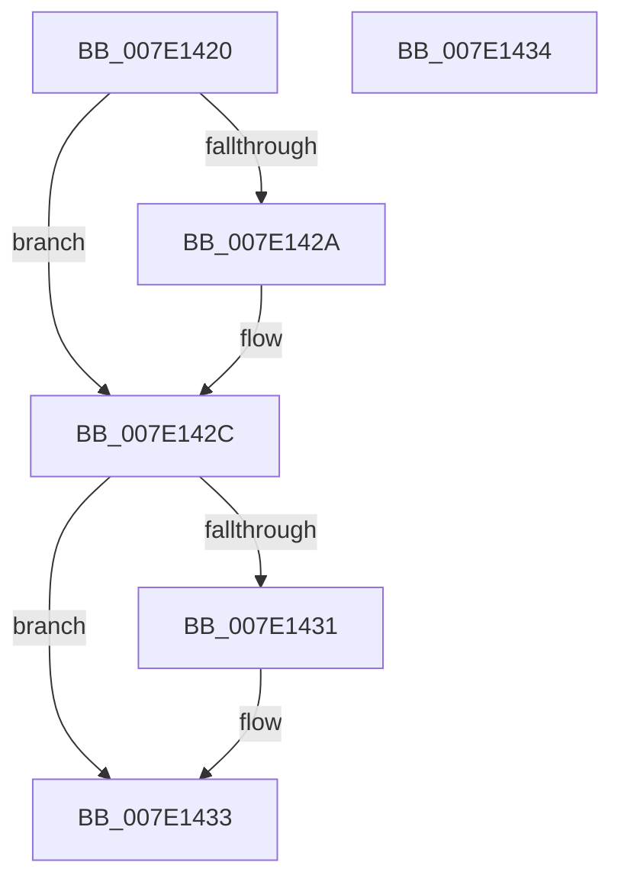

# CmGetCallbackVersion

- RVA: `0x007E1420`–`0x007E1435` (길이 `21` bytes)
- VA: `0x00000001407E1420`
- 실행 섹션: `PAGE`
- PDB 이름 있음: `예`; PDB Function 태그: `아니요`
- unwind 정보 RVA: `0x000DB714`
- 디코드: `9`개 명령, `21/21` bytes 표시
- 미해석 바이트: `0` (있으면 어셈블리에 `.byte`로 보존)

> 이 문서는 커널 이미지의 기계어와 PDB 기호를 분석해 생성했습니다. 4번과 5번은 함수 원형과 자료형을 바이너리 사용 방식에서 추정한 C 해석이며 원본 소스 복구 결과는 아닙니다.

## 1. Dependencies

- 직접 호출 지점: **0**; 고유 호출 대상: **0**
- 직접 호출자로 확인된 함수: **0**
- RIP 상대 이미지 참조: **0**

### Outgoing calls
- 직접 디코드된 call 명령이 없습니다.

### Direct callers
- 이 함수 시작 RVA로 연결되는 직접 call은 확인되지 않았습니다. 간접 호출은 완전히 역산할 수 없습니다.

### Static image references
- 디코드된 RIP-relative 메모리 참조가 없습니다.

## 2. Other-region calls and transfers

- 다른 실행 섹션으로 향하는 call: **0**
- 별도 외부 분기/꼬리 이동을 확인하지 못했습니다.

## 3. Assembly (complete function range)

```asm
007E1420  B8 01 00 00 00                  mov eax, 1
007E1425  48 85 C9                        test rcx, rcx
007E1428  74 02                           je 0x1407e142c
007E142A  89 01                           mov dword ptr [rcx], eax
007E142C  48 85 D2                        test rdx, rdx
007E142F  74 02                           je 0x1407e1433
007E1431  89 02                           mov dword ptr [rdx], eax
007E1433  C3                              ret
007E1434  CC                              int3
```

## 4. C-style interpretation (structured pseudocode)

```c
__int64 __fastcall CmGetCallbackVersion(__int64 a1, __int64 a2)
{
    if (a1 != 0) {
        *(unsigned int *)(a1) = 1;
    }
    if (a2 != 0) {
        *(unsigned int *)(a2) = 1;
    }
    return 1;
}
```

## 5. (Beta) C Style

```c
int64_t CmGetCallbackVersion(int64_t Arg1, int64_t Arg2)
{
    if (Arg1 != 0) {
        *(uint32_t *)(Arg1) = 1;
    }
    if (Arg2 != 0) {
        *(uint32_t *)(Arg2) = 1;
    }
    return 1;
}
```

## 6. Execution-region graph

[열기: 2D/3D 그래프와 함수 탐색 컨트롤 패널](../../../control-panel.html?section=page&rva=0x007E1420&view=graph)

- 2D 그래프는 위에서 아래로 흐르고, 3D 그래프는 빈 공간을 드래그해 회전합니다. Shift+드래그는 이동, 휠은 확대·축소, 함수 노드 선택은 대상 보고서 이동입니다.

### Static fallback


