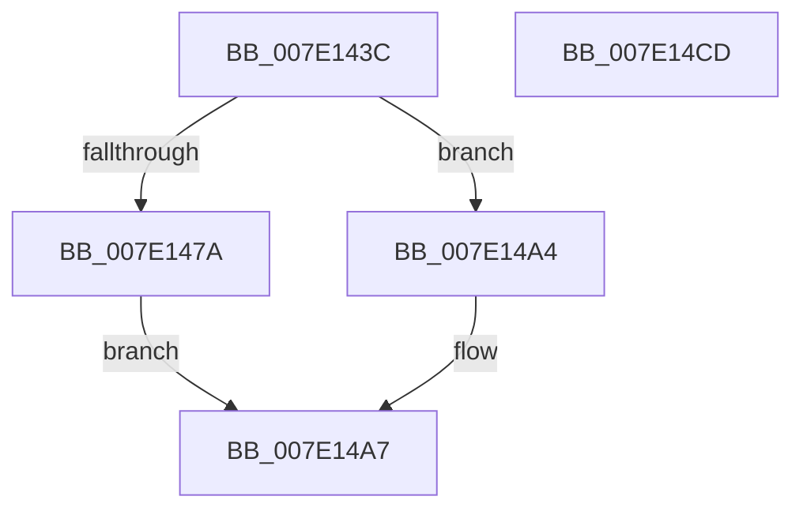

# CmInitializeProcessorCallbacks

- RVA: `0x007E143C`–`0x007E14CE` (길이 `146` bytes)
- VA: `0x00000001407E143C`
- 실행 섹션: `PAGE`
- PDB 이름 있음: `예`; PDB Function 태그: `아니요`
- unwind 정보 RVA: `0x0009B270`
- 디코드: `35`개 명령, `146/146` bytes 표시
- 미해석 바이트: `0` (있으면 어셈블리에 `.byte`로 보존)

> 이 문서는 커널 이미지의 기계어와 PDB 기호를 분석해 생성했습니다. 4번과 5번은 함수 원형과 자료형을 바이너리 사용 방식에서 추정한 C 해석이며 원본 소스 복구 결과는 아닙니다.

## 1. Dependencies

- 직접 호출 지점: **2**; 고유 호출 대상: **2**
- 직접 호출자로 확인된 함수: **2**
- RIP 상대 이미지 참조: **2**

### Outgoing calls
- `0x007E1466` → [ExAllocatePool2](../../poolcode/B8/ExAllocatePool2_function_00B820F0.md) (function, `0x00B820F0`)
- `0x007E149D` → [ExInitializeSystemLookasideList](../../pagelk/B7/ExInitializeSystemLookasideList_function_00B7E57C.md) (function, `0x00B7E57C`)

### Direct callers
- [KiStartDynamicProcessor](../74/KiStartDynamicProcessor_function_007456C8.md) at `0x007459DD`
- [CmpInitCallbacks](CmpInitCallbacks_function_007E19A0.md) at `0x007E1A64`

### Static image references
- `0x007E146B` → RVA `0x00E2C9C0` (`.data`; read)
- `0x007E147A` → RVA `0x00EFAC00` (`.data`; read)

## 2. Other-region calls and transfers

- 다른 실행 섹션으로 향하는 call: **2**
  - `0x007E1466` → [ExAllocatePool2](../../poolcode/B8/ExAllocatePool2_function_00B820F0.md) (`PAGE` → `POOLCODE`)
  - `0x007E149D` → [ExInitializeSystemLookasideList](../../pagelk/B7/ExInitializeSystemLookasideList_function_00B7E57C.md) (`PAGE` → `PAGELK`)
- 별도 외부 분기/꼬리 이동을 확인하지 못했습니다.

## 3. Assembly (complete function range)

```asm
007E143C  48 89 5C 24 08                  mov qword ptr [rsp + 8], rbx
007E1441  48 89 74 24 10                  mov qword ptr [rsp + 0x10], rsi
007E1446  48 89 7C 24 18                  mov qword ptr [rsp + 0x18], rdi
007E144B  41 56                           push r14
007E144D  48 83 EC 30                     sub rsp, 0x30
007E1451  BA 80 00 00 00                  mov edx, 0x80
007E1456  48 8B F9                        mov rdi, rcx
007E1459  41 B8 43 4D 63 69               mov r8d, 0x69634d43
007E145F  44 8D 72 C0                     lea r14d, [rdx - 0x40]
007E1463  41 8B CE                        mov ecx, r14d
007E1466  E8 85 0C 3A 00                  call 0x140b820f0
007E146B  48 8D 35 4E B5 64 00            lea rsi, [rip + 0x64b54e]
007E1472  48 8B D8                        mov rbx, rax
007E1475  48 85 C0                        test rax, rax
007E1478  74 2A                           je 0x1407e14a4
007E147A  48 8D 05 7F 97 71 00            lea rax, [rip + 0x71977f]
007E1481  41 B9 43 4D 63 69               mov r9d, 0x69634d43
007E1487  48 89 44 24 28                  mov qword ptr [rsp + 0x28], rax
007E148C  41 8D 56 C1                     lea edx, [r14 - 0x3f]
007E1490  45 8D 46 F0                     lea r8d, [r14 - 0x10]
007E1494  66 44 89 74 24 20               mov word ptr [rsp + 0x20], r14w
007E149A  48 8B CB                        mov rcx, rbx
007E149D  E8 DA D0 39 00                  call 0x140b7e57c
007E14A2  EB 03                           jmp 0x1407e14a7
007E14A4  48 8B DE                        mov rbx, rsi
007E14A7  48 89 9F A0 08 00 00            mov qword ptr [rdi + 0x8a0], rbx
007E14AE  33 C0                           xor eax, eax
007E14B0  48 8B 5C 24 40                  mov rbx, qword ptr [rsp + 0x40]
007E14B5  48 89 B7 A8 08 00 00            mov qword ptr [rdi + 0x8a8], rsi
007E14BC  48 8B 74 24 48                  mov rsi, qword ptr [rsp + 0x48]
007E14C1  48 8B 7C 24 50                  mov rdi, qword ptr [rsp + 0x50]
007E14C6  48 83 C4 30                     add rsp, 0x30
007E14CA  41 5E                           pop r14
007E14CC  C3                              ret
007E14CD  CC                              int3
```

## 4. C-style interpretation (structured pseudocode)

```c
__int64 __fastcall CmInitializeProcessorCallbacks(__int64 a1)
{
    __int64 result;
    __int64 v_rsp;
    unsigned __int64 v_stack_m10;
    unsigned __int16 v_stack_m18;
    unsigned __int64 v_stack_p10;
    unsigned __int64 v_stack_p18;
    unsigned __int64 v_stack_p8;

    v_stack_p8 = v_rbx;
    v_stack_p10 = v_rsi;
    v_stack_p18 = v_rdi;
    v_rsp = (v_rsp) - (48);
    result = ExAllocatePool2((unsigned int)((unsigned int)(128 - 64)), 128, (unsigned int)(0x69634D43ULL), a4);
    if (result == 0) goto loc_007E14A4;
    v_stack_m10 = v_rip + 7444351;
    v_stack_m18 = (unsigned __int16)(128 - 64);
    result = ExInitializeSystemLookasideList(result, 128 - 64 - 63, 128 - 64 - 16, (unsigned int)(0x69634D43ULL));
    goto loc_007E14A7;
loc_007E14A4:
loc_007E14A7:
    *(unsigned __int64 *)(a1 + 2208) = v_rip + 6600014;
    result = 0;
    *(unsigned __int64 *)(a1 + 2216) = v_rip + 6600014;
    v_rsp = (v_rsp) + (48);
    return result;
}
```

## 5. (Beta) C Style

```c
int64_t CmInitializeProcessorCallbacks(void *Arg1)
{
    uint8_t *arg1 = (uint8_t *)Arg1;

    int64_t result;
    int64_t local_rsp;
    uint64_t v_stack_m10;
    uint16_t v_stack_m18;
    uint64_t v_stack_p10;
    uint64_t v_stack_p18;
    uint64_t v_stack_p8;

    v_stack_p8 = local_rbx;
    v_stack_p10 = local_rsi;
    v_stack_p18 = local_rdi;
    local_rsp = (local_rsp) - (48);
    result = ExAllocatePool2((uint32_t)((uint32_t)(128 - 64)), 128, (uint32_t)(0x69634D43ULL), a4);
    if (result == 0) goto loc_007E14A4;
    v_stack_m10 = v_rip + 7444351;
    v_stack_m18 = (uint16_t)(128 - 64);
    result = ExInitializeSystemLookasideList(result, 128 - 64 - 63, 128 - 64 - 16, (uint32_t)(0x69634D43ULL));
    goto loc_007E14A7;
loc_007E14A4:
loc_007E14A7:
    *(uint64_t *)(arg1 + 0x8A0) = v_rip + 6600014;
    result = 0;
    *(uint64_t *)(arg1 + 0x8A8) = v_rip + 6600014;
    local_rsp = (local_rsp) + (48);
    return result;
}
```

### 관측된 메모리 오프셋

구조체 형식이 확인되지 않은 접근은 인자 기준의 오프셋으로만 기록했습니다.

| 기준 인자 | 오프셋 표현 | 폭 (bit) | 접근 |
|---|---:|---:|---|
| `Arg1` | `+ 0x8A0` | `64` | `W` |
| `Arg1` | `+ 0x8A8` | `64` | `W` |

## 6. Execution-region graph

[열기: 2D/3D 그래프와 함수 탐색 컨트롤 패널](../../../control-panel.html?section=page&rva=0x007E143C&view=graph)

- 2D 그래프는 위에서 아래로 흐르고, 3D 그래프는 빈 공간을 드래그해 회전합니다. Shift+드래그는 이동, 휠은 확대·축소, 함수 노드 선택은 대상 보고서 이동입니다.

### Static fallback


