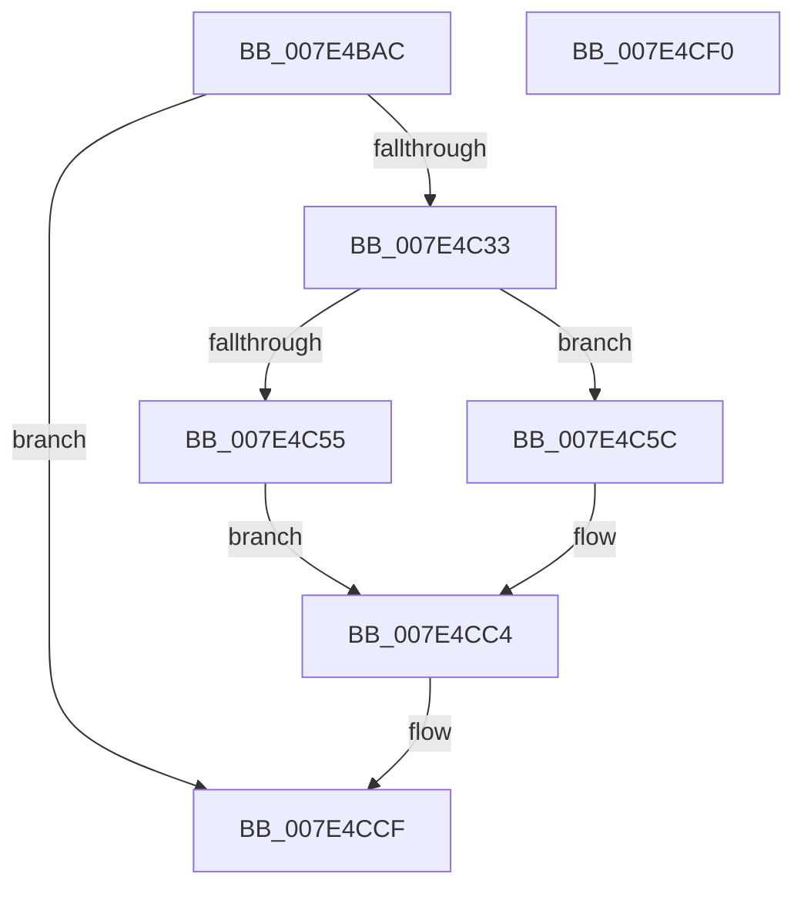

# CmInitializeProcessor

- RVA: `0x007E4BAC`–`0x007E4CF1` (길이 `325` bytes)
- VA: `0x00000001407E4BAC`
- 실행 섹션: `PAGE`
- PDB 이름 있음: `예`; PDB Function 태그: `아니요`
- unwind 정보 RVA: `0x000D6B1C`
- 디코드: `79`개 명령, `325/325` bytes 표시
- 미해석 바이트: `0` (있으면 어셈블리에 `.byte`로 보존)

> 이 문서는 커널 이미지의 기계어와 PDB 기호를 분석해 생성했습니다. 4번과 5번은 함수 원형과 자료형을 바이너리 사용 방식에서 추정한 C 해석이며 원본 소스 복구 결과는 아닙니다.

## 1. Dependencies

- 직접 호출 지점: **8**; 고유 호출 대상: **8**
- 직접 호출자로 확인된 함수: **1**
- RIP 상대 이미지 참조: **6**

### Outgoing calls
- `0x007E4C26` → [ZwCreateKey](../../text/6A/ZwCreateKey_function_006AD470.md) (function, `0x006AD470`)
- `0x007E4C44` → [ExAllocatePool2](../../poolcode/B8/ExAllocatePool2_function_00B820F0.md) (function, `0x00B820F0`)
- `0x007E4C92` → [KeSetSystemGroupAffinityThread](../../text/39/KeSetSystemGroupAffinityThread_function_00399140.md) (function, `0x00399140`)
- `0x007E4CA1` → [CmpAddProcessorConfigurationEntry](CmpAddProcessorConfigurationEntry_function_007E4CF8.md) (function, `0x007E4CF8`)
- `0x007E4CAA` → [KeRevertToUserGroupAffinityThread](../../text/39/KeRevertToUserGroupAffinityThread_function_00398EC0.md) (function, `0x00398EC0`)
- `0x007E4CB8` → [ExFreePoolWithTag](../../poolcode/B8/ExFreePoolWithTag_function_00B82870.md) (function, `0x00B82870`)
- `0x007E4CC8` → [ZwClose](../../text/6A/ZwClose_function_006AD2B0.md) (function, `0x006AD2B0`)
- `0x007E4CD6` → [_security_check_cookie](../../text/6A/_security_check_cookie_function_006AC640.md) (function, `0x006AC640`)

### Direct callers
- [KiStartDynamicProcessor](../74/KiStartDynamicProcessor_function_007456C8.md) at `0x00745B59`

### Static image references
- `0x007E4BC3` → RVA `0x00E0A740` (`.data`; read)
- `0x007E4BE9` → RVA `0x00FD9DE8` (`PAGEDATA`; read)
- `0x007E4C33` → RVA `0x00FD80A8` (`PAGEDATA`; read)
- `0x007E4C49` → RVA `0x00FD9AB0` (`PAGEDATA`; write)
- `0x007E4C63` → RVA `0x00F231B0` (`.data`; read)
- `0x007E4CAF` → RVA `0x00FD9AB0` (`PAGEDATA`; read)

## 2. Other-region calls and transfers

- 다른 실행 섹션으로 향하는 call: **7**
  - `0x007E4C26` → [ZwCreateKey](../../text/6A/ZwCreateKey_function_006AD470.md) (`PAGE` → `.text`)
  - `0x007E4C44` → [ExAllocatePool2](../../poolcode/B8/ExAllocatePool2_function_00B820F0.md) (`PAGE` → `POOLCODE`)
  - `0x007E4C92` → [KeSetSystemGroupAffinityThread](../../text/39/KeSetSystemGroupAffinityThread_function_00399140.md) (`PAGE` → `.text`)
  - `0x007E4CAA` → [KeRevertToUserGroupAffinityThread](../../text/39/KeRevertToUserGroupAffinityThread_function_00398EC0.md) (`PAGE` → `.text`)
  - `0x007E4CB8` → [ExFreePoolWithTag](../../poolcode/B8/ExFreePoolWithTag_function_00B82870.md) (`PAGE` → `POOLCODE`)
  - `0x007E4CC8` → [ZwClose](../../text/6A/ZwClose_function_006AD2B0.md) (`PAGE` → `.text`)
  - `0x007E4CD6` → [_security_check_cookie](../../text/6A/_security_check_cookie_function_006AC640.md) (`PAGE` → `.text`)
- 별도 외부 분기/꼬리 이동을 확인하지 못했습니다.

## 3. Assembly (complete function range)

```asm
007E4BAC  4C 8B DC                        mov r11, rsp
007E4BAF  49 89 5B 10                     mov qword ptr [r11 + 0x10], rbx
007E4BB3  49 89 7B 18                     mov qword ptr [r11 + 0x18], rdi
007E4BB7  55                              push rbp
007E4BB8  49 8D 6B A1                     lea rbp, [r11 - 0x5f]
007E4BBC  48 81 EC A0 00 00 00            sub rsp, 0xa0
007E4BC3  48 8B 05 76 5B 62 00            mov rax, qword ptr [rip + 0x625b76]
007E4BCA  48 33 C4                        xor rax, rsp
007E4BCD  48 89 45 4F                     mov qword ptr [rbp + 0x4f], rax
007E4BD1  33 DB                           xor ebx, ebx
007E4BD3  48 C7 45 0F 30 00 00 00         mov qword ptr [rbp + 0xf], 0x30
007E4BDB  0F 57 C0                        xorps xmm0, xmm0
007E4BDE  49 89 5B 88                     mov qword ptr [r11 - 0x78], rbx
007E4BE2  48 8B F9                        mov rdi, rcx
007E4BE5  89 5C 24 28                     mov dword ptr [rsp + 0x28], ebx
007E4BE9  48 8D 05 F8 51 7F 00            lea rax, [rip + 0x7f51f8]
007E4BF0  48 89 5C 24 20                  mov qword ptr [rsp + 0x20], rbx
007E4BF5  45 33 C9                        xor r9d, r9d
007E4BF8  48 C7 45 27 40 02 00 00         mov qword ptr [rbp + 0x27], 0x240
007E4C00  4C 8D 45 0F                     lea r8, [rbp + 0xf]
007E4C04  48 89 5D F7                     mov qword ptr [rbp - 9], rbx
007E4C08  BA 19 00 02 00                  mov edx, 0x20019
007E4C0D  48 89 5D 17                     mov qword ptr [rbp + 0x17], rbx
007E4C11  48 8D 4D F7                     lea rcx, [rbp - 9]
007E4C15  48 89 45 1F                     mov qword ptr [rbp + 0x1f], rax
007E4C19  0F 11 45 FF                     movups xmmword ptr [rbp - 1], xmm0
007E4C1D  0F 11 45 3F                     movups xmmword ptr [rbp + 0x3f], xmm0
007E4C21  F3 0F 7F 45 2F                  movdqu xmmword ptr [rbp + 0x2f], xmm0
007E4C26  E8 45 88 EC FF                  call 0x1406ad470
007E4C2B  85 C0                           test eax, eax
007E4C2D  0F 88 9C 00 00 00               js 0x1407e4ccf
007E4C33  8B 15 6F 34 7F 00               mov edx, dword ptr [rip + 0x7f346f]
007E4C39  B9 00 01 00 00                  mov ecx, 0x100
007E4C3E  41 B8 43 4D 20 20               mov r8d, 0x20204d43
007E4C44  E8 A7 D4 39 00                  call 0x140b820f0
007E4C49  48 89 05 60 4E 7F 00            mov qword ptr [rip + 0x7f4e60], rax
007E4C50  48 85 C0                        test rax, rax
007E4C53  75 07                           jne 0x1407e4c5c
007E4C55  BB 9A 00 00 C0                  mov ebx, 0xc000009a
007E4C5A  EB 68                           jmp 0x1407e4cc4
007E4C5C  8B 4F 24                        mov ecx, dword ptr [rdi + 0x24]
007E4C5F  48 8D 55 3F                     lea rdx, [rbp + 0x3f]
007E4C63  48 8B 05 46 E5 73 00            mov rax, qword ptr [rip + 0x73e546]
007E4C6A  8B 0C 88                        mov ecx, dword ptr [rax + rcx*4]
007E4C6D  33 C0                           xor eax, eax
007E4C6F  89 45 09                        mov dword ptr [rbp + 9], eax
007E4C72  66 89 45 0D                     mov word ptr [rbp + 0xd], ax
007E4C76  8B C1                           mov eax, ecx
007E4C78  C1 E8 06                        shr eax, 6
007E4C7B  83 E1 3F                        and ecx, 0x3f
007E4C7E  66 89 45 07                     mov word ptr [rbp + 7], ax
007E4C82  B8 01 00 00 00                  mov eax, 1
007E4C87  48 D3 E0                        shl rax, cl
007E4C8A  48 8D 4D FF                     lea rcx, [rbp - 1]
007E4C8E  48 89 45 FF                     mov qword ptr [rbp - 1], rax
007E4C92  E8 A9 44 BB FF                  call 0x140399140
007E4C97  4C 8B 45 F7                     mov r8, qword ptr [rbp - 9]
007E4C9B  48 8B CF                        mov rcx, rdi
007E4C9E  8B 57 24                        mov edx, dword ptr [rdi + 0x24]
007E4CA1  E8 52 00 00 00                  call 0x1407e4cf8
007E4CA6  48 8D 4D 3F                     lea rcx, [rbp + 0x3f]
007E4CAA  E8 11 42 BB FF                  call 0x140398ec0
007E4CAF  48 8B 0D FA 4D 7F 00            mov rcx, qword ptr [rip + 0x7f4dfa]
007E4CB6  33 D2                           xor edx, edx
007E4CB8  E8 B3 DB 39 00                  call 0x140b82870
007E4CBD  48 89 1D EC 4D 7F 00            mov qword ptr [rip + 0x7f4dec], rbx
007E4CC4  48 8B 4D F7                     mov rcx, qword ptr [rbp - 9]
007E4CC8  E8 E3 85 EC FF                  call 0x1406ad2b0
007E4CCD  8B C3                           mov eax, ebx
007E4CCF  48 8B 4D 4F                     mov rcx, qword ptr [rbp + 0x4f]
007E4CD3  48 33 CC                        xor rcx, rsp
007E4CD6  E8 65 79 EC FF                  call 0x1406ac640
007E4CDB  4C 8D 9C 24 A0 00 00 00         lea r11, [rsp + 0xa0]
007E4CE3  49 8B 5B 18                     mov rbx, qword ptr [r11 + 0x18]
007E4CE7  49 8B 7B 20                     mov rdi, qword ptr [r11 + 0x20]
007E4CEB  49 8B E3                        mov rsp, r11
007E4CEE  5D                              pop rbp
007E4CEF  C3                              ret
007E4CF0  CC                              int3
```

## 4. C-style interpretation (structured pseudocode)

```c
__int64 __fastcall CmInitializeProcessor(__int64 a1, __int64 a2, __int64 a3, int a4)
{
    __int64 result;
    __int64 v_rbx;
    __int64 v_rsp;
    unsigned __int64 v_stack_m8;
    unsigned int v_stack_m80;
    unsigned __int64 v_stack_m88;

    *(unsigned __int64 *)(v_rsp + 16) = v_rbx;
    *(unsigned __int64 *)(v_rsp + 24) = v_rdi;
    v_rsp = (v_rsp) - (160);
    result = (*(unsigned __int64 *)(v_rip + 6445942)) ^ (v_rsp);
    *(unsigned __int64 *)(v_rsp - 95 + 79) = result;
    v_rbx = 0;
    *(unsigned __int64 *)(v_rsp - 95 + 15) = 48;
    *(unsigned __int64 *)(v_rsp - 120) = 0;
    v_stack_m80 = 0;
    v_stack_m88 = 0;
    a4 = 0;
    *(unsigned __int64 *)(v_rsp - 95 + 39) = 576;
    *(unsigned __int64 *)(v_rsp - 95 - 9) = 0;
    *(unsigned __int64 *)(v_rsp - 95 + 23) = 0;
    *(unsigned __int64 *)(v_rsp - 95 + 31) = v_rip + 8344056;
    *(unsigned __int64 *)(v_rsp - 95 - 1) = v_xmm0;
    *(unsigned __int64 *)(v_rsp - 95 + 63) = v_xmm0;
    *(unsigned __int64 *)(v_rsp - 95 + 47) = v_xmm0;
    result = ZwCreateKey(v_rsp - 95 - 9, (unsigned int)(0x20019ULL), v_rsp - 95 + 15, a4);
    if (sign_flag) goto loc_007E4CCF;
    result = ExAllocatePool2(256, (unsigned int)(*(unsigned int *)(v_rip + 8336495)), (unsigned int)(0x20204D43ULL), a4);
    *(unsigned __int64 *)(v_rip + 8343136) = result;
    if (result != 0) goto loc_007E4C5C;
    goto loc_007E4CC4;
loc_007E4C5C:
    result = 0;
    *(unsigned int *)(v_rsp - 95 + 9) = 0;
    *(unsigned __int16 *)(v_rsp - 95 + 13) = 0;
    result = (unsigned int)(((unsigned int)((unsigned int)((unsigned int)(*(unsigned int *)(*(unsigned __int64 *)(v_rip + 7595334) + (unsigned int)(*(unsigned int *)(a1 + 36)) * 4))))) >> (6));
    a1 = (unsigned int)(((unsigned int)(*(unsigned int *)(*(unsigned __int64 *)(v_rip + 7595334) + (unsigned int)(*(unsigned int *)(a1 + 36)) * 4))) & (63));
    *(unsigned __int16 *)(v_rsp - 95 + 7) = (unsigned __int16)(result);
    result = (1) << ((unsigned __int8)(a1));
    *(unsigned __int64 *)(v_rsp - 95 - 1) = result;
    result = KeSetSystemGroupAffinityThread(v_rsp - 95 - 1, v_rsp - 95 + 63, (unsigned int)(0x20204D43ULL), a4);
    result = CmpAddProcessorConfigurationEntry(a1, (unsigned int)(*(unsigned int *)(a1 + 36)), *(unsigned __int64 *)(v_rsp - 95 - 9), a4);
    result = KeRevertToUserGroupAffinityThread(v_rsp - 95 + 63, (unsigned int)(*(unsigned int *)(a1 + 36)), *(unsigned __int64 *)(v_rsp - 95 - 9), a4);
    a2 = 0;
    result = ExFreePoolWithTag(*(unsigned __int64 *)(v_rip + 8343034), a2, *(unsigned __int64 *)(v_rsp - 95 - 9), a4);
    *(unsigned __int64 *)(v_rip + 8343020) = (unsigned int)(0xC000009AULL);
loc_007E4CC4:
    result = ZwClose(*(unsigned __int64 *)(v_rsp - 95 - 9), a2, *(unsigned __int64 *)(v_rsp - 95 - 9), a4);
loc_007E4CCF:
    a1 = (*(unsigned __int64 *)(v_rsp - 95 + 79)) ^ (v_rsp);
    result = _security_check_cookie(a1, a2, *(unsigned __int64 *)(v_rsp - 95 - 9), a4);
    return result;
}
```

## 5. (Beta) C Style

```c
int64_t CmInitializeProcessor(void *Arg1, int64_t Arg2, int64_t Arg3, int32_t Arg4)
{
    uint8_t *arg1 = (uint8_t *)Arg1;

    int64_t result;
    int64_t local_rbx;
    int64_t local_rsp;
    uint64_t v_stack_m8;
    uint32_t v_stack_m80;
    uint64_t v_stack_m88;

    *(uint64_t *)(local_rsp + 0x10) = local_rbx;
    *(uint64_t *)(local_rsp + 0x18) = local_rdi;
    local_rsp = (local_rsp) - (160);
    result = (*(uint64_t *)(v_rip + 0x625B76)) ^ (local_rsp);
    *(uint64_t *)(local_rsp - 0x5F + 0x4F) = result;
    local_rbx = 0;
    *(uint64_t *)(local_rsp - 0x5F + 0xF) = 48;
    *(uint64_t *)(local_rsp - 0x78) = 0;
    v_stack_m80 = 0;
    v_stack_m88 = 0;
    Arg4 = 0;
    *(uint64_t *)(local_rsp - 0x5F + 0x27) = 576;
    *(uint64_t *)(local_rsp - 0x5F - 0x9) = 0;
    *(uint64_t *)(local_rsp - 0x5F + 0x17) = 0;
    *(uint64_t *)(local_rsp - 0x5F + 0x1F) = v_rip + 8344056;
    *(uint64_t *)(local_rsp - 0x5F - 0x1) = v_xmm0;
    *(uint64_t *)(local_rsp - 0x5F + 0x3F) = v_xmm0;
    *(uint64_t *)(local_rsp - 0x5F + 0x2F) = v_xmm0;
    result = ZwCreateKey(local_rsp - 95 - 9, (uint32_t)(0x20019ULL), local_rsp - 95 + 15, Arg4);
    if (sign_flag) goto loc_007E4CCF;
    result = ExAllocatePool2(256, (uint32_t)(*(uint32_t *)(v_rip + 0x7F346F)), (uint32_t)(0x20204D43ULL), Arg4);
    *(uint64_t *)(v_rip + 0x7F4E60) = result;
    if (result != 0) goto loc_007E4C5C;
    goto loc_007E4CC4;
loc_007E4C5C:
    result = 0;
    *(uint32_t *)(local_rsp - 0x5F + 0x9) = 0;
    *(uint16_t *)(local_rsp - 0x5F + 0xD) = 0;
    result = (uint32_t)(((uint32_t)((uint32_t)((uint32_t)(*(uint32_t *)(*(uint64_t *)(v_rip + 0x73E546) + (uint32_t)(*(uint32_t *)(arg1 + 0x24)) * 4))))) >> (6));
    Arg1 = (uint32_t)(((uint32_t)(*(uint32_t *)(*(uint64_t *)(v_rip + 0x73E546) + (uint32_t)(*(uint32_t *)(arg1 + 0x24)) * 4))) & (63));
    *(uint16_t *)(local_rsp - 0x5F + 0x7) = (uint16_t)(result);
    result = (1) << ((uint8_t)(Arg1));
    *(uint64_t *)(local_rsp - 0x5F - 0x1) = result;
    result = KeSetSystemGroupAffinityThread(local_rsp - 95 - 1, local_rsp - 95 + 63, (uint32_t)(0x20204D43ULL), Arg4);
    result = CmpAddProcessorConfigurationEntry(Arg1, (uint32_t)(*(uint32_t *)(arg1 + 0x24)), *(uint64_t *)(local_rsp - 0x5F - 0x9), Arg4);
    result = KeRevertToUserGroupAffinityThread(local_rsp - 95 + 63, (uint32_t)(*(uint32_t *)(arg1 + 0x24)), *(uint64_t *)(local_rsp - 0x5F - 0x9), Arg4);
    Arg2 = 0;
    result = ExFreePoolWithTag(*(uint64_t *)(v_rip + 0x7F4DFA), Arg2, *(uint64_t *)(local_rsp - 0x5F - 0x9), Arg4);
    *(uint64_t *)(v_rip + 0x7F4DEC) = (uint32_t)(0xC000009AULL);
loc_007E4CC4:
    result = ZwClose(*(uint64_t *)(local_rsp - 0x5F - 0x9), Arg2, *(uint64_t *)(local_rsp - 0x5F - 0x9), Arg4);
loc_007E4CCF:
    Arg1 = (*(uint64_t *)(local_rsp - 0x5F + 0x4F)) ^ (local_rsp);
    result = _security_check_cookie(Arg1, Arg2, *(uint64_t *)(local_rsp - 0x5F - 0x9), Arg4);
    return result;
}
```

### 관측된 메모리 오프셋

구조체 형식이 확인되지 않은 접근은 인자 기준의 오프셋으로만 기록했습니다.

| 기준 인자 | 오프셋 표현 | 폭 (bit) | 접근 |
|---|---:|---:|---|
| `Arg1` | `+ 0x24` | `32` | `R` |

## 6. Execution-region graph

[열기: 2D/3D 그래프와 함수 탐색 컨트롤 패널](../../../control-panel.html?section=page&rva=0x007E4BAC&view=graph)

- 2D 그래프는 위에서 아래로 흐르고, 3D 그래프는 빈 공간을 드래그해 회전합니다. Shift+드래그는 이동, 휠은 확대·축소, 함수 노드 선택은 대상 보고서 이동입니다.

### Static fallback


