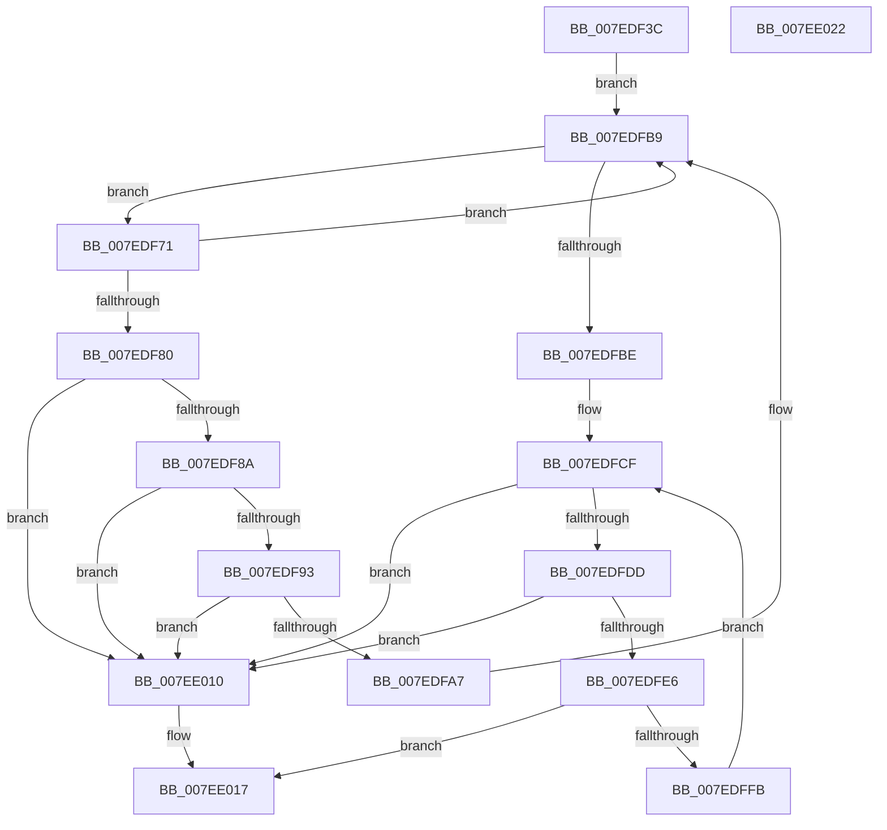

# CmObliterateRMTxArray

- RVA: `0x007EDF3C`–`0x007EE023` (길이 `231` bytes)
- VA: `0x00000001407EDF3C`
- 실행 섹션: `PAGE`
- PDB 이름 있음: `예`; PDB Function 태그: `아니요`
- unwind 정보 RVA: `0x000A4C70`
- 디코드: `65`개 명령, `231/231` bytes 표시
- 미해석 바이트: `0` (있으면 어셈블리에 `.byte`로 보존)

> 이 문서는 커널 이미지의 기계어와 PDB 기호를 분석해 생성했습니다. 4번과 5번은 함수 원형과 자료형을 바이너리 사용 방식에서 추정한 C 해석이며 원본 소스 복구 결과는 아닙니다.

## 1. Dependencies

- 직접 호출 지점: **4**; 고유 호출 대상: **4**
- 직접 호출자로 확인된 함수: **2**
- RIP 상대 이미지 참조: **2**

### Outgoing calls
- `0x007EDF5C` → [LOCK_TRANSACTION_LIST](../87/LOCK_TRANSACTION_LIST_function_00874AD4.md) (function, `0x00874AD4`)
- `0x007EDFC5` → [ExReleaseFastMutexUnsafe](../../text/25/ExReleaseFastMutexUnsafe_function_002503A0.md) (function, `0x002503A0`)
- `0x007EDFCA` → [KeLeaveCriticalRegion](../../text/25/KeLeaveCriticalRegion_function_0025D8B0.md) (function, `0x0025D8B0`)
- `0x007EE009` → [CmpCleanupTransactionState](../84/CmpCleanupTransactionState_function_008428E0.md) (function, `0x008428E0`)

### Direct callers
- [CmpTryToRundownHive](../../text/2A/CmpTryToRundownHive_function_002A4A60.md) at `0x002A4C38`
- [CmpPerformUnloadKey](../9A/CmpPerformUnloadKey_function_009AFA28.md) at `0x009B00E8`

### Static image references
- `0x007EDF61` → RVA `0x00EF57A0` (`.data`; read)
- `0x007EDFBE` → RVA `0x00EF5820` (`.data`; read)

## 2. Other-region calls and transfers

- 다른 실행 섹션으로 향하는 call: **2**
  - `0x007EDFC5` → [ExReleaseFastMutexUnsafe](../../text/25/ExReleaseFastMutexUnsafe_function_002503A0.md) (`PAGE` → `.text`)
  - `0x007EDFCA` → [KeLeaveCriticalRegion](../../text/25/KeLeaveCriticalRegion_function_0025D8B0.md) (`PAGE` → `.text`)
- 별도 외부 분기/꼬리 이동을 확인하지 못했습니다.

## 3. Assembly (complete function range)

```asm
007EDF3C  48 89 5C 24 08                  mov qword ptr [rsp + 8], rbx
007EDF41  55                              push rbp
007EDF42  48 8B EC                        mov rbp, rsp
007EDF45  48 83 EC 30                     sub rsp, 0x30
007EDF49  48 8D 45 F0                     lea rax, [rbp - 0x10]
007EDF4D  48 8B D9                        mov rbx, rcx
007EDF50  48 89 45 F8                     mov qword ptr [rbp - 8], rax
007EDF54  48 8D 45 F0                     lea rax, [rbp - 0x10]
007EDF58  48 89 45 F0                     mov qword ptr [rbp - 0x10], rax
007EDF5C  E8 73 6B 08 00                  call 0x140874ad4
007EDF61  48 8B 15 38 78 70 00            mov rdx, qword ptr [rip + 0x707838]
007EDF68  4C 8D 0D 31 78 70 00            lea r9, [rip + 0x707831]
007EDF6F  EB 48                           jmp 0x1407edfb9
007EDF71  48 8B C2                        mov rax, rdx
007EDF74  48 8B CA                        mov rcx, rdx
007EDF77  48 8B 12                        mov rdx, qword ptr [rdx]
007EDF7A  48 39 58 20                     cmp qword ptr [rax + 0x20], rbx
007EDF7E  75 39                           jne 0x1407edfb9
007EDF80  48 39 42 08                     cmp qword ptr [rdx + 8], rax
007EDF84  0F 85 86 00 00 00               jne 0x1407ee010
007EDF8A  48 8B 40 08                     mov rax, qword ptr [rax + 8]
007EDF8E  48 39 08                        cmp qword ptr [rax], rcx
007EDF91  75 7D                           jne 0x1407ee010
007EDF93  48 89 10                        mov qword ptr [rax], rdx
007EDF96  4C 8D 45 F0                     lea r8, [rbp - 0x10]
007EDF9A  48 89 42 08                     mov qword ptr [rdx + 8], rax
007EDF9E  48 8B 45 F8                     mov rax, qword ptr [rbp - 8]
007EDFA2  4C 39 00                        cmp qword ptr [rax], r8
007EDFA5  75 69                           jne 0x1407ee010
007EDFA7  48 89 41 08                     mov qword ptr [rcx + 8], rax
007EDFAB  4C 8D 45 F0                     lea r8, [rbp - 0x10]
007EDFAF  4C 89 01                        mov qword ptr [rcx], r8
007EDFB2  48 89 08                        mov qword ptr [rax], rcx
007EDFB5  48 89 4D F8                     mov qword ptr [rbp - 8], rcx
007EDFB9  49 3B D1                        cmp rdx, r9
007EDFBC  75 B3                           jne 0x1407edf71
007EDFBE  48 8D 0D 5B 78 70 00            lea rcx, [rip + 0x70785b]
007EDFC5  E8 D6 23 A6 FF                  call 0x1402503a0
007EDFCA  E8 E1 F8 A6 FF                  call 0x14025d8b0
007EDFCF  48 8B 55 F0                     mov rdx, qword ptr [rbp - 0x10]
007EDFD3  48 8D 45 F0                     lea rax, [rbp - 0x10]
007EDFD7  48 39 42 08                     cmp qword ptr [rdx + 8], rax
007EDFDB  75 33                           jne 0x1407ee010
007EDFDD  48 8B 02                        mov rax, qword ptr [rdx]
007EDFE0  48 39 50 08                     cmp qword ptr [rax + 8], rdx
007EDFE4  75 2A                           jne 0x1407ee010
007EDFE6  48 89 45 F0                     mov qword ptr [rbp - 0x10], rax
007EDFEA  48 8D 4D F0                     lea rcx, [rbp - 0x10]
007EDFEE  48 89 48 08                     mov qword ptr [rax + 8], rcx
007EDFF2  48 8D 45 F0                     lea rax, [rbp - 0x10]
007EDFF6  48 3B D0                        cmp rdx, rax
007EDFF9  74 1C                           je 0x1407ee017
007EDFFB  45 33 C9                        xor r9d, r9d
007EDFFE  48 83 C2 E0                     add rdx, -0x20
007EE002  48 8B CB                        mov rcx, rbx
007EE005  45 8D 41 08                     lea r8d, [r9 + 8]
007EE009  E8 D2 48 05 00                  call 0x1408428e0
007EE00E  EB BF                           jmp 0x1407edfcf
007EE010  B9 03 00 00 00                  mov ecx, 3
007EE015  CD 29                           int 0x29
007EE017  48 8B 5C 24 40                  mov rbx, qword ptr [rsp + 0x40]
007EE01C  48 83 C4 30                     add rsp, 0x30
007EE020  5D                              pop rbp
007EE021  C3                              ret
007EE022  CC                              int3
```

## 4. C-style interpretation (structured pseudocode)

```c
__int64 __fastcall CmObliterateRMTxArray(__int64 a1)
{
    __int64 result;
    __int64 v_rsp;
    unsigned __int64 v_stack_m10;
    unsigned __int64 v_stack_m18;
    unsigned __int64 v_stack_p8;

    v_stack_p8 = v_rbx;
    v_rsp = (v_rsp) - (48);
    v_stack_m10 = v_stack_m18;
    v_stack_m18 = v_stack_m18;
    result = LOCK_TRANSACTION_LIST(a1, a2, a3, a4);
    goto loc_007EDFB9;
loc_007EDF71:
    if ((*(unsigned __int64 *)(*(unsigned __int64 *)(v_rip + 7370808) + 32)) != a1) goto loc_007EDFB9;
    if ((*(unsigned __int64 *)(*(unsigned __int64 *)(*(unsigned __int64 *)(v_rip + 7370808)) + 8)) != (*(unsigned __int64 *)(v_rip + 7370808))) goto loc_007EE010;
    if ((*(unsigned __int64 *)(*(unsigned __int64 *)(*(unsigned __int64 *)(v_rip + 7370808) + 8))) != (*(unsigned __int64 *)(v_rip + 7370808))) goto loc_007EE010;
    *(unsigned __int64 *)(*(unsigned __int64 *)(*(unsigned __int64 *)(v_rip + 7370808) + 8)) = *(unsigned __int64 *)(*(unsigned __int64 *)(v_rip + 7370808));
    *(unsigned __int64 *)(*(unsigned __int64 *)(*(unsigned __int64 *)(v_rip + 7370808)) + 8) = *(unsigned __int64 *)(*(unsigned __int64 *)(v_rip + 7370808) + 8);
    if ((*(unsigned __int64 *)(v_stack_m10)) != v_stack_m18) goto loc_007EE010;
    *(unsigned __int64 *)(*(unsigned __int64 *)(v_rip + 7370808) + 8) = v_stack_m10;
    *(unsigned __int64 *)(*(unsigned __int64 *)(v_rip + 7370808)) = v_stack_m18;
    *(unsigned __int64 *)(v_stack_m10) = *(unsigned __int64 *)(v_rip + 7370808);
    v_stack_m10 = *(unsigned __int64 *)(v_rip + 7370808);
loc_007EDFB9:
    if ((*(unsigned __int64 *)(*(unsigned __int64 *)(v_rip + 7370808))) != (v_rip + 7370801)) goto loc_007EDF71;
    result = ExReleaseFastMutexUnsafe(v_rip + 7370843, *(unsigned __int64 *)(*(unsigned __int64 *)(v_rip + 7370808)), v_stack_m18, v_rip + 7370801);
    result = KeLeaveCriticalRegion(v_rip + 7370843, *(unsigned __int64 *)(*(unsigned __int64 *)(v_rip + 7370808)), v_stack_m18, v_rip + 7370801);
loc_007EDFCF:
    if ((*(unsigned __int64 *)(v_stack_m18 + 8)) != v_stack_m18) goto loc_007EE010;
    if ((*(unsigned __int64 *)(*(unsigned __int64 *)(v_stack_m18) + 8)) != v_stack_m18) goto loc_007EE010;
    v_stack_m18 = *(unsigned __int64 *)(v_stack_m18);
    *(unsigned __int64 *)(*(unsigned __int64 *)(v_stack_m18) + 8) = v_stack_m18;
    if (v_stack_m18 == v_stack_m18) goto loc_007EE017;
    a4 = 0;
    a2 = (v_stack_m18) + (-32);
    result = CmpCleanupTransactionState(a1, a2, a4 + 8, a4);
    goto loc_007EDFCF;
loc_007EE010:
loc_007EE017:
    v_rsp = (v_rsp) + (48);
    return result;
}
```

## 5. (Beta) C Style

```c
int64_t CmObliterateRMTxArray(int64_t Arg1)
{
    int64_t result;
    int64_t local_rsp;
    uint64_t v_stack_m10;
    uint64_t v_stack_m18;
    uint64_t v_stack_p8;

    v_stack_p8 = local_rbx;
    local_rsp = (local_rsp) - (48);
    v_stack_m10 = v_stack_m18;
    v_stack_m18 = v_stack_m18;
    result = LOCK_TRANSACTION_LIST(Arg1, a2, a3, a4);
    goto loc_007EDFB9;
loc_007EDF71:
    if ((*(uint64_t *)(*(uint64_t *)(v_rip + 0x707838) + 0x20)) != Arg1) goto loc_007EDFB9;
    if ((*(uint64_t *)(*(uint64_t *)(*(uint64_t *)(v_rip + 0x707838)) + 0x8)) != (*(uint64_t *)(v_rip + 0x707838))) goto loc_007EE010;
    if ((*(uint64_t *)(*(uint64_t *)(*(uint64_t *)(v_rip + 0x707838) + 0x8))) != (*(uint64_t *)(v_rip + 0x707838))) goto loc_007EE010;
    *(uint64_t *)(*(uint64_t *)(*(uint64_t *)(v_rip + 0x707838) + 0x8)) = *(uint64_t *)(*(uint64_t *)(v_rip + 0x707838));
    *(uint64_t *)(*(uint64_t *)(*(uint64_t *)(v_rip + 0x707838)) + 0x8) = *(uint64_t *)(*(uint64_t *)(v_rip + 0x707838) + 0x8);
    if ((*(uint64_t *)(v_stack_m10)) != v_stack_m18) goto loc_007EE010;
    *(uint64_t *)(*(uint64_t *)(v_rip + 0x707838) + 0x8) = v_stack_m10;
    *(uint64_t *)(*(uint64_t *)(v_rip + 0x707838)) = v_stack_m18;
    *(uint64_t *)(v_stack_m10) = *(uint64_t *)(v_rip + 0x707838);
    v_stack_m10 = *(uint64_t *)(v_rip + 0x707838);
loc_007EDFB9:
    if ((*(uint64_t *)(*(uint64_t *)(v_rip + 0x707838))) != (v_rip + 7370801)) goto loc_007EDF71;
    result = ExReleaseFastMutexUnsafe(v_rip + 7370843, *(uint64_t *)(*(uint64_t *)(v_rip + 0x707838)), v_stack_m18, v_rip + 7370801);
    result = KeLeaveCriticalRegion(v_rip + 7370843, *(uint64_t *)(*(uint64_t *)(v_rip + 0x707838)), v_stack_m18, v_rip + 7370801);
loc_007EDFCF:
    if ((*(uint64_t *)(v_stack_m18 + 0x8)) != v_stack_m18) goto loc_007EE010;
    if ((*(uint64_t *)(*(uint64_t *)(v_stack_m18) + 0x8)) != v_stack_m18) goto loc_007EE010;
    v_stack_m18 = *(uint64_t *)(v_stack_m18);
    *(uint64_t *)(*(uint64_t *)(v_stack_m18) + 0x8) = v_stack_m18;
    if (v_stack_m18 == v_stack_m18) goto loc_007EE017;
    a4 = 0;
    a2 = (v_stack_m18) + (-32);
    result = CmpCleanupTransactionState(Arg1, a2, a4 + 8, a4);
    goto loc_007EDFCF;
loc_007EE010:
loc_007EE017:
    local_rsp = (local_rsp) + (48);
    return result;
}
```

## 6. Execution-region graph

[열기: 2D/3D 그래프와 함수 탐색 컨트롤 패널](../../../control-panel.html?section=page&rva=0x007EDF3C&view=graph)

- 2D 그래프는 위에서 아래로 흐르고, 3D 그래프는 빈 공간을 드래그해 회전합니다. Shift+드래그는 이동, 휠은 확대·축소, 함수 노드 선택은 대상 보고서 이동입니다.

### Static fallback


