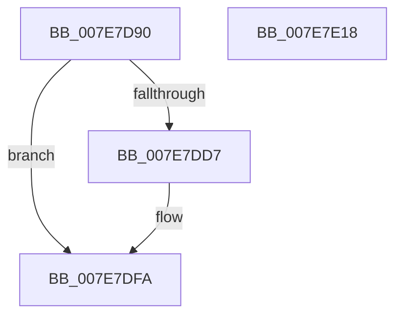

# CmReconcileAndValidateAllHives

- RVA: `0x007E7D90`–`0x007E7E19` (길이 `137` bytes)
- VA: `0x00000001407E7D90`
- 실행 섹션: `PAGE`
- PDB 이름 있음: `예`; PDB Function 태그: `아니요`
- unwind 정보 RVA: `0x000986E4`
- 디코드: `33`개 명령, `137/137` bytes 표시
- 미해석 바이트: `0` (있으면 어셈블리에 `.byte`로 보존)

> 이 문서는 커널 이미지의 기계어와 PDB 기호를 분석해 생성했습니다. 4번과 5번은 함수 원형과 자료형을 바이너리 사용 방식에서 추정한 C 해석이며 원본 소스 복구 결과는 아닙니다.

## 1. Dependencies

- 직접 호출 지점: **8**; 고유 호출 대상: **8**
- 직접 호출자로 확인된 함수: **1**
- RIP 상대 이미지 참조: **1**

### Outgoing calls
- `0x007E7DC9` → [CmpInitializeThreadInfo](../../text/3F/CmpInitializeThreadInfo_function_003FBE70.md) (function, `0x003FBE70`)
- `0x007E7DCE` → [CmpAcquireShutdownRundown](../../pagecmrc/BC/CmpAcquireShutdownRundown_function_00BC9400.md) (function, `0x00BC9400`)
- `0x007E7DDC` → [CmpAttachToRegistryProcess](../../pagecmrc/BC/CmpAttachToRegistryProcess_function_00BC98E0.md) (function, `0x00BC98E0`)
- `0x007E7DE6` → [CmpDoFlushAll](../../text/34/CmpDoFlushAll_function_00349A9C.md) (function, `0x00349A9C`)
- `0x007E7DF0` → [CmpDetachFromRegistryProcess](../../pagecmrc/BC/CmpDetachFromRegistryProcess_function_00BC9920.md) (function, `0x00BC9920`)
- `0x007E7DF5` → [CmpReleaseShutdownRundown](../../pagecmrc/BC/CmpReleaseShutdownRundown_function_00BC9880.md) (function, `0x00BC9880`)
- `0x007E7DFF` → [CmCleanupThreadInfo](../../text/41/CmCleanupThreadInfo_function_0041FD50.md) (function, `0x0041FD50`)
- `0x007E7E0E` → [_security_check_cookie](../../text/6A/_security_check_cookie_function_006AC640.md) (function, `0x006AC640`)

### Direct callers
- [NtSetSystemInformation](../AF/NtSetSystemInformation_function_00AF4A60.md) at `0x00AF6008`

### Static image references
- `0x007E7D94` → RVA `0x00E0A740` (`.data`; read)

## 2. Other-region calls and transfers

- 다른 실행 섹션으로 향하는 call: **8**
  - `0x007E7DC9` → [CmpInitializeThreadInfo](../../text/3F/CmpInitializeThreadInfo_function_003FBE70.md) (`PAGE` → `.text`)
  - `0x007E7DCE` → [CmpAcquireShutdownRundown](../../pagecmrc/BC/CmpAcquireShutdownRundown_function_00BC9400.md) (`PAGE` → `PAGECMRC`)
  - `0x007E7DDC` → [CmpAttachToRegistryProcess](../../pagecmrc/BC/CmpAttachToRegistryProcess_function_00BC98E0.md) (`PAGE` → `PAGECMRC`)
  - `0x007E7DE6` → [CmpDoFlushAll](../../text/34/CmpDoFlushAll_function_00349A9C.md) (`PAGE` → `.text`)
  - `0x007E7DF0` → [CmpDetachFromRegistryProcess](../../pagecmrc/BC/CmpDetachFromRegistryProcess_function_00BC9920.md) (`PAGE` → `PAGECMRC`)
  - `0x007E7DF5` → [CmpReleaseShutdownRundown](../../pagecmrc/BC/CmpReleaseShutdownRundown_function_00BC9880.md) (`PAGE` → `PAGECMRC`)
  - `0x007E7DFF` → [CmCleanupThreadInfo](../../text/41/CmCleanupThreadInfo_function_0041FD50.md) (`PAGE` → `.text`)
  - `0x007E7E0E` → [_security_check_cookie](../../text/6A/_security_check_cookie_function_006AC640.md) (`PAGE` → `.text`)
- 별도 외부 분기/꼬리 이동을 확인하지 못했습니다.

## 3. Assembly (complete function range)

```asm
007E7D90  48 83 EC 78                     sub rsp, 0x78
007E7D94  48 8B 05 A5 29 62 00            mov rax, qword ptr [rip + 0x6229a5]
007E7D9B  48 33 C4                        xor rax, rsp
007E7D9E  48 89 44 24 68                  mov qword ptr [rsp + 0x68], rax
007E7DA3  0F 57 C9                        xorps xmm1, xmm1
007E7DA6  48 8D 4C 24 20                  lea rcx, [rsp + 0x20]
007E7DAB  0F 57 C0                        xorps xmm0, xmm0
007E7DAE  33 C0                           xor eax, eax
007E7DB0  0F 11 44 24 20                  movups xmmword ptr [rsp + 0x20], xmm0
007E7DB5  48 89 44 24 30                  mov qword ptr [rsp + 0x30], rax
007E7DBA  0F 11 4C 24 38                  movups xmmword ptr [rsp + 0x38], xmm1
007E7DBF  0F 11 4C 24 48                  movups xmmword ptr [rsp + 0x48], xmm1
007E7DC4  0F 11 4C 24 58                  movups xmmword ptr [rsp + 0x58], xmm1
007E7DC9  E8 A2 40 C1 FF                  call 0x1403fbe70
007E7DCE  E8 2D 16 3E 00                  call 0x140bc9400
007E7DD3  84 C0                           test al, al
007E7DD5  74 23                           je 0x1407e7dfa
007E7DD7  48 8D 4C 24 38                  lea rcx, [rsp + 0x38]
007E7DDC  E8 FF 1A 3E 00                  call 0x140bc98e0
007E7DE1  B9 0C 00 00 00                  mov ecx, 0xc
007E7DE6  E8 B1 1C B6 FF                  call 0x140349a9c
007E7DEB  48 8D 4C 24 38                  lea rcx, [rsp + 0x38]
007E7DF0  E8 2B 1B 3E 00                  call 0x140bc9920
007E7DF5  E8 86 1A 3E 00                  call 0x140bc9880
007E7DFA  48 8D 4C 24 20                  lea rcx, [rsp + 0x20]
007E7DFF  E8 4C 7F C3 FF                  call 0x14041fd50
007E7E04  33 C0                           xor eax, eax
007E7E06  48 8B 4C 24 68                  mov rcx, qword ptr [rsp + 0x68]
007E7E0B  48 33 CC                        xor rcx, rsp
007E7E0E  E8 2D 48 EC FF                  call 0x1406ac640
007E7E13  48 83 C4 78                     add rsp, 0x78
007E7E17  C3                              ret
007E7E18  CC                              int3
```

## 4. C-style interpretation (structured pseudocode)

```c
__int64 __fastcall CmReconcileAndValidateAllHives(void)
{
    __int64 result;
    __int64 v_rsp;
    unsigned __int64 v_stack_m10;
    unsigned __int64 v_stack_m20;
    unsigned __int64 v_stack_m30;
    unsigned __int64 v_stack_m40;
    unsigned __int64 v_stack_m48;
    unsigned __int64 v_stack_m58;

    v_rsp = (v_rsp) - (120);
    result = (*(unsigned __int64 *)(v_rip + 6433189)) ^ (v_rsp);
    v_stack_m10 = result;
    result = 0;
    v_stack_m58 = v_xmm0;
    v_stack_m48 = 0;
    v_stack_m40 = v_xmm1;
    v_stack_m30 = v_xmm1;
    v_stack_m20 = v_xmm1;
    result = CmpInitializeThreadInfo(v_stack_m58, a2, a3, a4);
    result = CmpAcquireShutdownRundown(v_stack_m58, a2, a3, a4);
    if ((unsigned __int8)(result) != 0) {
        a1 = v_stack_m40;
        result = CmpAttachToRegistryProcess(a1, a2, a3, a4);
        a1 = 12;
        result = CmpDoFlushAll(a1, a2, a3, a4);
        a1 = v_stack_m40;
        result = CmpDetachFromRegistryProcess(a1, a2, a3, a4);
        result = CmpReleaseShutdownRundown(a1, a2, a3, a4);
    }
    result = CmCleanupThreadInfo(v_stack_m58, a2, a3, a4);
    result = 0;
    a1 = (v_stack_m10) ^ (v_rsp);
    result = _security_check_cookie(a1, a2, a3, a4);
    v_rsp = (v_rsp) + (120);
    return result;
}
```

## 5. (Beta) C Style

```c
void CmReconcileAndValidateAllHives(void)
{
    int64_t result;
    int64_t local_rsp;
    uint64_t v_stack_m10;
    uint64_t v_stack_m20;
    uint64_t v_stack_m30;
    uint64_t v_stack_m40;
    uint64_t v_stack_m48;
    uint64_t v_stack_m58;

    local_rsp = (local_rsp) - (120);
    result = (*(uint64_t *)(v_rip + 0x6229A5)) ^ (local_rsp);
    v_stack_m10 = result;
    result = 0;
    v_stack_m58 = v_xmm0;
    v_stack_m48 = 0;
    v_stack_m40 = v_xmm1;
    v_stack_m30 = v_xmm1;
    v_stack_m20 = v_xmm1;
    result = CmpInitializeThreadInfo(v_stack_m58, a2, a3, a4);
    result = CmpAcquireShutdownRundown(v_stack_m58, a2, a3, a4);
    if ((uint8_t)(result) != 0) {
        a1 = v_stack_m40;
        result = CmpAttachToRegistryProcess(a1, a2, a3, a4);
        a1 = 12;
        result = CmpDoFlushAll(a1, a2, a3, a4);
        a1 = v_stack_m40;
        result = CmpDetachFromRegistryProcess(a1, a2, a3, a4);
        result = CmpReleaseShutdownRundown(a1, a2, a3, a4);
    }
    result = CmCleanupThreadInfo(v_stack_m58, a2, a3, a4);
    result = 0;
    a1 = (v_stack_m10) ^ (local_rsp);
    result = _security_check_cookie(a1, a2, a3, a4);
    local_rsp = (local_rsp) + (120);
    return result;
}
```

## 6. Execution-region graph

[열기: 2D/3D 그래프와 함수 탐색 컨트롤 패널](../../../control-panel.html?section=page&rva=0x007E7D90&view=graph)

- 2D 그래프는 위에서 아래로 흐르고, 3D 그래프는 빈 공간을 드래그해 회전합니다. Shift+드래그는 이동, 휠은 확대·축소, 함수 노드 선택은 대상 보고서 이동입니다.

### Static fallback


