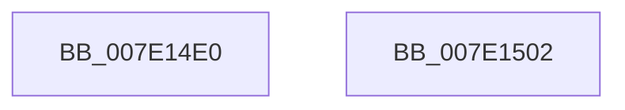

# CmRegisterCallback

- RVA: `0x007E14E0`–`0x007E1503` (길이 `35` bytes)
- VA: `0x00000001407E14E0`
- 실행 섹션: `PAGE`
- PDB 이름 있음: `예`; PDB Function 태그: `아니요`
- unwind 정보 RVA: `0x0005D2F4`
- 디코드: `9`개 명령, `35/35` bytes 표시
- 미해석 바이트: `0` (있으면 어셈블리에 `.byte`로 보존)

> 이 문서는 커널 이미지의 기계어와 PDB 기호를 분석해 생성했습니다. 4번과 5번은 함수 원형과 자료형을 바이너리 사용 방식에서 추정한 C 해석이며 원본 소스 복구 결과는 아닙니다.

## 1. Dependencies

- 직접 호출 지점: **1**; 고유 호출 대상: **1**
- 직접 호출자로 확인된 함수: **1**
- RIP 상대 이미지 참조: **1**

### Outgoing calls
- `0x007E14F8` → [CmpRegisterCallbackInternal](../97/CmpRegisterCallbackInternal_function_0097D54C.md) (function, `0x0097D54C`)

### Direct callers
- [DifCmRegisterCallbackWrapper](../../text/61/DifCmRegisterCallbackWrapper_function_0061C930.md) at `0x0061CA15`

### Static image references
- `0x007E14EC` → RVA `0x00EEFB90` (`.data`; read)

## 2. Other-region calls and transfers

- 다른 실행 섹션으로 향하는 call: **0**
- 별도 외부 분기/꼬리 이동을 확인하지 못했습니다.

## 3. Assembly (complete function range)

```asm
007E14E0  48 83 EC 38                     sub rsp, 0x38
007E14E4  4C 89 44 24 28                  mov qword ptr [rsp + 0x28], r8
007E14E9  41 B1 01                        mov r9b, 1
007E14EC  4C 8D 05 9D E6 70 00            lea r8, [rip + 0x70e69d]
007E14F3  C6 44 24 20 00                  mov byte ptr [rsp + 0x20], 0
007E14F8  E8 4F C0 19 00                  call 0x14097d54c
007E14FD  48 83 C4 38                     add rsp, 0x38
007E1501  C3                              ret
007E1502  CC                              int3
```

## 4. C-style interpretation (structured pseudocode)

```c
__int64 __fastcall CmRegisterCallback(__int64 a1, __int64 a2, __int64 a3)
{
    __int64 result;
    __int64 v_rsp;
    unsigned __int64 v_stack_m10;
    unsigned __int8 v_stack_m18;

    v_rsp = (v_rsp) - (56);
    v_stack_m10 = a3;
    v_stack_m18 = 0;
    result = CmpRegisterCallbackInternal(a1, a2, v_rip + 7399069, 1);
    v_rsp = (v_rsp) + (56);
    return result;
}
```

## 5. (Beta) C Style

```c
int64_t CmRegisterCallback(int64_t Arg1, int64_t Arg2, int64_t Arg3)
{
    int64_t result;
    int64_t local_rsp;
    uint64_t v_stack_m10;
    uint8_t v_stack_m18;

    local_rsp = (local_rsp) - (56);
    v_stack_m10 = Arg3;
    v_stack_m18 = 0;
    result = CmpRegisterCallbackInternal(Arg1, Arg2, v_rip + 7399069, 1);
    local_rsp = (local_rsp) + (56);
    return result;
}
```

## 6. Execution-region graph

[열기: 2D/3D 그래프와 함수 탐색 컨트롤 패널](../../../control-panel.html?section=page&rva=0x007E14E0&view=graph)

- 2D 그래프는 위에서 아래로 흐르고, 3D 그래프는 빈 공간을 드래그해 회전합니다. Shift+드래그는 이동, 휠은 확대·축소, 함수 노드 선택은 대상 보고서 이동입니다.

### Static fallback


