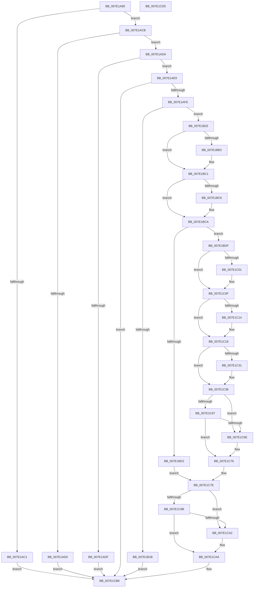

# CmRegisterMachineHiveLoadedNotification

- RVA: `0x007E1A90`–`0x007E1CD6` (길이 `582` bytes)
- VA: `0x00000001407E1A90`
- 실행 섹션: `PAGE`
- PDB 이름 있음: `예`; PDB Function 태그: `아니요`
- unwind 정보 RVA: `0x0005D79C`
- 디코드: `159`개 명령, `582/582` bytes 표시
- 미해석 바이트: `0` (있으면 어셈블리에 `.byte`로 보존)

> 이 문서는 커널 이미지의 기계어와 PDB 기호를 분석해 생성했습니다. 4번과 5번은 함수 원형과 자료형을 바이너리 사용 방식에서 추정한 C 해석이며 원본 소스 복구 결과는 아닙니다.

## 1. Dependencies

- 직접 호출 지점: **12**; 고유 호출 대상: **8**
- 직접 호출자로 확인된 함수: **1**
- RIP 상대 이미지 참조: **3**

### Outgoing calls
- `0x007E1AF1` → [CmpFindMachineHiveByMountPoint](CmpFindMachineHiveByMountPoint_function_007E1DF8.md) (function, `0x007E1DF8`)
- `0x007E1B0E` → [ExAllocatePool2](../../poolcode/B8/ExAllocatePool2_function_00B820F0.md) (function, `0x00B820F0`)
- `0x007E1B4D` → [memset](../../text/6C/memset_function_006C6C40.md) (function, `0x006C6C40`)
- `0x007E1BA3` → [KeAbPreAcquire](../../text/21/KeAbPreAcquire_function_00210230.md) (function, `0x00210230`)
- `0x007E1BBC` → [ExfAcquirePushLockExclusiveEx](../../text/20/ExfAcquirePushLockExclusiveEx_function_0020FC90.md) (function, `0x0020FC90`)
- `0x007E1BD5` → [CmpWorkItemQueueWork](../../text/37/CmpWorkItemQueueWork_function_00378D4C.md) (function, `0x00378D4C`)
- `0x007E1BF1` → [KeAbPreAcquire](../../text/21/KeAbPreAcquire_function_00210230.md) (function, `0x00210230`)
- `0x007E1C0A` → [ExfAcquirePushLockExclusiveEx](../../text/20/ExfAcquirePushLockExclusiveEx_function_0020FC90.md) (function, `0x0020FC90`)
- `0x007E1C71` → [ExfReleasePushLock](../../text/26/ExfReleasePushLock_function_002638D0.md) (function, `0x002638D0`)
- `0x007E1C79` → [KeAbPostRelease](../../text/2E/KeAbPostRelease_function_002E1600.md) (function, `0x002E1600`)
- `0x007E1CA5` → [ExfReleasePushLock](../../text/26/ExfReleasePushLock_function_002638D0.md) (function, `0x002638D0`)
- `0x007E1CAD` → [KeAbPostRelease](../../text/2E/KeAbPostRelease_function_002E1600.md) (function, `0x002E1600`)

### Direct callers
- [CmFcManagerStartRuntimePhase](../../init/C5/CmFcManagerStartRuntimePhase_function_00C5DC70.md) at `0x00C5E047`

### Static image references
- `0x007E1B56` → RVA `0x0049F4E0` (`CmpWorkItemWrapper`; read)
- `0x007E1B61` → RVA `0x00E098A0` (`.data`; read)
- `0x007E1B6B` → RVA `0x007E1F40` (`CmpMachineHiveLoadedWorkItem`; read)

## 2. Other-region calls and transfers

- 다른 실행 섹션으로 향하는 call: **11**
  - `0x007E1B0E` → [ExAllocatePool2](../../poolcode/B8/ExAllocatePool2_function_00B820F0.md) (`PAGE` → `POOLCODE`)
  - `0x007E1B4D` → [memset](../../text/6C/memset_function_006C6C40.md) (`PAGE` → `.text`)
  - `0x007E1BA3` → [KeAbPreAcquire](../../text/21/KeAbPreAcquire_function_00210230.md) (`PAGE` → `.text`)
  - `0x007E1BBC` → [ExfAcquirePushLockExclusiveEx](../../text/20/ExfAcquirePushLockExclusiveEx_function_0020FC90.md) (`PAGE` → `.text`)
  - `0x007E1BD5` → [CmpWorkItemQueueWork](../../text/37/CmpWorkItemQueueWork_function_00378D4C.md) (`PAGE` → `.text`)
  - `0x007E1BF1` → [KeAbPreAcquire](../../text/21/KeAbPreAcquire_function_00210230.md) (`PAGE` → `.text`)
  - `0x007E1C0A` → [ExfAcquirePushLockExclusiveEx](../../text/20/ExfAcquirePushLockExclusiveEx_function_0020FC90.md) (`PAGE` → `.text`)
  - `0x007E1C71` → [ExfReleasePushLock](../../text/26/ExfReleasePushLock_function_002638D0.md) (`PAGE` → `.text`)
  - `0x007E1C79` → [KeAbPostRelease](../../text/2E/KeAbPostRelease_function_002E1600.md) (`PAGE` → `.text`)
  - `0x007E1CA5` → [ExfReleasePushLock](../../text/26/ExfReleasePushLock_function_002638D0.md) (`PAGE` → `.text`)
  - `0x007E1CAD` → [KeAbPostRelease](../../text/2E/KeAbPostRelease_function_002E1600.md) (`PAGE` → `.text`)
- 별도 외부 분기/꼬리 이동을 확인하지 못했습니다.

## 3. Assembly (complete function range)

```asm
007E1A90  48 8B C4                        mov rax, rsp
007E1A93  48 89 58 10                     mov qword ptr [rax + 0x10], rbx
007E1A97  48 89 68 18                     mov qword ptr [rax + 0x18], rbp
007E1A9B  48 89 70 20                     mov qword ptr [rax + 0x20], rsi
007E1A9F  57                              push rdi
007E1AA0  41 54                           push r12
007E1AA2  41 55                           push r13
007E1AA4  41 56                           push r14
007E1AA6  41 57                           push r15
007E1AA8  48 83 EC 20                     sub rsp, 0x20
007E1AAC  45 33 ED                        xor r13d, r13d
007E1AAF  4D 8B F9                        mov r15, r9
007E1AB2  44 89 68 08                     mov dword ptr [rax + 8], r13d
007E1AB6  48 8B FA                        mov rdi, rdx
007E1AB9  48 8B D9                        mov rbx, rcx
007E1ABC  48 85 C9                        test rcx, rcx
007E1ABF  75 0A                           jne 0x1407e1acb
007E1AC1  B8 EF 00 00 C0                  mov eax, 0xc00000ef
007E1AC6  E9 ED 01 00 00                  jmp 0x1407e1cb8
007E1ACB  4D 85 C0                        test r8, r8
007E1ACE  75 0A                           jne 0x1407e1ada
007E1AD0  B8 F1 00 00 C0                  mov eax, 0xc00000f1
007E1AD5  E9 DE 01 00 00                  jmp 0x1407e1cb8
007E1ADA  4D 85 FF                        test r15, r15
007E1ADD  75 0A                           jne 0x1407e1ae9
007E1ADF  B8 F2 00 00 C0                  mov eax, 0xc00000f2
007E1AE4  E9 CF 01 00 00                  jmp 0x1407e1cb8
007E1AE9  48 8D 54 24 50                  lea rdx, [rsp + 0x50]
007E1AEE  49 8B C8                        mov rcx, r8
007E1AF1  E8 02 03 00 00                  call 0x1407e1df8
007E1AF6  85 C0                           test eax, eax
007E1AF8  0F 88 BA 01 00 00               js 0x1407e1cb8
007E1AFE  BA 70 00 00 00                  mov edx, 0x70
007E1B03  41 B8 43 4D 39 32               mov r8d, 0x32394d43
007E1B09  8D 6A D0                        lea ebp, [rdx - 0x30]
007E1B0C  8B CD                           mov ecx, ebp
007E1B0E  E8 DD 05 3A 00                  call 0x140b820f0
007E1B13  48 8B F0                        mov rsi, rax
007E1B16  48 85 C0                        test rax, rax
007E1B19  75 0A                           jne 0x1407e1b25
007E1B1B  B8 9A 00 00 C0                  mov eax, 0xc000009a
007E1B20  E9 93 01 00 00                  jmp 0x1407e1cb8
007E1B25  48 89 58 50                     mov qword ptr [rax + 0x50], rbx
007E1B29  4C 8D 70 10                     lea r14, [rax + 0x10]
007E1B2D  8B 5C 24 50                     mov ebx, dword ptr [rsp + 0x50]
007E1B31  49 8B CE                        mov rcx, r14
007E1B34  4C 8B C5                        mov r8, rbp
007E1B37  89 58 68                        mov dword ptr [rax + 0x68], ebx
007E1B3A  33 D2                           xor edx, edx
007E1B3C  48 89 78 58                     mov qword ptr [rax + 0x58], rdi
007E1B40  66 44 89 68 6C                  mov word ptr [rax + 0x6c], r13w
007E1B45  44 88 68 6E                     mov byte ptr [rax + 0x6e], r13b
007E1B49  4C 89 68 60                     mov qword ptr [rax + 0x60], r13
007E1B4D  E8 EE 50 EE FF                  call 0x1406c6c40
007E1B52  4D 89 76 18                     mov qword ptr [r14 + 0x18], r14
007E1B56  48 8D 05 83 D9 CB FF            lea rax, [rip - 0x34267d]
007E1B5D  49 89 46 10                     mov qword ptr [r14 + 0x10], rax
007E1B61  48 8D 2D 38 7D 62 00            lea rbp, [rip + 0x627d38]
007E1B68  4D 89 2E                        mov qword ptr [r14], r13
007E1B6B  48 8D 05 CE 03 00 00            lea rax, [rip + 0x3ce]
007E1B72  4C 69 E3 B8 00 00 00            imul r12, rbx, 0xb8
007E1B79  48 8D BD 88 00 00 00            lea rdi, [rbp + 0x88]
007E1B80  45 89 6E 28                     mov dword ptr [r14 + 0x28], r13d
007E1B84  49 03 FC                        add rdi, r12
007E1B87  4D 89 6E 20                     mov qword ptr [r14 + 0x20], r13
007E1B8B  48 8B CF                        mov rcx, rdi
007E1B8E  41 C7 46 2C 01 00 00 00         mov dword ptr [r14 + 0x2c], 1
007E1B96  45 33 C0                        xor r8d, r8d
007E1B99  49 89 46 30                     mov qword ptr [r14 + 0x30], rax
007E1B9D  33 D2                           xor edx, edx
007E1B9F  49 89 76 38                     mov qword ptr [r14 + 0x38], rsi
007E1BA3  E8 88 E6 A2 FF                  call 0x140210230
007E1BA8  F0 48 0F BA 2F 00               lock bts qword ptr [rdi], 0
007E1BAE  48 8B D8                        mov rbx, rax
007E1BB1  73 0E                           jae 0x1407e1bc1
007E1BB3  4C 8B C7                        mov r8, rdi
007E1BB6  48 8B D0                        mov rdx, rax
007E1BB9  48 8B CF                        mov rcx, rdi
007E1BBC  E8 CF E0 A2 FF                  call 0x14020fc90
007E1BC1  48 85 DB                        test rbx, rbx
007E1BC4  74 04                           je 0x1407e1bca
007E1BC6  C6 43 0A 01                     mov byte ptr [rbx + 0xa], 1
007E1BCA  41 83 7C 2C 74 01               cmp dword ptr [r12 + rbp + 0x74], 1
007E1BD0  75 0D                           jne 0x1407e1bdf
007E1BD2  49 8B CE                        mov rcx, r14
007E1BD5  E8 72 71 B9 FF                  call 0x140378d4c
007E1BDA  E9 9F 00 00 00                  jmp 0x1407e1c7e
007E1BDF  48 8D 9D 90 00 00 00            lea rbx, [rbp + 0x90]
007E1BE6  45 33 C0                        xor r8d, r8d
007E1BE9  49 03 DC                        add rbx, r12
007E1BEC  33 D2                           xor edx, edx
007E1BEE  48 8B CB                        mov rcx, rbx
007E1BF1  E8 3A E6 A2 FF                  call 0x140210230
007E1BF6  F0 48 0F BA 2B 00               lock bts qword ptr [rbx], 0
007E1BFC  48 8B E8                        mov rbp, rax
007E1BFF  73 0E                           jae 0x1407e1c0f
007E1C01  4C 8B C3                        mov r8, rbx
007E1C04  48 8B D0                        mov rdx, rax
007E1C07  48 8B CB                        mov rcx, rbx
007E1C0A  E8 81 E0 A2 FF                  call 0x14020fc90
007E1C0F  48 85 ED                        test rbp, rbp
007E1C12  74 04                           je 0x1407e1c18
007E1C14  C6 45 0A 01                     mov byte ptr [rbp + 0xa], 1
007E1C18  48 8D 05 81 7C 62 00            lea rax, [rip + 0x627c81]
007E1C1F  48 05 98 00 00 00               add rax, 0x98
007E1C25  49 03 C4                        add rax, r12
007E1C28  48 8B 48 08                     mov rcx, qword ptr [rax + 8]
007E1C2C  48 39 01                        cmp qword ptr [rcx], rax
007E1C2F  74 07                           je 0x1407e1c38
007E1C31  B9 03 00 00 00                  mov ecx, 3
007E1C36  CD 29                           int 0x29
007E1C38  48 89 06                        mov qword ptr [rsi], rax
007E1C3B  48 89 4E 08                     mov qword ptr [rsi + 8], rcx
007E1C3F  48 89 31                        mov qword ptr [rcx], rsi
007E1C42  48 89 70 08                     mov qword ptr [rax + 8], rsi
007E1C46  C6 46 6D 01                     mov byte ptr [rsi + 0x6d], 1
007E1C4A  0F 0D 0B                        prefetchw byte ptr [rbx]
007E1C4D  48 8B 03                        mov rax, qword ptr [rbx]
007E1C50  48 8B C8                        mov rcx, rax
007E1C53  48 83 E1 F0                     and rcx, 0xfffffffffffffff0
007E1C57  48 83 F9 10                     cmp rcx, 0x10
007E1C5B  48 8D 50 F0                     lea rdx, [rax - 0x10]
007E1C5F  49 0F 46 D5                     cmovbe rdx, r13
007E1C63  A8 02                           test al, 2
007E1C65  75 07                           jne 0x1407e1c6e
007E1C67  F0 48 0F B1 13                  lock cmpxchg qword ptr [rbx], rdx
007E1C6C  74 08                           je 0x1407e1c76
007E1C6E  48 8B CB                        mov rcx, rbx
007E1C71  E8 5A 1C A8 FF                  call 0x1402638d0
007E1C76  48 8B CB                        mov rcx, rbx
007E1C79  E8 82 F9 AF FF                  call 0x1402e1600
007E1C7E  0F 0D 0F                        prefetchw byte ptr [rdi]
007E1C81  48 8B 07                        mov rax, qword ptr [rdi]
007E1C84  48 8B C8                        mov rcx, rax
007E1C87  48 83 E1 F0                     and rcx, 0xfffffffffffffff0
007E1C8B  48 83 F9 10                     cmp rcx, 0x10
007E1C8F  48 8D 50 F0                     lea rdx, [rax - 0x10]
007E1C93  49 0F 46 D5                     cmovbe rdx, r13
007E1C97  A8 02                           test al, 2
007E1C99  75 07                           jne 0x1407e1ca2
007E1C9B  F0 48 0F B1 17                  lock cmpxchg qword ptr [rdi], rdx
007E1CA0  74 08                           je 0x1407e1caa
007E1CA2  48 8B CF                        mov rcx, rdi
007E1CA5  E8 26 1C A8 FF                  call 0x1402638d0
007E1CAA  48 8B CF                        mov rcx, rdi
007E1CAD  E8 4E F9 AF FF                  call 0x1402e1600
007E1CB2  41 8B C5                        mov eax, r13d
007E1CB5  49 89 37                        mov qword ptr [r15], rsi
007E1CB8  48 8B 5C 24 58                  mov rbx, qword ptr [rsp + 0x58]
007E1CBD  48 8B 6C 24 60                  mov rbp, qword ptr [rsp + 0x60]
007E1CC2  48 8B 74 24 68                  mov rsi, qword ptr [rsp + 0x68]
007E1CC7  48 83 C4 20                     add rsp, 0x20
007E1CCB  41 5F                           pop r15
007E1CCD  41 5E                           pop r14
007E1CCF  41 5D                           pop r13
007E1CD1  41 5C                           pop r12
007E1CD3  5F                              pop rdi
007E1CD4  C3                              ret
007E1CD5  CC                              int3
```

## 4. C-style interpretation (structured pseudocode)

```c
__int64 __fastcall CmRegisterMachineHiveLoadedNotification(__int64 a1, __int64 a2, __int64 a3, __int64 a4)
{
    __int64 result;
    __int64 v_r12;
    __int64 v_r13;
    __int64 v_rbx;
    __int64 v_rdi;
    __int64 v_rsp;
    unsigned __int64 v_stack_p10;
    unsigned __int64 v_stack_p18;
    unsigned __int64 v_stack_p20;
    unsigned __int64 v_stack_p8;

    *(unsigned __int64 *)(v_rsp + 16) = v_rbx;
    *(unsigned __int64 *)(v_rsp + 24) = v_rbp;
    *(unsigned __int64 *)(v_rsp + 32) = v_rsi;
    v_rsp = (v_rsp) - (32);
    v_r13 = 0;
    *(unsigned int *)(v_rsp + 8) = 0;
    if (a1 != 0) goto loc_007E1ACB;
    goto loc_007E1CB8;
loc_007E1ACB:
    if (a3 != 0) goto loc_007E1ADA;
    goto loc_007E1CB8;
loc_007E1ADA:
    if (a4 != 0) goto loc_007E1AE9;
    goto loc_007E1CB8;
loc_007E1AE9:
    result = CmpFindMachineHiveByMountPoint(a3, v_stack_p8, a3, a4);
    if (sign_flag) goto loc_007E1CB8;
    result = ExAllocatePool2((unsigned int)((unsigned int)(112 - 48)), 112, (unsigned int)(0x32394D43ULL), a4);
    if (result != 0) goto loc_007E1B25;
    goto loc_007E1CB8;
loc_007E1B25:
    *(unsigned __int64 *)((unsigned int)(0xC000009AULL) + 80) = a1;
    *(unsigned int *)((unsigned int)(0xC000009AULL) + 104) = (unsigned int)((unsigned int)(v_stack_p8));
    a2 = 0;
    *(unsigned __int64 *)((unsigned int)(0xC000009AULL) + 88) = 0;
    *(unsigned __int16 *)((unsigned int)(0xC000009AULL) + 108) = 0;
    *(unsigned __int8 *)((unsigned int)(0xC000009AULL) + 110) = 0;
    *(unsigned __int64 *)((unsigned int)(0xC000009AULL) + 96) = 0;
    result = memset((unsigned int)(0xC000009AULL) + 16, a2, 112 - 48, a4);
    *(unsigned __int64 *)((unsigned int)(0xC000009AULL) + 16 + 24) = (unsigned int)(0xC000009AULL) + 16;
    *(unsigned __int64 *)((unsigned int)(0xC000009AULL) + 16 + 16) = v_rip - 3417725;
    *(unsigned __int64 *)((unsigned int)(0xC000009AULL) + 16) = 0;
    v_r12 = (v_r12) * ((unsigned int)(v_stack_p8));
    *(unsigned int *)((unsigned int)(0xC000009AULL) + 16 + 40) = 0;
    v_rdi = (v_rip + 6454584 + 136) + (v_r12);
    *(unsigned __int64 *)((unsigned int)(0xC000009AULL) + 16 + 32) = 0;
    *(unsigned int *)((unsigned int)(0xC000009AULL) + 16 + 44) = 1;
    a3 = 0;
    *(unsigned __int64 *)((unsigned int)(0xC000009AULL) + 16 + 48) = v_rip + 974;
    a2 = 0;
    *(unsigned __int64 *)((unsigned int)(0xC000009AULL) + 16 + 56) = result;
    result = KeAbPreAcquire(v_rdi, a2, a3, a4);
    if (!(condition_is_above_or_equal)) {
        a3 = v_rdi;
        a2 = result;
        a1 = v_rdi;
        result = ExfAcquirePushLockExclusiveEx(a1, a2, a3, a4);
    }
    if (result != 0) {
        *(unsigned __int8 *)(result + 10) = 1;
    }
    if ((*(unsigned int *)(v_r12 + v_rip + 6454584 * 1 + 116)) != 1) goto loc_007E1BDF;
    result = CmpWorkItemQueueWork((unsigned int)(0xC000009AULL) + 16, a2, a3, a4);
    goto loc_007E1C7E;
loc_007E1BDF:
    a3 = 0;
    v_rbx = (v_rip + 6454584 + 144) + (v_r12);
    a2 = 0;
    result = KeAbPreAcquire(v_rbx, a2, a3, a4);
    if (!(condition_is_above_or_equal)) {
        a3 = v_rbx;
        a2 = result;
        a1 = v_rbx;
        result = ExfAcquirePushLockExclusiveEx(a1, a2, a3, a4);
    }
    if (result != 0) {
        *(unsigned __int8 *)(result + 10) = 1;
    }
    result = (v_rip + 6454401) + (152);
    result = (result) + (v_r12);
    if ((*(unsigned __int64 *)(*(unsigned __int64 *)(result + 8))) != result) {
        a1 = 3;
    }
    *(unsigned __int64 *)(result) = result;
    *(unsigned __int64 *)(result + 8) = a1;
    *(unsigned __int64 *)(a1) = result;
    *(unsigned __int64 *)(result + 8) = result;
    *(unsigned __int8 *)(result + 109) = 1;
    a1 = (*(unsigned __int64 *)(v_rbx)) & (-16);
    a2 = *(unsigned __int64 *)(v_rbx) - 16;
    if (a1 <= 16) { a2 = 0; }
    if ((((unsigned __int8)(*(unsigned __int64 *)(v_rbx))) & (2)) != 0) goto loc_007E1C6E;
    result = *(unsigned __int64 *)(v_rbx);
    if ((((unsigned __int8)(*(unsigned __int64 *)(v_rbx))) & (2)) != 0) {
        a1 = v_rbx;
        result = ExfReleasePushLock(a1, a2, a3, a4);
    }
    result = KeAbPostRelease(v_rbx, a2, a3, a4);
loc_007E1C7E:
    a1 = (*(unsigned __int64 *)(v_rdi)) & (-16);
    a2 = *(unsigned __int64 *)(v_rdi) - 16;
    if (a1 <= 16) { a2 = 0; }
    if ((((unsigned __int8)(*(unsigned __int64 *)(v_rdi))) & (2)) != 0) goto loc_007E1CA2;
    result = *(unsigned __int64 *)(v_rdi);
    if ((((unsigned __int8)(*(unsigned __int64 *)(v_rdi))) & (2)) != 0) {
        a1 = v_rdi;
        result = ExfReleasePushLock(a1, a2, a3, a4);
    }
    result = KeAbPostRelease(v_rdi, a2, a3, a4);
    *(unsigned __int64 *)(a4) = result;
loc_007E1CB8:
    v_rsp = (v_rsp) + (32);
    return 0;
}
```

## 5. (Beta) C Style

```c
int64_t CmRegisterMachineHiveLoadedNotification(int64_t Arg1, int64_t Arg2, int64_t Arg3, int64_t Arg4)
{
    int64_t result;
    int64_t local_r12;
    int64_t local_r13;
    int64_t local_rbx;
    int64_t local_rdi;
    int64_t local_rsp;
    uint64_t v_stack_p10;
    uint64_t v_stack_p18;
    uint64_t v_stack_p20;
    uint64_t v_stack_p8;

    *(uint64_t *)(local_rsp + 0x10) = local_rbx;
    *(uint64_t *)(local_rsp + 0x18) = local_rbp;
    *(uint64_t *)(local_rsp + 0x20) = local_rsi;
    local_rsp = (local_rsp) - (32);
    local_r13 = 0;
    *(uint32_t *)(local_rsp + 0x8) = 0;
    if (Arg1 != 0) goto loc_007E1ACB;
    goto loc_007E1CB8;
loc_007E1ACB:
    if (Arg3 != 0) goto loc_007E1ADA;
    goto loc_007E1CB8;
loc_007E1ADA:
    if (Arg4 != 0) goto loc_007E1AE9;
    goto loc_007E1CB8;
loc_007E1AE9:
    result = CmpFindMachineHiveByMountPoint(Arg3, v_stack_p8, Arg3, Arg4);
    if (sign_flag) goto loc_007E1CB8;
    result = ExAllocatePool2((uint32_t)((uint32_t)(112 - 48)), 112, (uint32_t)(0x32394D43ULL), Arg4);
    if (result != 0) goto loc_007E1B25;
    goto loc_007E1CB8;
loc_007E1B25:
    *(uint64_t *)((uint32_t)(0xC000009AULL) + 0x50) = Arg1;
    *(uint32_t *)((uint32_t)(0xC000009AULL) + 0x68) = (uint32_t)((uint32_t)(v_stack_p8));
    Arg2 = 0;
    *(uint64_t *)((uint32_t)(0xC000009AULL) + 0x58) = 0;
    *(uint16_t *)((uint32_t)(0xC000009AULL) + 0x6C) = 0;
    *(uint8_t *)((uint32_t)(0xC000009AULL) + 0x6E) = 0;
    *(uint64_t *)((uint32_t)(0xC000009AULL) + 0x60) = 0;
    result = memset((uint32_t)(0xC000009AULL) + 16, Arg2, 112 - 48, Arg4);
    *(uint64_t *)((uint32_t)(0xC000009AULL) + 0x10 + 0x18) = (uint32_t)(0xC000009AULL) + 16;
    *(uint64_t *)((uint32_t)(0xC000009AULL) + 0x10 + 0x10) = v_rip - 3417725;
    *(uint64_t *)((uint32_t)(0xC000009AULL) + 0x10) = 0;
    local_r12 = (local_r12) * ((uint32_t)(v_stack_p8));
    *(uint32_t *)((uint32_t)(0xC000009AULL) + 0x10 + 0x28) = 0;
    local_rdi = (v_rip + 6454584 + 136) + (local_r12);
    *(uint64_t *)((uint32_t)(0xC000009AULL) + 0x10 + 0x20) = 0;
    *(uint32_t *)((uint32_t)(0xC000009AULL) + 0x10 + 0x2C) = 1;
    Arg3 = 0;
    *(uint64_t *)((uint32_t)(0xC000009AULL) + 0x10 + 0x30) = v_rip + 974;
    Arg2 = 0;
    *(uint64_t *)((uint32_t)(0xC000009AULL) + 0x10 + 0x38) = result;
    result = KeAbPreAcquire(local_rdi, Arg2, Arg3, Arg4);
    if (!(condition_is_above_or_equal)) {
        Arg3 = local_rdi;
        Arg2 = result;
        Arg1 = local_rdi;
        result = ExfAcquirePushLockExclusiveEx(Arg1, Arg2, Arg3, Arg4);
    }
    if (result != 0) {
        *(uint8_t *)(result + 0xA) = 1;
    }
    if ((*(uint32_t *)(local_r12 + v_rip + 0x627D38 * 1 + 0x74)) != 1) goto loc_007E1BDF;
    result = CmpWorkItemQueueWork((uint32_t)(0xC000009AULL) + 16, Arg2, Arg3, Arg4);
    goto loc_007E1C7E;
loc_007E1BDF:
    Arg3 = 0;
    local_rbx = (v_rip + 6454584 + 144) + (local_r12);
    Arg2 = 0;
    result = KeAbPreAcquire(local_rbx, Arg2, Arg3, Arg4);
    if (!(condition_is_above_or_equal)) {
        Arg3 = local_rbx;
        Arg2 = result;
        Arg1 = local_rbx;
        result = ExfAcquirePushLockExclusiveEx(Arg1, Arg2, Arg3, Arg4);
    }
    if (result != 0) {
        *(uint8_t *)(result + 0xA) = 1;
    }
    result = (v_rip + 6454401) + (152);
    result = (result) + (local_r12);
    if ((*(uint64_t *)(*(uint64_t *)(result + 0x8))) != result) {
        Arg1 = 3;
    }
    *(uint64_t *)(result) = result;
    *(uint64_t *)(result + 0x8) = Arg1;
    *(uint64_t *)(Arg1) = result;
    *(uint64_t *)(result + 0x8) = result;
    *(uint8_t *)(result + 0x6D) = 1;
    Arg1 = (*(uint64_t *)(local_rbx)) & (-16);
    Arg2 = *(uint64_t *)(local_rbx) - 16;
    if (Arg1 <= 16) { Arg2 = 0; }
    if ((((uint8_t)(*(uint64_t *)(local_rbx))) & (2)) != 0) goto loc_007E1C6E;
    result = *(uint64_t *)(local_rbx);
    if ((((uint8_t)(*(uint64_t *)(local_rbx))) & (2)) != 0) {
        Arg1 = local_rbx;
        result = ExfReleasePushLock(Arg1, Arg2, Arg3, Arg4);
    }
    result = KeAbPostRelease(local_rbx, Arg2, Arg3, Arg4);
loc_007E1C7E:
    Arg1 = (*(uint64_t *)(local_rdi)) & (-16);
    Arg2 = *(uint64_t *)(local_rdi) - 16;
    if (Arg1 <= 16) { Arg2 = 0; }
    if ((((uint8_t)(*(uint64_t *)(local_rdi))) & (2)) != 0) goto loc_007E1CA2;
    result = *(uint64_t *)(local_rdi);
    if ((((uint8_t)(*(uint64_t *)(local_rdi))) & (2)) != 0) {
        Arg1 = local_rdi;
        result = ExfReleasePushLock(Arg1, Arg2, Arg3, Arg4);
    }
    result = KeAbPostRelease(local_rdi, Arg2, Arg3, Arg4);
    *(uint64_t *)(Arg4) = result;
loc_007E1CB8:
    local_rsp = (local_rsp) + (32);
    return 0;
}
```

## 6. Execution-region graph

[열기: 2D/3D 그래프와 함수 탐색 컨트롤 패널](../../../control-panel.html?section=page&rva=0x007E1A90&view=graph)

- 2D 그래프는 위에서 아래로 흐르고, 3D 그래프는 빈 공간을 드래그해 회전합니다. Shift+드래그는 이동, 휠은 확대·축소, 함수 노드 선택은 대상 보고서 이동입니다.

### Static fallback


