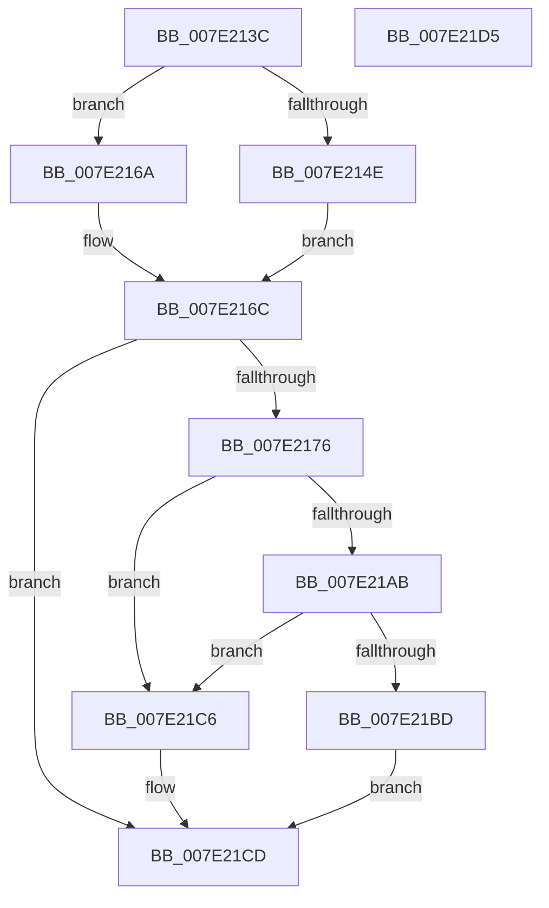

# CmRegisterSystemHiveLimitCallback

- RVA: `0x007E213C`–`0x007E21D6` (길이 `154` bytes)
- VA: `0x00000001407E213C`
- 실행 섹션: `PAGE`
- PDB 이름 있음: `예`; PDB Function 태그: `아니요`
- unwind 정보 RVA: `0x0005CF00`
- 디코드: `37`개 명령, `154/154` bytes 표시
- 미해석 바이트: `0` (있으면 어셈블리에 `.byte`로 보존)

> 이 문서는 커널 이미지의 기계어와 PDB 기호를 분석해 생성했습니다. 4번과 5번은 함수 원형과 자료형을 바이너리 사용 방식에서 추정한 C 해석이며 원본 소스 복구 결과는 아닙니다.

## 1. Dependencies

- 직접 호출 지점: **1**; 고유 호출 대상: **1**
- 직접 호출자로 확인된 함수: **1**
- RIP 상대 이미지 참조: **10**

### Outgoing calls
- `0x007E21B4` → [CmpDoQueueSystemHiveHysteresis](CmpDoQueueSystemHiveHysteresis_function_007E224C.md) (function, `0x007E224C`)

### Direct callers
- [IopInitializePlugPlayServices](../../init/C2/IopInitializePlugPlayServices_function_00C2F298.md) at `0x00C2F353`

### Static image references
- `0x007E2142` → RVA `0x00E09AE0` (`.data`; read)
- `0x007E2160` → RVA `0x00EEFBA8` (`.data`; read)
- `0x007E216C` → RVA `0x00EEFBB8` (`.data`; read)
- `0x007E2176` → RVA `0x00EEFBAC` (`.data`; write)
- `0x007E2180` → RVA `0x0072C310` (`PpSystemHiveLimitCallback`; read)
- `0x007E2187` → RVA `0x00EEFBB8` (`.data`; write)
- `0x007E218E` → RVA `0x00EEFBC8` (`.data`; write)
- `0x007E2198` → RVA `0x00EEFBC0` (`.data`; write)
- `0x007E219F` → RVA `0x00EEFBCD` (`.data`; write)
- `0x007E21AD` → RVA `0x00EEFBCC` (`.data`; write)

## 2. Other-region calls and transfers

- 다른 실행 섹션으로 향하는 call: **0**
- 별도 외부 분기/꼬리 이동을 확인하지 못했습니다.

## 3. Assembly (complete function range)

```asm
007E213C  40 53                           push rbx
007E213E  48 83 EC 20                     sub rsp, 0x20
007E2142  48 8B 05 97 79 62 00            mov rax, qword ptr [rip + 0x627997]
007E2149  48 85 C0                        test rax, rax
007E214C  74 1C                           je 0x1407e216a
007E214E  48 8B 40 40                     mov rax, qword ptr [rax + 0x40]
007E2152  33 D2                           xor edx, edx
007E2154  8B 48 28                        mov ecx, dword ptr [rax + 0x28]
007E2157  81 C1 00 10 00 00               add ecx, 0x1000
007E215D  6B C1 64                        imul eax, ecx, 0x64
007E2160  F7 35 42 DA 70 00               div dword ptr [rip + 0x70da42]
007E2166  8B D8                           mov ebx, eax
007E2168  EB 02                           jmp 0x1407e216c
007E216A  33 DB                           xor ebx, ebx
007E216C  48 83 3D 44 DA 70 00 00         cmp qword ptr [rip + 0x70da44], 0
007E2174  75 57                           jne 0x1407e21cd
007E2176  C7 05 2C DA 70 00 50 00 00 00   mov dword ptr [rip + 0x70da2c], 0x50
007E2180  48 8D 05 89 A1 F4 FF            lea rax, [rip - 0xb5e77]
007E2187  48 89 05 2A DA 70 00            mov qword ptr [rip + 0x70da2a], rax
007E218E  C7 05 30 DA 70 00 5A 00 00 00   mov dword ptr [rip + 0x70da30], 0x5a
007E2198  4C 89 05 21 DA 70 00            mov qword ptr [rip + 0x70da21], r8
007E219F  C6 05 27 DA 70 00 01            mov byte ptr [rip + 0x70da27], 1
007E21A6  83 FB 5A                        cmp ebx, 0x5a
007E21A9  72 1B                           jb 0x1407e21c6
007E21AB  8B CB                           mov ecx, ebx
007E21AD  C6 05 18 DA 70 00 01            mov byte ptr [rip + 0x70da18], 1
007E21B4  E8 93 00 00 00                  call 0x1407e224c
007E21B9  84 C0                           test al, al
007E21BB  74 09                           je 0x1407e21c6
007E21BD  C6 05 09 DA 70 00 00            mov byte ptr [rip + 0x70da09], 0
007E21C4  EB 07                           jmp 0x1407e21cd
007E21C6  C6 05 FF D9 70 00 00            mov byte ptr [rip + 0x70d9ff], 0
007E21CD  8B C3                           mov eax, ebx
007E21CF  48 83 C4 20                     add rsp, 0x20
007E21D3  5B                              pop rbx
007E21D4  C3                              ret
007E21D5  CC                              int3
```

## 4. C-style interpretation (structured pseudocode)

```c
__int64 __fastcall CmRegisterSystemHiveLimitCallback(__int64 a1, int a2, __int64 a3)
{
    __int64 result;
    __int64 v_rbx;
    __int64 v_rsp;

    v_rsp = (v_rsp) - (32);
    if (*(unsigned __int64 *)(v_rip + 6453655) == 0) goto loc_007E216A;
    a2 = 0;
    a1 = (unsigned int)(((unsigned int)(*(unsigned int *)(*(unsigned __int64 *)(*(unsigned __int64 *)(v_rip + 6453655) + 64) + 40))) + (0x1000ULL));
    result = (unsigned int)((*(unsigned __int64 *)(*(unsigned __int64 *)(v_rip + 6453655) + 64)) * ((unsigned int)(a1)));
    goto loc_007E216C;
loc_007E216A:
    v_rbx = 0;
loc_007E216C:
    if ((*(unsigned __int64 *)(v_rip + 7395908)) != 0) goto loc_007E21CD;
    *(unsigned int *)(v_rip + 7395884) = 80;
    *(unsigned __int64 *)(v_rip + 7395882) = v_rip - 745079;
    *(unsigned int *)(v_rip + 7395888) = 90;
    *(unsigned __int64 *)(v_rip + 7395873) = a3;
    *(unsigned __int8 *)(v_rip + 7395879) = 1;
    if (0 < 90) goto loc_007E21C6;
    *(unsigned __int8 *)(v_rip + 7395864) = 1;
    result = CmpDoQueueSystemHiveHysteresis(0, a2, a3, a4);
    if ((unsigned __int8)(result) == 0) goto loc_007E21C6;
    *(unsigned __int8 *)(v_rip + 7395849) = 0;
    goto loc_007E21CD;
loc_007E21C6:
    *(unsigned __int8 *)(v_rip + 7395839) = 0;
loc_007E21CD:
    v_rsp = (v_rsp) + (32);
    return 0;
}
```

## 5. (Beta) C Style

```c
int64_t CmRegisterSystemHiveLimitCallback(int64_t Arg1, int32_t Arg2, int64_t Arg3)
{
    int64_t result;
    int64_t local_rbx;
    int64_t local_rsp;

    local_rsp = (local_rsp) - (32);
    if (*(uint64_t *)(v_rip + 0x627997) == 0) goto loc_007E216A;
    Arg2 = 0;
    Arg1 = (uint32_t)(((uint32_t)(*(uint32_t *)(*(uint64_t *)(*(uint64_t *)(v_rip + 0x627997) + 0x40) + 0x28))) + (0x1000ULL));
    result = (uint32_t)((*(uint64_t *)(*(uint64_t *)(v_rip + 0x627997) + 0x40)) * ((uint32_t)(Arg1)));
    goto loc_007E216C;
loc_007E216A:
    local_rbx = 0;
loc_007E216C:
    if ((*(uint64_t *)(v_rip + 0x70DA44)) != 0) goto loc_007E21CD;
    *(uint32_t *)(v_rip + 0x70DA2C) = 80;
    *(uint64_t *)(v_rip + 0x70DA2A) = v_rip - 745079;
    *(uint32_t *)(v_rip + 0x70DA30) = 90;
    *(uint64_t *)(v_rip + 0x70DA21) = Arg3;
    *(uint8_t *)(v_rip + 0x70DA27) = 1;
    if (0 < 90) goto loc_007E21C6;
    *(uint8_t *)(v_rip + 0x70DA18) = 1;
    result = CmpDoQueueSystemHiveHysteresis(0, Arg2, Arg3, a4);
    if ((uint8_t)(result) == 0) goto loc_007E21C6;
    *(uint8_t *)(v_rip + 0x70DA09) = 0;
    goto loc_007E21CD;
loc_007E21C6:
    *(uint8_t *)(v_rip + 0x70D9FF) = 0;
loc_007E21CD:
    local_rsp = (local_rsp) + (32);
    return 0;
}
```

## 6. Execution-region graph

[열기: 2D/3D 그래프와 함수 탐색 컨트롤 패널](../../../control-panel.html?section=page&rva=0x007E213C&view=graph)

- 2D 그래프는 위에서 아래로 흐르고, 3D 그래프는 빈 공간을 드래그해 회전합니다. Shift+드래그는 이동, 휠은 확대·축소, 함수 노드 선택은 대상 보고서 이동입니다.

### Static fallback


