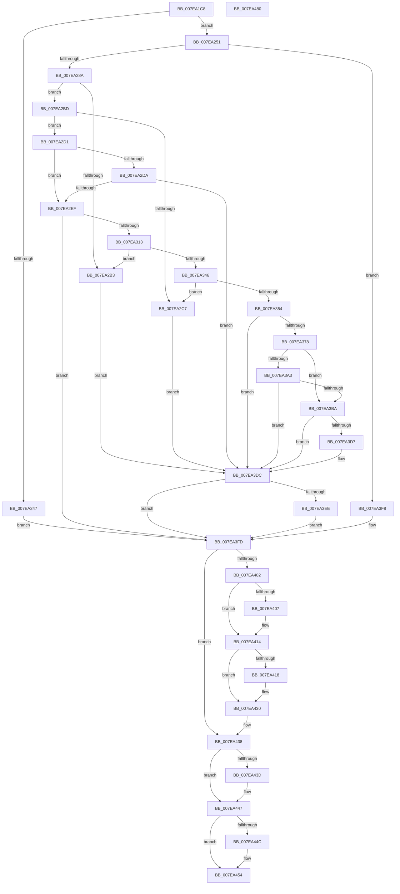

# CmReplaceKey

- RVA: `0x007EA1C8`–`0x007EA481` (길이 `697` bytes)
- VA: `0x00000001407EA1C8`
- 실행 섹션: `PAGE`
- PDB 이름 있음: `예`; PDB Function 태그: `아니요`
- unwind 정보 RVA: `0x000D6DAC`
- 디코드: `180`개 명령, `697/697` bytes 표시
- 미해석 바이트: `0` (있으면 어셈블리에 `.byte`로 보존)

> 이 문서는 커널 이미지의 기계어와 PDB 기호를 분석해 생성했습니다. 4번과 5번은 함수 원형과 자료형을 바이너리 사용 방식에서 추정한 C 해석이며 원본 소스 복구 결과는 아닙니다.

## 1. Dependencies

- 직접 호출 지점: **25**; 고유 호출 대상: **17**
- 직접 호출자로 확인된 함수: **1**
- RIP 상대 이미지 참조: **2**

### Outgoing calls
- `0x007EA238` → [CmpAllocatePool](../../text/3C/CmpAllocatePool_function_003CD504.md) (function, `0x003CD504`)
- `0x007EA27B` → [CmpCmdHiveOpen](../87/CmpCmdHiveOpen_function_00878404.md) (function, `0x00878404`)
- `0x007EA28F` → [CmpAttachToRegistryProcess](../../pagecmrc/BC/CmpAttachToRegistryProcess_function_00BC98E0.md) (function, `0x00BC98E0`)
- `0x007EA297` → [CmpLockRegistry](../../pagecmrc/BC/CmpLockRegistry_function_00BC9B34.md) (function, `0x00BC9B34`)
- `0x007EA29F` → [HvLockHiveFlusherExclusive](../../pagecmrc/BC/HvLockHiveFlusherExclusive_function_00BC9C50.md) (function, `0x00BC9C50`)
- `0x007EA2E0` → [CmpPreserveSystemHiveData](../7F/CmpPreserveSystemHiveData_function_007F2518.md) (function, `0x007F2518`)
- `0x007EA2F2` → [HvUnlockHiveFlusherExclusive](../../pagecmrc/BC/HvUnlockHiveFlusherExclusive_function_00BC9C34.md) (function, `0x00BC9C34`)
- `0x007EA2F7` → [CmpUnlockRegistry](../../pagecmrc/BC/CmpUnlockRegistry_function_00BC9A84.md) (function, `0x00BC9A84`)
- `0x007EA304` → [CmpFlushHive](../9B/CmpFlushHive_function_009B3DC0.md) (function, `0x009B3DC0`)
- `0x007EA318` → [CmpDetachFromRegistryProcess](../../pagecmrc/BC/CmpDetachFromRegistryProcess_function_00BC9920.md) (function, `0x00BC9920`)
- `0x007EA323` → [CmpBecomeActiveFlusherAndReconciler](CmpBecomeActiveFlusherAndReconciler_function_007E7E20.md) (function, `0x007E7E20`)
- `0x007EA32B` → [CmpLockRegistry](../../pagecmrc/BC/CmpLockRegistry_function_00BC9B34.md) (function, `0x00BC9B34`)
- `0x007EA333` → [HvLockHiveFlusherExclusive](../../pagecmrc/BC/HvLockHiveFlusherExclusive_function_00BC9C50.md) (function, `0x00BC9C50`)
- `0x007EA36D` → [CmpCmdRenameHive](CmpCmdRenameHive_function_007E5910.md) (function, `0x007E5910`)
- `0x007EA398` → [CmpCmdRenameHive](CmpCmdRenameHive_function_007E5910.md) (function, `0x007E5910`)
- `0x007EA3AF` → [ZwFlushBuffersFile](../../text/6A/ZwFlushBuffersFile_function_006ADA30.md) (function, `0x006ADA30`)
- `0x007EA3CE` → [CmpCmdRenameHive](CmpCmdRenameHive_function_007E5910.md) (function, `0x007E5910`)
- `0x007EA3DF` → [HvUnlockHiveFlusherExclusive](../../pagecmrc/BC/HvUnlockHiveFlusherExclusive_function_00BC9C34.md) (function, `0x00BC9C34`)
- `0x007EA3E4` → [CmpUnlockRegistry](../../pagecmrc/BC/CmpUnlockRegistry_function_00BC9A84.md) (function, `0x00BC9A84`)
- `0x007EA3F1` → [CmpFinishBeingActiveFlusherAndReconciler](CmpFinishBeingActiveFlusherAndReconciler_function_007E7EB0.md) (function, `0x007E7EB0`)
- `0x007EA40C` → [CmpAttachToRegistryProcess](../../pagecmrc/BC/CmpAttachToRegistryProcess_function_00BC98E0.md) (function, `0x00BC98E0`)
- `0x007EA433` → [CmpDestroyHive](../9B/CmpDestroyHive_function_009B1708.md) (function, `0x009B1708`)
- `0x007EA442` → [CmpDetachFromRegistryProcess](../../pagecmrc/BC/CmpDetachFromRegistryProcess_function_00BC9920.md) (function, `0x00BC9920`)
- `0x007EA44F` → [CmSiFreeMemory](../../text/47/CmSiFreeMemory_function_00475D80.md) (function, `0x00475D80`)
- `0x007EA460` → [_security_check_cookie](../../text/6A/_security_check_cookie_function_006AC640.md) (function, `0x006AC640`)

### Direct callers
- [NtReplaceKey](NtReplaceKey_function_007E0970.md) at `0x007E0B40`

### Static image references
- `0x007EA1E7` → RVA `0x00E0A740` (`.data`; read)
- `0x007EA2D1` → RVA `0x00E09AE0` (`.data`; read)

## 2. Other-region calls and transfers

- 다른 실행 섹션으로 향하는 call: **16**
  - `0x007EA238` → [CmpAllocatePool](../../text/3C/CmpAllocatePool_function_003CD504.md) (`PAGE` → `.text`)
  - `0x007EA28F` → [CmpAttachToRegistryProcess](../../pagecmrc/BC/CmpAttachToRegistryProcess_function_00BC98E0.md) (`PAGE` → `PAGECMRC`)
  - `0x007EA297` → [CmpLockRegistry](../../pagecmrc/BC/CmpLockRegistry_function_00BC9B34.md) (`PAGE` → `PAGECMRC`)
  - `0x007EA29F` → [HvLockHiveFlusherExclusive](../../pagecmrc/BC/HvLockHiveFlusherExclusive_function_00BC9C50.md) (`PAGE` → `PAGECMRC`)
  - `0x007EA2F2` → [HvUnlockHiveFlusherExclusive](../../pagecmrc/BC/HvUnlockHiveFlusherExclusive_function_00BC9C34.md) (`PAGE` → `PAGECMRC`)
  - `0x007EA2F7` → [CmpUnlockRegistry](../../pagecmrc/BC/CmpUnlockRegistry_function_00BC9A84.md) (`PAGE` → `PAGECMRC`)
  - `0x007EA318` → [CmpDetachFromRegistryProcess](../../pagecmrc/BC/CmpDetachFromRegistryProcess_function_00BC9920.md) (`PAGE` → `PAGECMRC`)
  - `0x007EA32B` → [CmpLockRegistry](../../pagecmrc/BC/CmpLockRegistry_function_00BC9B34.md) (`PAGE` → `PAGECMRC`)
  - `0x007EA333` → [HvLockHiveFlusherExclusive](../../pagecmrc/BC/HvLockHiveFlusherExclusive_function_00BC9C50.md) (`PAGE` → `PAGECMRC`)
  - `0x007EA3AF` → [ZwFlushBuffersFile](../../text/6A/ZwFlushBuffersFile_function_006ADA30.md) (`PAGE` → `.text`)
  - `0x007EA3DF` → [HvUnlockHiveFlusherExclusive](../../pagecmrc/BC/HvUnlockHiveFlusherExclusive_function_00BC9C34.md) (`PAGE` → `PAGECMRC`)
  - `0x007EA3E4` → [CmpUnlockRegistry](../../pagecmrc/BC/CmpUnlockRegistry_function_00BC9A84.md) (`PAGE` → `PAGECMRC`)
  - `0x007EA40C` → [CmpAttachToRegistryProcess](../../pagecmrc/BC/CmpAttachToRegistryProcess_function_00BC98E0.md) (`PAGE` → `PAGECMRC`)
  - `0x007EA442` → [CmpDetachFromRegistryProcess](../../pagecmrc/BC/CmpDetachFromRegistryProcess_function_00BC9920.md) (`PAGE` → `PAGECMRC`)
  - `0x007EA44F` → [CmSiFreeMemory](../../text/47/CmSiFreeMemory_function_00475D80.md) (`PAGE` → `.text`)
  - `0x007EA460` → [_security_check_cookie](../../text/6A/_security_check_cookie_function_006AC640.md) (`PAGE` → `.text`)
- 별도 외부 분기/꼬리 이동을 확인하지 못했습니다.

## 3. Assembly (complete function range)

```asm
007EA1C8  48 89 5C 24 10                  mov qword ptr [rsp + 0x10], rbx
007EA1CD  55                              push rbp
007EA1CE  56                              push rsi
007EA1CF  57                              push rdi
007EA1D0  41 54                           push r12
007EA1D2  41 55                           push r13
007EA1D4  41 56                           push r14
007EA1D6  41 57                           push r15
007EA1D8  48 8D AC 24 50 FE FF FF         lea rbp, [rsp - 0x1b0]
007EA1E0  48 81 EC B0 02 00 00            sub rsp, 0x2b0
007EA1E7  48 8B 05 52 05 62 00            mov rax, qword ptr [rip + 0x620552]
007EA1EE  48 33 C4                        xor rax, rsp
007EA1F1  48 89 85 A0 01 00 00            mov qword ptr [rbp + 0x1a0], rax
007EA1F8  0F 57 C0                        xorps xmm0, xmm0
007EA1FB  C6 44 24 50 00                  mov byte ptr [rsp + 0x50], 0
007EA200  49 8B D8                        mov rbx, r8
007EA203  48 8B F9                        mov rdi, rcx
007EA206  33 F6                           xor esi, esi
007EA208  B9 00 01 00 00                  mov ecx, 0x100
007EA20D  41 B8 43 4D 39 33               mov r8d, 0x33394d43
007EA213  48 89 74 24 58                  mov qword ptr [rsp + 0x58], rsi
007EA218  BA B0 01 00 00                  mov edx, 0x1b0
007EA21D  4D 8B E9                        mov r13, r9
007EA220  0F 11 44 24 60                  movups xmmword ptr [rsp + 0x60], xmm0
007EA225  45 32 F6                        xor r14b, r14b
007EA228  45 32 E4                        xor r12b, r12b
007EA22B  0F 11 44 24 70                  movups xmmword ptr [rsp + 0x70], xmm0
007EA230  0F 11 45 80                     movups xmmword ptr [rbp - 0x80], xmm0
007EA234  0F 11 45 90                     movups xmmword ptr [rbp - 0x70], xmm0
007EA238  E8 C7 32 BE FF                  call 0x1403cd504
007EA23D  4C 8B F8                        mov r15, rax
007EA240  33 C0                           xor eax, eax
007EA242  4D 85 FF                        test r15, r15
007EA245  75 0A                           jne 0x1407ea251
007EA247  BB 9A 00 00 C0                  mov ebx, 0xc000009a
007EA24C  E9 AC 01 00 00                  jmp 0x1407ea3fd
007EA251  4C 89 7C 24 40                  mov qword ptr [rsp + 0x40], r15
007EA256  4C 8D 4C 24 58                  lea r9, [rsp + 0x58]
007EA25B  48 89 44 24 38                  mov qword ptr [rsp + 0x38], rax
007EA260  4C 8D 44 24 50                  lea r8, [rsp + 0x50]
007EA265  48 89 44 24 30                  mov qword ptr [rsp + 0x30], rax
007EA26A  33 D2                           xor edx, edx
007EA26C  89 44 24 28                     mov dword ptr [rsp + 0x28], eax
007EA270  48 8B CB                        mov rcx, rbx
007EA273  C7 44 24 20 01 00 19 01         mov dword ptr [rsp + 0x20], 0x1190001
007EA27B  E8 84 E1 08 00                  call 0x140878404
007EA280  8B D8                           mov ebx, eax
007EA282  85 C0                           test eax, eax
007EA284  0F 88 6E 01 00 00               js 0x1407ea3f8
007EA28A  48 8D 4C 24 70                  lea rcx, [rsp + 0x70]
007EA28F  E8 4C F6 3D 00                  call 0x140bc98e0
007EA294  41 B6 01                        mov r14b, 1
007EA297  E8 98 F8 3D 00                  call 0x140bc9b34
007EA29C  48 8B CF                        mov rcx, rdi
007EA29F  E8 AC F9 3D 00                  call 0x140bc9c50
007EA2A4  8B 87 A0 00 00 00               mov eax, dword ptr [rdi + 0xa0]
007EA2AA  48 8B 74 24 58                  mov rsi, qword ptr [rsp + 0x58]
007EA2AF  A8 04                           test al, 4
007EA2B1  74 0A                           je 0x1407ea2bd
007EA2B3  BB D5 00 00 C0                  mov ebx, 0xc00000d5
007EA2B8  E9 1F 01 00 00                  jmp 0x1407ea3dc
007EA2BD  8B 87 10 10 00 00               mov eax, dword ptr [rdi + 0x1010]
007EA2C3  A8 20                           test al, 0x20
007EA2C5  74 0A                           je 0x1407ea2d1
007EA2C7  BB 0D 00 00 C0                  mov ebx, 0xc000000d
007EA2CC  E9 0B 01 00 00                  jmp 0x1407ea3dc
007EA2D1  48 3B 3D 08 F8 61 00            cmp rdi, qword ptr [rip + 0x61f808]
007EA2D8  75 15                           jne 0x1407ea2ef
007EA2DA  48 8B D6                        mov rdx, rsi
007EA2DD  48 8B CF                        mov rcx, rdi
007EA2E0  E8 33 82 00 00                  call 0x1407f2518
007EA2E5  8B D8                           mov ebx, eax
007EA2E7  85 C0                           test eax, eax
007EA2E9  0F 88 ED 00 00 00               js 0x1407ea3dc
007EA2EF  48 8B CF                        mov rcx, rdi
007EA2F2  E8 3D F9 3D 00                  call 0x140bc9c34
007EA2F7  E8 88 F7 3D 00                  call 0x140bc9a84
007EA2FC  BA 0C 00 00 00                  mov edx, 0xc
007EA301  48 8B CE                        mov rcx, rsi
007EA304  E8 B7 9A 1C 00                  call 0x1409b3dc0
007EA309  8B D8                           mov ebx, eax
007EA30B  85 C0                           test eax, eax
007EA30D  0F 88 EA 00 00 00               js 0x1407ea3fd
007EA313  48 8D 4C 24 70                  lea rcx, [rsp + 0x70]
007EA318  E8 03 F6 3D 00                  call 0x140bc9920
007EA31D  48 8B CF                        mov rcx, rdi
007EA320  45 32 F6                        xor r14b, r14b
007EA323  E8 F8 DA FF FF                  call 0x1407e7e20
007EA328  41 B4 01                        mov r12b, 1
007EA32B  E8 04 F8 3D 00                  call 0x140bc9b34
007EA330  48 8B CF                        mov rcx, rdi
007EA333  E8 18 F9 3D 00                  call 0x140bc9c50
007EA338  8B 87 A0 00 00 00               mov eax, dword ptr [rdi + 0xa0]
007EA33E  A8 04                           test al, 4
007EA340  0F 85 6D FF FF FF               jne 0x1407ea2b3
007EA346  8B 87 10 10 00 00               mov eax, dword ptr [rdi + 0x1010]
007EA34C  A8 20                           test al, 0x20
007EA34E  0F 85 73 FF FF FF               jne 0x1407ea2c7
007EA354  48 8B 8F 08 06 00 00            mov rcx, qword ptr [rdi + 0x608]
007EA35B  48 8D 55 A0                     lea rdx, [rbp - 0x60]
007EA35F  41 B9 00 02 00 00               mov r9d, 0x200
007EA365  44 88 74 24 20                  mov byte ptr [rsp + 0x20], r14b
007EA36A  4D 8B C5                        mov r8, r13
007EA36D  E8 9E B5 FF FF                  call 0x1407e5910
007EA372  8B D8                           mov ebx, eax
007EA374  85 C0                           test eax, eax
007EA376  78 64                           js 0x1407ea3dc
007EA378  83 8F A0 00 00 00 04            or dword ptr [rdi + 0xa0], 4
007EA37F  4C 8D 45 A0                     lea r8, [rbp - 0x60]
007EA383  48 8B 8E 08 06 00 00            mov rcx, qword ptr [rsi + 0x608]
007EA38A  4C 8D 6D A0                     lea r13, [rbp - 0x60]
007EA38E  45 33 C9                        xor r9d, r9d
007EA391  44 88 74 24 20                  mov byte ptr [rsp + 0x20], r14b
007EA396  33 D2                           xor edx, edx
007EA398  E8 73 B5 FF FF                  call 0x1407e5910
007EA39D  8B D8                           mov ebx, eax
007EA39F  85 C0                           test eax, eax
007EA3A1  78 17                           js 0x1407ea3ba
007EA3A3  48 8B 8E 08 06 00 00            mov rcx, qword ptr [rsi + 0x608]
007EA3AA  48 8D 54 24 60                  lea rdx, [rsp + 0x60]
007EA3AF  E8 7C 36 EC FF                  call 0x1406ada30
007EA3B4  8B D8                           mov ebx, eax
007EA3B6  85 C0                           test eax, eax
007EA3B8  79 22                           jns 0x1407ea3dc
007EA3BA  48 8B 8F 08 06 00 00            mov rcx, qword ptr [rdi + 0x608]
007EA3C1  45 33 C9                        xor r9d, r9d
007EA3C4  4D 8B C5                        mov r8, r13
007EA3C7  44 88 74 24 20                  mov byte ptr [rsp + 0x20], r14b
007EA3CC  33 D2                           xor edx, edx
007EA3CE  E8 3D B5 FF FF                  call 0x1407e5910
007EA3D3  85 C0                           test eax, eax
007EA3D5  79 05                           jns 0x1407ea3dc
007EA3D7  BB 4C 01 00 C0                  mov ebx, 0xc000014c
007EA3DC  48 8B CF                        mov rcx, rdi
007EA3DF  E8 50 F8 3D 00                  call 0x140bc9c34
007EA3E4  E8 9B F6 3D 00                  call 0x140bc9a84
007EA3E9  45 84 E4                        test r12b, r12b
007EA3EC  74 0F                           je 0x1407ea3fd
007EA3EE  48 8B CF                        mov rcx, rdi
007EA3F1  E8 BA DA FF FF                  call 0x1407e7eb0
007EA3F6  EB 05                           jmp 0x1407ea3fd
007EA3F8  48 8B 74 24 58                  mov rsi, qword ptr [rsp + 0x58]
007EA3FD  48 85 F6                        test rsi, rsi
007EA400  74 36                           je 0x1407ea438
007EA402  45 84 F6                        test r14b, r14b
007EA405  75 0D                           jne 0x1407ea414
007EA407  48 8D 4C 24 70                  lea rcx, [rsp + 0x70]
007EA40C  E8 CF F4 3D 00                  call 0x140bc98e0
007EA411  41 B6 01                        mov r14b, 1
007EA414  85 DB                           test ebx, ebx
007EA416  78 18                           js 0x1407ea430
007EA418  0F 57 C0                        xorps xmm0, xmm0
007EA41B  0F 11 86 08 06 00 00            movups xmmword ptr [rsi + 0x608], xmm0
007EA422  0F 11 86 18 06 00 00            movups xmmword ptr [rsi + 0x618], xmm0
007EA429  0F 11 86 28 06 00 00            movups xmmword ptr [rsi + 0x628], xmm0
007EA430  48 8B CE                        mov rcx, rsi
007EA433  E8 D0 72 1C 00                  call 0x1409b1708
007EA438  45 84 F6                        test r14b, r14b
007EA43B  74 0A                           je 0x1407ea447
007EA43D  48 8D 4C 24 70                  lea rcx, [rsp + 0x70]
007EA442  E8 D9 F4 3D 00                  call 0x140bc9920
007EA447  4D 85 FF                        test r15, r15
007EA44A  74 08                           je 0x1407ea454
007EA44C  49 8B CF                        mov rcx, r15
007EA44F  E8 2C B9 C8 FF                  call 0x140475d80
007EA454  8B C3                           mov eax, ebx
007EA456  48 8B 8D A0 01 00 00            mov rcx, qword ptr [rbp + 0x1a0]
007EA45D  48 33 CC                        xor rcx, rsp
007EA460  E8 DB 21 EC FF                  call 0x1406ac640
007EA465  48 8B 9C 24 F8 02 00 00         mov rbx, qword ptr [rsp + 0x2f8]
007EA46D  48 81 C4 B0 02 00 00            add rsp, 0x2b0
007EA474  41 5F                           pop r15
007EA476  41 5E                           pop r14
007EA478  41 5D                           pop r13
007EA47A  41 5C                           pop r12
007EA47C  5F                              pop rdi
007EA47D  5E                              pop rsi
007EA47E  5D                              pop rbp
007EA47F  C3                              ret
007EA480  CC                              int3
```

## 4. C-style interpretation (structured pseudocode)

```c
__int64 __fastcall CmReplaceKey(__int64 a1, __int64 a2, __int64 a3, __int64 a4)
{
    __int64 result;
    __int64 v_r12;
    __int64 v_r14;
    __int64 v_rbx;
    __int64 v_rsi;
    __int64 v_rsp;
    unsigned __int64 v_stack_m1E8;
    unsigned __int64 v_stack_m248;
    unsigned __int64 v_stack_m258;
    unsigned __int64 v_stack_m268;
    unsigned __int64 v_stack_m278;
    unsigned __int64 v_stack_m288;
    unsigned __int64 v_stack_m290;
    unsigned __int8 v_stack_m298;
    unsigned __int64 v_stack_m2A8;
    unsigned __int64 v_stack_m2B0;
    unsigned __int64 v_stack_m2B8;
    unsigned int v_stack_m2C0;
    unsigned int v_stack_m2C8;
    unsigned __int64 v_stack_m48;
    unsigned __int64 v_stack_p10;

    v_stack_p10 = v_rbx;
    v_rsp = (v_rsp) - (688);
    result = (*(unsigned __int64 *)(v_rip + 6423890)) ^ (v_rsp);
    v_stack_m48 = result;
    v_stack_m298 = 0;
    v_rsi = 0;
    v_stack_m290 = 0;
    v_stack_m288 = v_xmm0;
    v_r14 = 0;
    v_r12 = 0;
    v_stack_m278 = v_xmm0;
    v_stack_m268 = v_xmm0;
    v_stack_m258 = v_xmm0;
    result = CmpAllocatePool(256, 432, (unsigned int)(0x33394D43ULL), a4);
    result = 0;
    if (0 != 0) goto loc_007EA251;
    goto loc_007EA3FD;
loc_007EA251:
    v_stack_m2A8 = 0;
    v_stack_m2B0 = 0;
    v_stack_m2B8 = 0;
    a2 = 0;
    v_stack_m2C0 = 0;
    v_stack_m2C8 = 0x1190001ULL;
    result = CmpCmdHiveOpen((unsigned int)(0xC000009AULL), a2, v_stack_m298, v_stack_m290);
    if (sign_flag) goto loc_007EA3F8;
    result = CmpAttachToRegistryProcess(v_stack_m278, a2, v_stack_m298, v_stack_m290);
    result = CmpLockRegistry(v_stack_m278, a2, v_stack_m298, v_stack_m290);
    result = HvLockHiveFlusherExclusive(a1, a2, v_stack_m298, v_stack_m290);
    if ((((unsigned __int8)((unsigned int)(*(unsigned int *)(a1 + 160)))) & (4)) == 0) goto loc_007EA2BD;
loc_007EA2B3:
    goto loc_007EA3DC;
loc_007EA2BD:
    if ((((unsigned __int8)((unsigned int)(*(unsigned int *)(a1 + 4112)))) & (32)) == 0) goto loc_007EA2D1;
loc_007EA2C7:
    goto loc_007EA3DC;
loc_007EA2D1:
    if (a1 != (*(unsigned __int64 *)(v_rip + 6420488))) goto loc_007EA2EF;
    result = CmpPreserveSystemHiveData(a1, v_stack_m290, v_stack_m298, v_stack_m290);
    if (sign_flag) goto loc_007EA3DC;
loc_007EA2EF:
    result = HvUnlockHiveFlusherExclusive(a1, v_stack_m290, v_stack_m298, v_stack_m290);
    result = CmpUnlockRegistry(a1, v_stack_m290, v_stack_m298, v_stack_m290);
    result = CmpFlushHive(v_stack_m290, 12, v_stack_m298, v_stack_m290);
    if (sign_flag) goto loc_007EA3FD;
    result = CmpDetachFromRegistryProcess(v_stack_m278, 12, v_stack_m298, v_stack_m290);
    v_r14 = 0;
    result = CmpBecomeActiveFlusherAndReconciler(a1, 12, v_stack_m298, v_stack_m290);
    result = CmpLockRegistry(a1, 12, v_stack_m298, v_stack_m290);
    result = HvLockHiveFlusherExclusive(a1, 12, v_stack_m298, v_stack_m290);
    if ((((unsigned __int8)((unsigned int)(*(unsigned int *)(a1 + 160)))) & (4)) != 0) goto loc_007EA2B3;
    if ((((unsigned __int8)((unsigned int)(*(unsigned int *)(a1 + 4112)))) & (32)) != 0) goto loc_007EA2C7;
    v_stack_m2C8 = 0;
    result = CmpCmdRenameHive(*(unsigned __int64 *)(a1 + 1544), v_stack_m248, a4, 512);
    if (sign_flag) goto loc_007EA3DC;
    a4 = 0;
    v_stack_m2C8 = 0;
    a2 = 0;
    result = CmpCmdRenameHive(*(unsigned __int64 *)(v_stack_m290 + 1544), a2, v_stack_m248, a4);
    if (sign_flag) goto loc_007EA3BA;
    result = ZwFlushBuffersFile(*(unsigned __int64 *)(v_stack_m290 + 1544), v_stack_m288, v_stack_m248, a4);
    if (!sign_flag) goto loc_007EA3DC;
loc_007EA3BA:
    a4 = 0;
    v_stack_m2C8 = 0;
    a2 = 0;
    result = CmpCmdRenameHive(*(unsigned __int64 *)(a1 + 1544), a2, v_stack_m248, a4);
    v_rbx = (unsigned int)((unsigned int)(result));
    if (sign_flag) {
        v_rbx = 0xC000014CULL;
    }
    result = HvUnlockHiveFlusherExclusive(a1, a2, v_stack_m248, a4);
    result = CmpUnlockRegistry(a1, a2, v_stack_m248, a4);
    if (1 == 0) goto loc_007EA3FD;
    result = CmpFinishBeingActiveFlusherAndReconciler(a1, a2, v_stack_m248, a4);
    goto loc_007EA3FD;
loc_007EA3F8:
loc_007EA3FD:
    if (v_stack_m290 == 0) goto loc_007EA438;
    if (0 == 0) {
        a1 = v_stack_m278;
        result = CmpAttachToRegistryProcess(a1, a2, v_stack_m248, a4);
        v_r14 = 1;
    }
    if (!(sign_flag)) {
        *(unsigned __int64 *)(v_stack_m290 + 1544) = v_xmm0;
        *(unsigned __int64 *)(v_stack_m290 + 1560) = v_xmm0;
        *(unsigned __int64 *)(v_stack_m290 + 1576) = v_xmm0;
    }
    result = CmpDestroyHive(v_stack_m290, a2, v_stack_m248, a4);
loc_007EA438:
    if ((unsigned __int8)(v_r14) != 0) {
        a1 = v_stack_m278;
        result = CmpDetachFromRegistryProcess(a1, a2, v_stack_m248, a4);
    }
    if (result != 0) {
        a1 = result;
        result = CmSiFreeMemory(a1, a2, v_stack_m248, a4);
    }
    a1 = (v_stack_m48) ^ (v_rsp);
    result = _security_check_cookie(a1, a2, v_stack_m248, a4);
    v_rsp = (v_rsp) + (688);
    return result;
}
```

## 5. (Beta) C Style

```c
int64_t CmReplaceKey(void *Arg1, int64_t Arg2, int64_t Arg3, int64_t Arg4)
{
    uint8_t *arg1 = (uint8_t *)Arg1;

    int64_t result;
    int64_t local_r12;
    int64_t local_r14;
    int64_t local_rbx;
    int64_t local_rsi;
    int64_t local_rsp;
    uint64_t v_stack_m1E8;
    uint64_t v_stack_m248;
    uint64_t v_stack_m258;
    uint64_t v_stack_m268;
    uint64_t v_stack_m278;
    uint64_t v_stack_m288;
    uint64_t v_stack_m290;
    uint8_t v_stack_m298;
    uint64_t v_stack_m2A8;
    uint64_t v_stack_m2B0;
    uint64_t v_stack_m2B8;
    uint32_t v_stack_m2C0;
    uint32_t v_stack_m2C8;
    uint64_t v_stack_m48;
    uint64_t v_stack_p10;

    v_stack_p10 = local_rbx;
    local_rsp = (local_rsp) - (688);
    result = (*(uint64_t *)(v_rip + 0x620552)) ^ (local_rsp);
    v_stack_m48 = result;
    v_stack_m298 = 0;
    local_rsi = 0;
    v_stack_m290 = 0;
    v_stack_m288 = v_xmm0;
    local_r14 = 0;
    local_r12 = 0;
    v_stack_m278 = v_xmm0;
    v_stack_m268 = v_xmm0;
    v_stack_m258 = v_xmm0;
    result = CmpAllocatePool(256, 432, (uint32_t)(0x33394D43ULL), Arg4);
    result = 0;
    if (0 != 0) goto loc_007EA251;
    goto loc_007EA3FD;
loc_007EA251:
    v_stack_m2A8 = 0;
    v_stack_m2B0 = 0;
    v_stack_m2B8 = 0;
    Arg2 = 0;
    v_stack_m2C0 = 0;
    v_stack_m2C8 = 0x1190001ULL;
    result = CmpCmdHiveOpen((uint32_t)(0xC000009AULL), Arg2, v_stack_m298, v_stack_m290);
    if (sign_flag) goto loc_007EA3F8;
    result = CmpAttachToRegistryProcess(v_stack_m278, Arg2, v_stack_m298, v_stack_m290);
    result = CmpLockRegistry(v_stack_m278, Arg2, v_stack_m298, v_stack_m290);
    result = HvLockHiveFlusherExclusive(Arg1, Arg2, v_stack_m298, v_stack_m290);
    if ((((uint8_t)((uint32_t)(*(uint32_t *)(arg1 + 0xA0)))) & (4)) == 0) goto loc_007EA2BD;
loc_007EA2B3:
    goto loc_007EA3DC;
loc_007EA2BD:
    if ((((uint8_t)((uint32_t)(*(uint32_t *)(arg1 + 0x1010)))) & (32)) == 0) goto loc_007EA2D1;
loc_007EA2C7:
    goto loc_007EA3DC;
loc_007EA2D1:
    if (Arg1 != (*(uint64_t *)(v_rip + 0x61F808))) goto loc_007EA2EF;
    result = CmpPreserveSystemHiveData(Arg1, v_stack_m290, v_stack_m298, v_stack_m290);
    if (sign_flag) goto loc_007EA3DC;
loc_007EA2EF:
    result = HvUnlockHiveFlusherExclusive(Arg1, v_stack_m290, v_stack_m298, v_stack_m290);
    result = CmpUnlockRegistry(Arg1, v_stack_m290, v_stack_m298, v_stack_m290);
    result = CmpFlushHive(v_stack_m290, 12, v_stack_m298, v_stack_m290);
    if (sign_flag) goto loc_007EA3FD;
    result = CmpDetachFromRegistryProcess(v_stack_m278, 12, v_stack_m298, v_stack_m290);
    local_r14 = 0;
    result = CmpBecomeActiveFlusherAndReconciler(Arg1, 12, v_stack_m298, v_stack_m290);
    result = CmpLockRegistry(Arg1, 12, v_stack_m298, v_stack_m290);
    result = HvLockHiveFlusherExclusive(Arg1, 12, v_stack_m298, v_stack_m290);
    if ((((uint8_t)((uint32_t)(*(uint32_t *)(arg1 + 0xA0)))) & (4)) != 0) goto loc_007EA2B3;
    if ((((uint8_t)((uint32_t)(*(uint32_t *)(arg1 + 0x1010)))) & (32)) != 0) goto loc_007EA2C7;
    v_stack_m2C8 = 0;
    result = CmpCmdRenameHive(*(uint64_t *)(arg1 + 0x608), v_stack_m248, Arg4, 512);
    if (sign_flag) goto loc_007EA3DC;
    Arg4 = 0;
    v_stack_m2C8 = 0;
    Arg2 = 0;
    result = CmpCmdRenameHive(*(uint64_t *)(v_stack_m290 + 0x608), Arg2, v_stack_m248, Arg4);
    if (sign_flag) goto loc_007EA3BA;
    result = ZwFlushBuffersFile(*(uint64_t *)(v_stack_m290 + 0x608), v_stack_m288, v_stack_m248, Arg4);
    if (!sign_flag) goto loc_007EA3DC;
loc_007EA3BA:
    Arg4 = 0;
    v_stack_m2C8 = 0;
    Arg2 = 0;
    result = CmpCmdRenameHive(*(uint64_t *)(arg1 + 0x608), Arg2, v_stack_m248, Arg4);
    local_rbx = (uint32_t)((uint32_t)(result));
    if (sign_flag) {
        local_rbx = 0xC000014CULL;
    }
    result = HvUnlockHiveFlusherExclusive(Arg1, Arg2, v_stack_m248, Arg4);
    result = CmpUnlockRegistry(Arg1, Arg2, v_stack_m248, Arg4);
    if (1 == 0) goto loc_007EA3FD;
    result = CmpFinishBeingActiveFlusherAndReconciler(Arg1, Arg2, v_stack_m248, Arg4);
    goto loc_007EA3FD;
loc_007EA3F8:
loc_007EA3FD:
    if (v_stack_m290 == 0) goto loc_007EA438;
    if (0 == 0) {
        Arg1 = v_stack_m278;
        result = CmpAttachToRegistryProcess(Arg1, Arg2, v_stack_m248, Arg4);
        local_r14 = 1;
    }
    if (!(sign_flag)) {
        *(uint64_t *)(v_stack_m290 + 0x608) = v_xmm0;
        *(uint64_t *)(v_stack_m290 + 0x618) = v_xmm0;
        *(uint64_t *)(v_stack_m290 + 0x628) = v_xmm0;
    }
    result = CmpDestroyHive(v_stack_m290, Arg2, v_stack_m248, Arg4);
loc_007EA438:
    if ((uint8_t)(local_r14) != 0) {
        Arg1 = v_stack_m278;
        result = CmpDetachFromRegistryProcess(Arg1, Arg2, v_stack_m248, Arg4);
    }
    if (result != 0) {
        Arg1 = result;
        result = CmSiFreeMemory(Arg1, Arg2, v_stack_m248, Arg4);
    }
    Arg1 = (v_stack_m48) ^ (local_rsp);
    result = _security_check_cookie(Arg1, Arg2, v_stack_m248, Arg4);
    local_rsp = (local_rsp) + (688);
    return result;
}
```

### 관측된 메모리 오프셋

구조체 형식이 확인되지 않은 접근은 인자 기준의 오프셋으로만 기록했습니다.

| 기준 인자 | 오프셋 표현 | 폭 (bit) | 접근 |
|---|---:|---:|---|
| `Arg1` | `+ 0xA0` | `32` | `R` |
| `Arg1` | `+ 0x1010` | `32` | `R` |

## 6. Execution-region graph

[열기: 2D/3D 그래프와 함수 탐색 컨트롤 패널](../../../control-panel.html?section=page&rva=0x007EA1C8&view=graph)

- 2D 그래프는 위에서 아래로 흐르고, 3D 그래프는 빈 공간을 드래그해 회전합니다. Shift+드래그는 이동, 휠은 확대·축소, 함수 노드 선택은 대상 보고서 이동입니다.

### Static fallback


