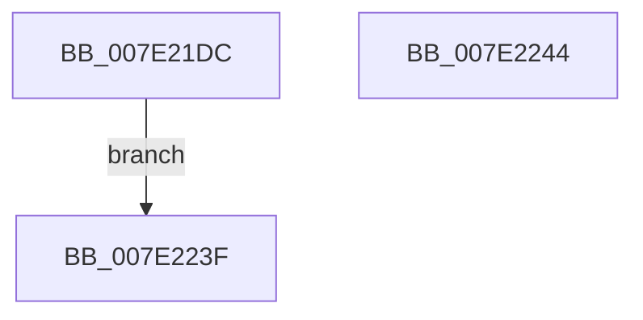

# CmSetRegistryQuotaInformation

- RVA: `0x007E21DC`–`0x007E2245` (길이 `105` bytes)
- VA: `0x00000001407E21DC`
- 실행 섹션: `PAGE`
- PDB 이름 있음: `예`; PDB Function 태그: `아니요`
- unwind 정보 RVA: `0x000D69A4`
- 디코드: `26`개 명령, `105/105` bytes 표시
- 미해석 바이트: `0` (있으면 어셈블리에 `.byte`로 보존)

> 이 문서는 커널 이미지의 기계어와 PDB 기호를 분석해 생성했습니다. 4번과 5번은 함수 원형과 자료형을 바이너리 사용 방식에서 추정한 C 해석이며 원본 소스 복구 결과는 아닙니다.

## 1. Dependencies

- 직접 호출 지점: **0**; 고유 호출 대상: **0**
- 직접 호출자로 확인된 함수: **1**
- RIP 상대 이미지 참조: **4**

### Outgoing calls
- 직접 디코드된 call 명령이 없습니다.

### Direct callers
- [NtSetSystemInformation](../AF/NtSetSystemInformation_function_00AF4A60.md) at `0x00AF5074`

### Static image references
- `0x007E21E6` → RVA `0x00FD9A65` (`PAGEDATA`; write)
- `0x007E2205` → RVA `0x00FD8060` (`PAGEDATA`; write)
- `0x007E222D` → RVA `0x00FD81C8` (`PAGEDATA`; write)
- `0x007E2234` → RVA `0x00FD81C0` (`PAGEDATA`; write)

## 2. Other-region calls and transfers

- 다른 실행 섹션으로 향하는 call: **0**
- 별도 외부 분기/꼬리 이동을 확인하지 못했습니다.

## 3. Assembly (complete function range)

```asm
007E21DC  48 83 EC 18                     sub rsp, 0x18
007E21E0  8B 09                           mov ecx, dword ptr [rcx]
007E21E2  48 89 0C 24                     mov qword ptr [rsp], rcx
007E21E6  C6 05 78 78 7F 00 01            mov byte ptr [rip + 0x7f7878], 1
007E21ED  B8 FF FF FF FF                  mov eax, 0xffffffff
007E21F2  48 3B C8                        cmp rcx, rax
007E21F5  48 0F 47 C8                     cmova rcx, rax
007E21F9  B8 00 00 00 01                  mov eax, 0x1000000
007E21FE  48 3B C8                        cmp rcx, rax
007E2201  48 0F 42 C8                     cmovb rcx, rax
007E2205  48 89 0D 54 5E 7F 00            mov qword ptr [rip + 0x7f5e54], rcx
007E220C  48 B8 15 AE 47 E1 7A 14 AE 47   movabs rax, 0x47ae147ae147ae15
007E2216  48 F7 E1                        mul rcx
007E2219  48 8B C1                        mov rax, rcx
007E221C  48 2B C2                        sub rax, rdx
007E221F  48 D1 E8                        shr rax, 1
007E2222  48 03 C2                        add rax, rdx
007E2225  48 C1 E8 06                     shr rax, 6
007E2229  48 6B C0 5F                     imul rax, rax, 0x5f
007E222D  48 89 05 94 5F 7F 00            mov qword ptr [rip + 0x7f5f94], rax
007E2234  48 89 0D 85 5F 7F 00            mov qword ptr [rip + 0x7f5f85], rcx
007E223B  33 C0                           xor eax, eax
007E223D  EB 00                           jmp 0x1407e223f
007E223F  48 83 C4 18                     add rsp, 0x18
007E2243  C3                              ret
007E2244  CC                              int3
```

## 4. C-style interpretation (structured pseudocode)

```c
__int64 __fastcall CmSetRegistryQuotaInformation(__int64 a1, __int64 a2)
{
    __int64 result;
    __int64 v_rsp;
    unsigned __int64 v_stack_m18;

    v_rsp = (v_rsp) - (24);
    v_stack_m18 = (unsigned int)(*(unsigned int *)(a1));
    *(unsigned __int8 *)(v_rip + 8353912) = 1;
    a1 = (unsigned int)(*(unsigned int *)(a1));
    if (((unsigned int)(*(unsigned int *)(a1))) > ((unsigned int)(0xFFFFFFFFULL))) { a1 = (unsigned int)(0xFFFFFFFFULL); }
    if (a1 < ((unsigned int)(0x1000000ULL))) { a1 = (unsigned int)(0x1000000ULL); }
    *(unsigned __int64 *)(v_rip + 8347220) = a1;
    result = (a1) - (a2);
    result = (result) >> (1);
    result = (result) + (a2);
    result = (result) >> (6);
    result = (result) * (result);
    *(unsigned __int64 *)(v_rip + 8347540) = result;
    *(unsigned __int64 *)(v_rip + 8347525) = a1;
    result = 0;
    goto loc_007E223F;
loc_007E223F:
    v_rsp = (v_rsp) + (24);
    return result;
}
```

## 5. (Beta) C Style

```c
int64_t CmSetRegistryQuotaInformation(void *Arg1, int64_t Arg2)
{
    uint8_t *arg1 = (uint8_t *)Arg1;

    int64_t result;
    int64_t local_rsp;
    uint64_t v_stack_m18;

    local_rsp = (local_rsp) - (24);
    v_stack_m18 = (uint32_t)(*(uint32_t *)(arg1));
    *(uint8_t *)(v_rip + 0x7F7878) = 1;
    Arg1 = (uint32_t)(*(uint32_t *)(arg1));
    if (((uint32_t)(*(uint32_t *)(arg1))) > ((uint32_t)(0xFFFFFFFFULL))) { Arg1 = (uint32_t)(0xFFFFFFFFULL); }
    if (Arg1 < ((uint32_t)(0x1000000ULL))) { Arg1 = (uint32_t)(0x1000000ULL); }
    *(void **)(v_rip + 0x7F5E54) = Arg1;
    result = (Arg1) - (Arg2);
    result = (result) >> (1);
    result = (result) + (Arg2);
    result = (result) >> (6);
    result = (result) * (result);
    *(uint64_t *)(v_rip + 0x7F5F94) = result;
    *(void **)(v_rip + 0x7F5F85) = Arg1;
    result = 0;
    goto loc_007E223F;
loc_007E223F:
    local_rsp = (local_rsp) + (24);
    return result;
}
```

### 관측된 메모리 오프셋

구조체 형식이 확인되지 않은 접근은 인자 기준의 오프셋으로만 기록했습니다.

| 기준 인자 | 오프셋 표현 | 폭 (bit) | 접근 |
|---|---:|---:|---|
| `Arg1` | `+ 0x0` | `32` | `R` |

## 6. Execution-region graph

[열기: 2D/3D 그래프와 함수 탐색 컨트롤 패널](../../../control-panel.html?section=page&rva=0x007E21DC&view=graph)

- 2D 그래프는 위에서 아래로 흐르고, 3D 그래프는 빈 공간을 드래그해 회전합니다. Shift+드래그는 이동, 휠은 확대·축소, 함수 노드 선택은 대상 보고서 이동입니다.

### Static fallback


