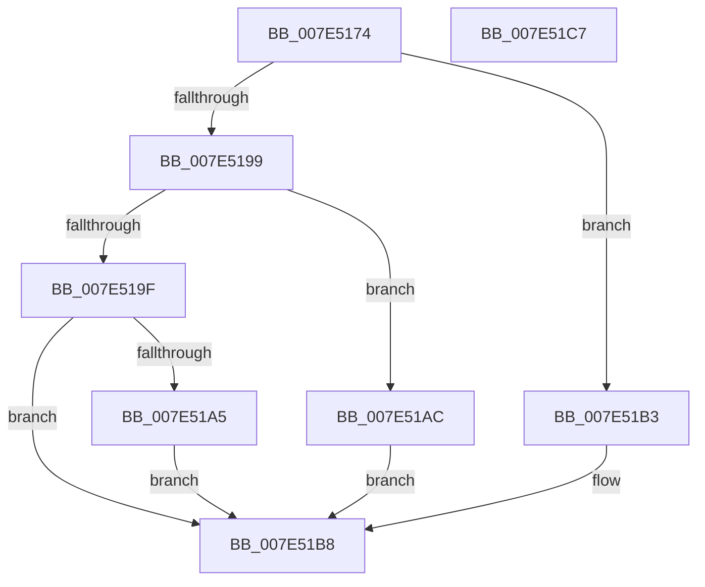

# CmShutdownSystem

- RVA: `0x007E5174`–`0x007E51C8` (길이 `84` bytes)
- VA: `0x00000001407E5174`
- 실행 섹션: `PAGE`
- PDB 이름 있음: `예`; PDB Function 태그: `아니요`
- unwind 정보 RVA: `0x00063458`
- 디코드: `24`개 명령, `84/84` bytes 표시
- 미해석 바이트: `0` (있으면 어셈블리에 `.byte`로 보존)

> 이 문서는 커널 이미지의 기계어와 PDB 기호를 분석해 생성했습니다. 4번과 5번은 함수 원형과 자료형을 바이너리 사용 방식에서 추정한 C 해석이며 원본 소스 복구 결과는 아닙니다.

## 1. Dependencies

- 직접 호출 지점: **5**; 고유 호출 대상: **5**
- 직접 호출자로 확인된 함수: **2**
- RIP 상대 이미지 참조: **0**

### Outgoing calls
- `0x007E518F` → [CmpInitializeThreadInfo](../../text/3F/CmpInitializeThreadInfo_function_003FBE70.md) (function, `0x003FBE70`)
- `0x007E51A5` → [CmShutdownSystem2](../../text/66/CmShutdownSystem2_function_0066A7FC.md) (function, `0x0066A7FC`)
- `0x007E51AC` → [CmShutdownSystem1](../../text/66/CmShutdownSystem1_function_0066A5B0.md) (function, `0x0066A5B0`)
- `0x007E51B3` → [CmShutdownSystem0](../../text/66/CmShutdownSystem0_function_0066A588.md) (function, `0x0066A588`)
- `0x007E51BD` → [CmCleanupThreadInfo](../../text/41/CmCleanupThreadInfo_function_0041FD50.md) (function, `0x0041FD50`)

### Direct callers
- [ExRebootSystemForRecovery](../../text/65/ExRebootSystemForRecovery_function_00655924.md) at `0x00655938`
- [ExRebootSystemForRecovery](../../text/65/ExRebootSystemForRecovery_function_00655924.md) at `0x00655942`
- [PopGracefulShutdown](../../pagelk/B6/PopGracefulShutdown_function_00B6BEC8.md) at `0x00B6C00B`
- [PopGracefulShutdown](../../pagelk/B6/PopGracefulShutdown_function_00B6BEC8.md) at `0x00B6C07E`
- [PopGracefulShutdown](../../pagelk/B6/PopGracefulShutdown_function_00B6BEC8.md) at `0x00B6C08A`

### Static image references
- 디코드된 RIP-relative 메모리 참조가 없습니다.

## 2. Other-region calls and transfers

- 다른 실행 섹션으로 향하는 call: **5**
  - `0x007E518F` → [CmpInitializeThreadInfo](../../text/3F/CmpInitializeThreadInfo_function_003FBE70.md) (`PAGE` → `.text`)
  - `0x007E51A5` → [CmShutdownSystem2](../../text/66/CmShutdownSystem2_function_0066A7FC.md) (`PAGE` → `.text`)
  - `0x007E51AC` → [CmShutdownSystem1](../../text/66/CmShutdownSystem1_function_0066A5B0.md) (`PAGE` → `.text`)
  - `0x007E51B3` → [CmShutdownSystem0](../../text/66/CmShutdownSystem0_function_0066A588.md) (`PAGE` → `.text`)
  - `0x007E51BD` → [CmCleanupThreadInfo](../../text/41/CmCleanupThreadInfo_function_0041FD50.md) (`PAGE` → `.text`)
- 별도 외부 분기/꼬리 이동을 확인하지 못했습니다.

## 3. Assembly (complete function range)

```asm
007E5174  48 83 EC 48                     sub rsp, 0x48
007E5178  0F 57 C0                        xorps xmm0, xmm0
007E517B  33 C0                           xor eax, eax
007E517D  44 8B C9                        mov r9d, ecx
007E5180  48 89 44 24 30                  mov qword ptr [rsp + 0x30], rax
007E5185  48 8D 4C 24 20                  lea rcx, [rsp + 0x20]
007E518A  0F 11 44 24 20                  movups xmmword ptr [rsp + 0x20], xmm0
007E518F  E8 DC 6C C1 FF                  call 0x1403fbe70
007E5194  45 85 C9                        test r9d, r9d
007E5197  74 1A                           je 0x1407e51b3
007E5199  41 83 E9 01                     sub r9d, 1
007E519D  74 0D                           je 0x1407e51ac
007E519F  41 83 F9 01                     cmp r9d, 1
007E51A3  75 13                           jne 0x1407e51b8
007E51A5  E8 52 56 E8 FF                  call 0x14066a7fc
007E51AA  EB 0C                           jmp 0x1407e51b8
007E51AC  E8 FF 53 E8 FF                  call 0x14066a5b0
007E51B1  EB 05                           jmp 0x1407e51b8
007E51B3  E8 D0 53 E8 FF                  call 0x14066a588
007E51B8  48 8D 4C 24 20                  lea rcx, [rsp + 0x20]
007E51BD  E8 8E AB C3 FF                  call 0x14041fd50
007E51C2  48 83 C4 48                     add rsp, 0x48
007E51C6  C3                              ret
007E51C7  CC                              int3
```

## 4. C-style interpretation (structured pseudocode)

```c
__int64 __fastcall CmShutdownSystem(int a1)
{
    __int64 result;
    __int64 v_rsp;
    unsigned __int64 v_stack_m18;
    unsigned __int64 v_stack_m28;

    v_rsp = (v_rsp) - (72);
    result = 0;
    v_stack_m18 = 0;
    v_stack_m28 = v_xmm0;
    result = CmpInitializeThreadInfo(v_stack_m28, a2, a3, (unsigned int)(a1));
    if ((unsigned int)((unsigned int)(a1)) == 0) goto loc_007E51B3;
    a4 = (unsigned int)(((unsigned int)(a1)) - (1));
    if (condition_is_equal) goto loc_007E51AC;
    if (((unsigned int)(a4)) != 1) goto loc_007E51B8;
    result = CmShutdownSystem2(v_stack_m28, a2, a3, a4);
    goto loc_007E51B8;
loc_007E51AC:
    result = CmShutdownSystem1(v_stack_m28, a2, a3, a4);
    goto loc_007E51B8;
loc_007E51B3:
    result = CmShutdownSystem0(v_stack_m28, a2, a3, a4);
loc_007E51B8:
    result = CmCleanupThreadInfo(v_stack_m28, a2, a3, a4);
    v_rsp = (v_rsp) + (72);
    return result;
}
```

## 5. (Beta) C Style

```c
int64_t CmShutdownSystem(int32_t Arg1)
{
    int64_t result;
    int64_t local_rsp;
    uint64_t v_stack_m18;
    uint64_t v_stack_m28;

    local_rsp = (local_rsp) - (72);
    result = 0;
    v_stack_m18 = 0;
    v_stack_m28 = v_xmm0;
    result = CmpInitializeThreadInfo(v_stack_m28, a2, a3, (uint32_t)(Arg1));
    if ((uint32_t)((uint32_t)(Arg1)) == 0) goto loc_007E51B3;
    a4 = (uint32_t)(((uint32_t)(Arg1)) - (1));
    if (condition_is_equal) goto loc_007E51AC;
    if (((uint32_t)(a4)) != 1) goto loc_007E51B8;
    result = CmShutdownSystem2(v_stack_m28, a2, a3, a4);
    goto loc_007E51B8;
loc_007E51AC:
    result = CmShutdownSystem1(v_stack_m28, a2, a3, a4);
    goto loc_007E51B8;
loc_007E51B3:
    result = CmShutdownSystem0(v_stack_m28, a2, a3, a4);
loc_007E51B8:
    result = CmCleanupThreadInfo(v_stack_m28, a2, a3, a4);
    local_rsp = (local_rsp) + (72);
    return result;
}
```

## 6. Execution-region graph

[열기: 2D/3D 그래프와 함수 탐색 컨트롤 패널](../../../control-panel.html?section=page&rva=0x007E5174&view=graph)

- 2D 그래프는 위에서 아래로 흐르고, 3D 그래프는 빈 공간을 드래그해 회전합니다. Shift+드래그는 이동, 휠은 확대·축소, 함수 노드 선택은 대상 보고서 이동입니다.

### Static fallback


