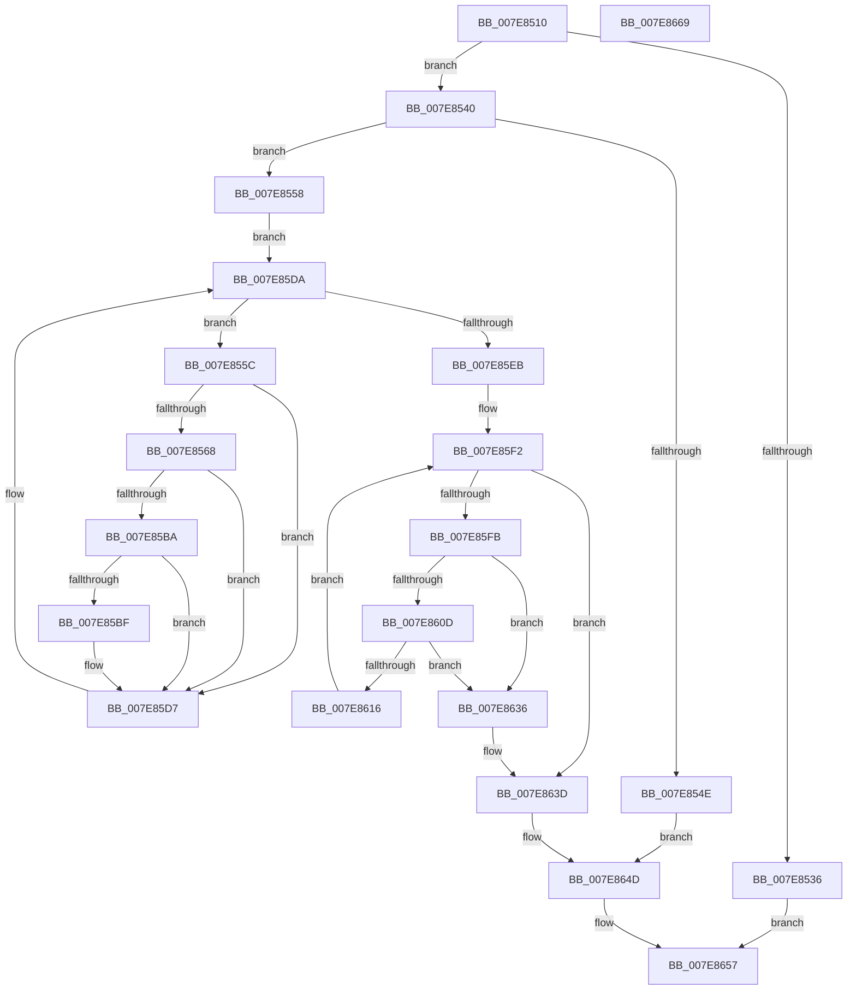

# CmThawRegistry

- RVA: `0x007E8510`–`0x007E866A` (길이 `346` bytes)
- VA: `0x00000001407E8510`
- 실행 섹션: `PAGE`
- PDB 이름 있음: `예`; PDB Function 태그: `아니요`
- unwind 정보 RVA: `0x00060BC4`
- 디코드: `81`개 명령, `346/346` bytes 표시
- 미해석 바이트: `0` (있으면 어셈블리에 `.byte`로 보존)

> 이 문서는 커널 이미지의 기계어와 PDB 기호를 분석해 생성했습니다. 4번과 5번은 함수 원형과 자료형을 바이너리 사용 방식에서 추정한 C 해석이며 원본 소스 복구 결과는 아닙니다.

## 1. Dependencies

- 직접 호출 지점: **13**; 고유 호출 대상: **13**
- 직접 호출자로 확인된 함수: **3**
- RIP 상대 이미지 참조: **5**

### Outgoing calls
- `0x007E8528` → [KeCancelTimer](../../text/23/KeCancelTimer_function_002327E0.md) (function, `0x002327E0`)
- `0x007E852D` → [CmpAcquireShutdownRundown](../../pagecmrc/BC/CmpAcquireShutdownRundown_function_00BC9400.md) (function, `0x00BC9400`)
- `0x007E8540` → [CmpLockRegistryExclusive](../84/CmpLockRegistryExclusive_function_0084F9B4.md) (function, `0x0084F9B4`)
- `0x007E85C2` → [HvLockHiveWriter](../85/HvLockHiveWriter_function_00859894.md) (function, `0x00859894`)
- `0x007E85CA` → [HvMarkBaseBlockDirty](../87/HvMarkBaseBlockDirty_function_0087BD04.md) (function, `0x0087BD04`)
- `0x007E85D2` → [HvUnlockHiveWriter](../85/HvUnlockHiveWriter_function_008598E4.md) (function, `0x008598E4`)
- `0x007E85DA` → [CmpGetNextActiveHive](../84/CmpGetNextActiveHive_function_0084E2A0.md) (function, `0x0084E2A0`)
- `0x007E85FB` → [CmpLockFreezeQueue](../70/CmpLockFreezeQueue_function_007048F0.md) (function, `0x007048F0`)
- `0x007E8621` → [CmpUnLockFreezeQueue](../70/CmpUnLockFreezeQueue_function_00704894.md) (function, `0x00704894`)
- `0x007E862F` → [KeSetEvent](../../text/33/KeSetEvent_function_0033F310.md) (function, `0x0033F310`)
- `0x007E8648` → [CmpEnableLazyFlush](../../text/4B/CmpEnableLazyFlush_function_004B7874.md) (function, `0x004B7874`)
- `0x007E864D` → [CmpUnlockRegistry](../../pagecmrc/BC/CmpUnlockRegistry_function_00BC9A84.md) (function, `0x00BC9A84`)
- `0x007E8652` → [CmpReleaseShutdownRundown](../../pagecmrc/BC/CmpReleaseShutdownRundown_function_00BC9880.md) (function, `0x00BC9880`)

### Direct callers
- [NtThawRegistry](NtThawRegistry_function_007E1320.md) at `0x007E1390`
- [CmFreezeRegistry](CmFreezeRegistry_function_007E834C.md) at `0x007E84E2`
- [CmpFreezeThawWorker](CmpFreezeThawWorker_function_007E8670.md) at `0x007E869D`

### Static image references
- `0x007E851F` → RVA `0x00EF7120` (`.data`; read)
- `0x007E8545` → RVA `0x00EEFBF8` (`.data`; read)
- `0x007E85EB` → RVA `0x00EF71D0` (`.data`; read)
- `0x007E8616` → RVA `0x00EF71D0` (`.data`; write)
- `0x007E8642` → RVA `0x00EEFBF8` (`.data`; write)

## 2. Other-region calls and transfers

- 다른 실행 섹션으로 향하는 call: **6**
  - `0x007E8528` → [KeCancelTimer](../../text/23/KeCancelTimer_function_002327E0.md) (`PAGE` → `.text`)
  - `0x007E852D` → [CmpAcquireShutdownRundown](../../pagecmrc/BC/CmpAcquireShutdownRundown_function_00BC9400.md) (`PAGE` → `PAGECMRC`)
  - `0x007E862F` → [KeSetEvent](../../text/33/KeSetEvent_function_0033F310.md) (`PAGE` → `.text`)
  - `0x007E8648` → [CmpEnableLazyFlush](../../text/4B/CmpEnableLazyFlush_function_004B7874.md) (`PAGE` → `.text`)
  - `0x007E864D` → [CmpUnlockRegistry](../../pagecmrc/BC/CmpUnlockRegistry_function_00BC9A84.md) (`PAGE` → `PAGECMRC`)
  - `0x007E8652` → [CmpReleaseShutdownRundown](../../pagecmrc/BC/CmpReleaseShutdownRundown_function_00BC9880.md) (`PAGE` → `PAGECMRC`)
- 별도 외부 분기/꼬리 이동을 확인하지 못했습니다.

## 3. Assembly (complete function range)

```asm
007E8510  48 89 5C 24 08                  mov qword ptr [rsp + 8], rbx
007E8515  48 89 74 24 10                  mov qword ptr [rsp + 0x10], rsi
007E851A  57                              push rdi
007E851B  48 83 EC 20                     sub rsp, 0x20
007E851F  48 8D 0D FA EB 70 00            lea rcx, [rip + 0x70ebfa]
007E8526  33 FF                           xor edi, edi
007E8528  E8 B3 A2 A4 FF                  call 0x1402327e0
007E852D  E8 CE 0E 3E 00                  call 0x140bc9400
007E8532  84 C0                           test al, al
007E8534  75 0A                           jne 0x1407e8540
007E8536  BF 89 01 00 C0                  mov edi, 0xc0000189
007E853B  E9 17 01 00 00                  jmp 0x1407e8657
007E8540  E8 6F 74 06 00                  call 0x14084f9b4
007E8545  83 3D AC 76 70 00 01            cmp dword ptr [rip + 0x7076ac], 1
007E854C  74 0A                           je 0x1407e8558
007E854E  BF 89 01 00 C0                  mov edi, 0xc0000189
007E8553  E9 F5 00 00 00                  jmp 0x1407e864d
007E8558  33 C9                           xor ecx, ecx
007E855A  EB 7E                           jmp 0x1407e85da
007E855C  48 8B 43 40                     mov rax, qword ptr [rbx + 0x40]
007E8560  39 B8 A4 00 00 00               cmp dword ptr [rax + 0xa4], edi
007E8566  75 6F                           jne 0x1407e85d7
007E8568  0F 10 80 D8 0F 00 00            movups xmm0, xmmword ptr [rax + 0xfd8]
007E856F  F3 0F 7F 40 70                  movdqu xmmword ptr [rax + 0x70], xmm0
007E8574  48 8B 4B 40                     mov rcx, qword ptr [rbx + 0x40]
007E8578  0F 10 89 C8 0F 00 00            movups xmm1, xmmword ptr [rcx + 0xfc8]
007E857F  F3 0F 7F 89 94 00 00 00         movdqu xmmword ptr [rcx + 0x94], xmm1
007E8587  48 8B 43 40                     mov rax, qword ptr [rbx + 0x40]
007E858B  0F 10 80 E8 0F 00 00            movups xmm0, xmmword ptr [rax + 0xfe8]
007E8592  F3 0F 7F 80 80 00 00 00         movdqu xmmword ptr [rax + 0x80], xmm0
007E859A  48 8B 43 40                     mov rax, qword ptr [rbx + 0x40]
007E859E  C7 80 A4 00 00 00 72 6D 74 6D   mov dword ptr [rax + 0xa4], 0x6d746d72
007E85A8  8B 83 10 10 00 00               mov eax, dword ptr [rbx + 0x1010]
007E85AE  25 00 03 00 00                  and eax, 0x300
007E85B3  3D 00 01 00 00                  cmp eax, 0x100
007E85B8  74 1D                           je 0x1407e85d7
007E85BA  39 7B 68                        cmp dword ptr [rbx + 0x68], edi
007E85BD  75 18                           jne 0x1407e85d7
007E85BF  48 8B CB                        mov rcx, rbx
007E85C2  E8 CD 12 07 00                  call 0x140859894
007E85C7  48 8B CB                        mov rcx, rbx
007E85CA  E8 35 37 09 00                  call 0x14087bd04
007E85CF  48 8B CB                        mov rcx, rbx
007E85D2  E8 0D 13 07 00                  call 0x1408598e4
007E85D7  48 8B CB                        mov rcx, rbx
007E85DA  E8 C1 5C 06 00                  call 0x14084e2a0
007E85DF  48 8B D8                        mov rbx, rax
007E85E2  48 85 C0                        test rax, rax
007E85E5  0F 85 71 FF FF FF               jne 0x1407e855c
007E85EB  48 8D 35 DE EB 70 00            lea rsi, [rip + 0x70ebde]
007E85F2  48 39 35 D7 EB 70 00            cmp qword ptr [rip + 0x70ebd7], rsi
007E85F9  74 42                           je 0x1407e863d
007E85FB  E8 F0 C2 F1 FF                  call 0x1407048f0
007E8600  48 8B 1D C9 EB 70 00            mov rbx, qword ptr [rip + 0x70ebc9]
007E8607  48 39 73 08                     cmp qword ptr [rbx + 8], rsi
007E860B  75 29                           jne 0x1407e8636
007E860D  48 8B 03                        mov rax, qword ptr [rbx]
007E8610  48 39 58 08                     cmp qword ptr [rax + 8], rbx
007E8614  75 20                           jne 0x1407e8636
007E8616  48 89 05 B3 EB 70 00            mov qword ptr [rip + 0x70ebb3], rax
007E861D  48 89 70 08                     mov qword ptr [rax + 8], rsi
007E8621  E8 6E C2 F1 FF                  call 0x140704894
007E8626  48 8D 4B 10                     lea rcx, [rbx + 0x10]
007E862A  45 33 C0                        xor r8d, r8d
007E862D  33 D2                           xor edx, edx
007E862F  E8 DC 6C B5 FF                  call 0x14033f310
007E8634  EB BC                           jmp 0x1407e85f2
007E8636  B9 03 00 00 00                  mov ecx, 3
007E863B  CD 29                           int 0x29
007E863D  B9 02 00 00 00                  mov ecx, 2
007E8642  89 3D B0 75 70 00               mov dword ptr [rip + 0x7075b0], edi
007E8648  E8 27 F2 CC FF                  call 0x1404b7874
007E864D  E8 32 14 3E 00                  call 0x140bc9a84
007E8652  E8 29 12 3E 00                  call 0x140bc9880
007E8657  48 8B 5C 24 30                  mov rbx, qword ptr [rsp + 0x30]
007E865C  8B C7                           mov eax, edi
007E865E  48 8B 74 24 38                  mov rsi, qword ptr [rsp + 0x38]
007E8663  48 83 C4 20                     add rsp, 0x20
007E8667  5F                              pop rdi
007E8668  C3                              ret
007E8669  CC                              int3
```

## 4. C-style interpretation (structured pseudocode)

```c
__int64 __fastcall CmThawRegistry(__int64 a1, int a2, int a3)
{
    __int64 result;
    __int64 v_rdi;
    __int64 v_rsp;
    unsigned __int64 v_stack_p10;
    unsigned __int64 v_stack_p8;

    v_stack_p8 = v_rbx;
    v_stack_p10 = v_rsi;
    v_rsp = (v_rsp) - (32);
    v_rdi = 0;
    result = KeCancelTimer(v_rip + 7400442, a2, a3, a4);
    result = CmpAcquireShutdownRundown(v_rip + 7400442, a2, a3, a4);
    if ((unsigned __int8)(result) != 0) goto loc_007E8540;
    goto loc_007E8657;
loc_007E8540:
    result = CmpLockRegistryExclusive(v_rip + 7400442, a2, a3, a4);
    if ((*(unsigned int *)(v_rip + 7370412)) == 1) goto loc_007E8558;
    goto loc_007E864D;
loc_007E8558:
    a1 = 0;
    goto loc_007E85DA;
loc_007E855C:
    if ((*(unsigned int *)(*(unsigned __int64 *)(v_rbx + 64) + 164)) != ((unsigned int)((unsigned int)(0xC0000189ULL)))) goto loc_007E85D7;
    *(unsigned __int64 *)(*(unsigned __int64 *)(v_rbx + 64) + 112) = v_xmm0;
    *(unsigned __int64 *)(*(unsigned __int64 *)(v_rbx + 64) + 148) = v_xmm1;
    *(unsigned __int64 *)(*(unsigned __int64 *)(v_rbx + 64) + 128) = v_xmm0;
    *(unsigned int *)(*(unsigned __int64 *)(v_rbx + 64) + 164) = 0x6D746D72ULL;
    result = (unsigned int)(((unsigned int)(*(unsigned int *)(v_rbx + 4112))) & (768));
    if (((unsigned int)(result)) == 256) goto loc_007E85D7;
    if ((*(unsigned int *)(v_rbx + 104)) == ((unsigned int)((unsigned int)(0xC0000189ULL)))) {
        a1 = v_rbx;
        result = HvLockHiveWriter(a1, a2, a3, a4);
        a1 = v_rbx;
        result = HvMarkBaseBlockDirty(a1, a2, a3, a4);
        a1 = v_rbx;
        result = HvUnlockHiveWriter(a1, a2, a3, a4);
    }
loc_007E85DA:
    result = CmpGetNextActiveHive(v_rbx, a2, a3, a4);
    if (result != 0) goto loc_007E855C;
loc_007E85F2:
    if ((*(unsigned __int64 *)(v_rip + 7400407)) == (v_rip + 7400414)) goto loc_007E863D;
    result = CmpLockFreezeQueue(v_rbx, a2, a3, a4);
    if ((*(unsigned __int64 *)(*(unsigned __int64 *)(v_rip + 7400393) + 8)) != (v_rip + 7400414)) goto loc_007E8636;
    if ((*(unsigned __int64 *)(*(unsigned __int64 *)(*(unsigned __int64 *)(v_rip + 7400393)) + 8)) != (*(unsigned __int64 *)(v_rip + 7400393))) goto loc_007E8636;
    *(unsigned __int64 *)(v_rip + 7400371) = *(unsigned __int64 *)(*(unsigned __int64 *)(v_rip + 7400393));
    *(unsigned __int64 *)(*(unsigned __int64 *)(*(unsigned __int64 *)(v_rip + 7400393)) + 8) = v_rip + 7400414;
    result = CmpUnLockFreezeQueue(v_rbx, a2, a3, a4);
    a3 = 0;
    a2 = 0;
    result = KeSetEvent(*(unsigned __int64 *)(v_rip + 7400393) + 16, a2, a3, a4);
    goto loc_007E85F2;
loc_007E8636:
loc_007E863D:
    *(unsigned int *)(v_rip + 7370160) = (unsigned int)((unsigned int)(0xC0000189ULL));
    result = CmpEnableLazyFlush(2, a2, a3, a4);
loc_007E864D:
    result = CmpUnlockRegistry(2, a2, a3, a4);
    result = CmpReleaseShutdownRundown(2, a2, a3, a4);
loc_007E8657:
    v_rsp = (v_rsp) + (32);
    return (unsigned int)((unsigned int)((unsigned int)(0xC0000189ULL)));
}
```

## 5. (Beta) C Style

```c
int64_t CmThawRegistry(int64_t Arg1, int32_t Arg2, int32_t Arg3)
{
    int64_t result;
    int64_t local_rdi;
    int64_t local_rsp;
    uint64_t v_stack_p10;
    uint64_t v_stack_p8;

    v_stack_p8 = local_rbx;
    v_stack_p10 = local_rsi;
    local_rsp = (local_rsp) - (32);
    local_rdi = 0;
    result = KeCancelTimer(v_rip + 7400442, Arg2, Arg3, a4);
    result = CmpAcquireShutdownRundown(v_rip + 7400442, Arg2, Arg3, a4);
    if ((uint8_t)(result) != 0) goto loc_007E8540;
    goto loc_007E8657;
loc_007E8540:
    result = CmpLockRegistryExclusive(v_rip + 7400442, Arg2, Arg3, a4);
    if ((*(uint32_t *)(v_rip + 0x7076AC)) == 1) goto loc_007E8558;
    goto loc_007E864D;
loc_007E8558:
    Arg1 = 0;
    goto loc_007E85DA;
loc_007E855C:
    if ((*(uint32_t *)(*(uint64_t *)(local_rbx + 0x40) + 0xA4)) != ((uint32_t)((uint32_t)(0xC0000189ULL)))) goto loc_007E85D7;
    *(uint64_t *)(*(uint64_t *)(local_rbx + 0x40) + 0x70) = v_xmm0;
    *(uint64_t *)(*(uint64_t *)(local_rbx + 0x40) + 0x94) = v_xmm1;
    *(uint64_t *)(*(uint64_t *)(local_rbx + 0x40) + 0x80) = v_xmm0;
    *(uint32_t *)(*(uint64_t *)(local_rbx + 0x40) + 0xA4) = 0x6D746D72ULL;
    result = (uint32_t)(((uint32_t)(*(uint32_t *)(local_rbx + 0x1010))) & (768));
    if (((uint32_t)(result)) == 256) goto loc_007E85D7;
    if ((*(uint32_t *)(local_rbx + 0x68)) == ((uint32_t)((uint32_t)(0xC0000189ULL)))) {
        Arg1 = local_rbx;
        result = HvLockHiveWriter(Arg1, Arg2, Arg3, a4);
        Arg1 = local_rbx;
        result = HvMarkBaseBlockDirty(Arg1, Arg2, Arg3, a4);
        Arg1 = local_rbx;
        result = HvUnlockHiveWriter(Arg1, Arg2, Arg3, a4);
    }
loc_007E85DA:
    result = CmpGetNextActiveHive(local_rbx, Arg2, Arg3, a4);
    if (result != 0) goto loc_007E855C;
loc_007E85F2:
    if ((*(uint64_t *)(v_rip + 0x70EBD7)) == (v_rip + 7400414)) goto loc_007E863D;
    result = CmpLockFreezeQueue(local_rbx, Arg2, Arg3, a4);
    if ((*(uint64_t *)(*(uint64_t *)(v_rip + 0x70EBC9) + 0x8)) != (v_rip + 7400414)) goto loc_007E8636;
    if ((*(uint64_t *)(*(uint64_t *)(*(uint64_t *)(v_rip + 0x70EBC9)) + 0x8)) != (*(uint64_t *)(v_rip + 0x70EBC9))) goto loc_007E8636;
    *(uint64_t *)(v_rip + 0x70EBB3) = *(uint64_t *)(*(uint64_t *)(v_rip + 0x70EBC9));
    *(uint64_t *)(*(uint64_t *)(*(uint64_t *)(v_rip + 0x70EBC9)) + 0x8) = v_rip + 7400414;
    result = CmpUnLockFreezeQueue(local_rbx, Arg2, Arg3, a4);
    Arg3 = 0;
    Arg2 = 0;
    result = KeSetEvent(*(uint64_t *)(v_rip + 0x70EBC9) + 16, Arg2, Arg3, a4);
    goto loc_007E85F2;
loc_007E8636:
loc_007E863D:
    *(uint32_t *)(v_rip + 0x7075B0) = (uint32_t)((uint32_t)(0xC0000189ULL));
    result = CmpEnableLazyFlush(2, Arg2, Arg3, a4);
loc_007E864D:
    result = CmpUnlockRegistry(2, Arg2, Arg3, a4);
    result = CmpReleaseShutdownRundown(2, Arg2, Arg3, a4);
loc_007E8657:
    local_rsp = (local_rsp) + (32);
    return (uint32_t)((uint32_t)((uint32_t)(0xC0000189ULL)));
}
```

## 6. Execution-region graph

[열기: 2D/3D 그래프와 함수 탐색 컨트롤 패널](../../../control-panel.html?section=page&rva=0x007E8510&view=graph)

- 2D 그래프는 위에서 아래로 흐르고, 3D 그래프는 빈 공간을 드래그해 회전합니다. Shift+드래그는 이동, 휠은 확대·축소, 함수 노드 선택은 대상 보고서 이동입니다.

### Static fallback


