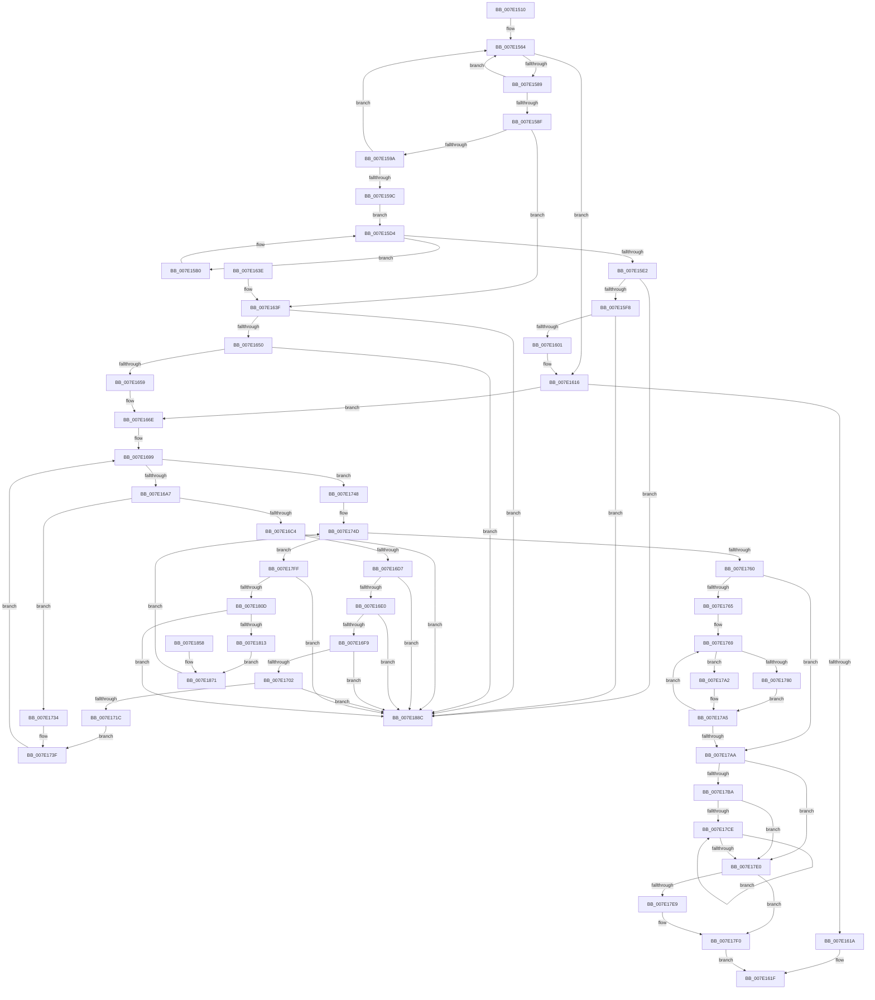

# CmUnRegisterCallback

- RVA: `0x007E1510`–`0x007E1893` (길이 `899` bytes)
- VA: `0x00000001407E1510`
- 실행 섹션: `PAGE`
- PDB 이름 있음: `예`; PDB Function 태그: `아니요`
- unwind 정보 RVA: `0x000D68C0`
- 디코드: `222`개 명령, `899/899` bytes 표시
- 미해석 바이트: `0` (있으면 어셈블리에 `.byte`로 보존)

> 이 문서는 커널 이미지의 기계어와 PDB 기호를 분석해 생성했습니다. 4번과 5번은 함수 원형과 자료형을 바이너리 사용 방식에서 추정한 C 해석이며 원본 소스 복구 결과는 아닙니다.

## 1. Dependencies

- 직접 호출 지점: **23**; 고유 호출 대상: **13**
- 직접 호출자로 확인된 함수: **3**
- RIP 상대 이미지 참조: **4**

### Outgoing calls
- `0x007E1554` → [CmpInitializeThreadInfo](../../text/3F/CmpInitializeThreadInfo_function_003FBE70.md) (function, `0x003FBE70`)
- `0x007E155F` → [CmpLockCallbackListExclusive](../6F/CmpLockCallbackListExclusive_function_006FEDDC.md) (function, `0x006FEDDC`)
- `0x007E1573` → [CmListGetNextElement](../../pagecmrc/BC/CmListGetNextElement_function_00BC9940.md) (function, `0x00BC9940`)
- `0x007E15A4` → [CmpUnlockCallbackList](../97/CmpUnlockCallbackList_function_0097D760.md) (function, `0x0097D760`)
- `0x007E15CF` → [ExBlockOnAddressPushLock](../../text/2A/ExBlockOnAddressPushLock_function_002A43A0.md) (function, `0x002A43A0`)
- `0x007E15E2` → [CmpLockCallbackListExclusive](../6F/CmpLockCallbackListExclusive_function_006FEDDC.md) (function, `0x006FEDDC`)
- `0x007E1608` → [CmpUnlockCallbackList](../97/CmpUnlockCallbackList_function_0097D760.md) (function, `0x0097D760`)
- `0x007E161A` → [CmpUnlockCallbackList](../97/CmpUnlockCallbackList_function_0097D760.md) (function, `0x0097D760`)
- `0x007E1624` → [CmCleanupThreadInfo](../../text/41/CmCleanupThreadInfo_function_0041FD50.md) (function, `0x0041FD50`)
- `0x007E1660` → [CmpUnlockCallbackList](../97/CmpUnlockCallbackList_function_0097D760.md) (function, `0x0097D760`)
- `0x007E168D` → [CmpLockContextListExclusive](../93/CmpLockContextListExclusive_function_00936C7C.md) (function, `0x00936C7C`)
- `0x007E16BB` → [ObReferenceObjectSafe](../../text/41/ObReferenceObjectSafe_function_0041DAE0.md) (function, `0x0041DAE0`)
- `0x007E1748` → [CmpUnlockContextList](../93/CmpUnlockContextList_function_00936C10.md) (function, `0x00936C10`)
- `0x007E1769` → [CmpLockContextListExclusive](../93/CmpLockContextListExclusive_function_00936C7C.md) (function, `0x00936C7C`)
- `0x007E1776` → [CmpUnlockContextList](../93/CmpUnlockContextList_function_00936C10.md) (function, `0x00936C10`)
- `0x007E179B` → [ExBlockOnAddressPushLock](../../text/2A/ExBlockOnAddressPushLock_function_002A43A0.md) (function, `0x002A43A0`)
- `0x007E17C1` → [ExpInterlockedFlushSList](../../text/6B/ExpInterlockedFlushSList_function_006BA5F0.md) (function, `0x006BA5F0`)
- `0x007E17D6` → [ExFreePoolWithTag](../../poolcode/B8/ExFreePoolWithTag_function_00B82870.md) (function, `0x00B82870`)
- `0x007E17EB` → [ExFreePoolWithTag](../../poolcode/B8/ExFreePoolWithTag_function_00B82870.md) (function, `0x00B82870`)
- `0x007E17F5` → [ExFreePoolWithTag](../../poolcode/B8/ExFreePoolWithTag_function_00B82870.md) (function, `0x00B82870`)
- `0x007E1851` → [guard_dispatch_icall](../../text/6B/guard_dispatch_icall_function_006BAAD0.md) (function, `0x006BAAD0`)
- `0x007E1875` → [ObfDereferenceObject](../../text/2F/ObfDereferenceObject_function_002F9350.md) (function, `0x002F9350`)
- `0x007E1882` → [ExFreePoolWithTag](../../poolcode/B8/ExFreePoolWithTag_function_00B82870.md) (function, `0x00B82870`)

### Direct callers
- [DifCmUnRegisterCallbackWrapper](../../text/61/DifCmUnRegisterCallbackWrapper_function_0061CAB0.md) at `0x0061CB7D`
- [EtwpRegTraceEnableCallback](../97/EtwpRegTraceEnableCallback_function_0097D4A0.md) at `0x0097D535`
- [VrpDecrementSiloCount](../AC/VrpDecrementSiloCount_function_00AC33C8.md) at `0x00AC3432`

### Static image references
- `0x007E156C` → RVA `0x00EF7BE0` (`.data`; read)
- `0x007E15C8` → RVA `0x00EF7BB8` (`.data`; read)
- `0x007E17AD` → RVA `0x00EEFB88` (`.data`; read/write)
- `0x007E17BA` → RVA `0x00E2C980` (`.data`; read)

## 2. Other-region calls and transfers

- 다른 실행 섹션으로 향하는 call: **13**
  - `0x007E1554` → [CmpInitializeThreadInfo](../../text/3F/CmpInitializeThreadInfo_function_003FBE70.md) (`PAGE` → `.text`)
  - `0x007E1573` → [CmListGetNextElement](../../pagecmrc/BC/CmListGetNextElement_function_00BC9940.md) (`PAGE` → `PAGECMRC`)
  - `0x007E15CF` → [ExBlockOnAddressPushLock](../../text/2A/ExBlockOnAddressPushLock_function_002A43A0.md) (`PAGE` → `.text`)
  - `0x007E1624` → [CmCleanupThreadInfo](../../text/41/CmCleanupThreadInfo_function_0041FD50.md) (`PAGE` → `.text`)
  - `0x007E16BB` → [ObReferenceObjectSafe](../../text/41/ObReferenceObjectSafe_function_0041DAE0.md) (`PAGE` → `.text`)
  - `0x007E179B` → [ExBlockOnAddressPushLock](../../text/2A/ExBlockOnAddressPushLock_function_002A43A0.md) (`PAGE` → `.text`)
  - `0x007E17C1` → [ExpInterlockedFlushSList](../../text/6B/ExpInterlockedFlushSList_function_006BA5F0.md) (`PAGE` → `.text`)
  - `0x007E17D6` → [ExFreePoolWithTag](../../poolcode/B8/ExFreePoolWithTag_function_00B82870.md) (`PAGE` → `POOLCODE`)
  - `0x007E17EB` → [ExFreePoolWithTag](../../poolcode/B8/ExFreePoolWithTag_function_00B82870.md) (`PAGE` → `POOLCODE`)
  - `0x007E17F5` → [ExFreePoolWithTag](../../poolcode/B8/ExFreePoolWithTag_function_00B82870.md) (`PAGE` → `POOLCODE`)
  - `0x007E1851` → [guard_dispatch_icall](../../text/6B/guard_dispatch_icall_function_006BAAD0.md) (`PAGE` → `.text`)
  - `0x007E1875` → [ObfDereferenceObject](../../text/2F/ObfDereferenceObject_function_002F9350.md) (`PAGE` → `.text`)
  - `0x007E1882` → [ExFreePoolWithTag](../../poolcode/B8/ExFreePoolWithTag_function_00B82870.md) (`PAGE` → `POOLCODE`)
- 별도 외부 분기/꼬리 이동을 확인하지 못했습니다.

## 3. Assembly (complete function range)

```asm
007E1510  4C 8B DC                        mov r11, rsp
007E1513  53                              push rbx
007E1514  56                              push rsi
007E1515  57                              push rdi
007E1516  41 54                           push r12
007E1518  41 55                           push r13
007E151A  41 56                           push r14
007E151C  41 57                           push r15
007E151E  48 81 EC 90 00 00 00            sub rsp, 0x90
007E1525  48 8B D9                        mov rbx, rcx
007E1528  0F 57 C0                        xorps xmm0, xmm0
007E152B  33 C0                           xor eax, eax
007E152D  0F 11 44 24 60                  movups xmmword ptr [rsp + 0x60], xmm0
007E1532  49 89 43 A8                     mov qword ptr [r11 - 0x58], rax
007E1536  BE 0D 00 00 C0                  mov esi, 0xc000000d
007E153B  89 B4 24 E0 00 00 00            mov dword ptr [rsp + 0xe0], esi
007E1542  0F 11 44 24 78                  movups xmmword ptr [rsp + 0x78], xmm0
007E1547  49 89 43 C0                     mov qword ptr [r11 - 0x40], rax
007E154B  0F 11 44 24 30                  movups xmmword ptr [rsp + 0x30], xmm0
007E1550  49 8D 4B 98                     lea rcx, [r11 - 0x68]
007E1554  E8 17 A9 C1 FF                  call 0x1403fbe70
007E1559  48 83 64 24 48 00               and qword ptr [rsp + 0x48], 0
007E155F  E8 78 D8 F1 FF                  call 0x1406feddc
007E1564  45 33 C0                        xor r8d, r8d
007E1567  48 8D 54 24 48                  lea rdx, [rsp + 0x48]
007E156C  48 8D 0D 6D 66 71 00            lea rcx, [rip + 0x71666d]
007E1573  E8 C8 83 3E 00                  call 0x140bc9940
007E1578  48 8B F8                        mov rdi, rax
007E157B  48 89 44 24 50                  mov qword ptr [rsp + 0x50], rax
007E1580  48 85 C0                        test rax, rax
007E1583  0F 84 8D 00 00 00               je 0x1407e1616
007E1589  48 39 58 18                     cmp qword ptr [rax + 0x18], rbx
007E158D  75 D5                           jne 0x1407e1564
007E158F  8B 40 10                        mov eax, dword ptr [rax + 0x10]
007E1592  85 C0                           test eax, eax
007E1594  0F 84 A5 00 00 00               je 0x1407e163f
007E159A  78 C8                           js 0x1407e1564
007E159C  F0 81 4F 10 00 00 00 80         lock or dword ptr [rdi + 0x10], 0x80000000
007E15A4  E8 B7 C1 19 00                  call 0x14097d760
007E15A9  BE 00 00 00 80                  mov esi, 0x80000000
007E15AE  EB 24                           jmp 0x1407e15d4
007E15B0  48 83 64 24 20 00               and qword ptr [rsp + 0x20], 0
007E15B6  41 B9 04 00 00 00               mov r9d, 4
007E15BC  4C 8D 84 24 E8 00 00 00         lea r8, [rsp + 0xe8]
007E15C4  48 8D 57 10                     lea rdx, [rdi + 0x10]
007E15C8  48 8D 0D E9 65 71 00            lea rcx, [rip + 0x7165e9]
007E15CF  E8 CC 2D AC FF                  call 0x1402a43a0
007E15D4  8B 47 10                        mov eax, dword ptr [rdi + 0x10]
007E15D7  3B C6                           cmp eax, esi
007E15D9  89 84 24 E8 00 00 00            mov dword ptr [rsp + 0xe8], eax
007E15E0  75 CE                           jne 0x1407e15b0
007E15E2  E8 F5 D7 F1 FF                  call 0x1406feddc
007E15E7  48 8B 0F                        mov rcx, qword ptr [rdi]
007E15EA  48 8B 47 08                     mov rax, qword ptr [rdi + 8]
007E15EE  48 39 79 08                     cmp qword ptr [rcx + 8], rdi
007E15F2  0F 85 94 02 00 00               jne 0x1407e188c
007E15F8  48 39 38                        cmp qword ptr [rax], rdi
007E15FB  0F 85 8B 02 00 00               jne 0x1407e188c
007E1601  48 89 08                        mov qword ptr [rax], rcx
007E1604  48 89 41 08                     mov qword ptr [rcx + 8], rax
007E1608  E8 53 C1 19 00                  call 0x14097d760
007E160D  33 F6                           xor esi, esi
007E160F  89 B4 24 E0 00 00 00            mov dword ptr [rsp + 0xe0], esi
007E1616  85 F6                           test esi, esi
007E1618  79 54                           jns 0x1407e166e
007E161A  E8 41 C1 19 00                  call 0x14097d760
007E161F  48 8D 4C 24 60                  lea rcx, [rsp + 0x60]
007E1624  E8 27 E7 C3 FF                  call 0x14041fd50
007E1629  8B C6                           mov eax, esi
007E162B  48 81 C4 90 00 00 00            add rsp, 0x90
007E1632  41 5F                           pop r15
007E1634  41 5E                           pop r14
007E1636  41 5D                           pop r13
007E1638  41 5C                           pop r12
007E163A  5F                              pop rdi
007E163B  5E                              pop rsi
007E163C  5B                              pop rbx
007E163D  C3                              ret
007E163E  CC                              int3
007E163F  48 8B 0F                        mov rcx, qword ptr [rdi]
007E1642  48 8B 47 08                     mov rax, qword ptr [rdi + 8]
007E1646  48 39 79 08                     cmp qword ptr [rcx + 8], rdi
007E164A  0F 85 3C 02 00 00               jne 0x1407e188c
007E1650  48 39 38                        cmp qword ptr [rax], rdi
007E1653  0F 85 33 02 00 00               jne 0x1407e188c
007E1659  48 89 08                        mov qword ptr [rax], rcx
007E165C  48 89 41 08                     mov qword ptr [rcx + 8], rax
007E1660  E8 FB C0 19 00                  call 0x14097d760
007E1665  33 F6                           xor esi, esi
007E1667  89 B4 24 E0 00 00 00            mov dword ptr [rsp + 0xe0], esi
007E166E  48 8D 44 24 30                  lea rax, [rsp + 0x30]
007E1673  48 89 44 24 38                  mov qword ptr [rsp + 0x38], rax
007E1678  48 8D 44 24 30                  lea rax, [rsp + 0x30]
007E167D  48 89 44 24 30                  mov qword ptr [rsp + 0x30], rax
007E1682  45 32 F6                        xor r14b, r14b
007E1685  44 88 B4 24 D8 00 00 00         mov byte ptr [rsp + 0xd8], r14b
007E168D  E8 EA 55 15 00                  call 0x140936c7c
007E1692  48 8D 47 40                     lea rax, [rdi + 0x40]
007E1696  48 8B 18                        mov rbx, qword ptr [rax]
007E1699  48 3B D8                        cmp rbx, rax
007E169C  48 89 5C 24 40                  mov qword ptr [rsp + 0x40], rbx
007E16A1  0F 84 A1 00 00 00               je 0x1407e1748
007E16A7  48 8B C3                        mov rax, rbx
007E16AA  4C 8B FB                        mov r15, rbx
007E16AD  4C 8B E3                        mov r12, rbx
007E16B0  48 8B 1B                        mov rbx, qword ptr [rbx]
007E16B3  4C 8D 68 F0                     lea r13, [rax - 0x10]
007E16B7  49 8B 4D 30                     mov rcx, qword ptr [r13 + 0x30]
007E16BB  E8 20 C4 C3 FF                  call 0x14041dae0
007E16C0  84 C0                           test al, al
007E16C2  74 70                           je 0x1407e1734
007E16C4  49 8B 0C 24                     mov rcx, qword ptr [r12]
007E16C8  49 8B 44 24 08                  mov rax, qword ptr [r12 + 8]
007E16CD  4C 39 61 08                     cmp qword ptr [rcx + 8], r12
007E16D1  0F 85 B5 01 00 00               jne 0x1407e188c
007E16D7  4C 39 20                        cmp qword ptr [rax], r12
007E16DA  0F 85 AC 01 00 00               jne 0x1407e188c
007E16E0  48 89 08                        mov qword ptr [rax], rcx
007E16E3  48 89 41 08                     mov qword ptr [rcx + 8], rax
007E16E7  49 8B 4D 00                     mov rcx, qword ptr [r13]
007E16EB  49 8B 45 08                     mov rax, qword ptr [r13 + 8]
007E16EF  4C 39 69 08                     cmp qword ptr [rcx + 8], r13
007E16F3  0F 85 93 01 00 00               jne 0x1407e188c
007E16F9  4C 39 28                        cmp qword ptr [rax], r13
007E16FC  0F 85 8A 01 00 00               jne 0x1407e188c
007E1702  48 89 08                        mov qword ptr [rax], rcx
007E1705  48 89 41 08                     mov qword ptr [rcx + 8], rax
007E1709  48 8B 44 24 38                  mov rax, qword ptr [rsp + 0x38]
007E170E  48 8D 4C 24 30                  lea rcx, [rsp + 0x30]
007E1713  48 39 08                        cmp qword ptr [rax], rcx
007E1716  0F 85 70 01 00 00               jne 0x1407e188c
007E171C  48 8D 4C 24 30                  lea rcx, [rsp + 0x30]
007E1721  49 89 0C 24                     mov qword ptr [r12], rcx
007E1725  49 89 44 24 08                  mov qword ptr [r12 + 8], rax
007E172A  4C 89 20                        mov qword ptr [rax], r12
007E172D  4C 89 64 24 38                  mov qword ptr [rsp + 0x38], r12
007E1732  EB 0B                           jmp 0x1407e173f
007E1734  41 B6 01                        mov r14b, 1
007E1737  44 88 B4 24 D8 00 00 00         mov byte ptr [rsp + 0xd8], r14b
007E173F  48 8D 47 40                     lea rax, [rdi + 0x40]
007E1743  E9 51 FF FF FF                  jmp 0x1407e1699
007E1748  E8 C3 54 15 00                  call 0x140936c10
007E174D  48 8D 4C 24 30                  lea rcx, [rsp + 0x30]
007E1752  48 8B 44 24 30                  mov rax, qword ptr [rsp + 0x30]
007E1757  48 3B C1                        cmp rax, rcx
007E175A  0F 85 9F 00 00 00               jne 0x1407e17ff
007E1760  45 84 F6                        test r14b, r14b
007E1763  74 45                           je 0x1407e17aa
007E1765  4C 8D 7F 40                     lea r15, [rdi + 0x40]
007E1769  E8 0E 55 15 00                  call 0x140936c7c
007E176E  49 8B 1F                        mov rbx, qword ptr [r15]
007E1771  48 89 5C 24 40                  mov qword ptr [rsp + 0x40], rbx
007E1776  E8 95 54 15 00                  call 0x140936c10
007E177B  49 3B DF                        cmp rbx, r15
007E177E  74 22                           je 0x1407e17a2
007E1780  48 83 64 24 20 00               and qword ptr [rsp + 0x20], 0
007E1786  41 B9 08 00 00 00               mov r9d, 8
007E178C  4C 8D 44 24 40                  lea r8, [rsp + 0x40]
007E1791  49 8B D7                        mov rdx, r15
007E1794  48 8D 0D 1D 64 71 00            lea rcx, [rip + 0x71641d]
007E179B  E8 00 2C AC FF                  call 0x1402a43a0
007E17A0  EB 03                           jmp 0x1407e17a5
007E17A2  45 32 F6                        xor r14b, r14b
007E17A5  45 84 F6                        test r14b, r14b
007E17A8  75 BF                           jne 0x1407e1769
007E17AA  83 C8 FF                        or eax, 0xffffffff
007E17AD  F0 0F C1 05 D3 E3 70 00         lock xadd dword ptr [rip + 0x70e3d3], eax
007E17B5  83 F8 01                        cmp eax, 1
007E17B8  75 26                           jne 0x1407e17e0
007E17BA  48 8D 0D BF B1 64 00            lea rcx, [rip + 0x64b1bf]
007E17C1  E8 2A 8E ED FF                  call 0x1406ba5f0
007E17C6  48 8B D8                        mov rbx, rax
007E17C9  48 85 C0                        test rax, rax
007E17CC  74 12                           je 0x1407e17e0
007E17CE  48 8B CB                        mov rcx, rbx
007E17D1  48 8B 1B                        mov rbx, qword ptr [rbx]
007E17D4  33 D2                           xor edx, edx
007E17D6  E8 95 10 3A 00                  call 0x140b82870
007E17DB  48 85 DB                        test rbx, rbx
007E17DE  75 EE                           jne 0x1407e17ce
007E17E0  48 8B 4F 38                     mov rcx, qword ptr [rdi + 0x38]
007E17E4  48 85 C9                        test rcx, rcx
007E17E7  74 07                           je 0x1407e17f0
007E17E9  33 D2                           xor edx, edx
007E17EB  E8 80 10 3A 00                  call 0x140b82870
007E17F0  33 D2                           xor edx, edx
007E17F2  48 8B CF                        mov rcx, rdi
007E17F5  E8 76 10 3A 00                  call 0x140b82870
007E17FA  E9 20 FE FF FF                  jmp 0x1407e161f
007E17FF  48 8B 08                        mov rcx, qword ptr [rax]
007E1802  48 8D 54 24 30                  lea rdx, [rsp + 0x30]
007E1807  48 39 50 08                     cmp qword ptr [rax + 8], rdx
007E180B  75 7F                           jne 0x1407e188c
007E180D  48 39 41 08                     cmp qword ptr [rcx + 8], rax
007E1811  75 79                           jne 0x1407e188c
007E1813  48 89 4C 24 30                  mov qword ptr [rsp + 0x30], rcx
007E1818  48 8D 54 24 30                  lea rdx, [rsp + 0x30]
007E181D  48 89 51 08                     mov qword ptr [rcx + 8], rdx
007E1821  48 8D 58 F0                     lea rbx, [rax - 0x10]
007E1825  48 89 5C 24 58                  mov qword ptr [rsp + 0x58], rbx
007E182A  48 8B 43 30                     mov rax, qword ptr [rbx + 0x30]
007E182E  48 89 44 24 78                  mov qword ptr [rsp + 0x78], rax
007E1833  48 8B 43 38                     mov rax, qword ptr [rbx + 0x38]
007E1837  48 89 84 24 80 00 00 00         mov qword ptr [rsp + 0x80], rax
007E183F  48 8B 47 28                     mov rax, qword ptr [rdi + 0x28]
007E1843  4C 8D 44 24 78                  lea r8, [rsp + 0x78]
007E1848  BA 28 00 00 00                  mov edx, 0x28
007E184D  48 8B 4F 20                     mov rcx, qword ptr [rdi + 0x20]
007E1851  E8 7A 92 ED FF                  call 0x1406baad0
007E1856  EB 19                           jmp 0x1407e1871
007E1858  48 8B 7C 24 50                  mov rdi, qword ptr [rsp + 0x50]
007E185D  8B B4 24 E0 00 00 00            mov esi, dword ptr [rsp + 0xe0]
007E1864  48 8B 5C 24 58                  mov rbx, qword ptr [rsp + 0x58]
007E1869  44 8A B4 24 D8 00 00 00         mov r14b, byte ptr [rsp + 0xd8]
007E1871  48 8B 4B 30                     mov rcx, qword ptr [rbx + 0x30]
007E1875  E8 D6 7A B1 FF                  call 0x1402f9350
007E187A  BA 43 4D 63 63                  mov edx, 0x63634d43
007E187F  48 8B CB                        mov rcx, rbx
007E1882  E8 E9 0F 3A 00                  call 0x140b82870
007E1887  E9 C1 FE FF FF                  jmp 0x1407e174d
007E188C  B9 03 00 00 00                  mov ecx, 3
007E1891  CD 29                           int 0x29
```

## 4. C-style interpretation (structured pseudocode)

```c
__int64 __fastcall CmUnRegisterCallback(__int64 a1, __int64 a2, int a3)
{
    __int64 result;
    __int64 v_r14;
    __int64 v_rsi;
    __int64 v_rsp;
    unsigned __int64 v_stack_m50;
    unsigned __int64 v_stack_m68;
    unsigned __int64 v_stack_m78;
    unsigned __int64 v_stack_m80;
    unsigned __int64 v_stack_m98;
    unsigned __int64 v_stack_mA8;
    unsigned int v_stack_p18;
    unsigned __int64 v_stack_p20;
    unsigned __int64 v_stack_p30;
    unsigned __int64 v_stack_p38;
    unsigned __int64 v_stack_p40;
    unsigned __int64 v_stack_p50;
    unsigned __int64 v_stack_p58;
    unsigned __int64 v_stack_p78;
    unsigned __int64 v_stack_p80;
    unsigned __int8 v_stack_pD8;
    unsigned int v_stack_pE0;

    v_rsp = (v_rsp) - (144);
    result = 0;
    v_stack_m68 = v_xmm0;
    *(unsigned __int64 *)(v_rsp - 88) = 0;
    v_stack_p18 = (unsigned int)((unsigned int)(0xC000000DULL));
    v_stack_m50 = v_xmm0;
    *(unsigned __int64 *)(v_rsp - 64) = 0;
    v_stack_m98 = v_xmm0;
    result = CmpInitializeThreadInfo(v_rsp - 104, a2, a3, a4);
    result = CmpLockCallbackListExclusive(v_rsp - 104, a2, a3, a4);
loc_007E1564:
    a3 = 0;
    result = CmListGetNextElement(v_rip + 7431789, v_stack_m80, a3, a4);
    v_stack_m78 = result;
    if (result == 0) goto loc_007E1616;
    if ((*(unsigned __int64 *)(result + 24)) != a1) goto loc_007E1564;
    if ((unsigned int)((unsigned int)(*(unsigned int *)(result + 16))) == 0) goto loc_007E163F;
    if (sign_flag) goto loc_007E1564;
    result = CmpUnlockCallbackList(v_rip + 7431789, v_stack_m80, a3, a4);
    goto loc_007E15D4;
loc_007E15B0:
    result = ExBlockOnAddressPushLock(v_rip + 7431657, result + 16, v_stack_p20, 4);
loc_007E15D4:
    v_stack_p20 = (unsigned int)((unsigned int)(*(unsigned int *)(result + 16)));
    if (((unsigned int)((unsigned int)(*(unsigned int *)(result + 16)))) != ((unsigned int)((unsigned int)(0x80000000ULL)))) goto loc_007E15B0;
    result = CmpLockCallbackListExclusive(v_rip + 7431657, result + 16, v_stack_p20, 4);
    if ((*(unsigned __int64 *)(*(unsigned __int64 *)(result) + 8)) != result) goto loc_007E188C;
    if ((*(unsigned __int64 *)(*(unsigned __int64 *)(result + 8))) != result) goto loc_007E188C;
    *(unsigned __int64 *)(*(unsigned __int64 *)(result + 8)) = *(unsigned __int64 *)(result);
    *(unsigned __int64 *)(*(unsigned __int64 *)(result) + 8) = *(unsigned __int64 *)(result + 8);
    result = CmpUnlockCallbackList(*(unsigned __int64 *)(result), result + 16, v_stack_p20, 4);
    v_rsi = 0;
    v_stack_p18 = 0;
loc_007E1616:
    if (!sign_flag) goto loc_007E166E;
    result = CmpUnlockCallbackList(*(unsigned __int64 *)(result), result + 16, v_stack_p20, 4);
loc_007E161F:
    result = CmCleanupThreadInfo(v_stack_m68, result + 16, v_stack_p20, 4);
    v_rsp = (v_rsp) + (144);
    return 0;
loc_007E163F:
    if ((*(unsigned __int64 *)(*(unsigned __int64 *)(result) + 8)) != result) goto loc_007E188C;
    if ((*(unsigned __int64 *)(*(unsigned __int64 *)(result + 8))) != result) goto loc_007E188C;
    *(unsigned __int64 *)(*(unsigned __int64 *)(result + 8)) = *(unsigned __int64 *)(result);
    *(unsigned __int64 *)(*(unsigned __int64 *)(result) + 8) = *(unsigned __int64 *)(result + 8);
    result = CmpUnlockCallbackList(*(unsigned __int64 *)(result), result + 16, v_stack_p20, 4);
    v_rsi = 0;
    v_stack_pE0 = 0;
loc_007E166E:
    v_stack_p38 = v_stack_p30;
    v_stack_p30 = v_stack_p30;
    v_r14 = 0;
    v_stack_pD8 = 0;
    result = CmpLockContextListExclusive(*(unsigned __int64 *)(result), result + 16, v_stack_p20, 4);
loc_007E1699:
    v_stack_p40 = *(unsigned __int64 *)(result + 64);
    if ((*(unsigned __int64 *)(result + 64)) == (result + 64)) goto loc_007E1748;
    result = ObReferenceObjectSafe(*(unsigned __int64 *)(*(unsigned __int64 *)(result + 64) - 16 + 48), result + 16, v_stack_p20, 4);
    if ((unsigned __int8)(result) == 0) goto loc_007E1734;
    if ((*(unsigned __int64 *)(*(unsigned __int64 *)(*(unsigned __int64 *)(result + 64)) + 8)) != (*(unsigned __int64 *)(result + 64))) goto loc_007E188C;
    if ((*(unsigned __int64 *)(*(unsigned __int64 *)(*(unsigned __int64 *)(result + 64) + 8))) != (*(unsigned __int64 *)(result + 64))) goto loc_007E188C;
    *(unsigned __int64 *)(*(unsigned __int64 *)(*(unsigned __int64 *)(result + 64) + 8)) = *(unsigned __int64 *)(*(unsigned __int64 *)(result + 64));
    *(unsigned __int64 *)(*(unsigned __int64 *)(*(unsigned __int64 *)(result + 64)) + 8) = *(unsigned __int64 *)(*(unsigned __int64 *)(result + 64) + 8);
    if ((*(unsigned __int64 *)(*(unsigned __int64 *)(*(unsigned __int64 *)(result + 64) - 16) + 8)) != (*(unsigned __int64 *)(result + 64) - 16)) goto loc_007E188C;
    if ((*(unsigned __int64 *)(*(unsigned __int64 *)(*(unsigned __int64 *)(result + 64) - 16 + 8))) != (*(unsigned __int64 *)(result + 64) - 16)) goto loc_007E188C;
    *(unsigned __int64 *)(*(unsigned __int64 *)(*(unsigned __int64 *)(result + 64) - 16 + 8)) = *(unsigned __int64 *)(*(unsigned __int64 *)(result + 64) - 16);
    *(unsigned __int64 *)(*(unsigned __int64 *)(*(unsigned __int64 *)(result + 64) - 16) + 8) = *(unsigned __int64 *)(*(unsigned __int64 *)(result + 64) - 16 + 8);
    if ((*(unsigned __int64 *)(v_stack_p38)) != v_stack_p30) goto loc_007E188C;
    *(unsigned __int64 *)(*(unsigned __int64 *)(result + 64)) = v_stack_p30;
    *(unsigned __int64 *)(*(unsigned __int64 *)(result + 64) + 8) = v_stack_p38;
    *(unsigned __int64 *)(v_stack_p38) = *(unsigned __int64 *)(result + 64);
    v_stack_p38 = *(unsigned __int64 *)(result + 64);
    goto loc_007E173F;
loc_007E1734:
    v_stack_pD8 = 1;
loc_007E173F:
    goto loc_007E1699;
loc_007E1748:
    result = CmpUnlockContextList(v_stack_p30, result + 16, v_stack_p20, 4);
loc_007E174D:
    if (v_stack_p30 != v_stack_p30) goto loc_007E17FF;
    if (1 == 0) goto loc_007E17AA;
loc_007E1769:
    result = CmpLockContextListExclusive(v_stack_p30, result + 16, v_stack_p20, 4);
    v_stack_p40 = *(unsigned __int64 *)(result + 64);
    result = CmpUnlockContextList(v_stack_p30, result + 16, v_stack_p20, 4);
    if ((*(unsigned __int64 *)(result + 64)) == (result + 64)) goto loc_007E17A2;
    result = ExBlockOnAddressPushLock(v_rip + 7431197, result + 64, v_stack_p40, 8);
    goto loc_007E17A5;
loc_007E17A2:
    v_r14 = 0;
loc_007E17A5:
    if (0 != 0) goto loc_007E1769;
loc_007E17AA:
    result = (unsigned int)((result) | (0xFFFFFFFFULL));
    if (((unsigned int)(result)) != 1) goto loc_007E17E0;
    result = ExpInterlockedFlushSList(v_rip + 6599103, result + 64, v_stack_p40, 8);
    if (result == 0) goto loc_007E17E0;
loc_007E17CE:
    a2 = 0;
    result = ExFreePoolWithTag(result, a2, v_stack_p40, 8);
    if (*(unsigned __int64 *)(result) != 0) goto loc_007E17CE;
loc_007E17E0:
    if (*(unsigned __int64 *)(result + 56) != 0) {
        a2 = 0;
        result = ExFreePoolWithTag(*(unsigned __int64 *)(result + 56), a2, v_stack_p40, 8);
    }
    a2 = 0;
    result = ExFreePoolWithTag(result, a2, v_stack_p40, 8);
    goto loc_007E161F;
loc_007E17FF:
    if ((*(unsigned __int64 *)(result + 8)) != v_stack_p30) goto loc_007E188C;
    if ((*(unsigned __int64 *)(*(unsigned __int64 *)(result) + 8)) != result) goto loc_007E188C;
    v_stack_p30 = *(unsigned __int64 *)(result);
    *(unsigned __int64 *)(*(unsigned __int64 *)(result) + 8) = v_stack_p30;
    v_stack_p58 = result - 16;
    v_stack_p78 = *(unsigned __int64 *)(result - 16 + 48);
    v_stack_p80 = *(unsigned __int64 *)(result - 16 + 56);
    result = guard_dispatch_icall(*(unsigned __int64 *)(result + 32), 40, v_stack_p78, 8);
    goto loc_007E1871;
loc_007E1871:
    result = ObfDereferenceObject(*(unsigned __int64 *)(result - 16 + 48), 40, v_stack_p78, 8);
    result = ExFreePoolWithTag(result - 16, (unsigned int)(0x63634D43ULL), v_stack_p78, 8);
    goto loc_007E174D;
loc_007E188C:
    return result;
}
```

## 5. (Beta) C Style

```c
int64_t CmUnRegisterCallback(int64_t Arg1, int64_t Arg2, int32_t Arg3)
{
    int64_t result;
    int64_t local_r14;
    int64_t local_rsi;
    int64_t local_rsp;
    uint64_t v_stack_m50;
    uint64_t v_stack_m68;
    uint64_t v_stack_m78;
    uint64_t v_stack_m80;
    uint64_t v_stack_m98;
    uint64_t v_stack_mA8;
    uint32_t v_stack_p18;
    uint64_t v_stack_p20;
    uint64_t v_stack_p30;
    uint64_t v_stack_p38;
    uint64_t v_stack_p40;
    uint64_t v_stack_p50;
    uint64_t v_stack_p58;
    uint64_t v_stack_p78;
    uint64_t v_stack_p80;
    uint8_t v_stack_pD8;
    uint32_t v_stack_pE0;

    local_rsp = (local_rsp) - (144);
    result = 0;
    v_stack_m68 = v_xmm0;
    *(uint64_t *)(local_rsp - 0x58) = 0;
    v_stack_p18 = (uint32_t)((uint32_t)(0xC000000DULL));
    v_stack_m50 = v_xmm0;
    *(uint64_t *)(local_rsp - 0x40) = 0;
    v_stack_m98 = v_xmm0;
    result = CmpInitializeThreadInfo(local_rsp - 104, Arg2, Arg3, a4);
    result = CmpLockCallbackListExclusive(local_rsp - 104, Arg2, Arg3, a4);
loc_007E1564:
    Arg3 = 0;
    result = CmListGetNextElement(v_rip + 7431789, v_stack_m80, Arg3, a4);
    v_stack_m78 = result;
    if (result == 0) goto loc_007E1616;
    if ((*(uint64_t *)(result + 0x18)) != Arg1) goto loc_007E1564;
    if ((uint32_t)((uint32_t)(*(uint32_t *)(result + 0x10))) == 0) goto loc_007E163F;
    if (sign_flag) goto loc_007E1564;
    result = CmpUnlockCallbackList(v_rip + 7431789, v_stack_m80, Arg3, a4);
    goto loc_007E15D4;
loc_007E15B0:
    result = ExBlockOnAddressPushLock(v_rip + 7431657, result + 16, v_stack_p20, 4);
loc_007E15D4:
    v_stack_p20 = (uint32_t)((uint32_t)(*(uint32_t *)(result + 0x10)));
    if (((uint32_t)((uint32_t)(*(uint32_t *)(result + 0x10)))) != ((uint32_t)((uint32_t)(0x80000000ULL)))) goto loc_007E15B0;
    result = CmpLockCallbackListExclusive(v_rip + 7431657, result + 16, v_stack_p20, 4);
    if ((*(uint64_t *)(*(uint64_t *)(result) + 0x8)) != result) goto loc_007E188C;
    if ((*(uint64_t *)(*(uint64_t *)(result + 0x8))) != result) goto loc_007E188C;
    *(uint64_t *)(*(uint64_t *)(result + 0x8)) = *(uint64_t *)(result);
    *(uint64_t *)(*(uint64_t *)(result) + 0x8) = *(uint64_t *)(result + 0x8);
    result = CmpUnlockCallbackList(*(uint64_t *)(result), result + 16, v_stack_p20, 4);
    local_rsi = 0;
    v_stack_p18 = 0;
loc_007E1616:
    if (!sign_flag) goto loc_007E166E;
    result = CmpUnlockCallbackList(*(uint64_t *)(result), result + 16, v_stack_p20, 4);
loc_007E161F:
    result = CmCleanupThreadInfo(v_stack_m68, result + 16, v_stack_p20, 4);
    local_rsp = (local_rsp) + (144);
    return 0;
loc_007E163F:
    if ((*(uint64_t *)(*(uint64_t *)(result) + 0x8)) != result) goto loc_007E188C;
    if ((*(uint64_t *)(*(uint64_t *)(result + 0x8))) != result) goto loc_007E188C;
    *(uint64_t *)(*(uint64_t *)(result + 0x8)) = *(uint64_t *)(result);
    *(uint64_t *)(*(uint64_t *)(result) + 0x8) = *(uint64_t *)(result + 0x8);
    result = CmpUnlockCallbackList(*(uint64_t *)(result), result + 16, v_stack_p20, 4);
    local_rsi = 0;
    v_stack_pE0 = 0;
loc_007E166E:
    v_stack_p38 = v_stack_p30;
    v_stack_p30 = v_stack_p30;
    local_r14 = 0;
    v_stack_pD8 = 0;
    result = CmpLockContextListExclusive(*(uint64_t *)(result), result + 16, v_stack_p20, 4);
loc_007E1699:
    v_stack_p40 = *(uint64_t *)(result + 0x40);
    if ((*(uint64_t *)(result + 0x40)) == (result + 64)) goto loc_007E1748;
    result = ObReferenceObjectSafe(*(uint64_t *)(*(uint64_t *)(result + 0x40) - 0x10 + 0x30), result + 16, v_stack_p20, 4);
    if ((uint8_t)(result) == 0) goto loc_007E1734;
    if ((*(uint64_t *)(*(uint64_t *)(*(uint64_t *)(result + 0x40)) + 0x8)) != (*(uint64_t *)(result + 0x40))) goto loc_007E188C;
    if ((*(uint64_t *)(*(uint64_t *)(*(uint64_t *)(result + 0x40) + 0x8))) != (*(uint64_t *)(result + 0x40))) goto loc_007E188C;
    *(uint64_t *)(*(uint64_t *)(*(uint64_t *)(result + 0x40) + 0x8)) = *(uint64_t *)(*(uint64_t *)(result + 0x40));
    *(uint64_t *)(*(uint64_t *)(*(uint64_t *)(result + 0x40)) + 0x8) = *(uint64_t *)(*(uint64_t *)(result + 0x40) + 0x8);
    if ((*(uint64_t *)(*(uint64_t *)(*(uint64_t *)(result + 0x40) - 0x10) + 0x8)) != (*(uint64_t *)(result + 0x40) - 16)) goto loc_007E188C;
    if ((*(uint64_t *)(*(uint64_t *)(*(uint64_t *)(result + 0x40) - 0x10 + 0x8))) != (*(uint64_t *)(result + 0x40) - 16)) goto loc_007E188C;
    *(uint64_t *)(*(uint64_t *)(*(uint64_t *)(result + 0x40) - 0x10 + 0x8)) = *(uint64_t *)(*(uint64_t *)(result + 0x40) - 0x10);
    *(uint64_t *)(*(uint64_t *)(*(uint64_t *)(result + 0x40) - 0x10) + 0x8) = *(uint64_t *)(*(uint64_t *)(result + 0x40) - 0x10 + 0x8);
    if ((*(uint64_t *)(v_stack_p38)) != v_stack_p30) goto loc_007E188C;
    *(uint64_t *)(*(uint64_t *)(result + 0x40)) = v_stack_p30;
    *(uint64_t *)(*(uint64_t *)(result + 0x40) + 0x8) = v_stack_p38;
    *(uint64_t *)(v_stack_p38) = *(uint64_t *)(result + 0x40);
    v_stack_p38 = *(uint64_t *)(result + 0x40);
    goto loc_007E173F;
loc_007E1734:
    v_stack_pD8 = 1;
loc_007E173F:
    goto loc_007E1699;
loc_007E1748:
    result = CmpUnlockContextList(v_stack_p30, result + 16, v_stack_p20, 4);
loc_007E174D:
    if (v_stack_p30 != v_stack_p30) goto loc_007E17FF;
    if (1 == 0) goto loc_007E17AA;
loc_007E1769:
    result = CmpLockContextListExclusive(v_stack_p30, result + 16, v_stack_p20, 4);
    v_stack_p40 = *(uint64_t *)(result + 0x40);
    result = CmpUnlockContextList(v_stack_p30, result + 16, v_stack_p20, 4);
    if ((*(uint64_t *)(result + 0x40)) == (result + 64)) goto loc_007E17A2;
    result = ExBlockOnAddressPushLock(v_rip + 7431197, result + 64, v_stack_p40, 8);
    goto loc_007E17A5;
loc_007E17A2:
    local_r14 = 0;
loc_007E17A5:
    if (0 != 0) goto loc_007E1769;
loc_007E17AA:
    result = (uint32_t)((result) | (0xFFFFFFFFULL));
    if (((uint32_t)(result)) != 1) goto loc_007E17E0;
    result = ExpInterlockedFlushSList(v_rip + 6599103, result + 64, v_stack_p40, 8);
    if (result == 0) goto loc_007E17E0;
loc_007E17CE:
    Arg2 = 0;
    result = ExFreePoolWithTag(result, Arg2, v_stack_p40, 8);
    if (*(uint64_t *)(result) != 0) goto loc_007E17CE;
loc_007E17E0:
    if (*(uint64_t *)(result + 0x38) != 0) {
        Arg2 = 0;
        result = ExFreePoolWithTag(*(uint64_t *)(result + 0x38), Arg2, v_stack_p40, 8);
    }
    Arg2 = 0;
    result = ExFreePoolWithTag(result, Arg2, v_stack_p40, 8);
    goto loc_007E161F;
loc_007E17FF:
    if ((*(uint64_t *)(result + 0x8)) != v_stack_p30) goto loc_007E188C;
    if ((*(uint64_t *)(*(uint64_t *)(result) + 0x8)) != result) goto loc_007E188C;
    v_stack_p30 = *(uint64_t *)(result);
    *(uint64_t *)(*(uint64_t *)(result) + 0x8) = v_stack_p30;
    v_stack_p58 = result - 16;
    v_stack_p78 = *(uint64_t *)(result - 0x10 + 0x30);
    v_stack_p80 = *(uint64_t *)(result - 0x10 + 0x38);
    result = guard_dispatch_icall(*(uint64_t *)(result + 0x20), 40, v_stack_p78, 8);
    goto loc_007E1871;
loc_007E1871:
    result = ObfDereferenceObject(*(uint64_t *)(result - 0x10 + 0x30), 40, v_stack_p78, 8);
    result = ExFreePoolWithTag(result - 16, (uint32_t)(0x63634D43ULL), v_stack_p78, 8);
    goto loc_007E174D;
loc_007E188C:
    return result;
}
```

## 6. Execution-region graph

[열기: 2D/3D 그래프와 함수 탐색 컨트롤 패널](../../../control-panel.html?section=page&rva=0x007E1510&view=graph)

- 2D 그래프는 위에서 아래로 흐르고, 3D 그래프는 빈 공간을 드래그해 회전합니다. Shift+드래그는 이동, 휠은 확대·축소, 함수 노드 선택은 대상 보고서 이동입니다.

### Static fallback


