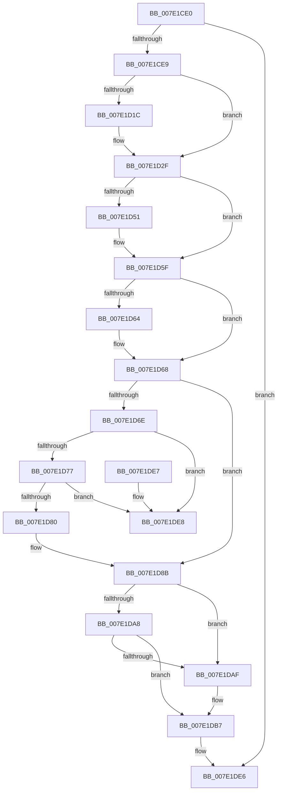

# CmUnregisterMachineHiveLoadedNotification

- RVA: `0x007E1CE0`–`0x007E1DEF` (길이 `271` bytes)
- VA: `0x00000001407E1CE0`
- 실행 섹션: `PAGE`
- PDB 이름 있음: `예`; PDB Function 태그: `아니요`
- unwind 정보 RVA: `0x000D68F4`
- 디코드: `77`개 명령, `271/271` bytes 표시
- 미해석 바이트: `0` (있으면 어셈블리에 `.byte`로 보존)

> 이 문서는 커널 이미지의 기계어와 PDB 기호를 분석해 생성했습니다. 4번과 5번은 함수 원형과 자료형을 바이너리 사용 방식에서 추정한 C 해석이며 원본 소스 복구 결과는 아닙니다.

## 1. Dependencies

- 직접 호출 지점: **7**; 고유 호출 대상: **7**
- 직접 호출자로 확인된 함수: **0**
- RIP 상대 이미지 참조: **1**

### Outgoing calls
- `0x007E1D29` → [KeBugCheckEx](../../text/4F/KeBugCheckEx_function_004FD660.md) (function, `0x004FD660`)
- `0x007E1D41` → [KeAbPreAcquire](../../text/21/KeAbPreAcquire_function_00210230.md) (function, `0x00210230`)
- `0x007E1D5A` → [ExfAcquirePushLockExclusiveEx](../../text/20/ExfAcquirePushLockExclusiveEx_function_0020FC90.md) (function, `0x0020FC90`)
- `0x007E1DB2` → [ExfReleasePushLock](../../text/26/ExfReleasePushLock_function_002638D0.md) (function, `0x002638D0`)
- `0x007E1DBA` → [KeAbPostRelease](../../text/2E/KeAbPostRelease_function_002E1600.md) (function, `0x002E1600`)
- `0x007E1DC3` → [CmpWorkItemRundown](../70/CmpWorkItemRundown_function_00705820.md) (function, `0x00705820`)
- `0x007E1DCD` → [ExFreePoolWithTag](../../poolcode/B8/ExFreePoolWithTag_function_00B82870.md) (function, `0x00B82870`)

### Direct callers
- 이 함수 시작 RVA로 연결되는 직접 call은 확인되지 않았습니다. 간접 호출은 완전히 역산할 수 없습니다.

### Static image references
- `0x007E1D2F` → RVA `0x00E09930` (`.data`; read)

## 2. Other-region calls and transfers

- 다른 실행 섹션으로 향하는 call: **6**
  - `0x007E1D29` → [KeBugCheckEx](../../text/4F/KeBugCheckEx_function_004FD660.md) (`PAGE` → `.text`)
  - `0x007E1D41` → [KeAbPreAcquire](../../text/21/KeAbPreAcquire_function_00210230.md) (`PAGE` → `.text`)
  - `0x007E1D5A` → [ExfAcquirePushLockExclusiveEx](../../text/20/ExfAcquirePushLockExclusiveEx_function_0020FC90.md) (`PAGE` → `.text`)
  - `0x007E1DB2` → [ExfReleasePushLock](../../text/26/ExfReleasePushLock_function_002638D0.md) (`PAGE` → `.text`)
  - `0x007E1DBA` → [KeAbPostRelease](../../text/2E/KeAbPostRelease_function_002E1600.md) (`PAGE` → `.text`)
  - `0x007E1DCD` → [ExFreePoolWithTag](../../poolcode/B8/ExFreePoolWithTag_function_00B82870.md) (`PAGE` → `POOLCODE`)
- 별도 외부 분기/꼬리 이동을 확인하지 못했습니다.

## 3. Assembly (complete function range)

```asm
007E1CE0  48 85 C9                        test rcx, rcx
007E1CE3  0F 84 FD 00 00 00               je 0x1407e1de6
007E1CE9  4C 8B DC                        mov r11, rsp
007E1CEC  49 89 5B 08                     mov qword ptr [r11 + 8], rbx
007E1CF0  49 89 6B 10                     mov qword ptr [r11 + 0x10], rbp
007E1CF4  49 89 73 18                     mov qword ptr [r11 + 0x18], rsi
007E1CF8  57                              push rdi
007E1CF9  48 83 EC 30                     sub rsp, 0x30
007E1CFD  44 8B 41 68                     mov r8d, dword ptr [rcx + 0x68]
007E1D01  48 8B D9                        mov rbx, rcx
007E1D04  65 48 8B 04 25 88 01 00 00      mov rax, qword ptr gs:[0x188]
007E1D0D  33 ED                           xor ebp, ebp
007E1D0F  49 69 C8 B8 00 00 00            imul rcx, r8, 0xb8
007E1D16  48 39 43 60                     cmp qword ptr [rbx + 0x60], rax
007E1D1A  75 13                           jne 0x1407e1d2f
007E1D1C  45 33 C9                        xor r9d, r9d
007E1D1F  49 89 6B E8                     mov qword ptr [r11 - 0x18], rbp
007E1D23  8D 55 28                        lea edx, [rbp + 0x28]
007E1D26  8D 4D 51                        lea ecx, [rbp + 0x51]
007E1D29  E8 32 B9 D1 FF                  call 0x1404fd660
007E1D2E  CC                              int3
007E1D2F  48 8D 3D FA 7B 62 00            lea rdi, [rip + 0x627bfa]
007E1D36  45 33 C0                        xor r8d, r8d
007E1D39  48 03 F9                        add rdi, rcx
007E1D3C  33 D2                           xor edx, edx
007E1D3E  48 8B CF                        mov rcx, rdi
007E1D41  E8 EA E4 A2 FF                  call 0x140210230
007E1D46  F0 48 0F BA 2F 00               lock bts qword ptr [rdi], 0
007E1D4C  48 8B F0                        mov rsi, rax
007E1D4F  73 0E                           jae 0x1407e1d5f
007E1D51  4C 8B C7                        mov r8, rdi
007E1D54  48 8B D0                        mov rdx, rax
007E1D57  48 8B CF                        mov rcx, rdi
007E1D5A  E8 31 DF A2 FF                  call 0x14020fc90
007E1D5F  48 85 F6                        test rsi, rsi
007E1D62  74 04                           je 0x1407e1d68
007E1D64  C6 46 0A 01                     mov byte ptr [rsi + 0xa], 1
007E1D68  40 38 6B 6D                     cmp byte ptr [rbx + 0x6d], bpl
007E1D6C  74 1D                           je 0x1407e1d8b
007E1D6E  48 8B 0B                        mov rcx, qword ptr [rbx]
007E1D71  48 39 59 08                     cmp qword ptr [rcx + 8], rbx
007E1D75  75 71                           jne 0x1407e1de8
007E1D77  48 8B 43 08                     mov rax, qword ptr [rbx + 8]
007E1D7B  48 39 18                        cmp qword ptr [rax], rbx
007E1D7E  75 68                           jne 0x1407e1de8
007E1D80  48 89 08                        mov qword ptr [rax], rcx
007E1D83  48 89 41 08                     mov qword ptr [rcx + 8], rax
007E1D87  40 88 6B 6D                     mov byte ptr [rbx + 0x6d], bpl
007E1D8B  0F 0D 0F                        prefetchw byte ptr [rdi]
007E1D8E  48 8B 07                        mov rax, qword ptr [rdi]
007E1D91  48 8B C8                        mov rcx, rax
007E1D94  48 83 E1 F0                     and rcx, 0xfffffffffffffff0
007E1D98  48 83 F9 10                     cmp rcx, 0x10
007E1D9C  48 8D 50 F0                     lea rdx, [rax - 0x10]
007E1DA0  48 0F 46 D5                     cmovbe rdx, rbp
007E1DA4  A8 02                           test al, 2
007E1DA6  75 07                           jne 0x1407e1daf
007E1DA8  F0 48 0F B1 17                  lock cmpxchg qword ptr [rdi], rdx
007E1DAD  74 08                           je 0x1407e1db7
007E1DAF  48 8B CF                        mov rcx, rdi
007E1DB2  E8 19 1B A8 FF                  call 0x1402638d0
007E1DB7  48 8B CF                        mov rcx, rdi
007E1DBA  E8 41 F8 AF FF                  call 0x1402e1600
007E1DBF  48 8D 4B 10                     lea rcx, [rbx + 0x10]
007E1DC3  E8 58 3A F2 FF                  call 0x140705820
007E1DC8  33 D2                           xor edx, edx
007E1DCA  48 8B CB                        mov rcx, rbx
007E1DCD  E8 9E 0A 3A 00                  call 0x140b82870
007E1DD2  48 8B 5C 24 40                  mov rbx, qword ptr [rsp + 0x40]
007E1DD7  48 8B 6C 24 48                  mov rbp, qword ptr [rsp + 0x48]
007E1DDC  48 8B 74 24 50                  mov rsi, qword ptr [rsp + 0x50]
007E1DE1  48 83 C4 30                     add rsp, 0x30
007E1DE5  5F                              pop rdi
007E1DE6  C3                              ret
007E1DE7  CC                              int3
007E1DE8  B9 03 00 00 00                  mov ecx, 3
007E1DED  CD 29                           int 0x29
```

## 4. C-style interpretation (structured pseudocode)

```c
__int64 __fastcall CmUnregisterMachineHiveLoadedNotification(__int64 a1, __int64 a2, __int64 a3, int a4)
{
    __int64 result;
    __int64 v_rbp;
    __int64 v_rdi;
    __int64 v_rsp;
    unsigned __int64 v_stack_p10;
    unsigned __int64 v_stack_p18;
    unsigned __int64 v_stack_p8;

    if (a1 == 0) goto loc_007E1DE6;
    *(unsigned __int64 *)(v_rsp + 8) = v_rbx;
    *(unsigned __int64 *)(v_rsp + 16) = v_rbp;
    *(unsigned __int64 *)(v_rsp + 24) = v_rsi;
    v_rsp = (v_rsp) - (48);
    v_rbp = 0;
    a1 = (a1) * ((unsigned int)(*(unsigned int *)(a1 + 104)));
    result = *(unsigned __int64 *)(gs_base + (0 + 392));
    if ((*(unsigned __int64 *)(a1 + 96)) == (*(unsigned __int64 *)(gs_base + (0 + 392)))) {
        a4 = 0;
        *(unsigned __int64 *)(v_rsp - 24) = 0;
        a2 = v_rbp + 40;
        a1 = v_rbp + 81;
        result = KeBugCheckEx(a1, a2, (unsigned int)(*(unsigned int *)(a1 + 104)), a4);
    }
    a3 = 0;
    v_rdi = (v_rip + 6454266) + (a1);
    a2 = 0;
    result = KeAbPreAcquire(v_rdi, a2, a3, a4);
    if (!(condition_is_above_or_equal)) {
        a3 = v_rdi;
        a2 = result;
        a1 = v_rdi;
        result = ExfAcquirePushLockExclusiveEx(a1, a2, a3, a4);
    }
    if (result != 0) {
        *(unsigned __int8 *)(result + 10) = 1;
    }
    if ((*(unsigned __int8 *)(a1 + 109)) == 0) goto loc_007E1D8B;
    if ((*(unsigned __int64 *)(*(unsigned __int64 *)(a1) + 8)) != a1) goto loc_007E1DE8;
    if ((*(unsigned __int64 *)(*(unsigned __int64 *)(a1 + 8))) != a1) goto loc_007E1DE8;
    *(unsigned __int64 *)(*(unsigned __int64 *)(a1 + 8)) = *(unsigned __int64 *)(a1);
    *(unsigned __int64 *)(*(unsigned __int64 *)(a1) + 8) = *(unsigned __int64 *)(a1 + 8);
    *(unsigned __int8 *)(a1 + 109) = 0;
loc_007E1D8B:
    a1 = (*(unsigned __int64 *)(v_rdi)) & (-16);
    a2 = *(unsigned __int64 *)(v_rdi) - 16;
    if (a1 <= 16) { a2 = 0; }
    if ((((unsigned __int8)(*(unsigned __int64 *)(v_rdi))) & (2)) != 0) goto loc_007E1DAF;
    result = *(unsigned __int64 *)(v_rdi);
    if ((((unsigned __int8)(*(unsigned __int64 *)(v_rdi))) & (2)) != 0) {
        a1 = v_rdi;
        result = ExfReleasePushLock(a1, a2, a3, a4);
    }
    result = KeAbPostRelease(v_rdi, a2, a3, a4);
    result = CmpWorkItemRundown(a1 + 16, a2, a3, a4);
    a2 = 0;
    result = ExFreePoolWithTag(a1, a2, a3, a4);
    v_rsp = (v_rsp) + (48);
loc_007E1DE6:
    return result;
loc_007E1DE8:
    return result;
}
```

## 5. (Beta) C Style

```c
int64_t CmUnregisterMachineHiveLoadedNotification(int64_t Arg1, int64_t Arg2, int64_t Arg3, int32_t Arg4)
{
    int64_t result;
    int64_t local_rbp;
    int64_t local_rdi;
    int64_t local_rsp;
    uint64_t v_stack_p10;
    uint64_t v_stack_p18;
    uint64_t v_stack_p8;

    if (Arg1 == 0) goto loc_007E1DE6;
    *(uint64_t *)(local_rsp + 0x8) = local_rbx;
    *(uint64_t *)(local_rsp + 0x10) = local_rbp;
    *(uint64_t *)(local_rsp + 0x18) = local_rsi;
    local_rsp = (local_rsp) - (48);
    local_rbp = 0;
    Arg1 = (Arg1) * ((uint32_t)(*(uint32_t *)(Arg1 + 0x68)));
    result = *(uint64_t *)(gs_base + (0 + 0x188));
    if ((*(uint64_t *)(Arg1 + 0x60)) == (*(uint64_t *)(gs_base + (0 + 0x188)))) {
        Arg4 = 0;
        *(uint64_t *)(local_rsp - 0x18) = 0;
        Arg2 = local_rbp + 40;
        Arg1 = local_rbp + 81;
        result = KeBugCheckEx(Arg1, Arg2, (uint32_t)(*(uint32_t *)(Arg1 + 0x68)), Arg4);
    }
    Arg3 = 0;
    local_rdi = (v_rip + 6454266) + (Arg1);
    Arg2 = 0;
    result = KeAbPreAcquire(local_rdi, Arg2, Arg3, Arg4);
    if (!(condition_is_above_or_equal)) {
        Arg3 = local_rdi;
        Arg2 = result;
        Arg1 = local_rdi;
        result = ExfAcquirePushLockExclusiveEx(Arg1, Arg2, Arg3, Arg4);
    }
    if (result != 0) {
        *(uint8_t *)(result + 0xA) = 1;
    }
    if ((*(uint8_t *)(Arg1 + 0x6D)) == 0) goto loc_007E1D8B;
    if ((*(uint64_t *)(*(uint64_t *)(Arg1) + 0x8)) != Arg1) goto loc_007E1DE8;
    if ((*(uint64_t *)(*(uint64_t *)(Arg1 + 0x8))) != Arg1) goto loc_007E1DE8;
    *(uint64_t *)(*(uint64_t *)(Arg1 + 0x8)) = *(uint64_t *)(Arg1);
    *(uint64_t *)(*(uint64_t *)(Arg1) + 0x8) = *(uint64_t *)(Arg1 + 0x8);
    *(uint8_t *)(Arg1 + 0x6D) = 0;
loc_007E1D8B:
    Arg1 = (*(uint64_t *)(local_rdi)) & (-16);
    Arg2 = *(uint64_t *)(local_rdi) - 16;
    if (Arg1 <= 16) { Arg2 = 0; }
    if ((((uint8_t)(*(uint64_t *)(local_rdi))) & (2)) != 0) goto loc_007E1DAF;
    result = *(uint64_t *)(local_rdi);
    if ((((uint8_t)(*(uint64_t *)(local_rdi))) & (2)) != 0) {
        Arg1 = local_rdi;
        result = ExfReleasePushLock(Arg1, Arg2, Arg3, Arg4);
    }
    result = KeAbPostRelease(local_rdi, Arg2, Arg3, Arg4);
    result = CmpWorkItemRundown(Arg1 + 16, Arg2, Arg3, Arg4);
    Arg2 = 0;
    result = ExFreePoolWithTag(Arg1, Arg2, Arg3, Arg4);
    local_rsp = (local_rsp) + (48);
loc_007E1DE6:
    return result;
loc_007E1DE8:
    return result;
}
```

## 6. Execution-region graph

[열기: 2D/3D 그래프와 함수 탐색 컨트롤 패널](../../../control-panel.html?section=page&rva=0x007E1CE0&view=graph)

- 2D 그래프는 위에서 아래로 흐르고, 3D 그래프는 빈 공간을 드래그해 회전합니다. Shift+드래그는 이동, 휠은 확대·축소, 함수 노드 선택은 대상 보고서 이동입니다.

### Static fallback


