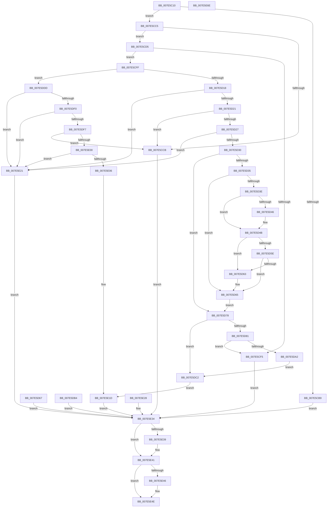

# CmUpdateFeatureConfiguration

- RVA: `0x007E5C10`–`0x007E5E6F` (길이 `607` bytes)
- VA: `0x00000001407E5C10`
- 실행 섹션: `PAGE`
- PDB 이름 있음: `예`; PDB Function 태그: `아니요`
- unwind 정보 RVA: `0x000D6BDC`
- 디코드: `161`개 명령, `607/607` bytes 표시
- 미해석 바이트: `0` (있으면 어셈블리에 `.byte`로 보존)

> 이 문서는 커널 이미지의 기계어와 PDB 기호를 분석해 생성했습니다. 4번과 5번은 함수 원형과 자료형을 바이너리 사용 방식에서 추정한 C 해석이며 원본 소스 복구 결과는 아닙니다.

## 1. Dependencies

- 직접 호출 지점: **12**; 고유 호출 대상: **9**
- 직접 호출자로 확인된 함수: **1**
- RIP 상대 이미지 참조: **2**

### Outgoing calls
- `0x007E5C55` → [SeCaptureSubjectContext](../86/SeCaptureSubjectContext_function_0086B820.md) (function, `0x0086B820`)
- `0x007E5CA1` → [SeAccessCheck](../../text/3A/SeAccessCheck_function_003A6BC0.md) (function, `0x003A6BC0`)
- `0x007E5CB0` → [SeReleaseSubjectContext](../86/SeReleaseSubjectContext_function_0086B710.md) (function, `0x0086B710`)
- `0x007E5CE3` → [CmpAllocatePoolWithQuota](../../text/46/CmpAllocatePoolWithQuota_function_00461D6C.md) (function, `0x00461D6C`)
- `0x007E5D08` → [memcpy](../../text/6C/memcpy_function_006C6840.md) (function, `0x006C6840`)
- `0x007E5D46` → [ExRaiseDatatypeMisalignment](../89/ExRaiseDatatypeMisalignment_function_00899FD0.md) (function, `0x00899FD0`)
- `0x007E5D8C` → [CmpAllocatePoolWithQuota](../../text/46/CmpAllocatePoolWithQuota_function_00461D6C.md) (function, `0x00461D6C`)
- `0x007E5DAD` → [memcpy](../../text/6C/memcpy_function_006C6840.md) (function, `0x006C6840`)
- `0x007E5DD6` → [CmFcManagerOverwriteFeatureConfigurationSection](../7F/CmFcManagerOverwriteFeatureConfigurationSection_function_007F4450.md) (function, `0x007F4450`)
- `0x007E5E18` → [CmFcManagerUpdateFeatureConfigurations](../7F/CmFcManagerUpdateFeatureConfigurations_function_007F4CF4.md) (function, `0x007F4CF4`)
- `0x007E5E3C` → [CmSiFreeMemory](../../text/47/CmSiFreeMemory_function_00475D80.md) (function, `0x00475D80`)
- `0x007E5E49` → [CmSiFreeMemory](../../text/47/CmSiFreeMemory_function_00475D80.md) (function, `0x00475D80`)

### Direct callers
- [NtSetSystemInformation](../AF/NtSetSystemInformation_function_00AF4A60.md) at `0x00AF642E`

### Static image references
- `0x007E5C76` → RVA `0x00E0EC80` (`.data`; read)
- `0x007E5C9A` → RVA `0x00EF7A48` (`.data`; read)

## 2. Other-region calls and transfers

- 다른 실행 섹션으로 향하는 call: **7**
  - `0x007E5CA1` → [SeAccessCheck](../../text/3A/SeAccessCheck_function_003A6BC0.md) (`PAGE` → `.text`)
  - `0x007E5CE3` → [CmpAllocatePoolWithQuota](../../text/46/CmpAllocatePoolWithQuota_function_00461D6C.md) (`PAGE` → `.text`)
  - `0x007E5D08` → [memcpy](../../text/6C/memcpy_function_006C6840.md) (`PAGE` → `.text`)
  - `0x007E5D8C` → [CmpAllocatePoolWithQuota](../../text/46/CmpAllocatePoolWithQuota_function_00461D6C.md) (`PAGE` → `.text`)
  - `0x007E5DAD` → [memcpy](../../text/6C/memcpy_function_006C6840.md) (`PAGE` → `.text`)
  - `0x007E5E3C` → [CmSiFreeMemory](../../text/47/CmSiFreeMemory_function_00475D80.md) (`PAGE` → `.text`)
  - `0x007E5E49` → [CmSiFreeMemory](../../text/47/CmSiFreeMemory_function_00475D80.md) (`PAGE` → `.text`)
- 별도 외부 분기/꼬리 이동을 확인하지 못했습니다.

## 3. Assembly (complete function range)

```asm
007E5C10  48 8B C4                        mov rax, rsp
007E5C13  48 89 58 08                     mov qword ptr [rax + 8], rbx
007E5C17  48 89 70 10                     mov qword ptr [rax + 0x10], rsi
007E5C1B  48 89 78 18                     mov qword ptr [rax + 0x18], rdi
007E5C1F  41 54                           push r12
007E5C21  41 56                           push r14
007E5C23  41 57                           push r15
007E5C25  48 81 EC B0 00 00 00            sub rsp, 0xb0
007E5C2C  45 8A F8                        mov r15b, r8b
007E5C2F  44 8B F2                        mov r14d, edx
007E5C32  4C 8B E1                        mov r12, rcx
007E5C35  83 60 20 00                     and dword ptr [rax + 0x20], 0
007E5C39  83 60 98 00                     and dword ptr [rax - 0x68], 0
007E5C3D  0F 57 C0                        xorps xmm0, xmm0
007E5C40  0F 11 40 C0                     movups xmmword ptr [rax - 0x40], xmm0
007E5C44  0F 11 40 D0                     movups xmmword ptr [rax - 0x30], xmm0
007E5C48  33 FF                           xor edi, edi
007E5C4A  33 F6                           xor esi, esi
007E5C4C  48 89 74 24 58                  mov qword ptr [rsp + 0x58], rsi
007E5C51  48 8D 48 C0                     lea rcx, [rax - 0x40]
007E5C55  E8 C6 5B 08 00                  call 0x14086b820
007E5C5A  48 8D 84 24 E8 00 00 00         lea rax, [rsp + 0xe8]
007E5C62  48 89 44 24 48                  mov qword ptr [rsp + 0x48], rax
007E5C67  48 8D 44 24 60                  lea rax, [rsp + 0x60]
007E5C6C  48 89 44 24 40                  mov qword ptr [rsp + 0x40], rax
007E5C71  44 88 7C 24 38                  mov byte ptr [rsp + 0x38], r15b
007E5C76  48 8D 05 03 90 62 00            lea rax, [rip + 0x629003]
007E5C7D  48 89 44 24 30                  mov qword ptr [rsp + 0x30], rax
007E5C82  48 21 74 24 28                  and qword ptr [rsp + 0x28], rsi
007E5C87  21 74 24 20                     and dword ptr [rsp + 0x20], esi
007E5C8B  44 8D 4F 01                     lea r9d, [rdi + 1]
007E5C8F  45 33 C0                        xor r8d, r8d
007E5C92  48 8D 94 24 88 00 00 00         lea rdx, [rsp + 0x88]
007E5C9A  48 8B 0D A7 1D 71 00            mov rcx, qword ptr [rip + 0x711da7]
007E5CA1  E8 1A 0F BC FF                  call 0x1403a6bc0
007E5CA6  8A D8                           mov bl, al
007E5CA8  48 8D 8C 24 88 00 00 00         lea rcx, [rsp + 0x88]
007E5CB0  E8 5B 5A 08 00                  call 0x14086b710
007E5CB5  84 DB                           test bl, bl
007E5CB7  75 0C                           jne 0x1407e5cc5
007E5CB9  8B 9C 24 E8 00 00 00            mov ebx, dword ptr [rsp + 0xe8]
007E5CC0  E9 6F 01 00 00                  jmp 0x1407e5e34
007E5CC5  41 83 FE 04                     cmp r14d, 4
007E5CC9  73 0A                           jae 0x1407e5cd5
007E5CCB  BB 04 00 00 C0                  mov ebx, 0xc0000004
007E5CD0  E9 5F 01 00 00                  jmp 0x1407e5e34
007E5CD5  41 B8 43 6D 46 63               mov r8d, 0x63466d43
007E5CDB  49 8B D6                        mov rdx, r14
007E5CDE  B9 00 01 00 00                  mov ecx, 0x100
007E5CE3  E8 84 C0 C7 FF                  call 0x140461d6c
007E5CE8  48 8B F8                        mov rdi, rax
007E5CEB  48 89 44 24 68                  mov qword ptr [rsp + 0x68], rax
007E5CF0  48 85 C0                        test rax, rax
007E5CF3  75 0A                           jne 0x1407e5cff
007E5CF5  BB 9A 00 00 C0                  mov ebx, 0xc000009a
007E5CFA  E9 35 01 00 00                  jmp 0x1407e5e34
007E5CFF  4D 8B C6                        mov r8, r14
007E5D02  49 8B D4                        mov rdx, r12
007E5D05  48 8B CF                        mov rcx, rdi
007E5D08  E8 33 0B EE FF                  call 0x1406c6840
007E5D0D  90                              nop
007E5D0E  8B 0F                           mov ecx, dword ptr [rdi]
007E5D10  85 C9                           test ecx, ecx
007E5D12  0F 84 C5 00 00 00               je 0x1407e5ddd
007E5D18  83 F9 01                        cmp ecx, 1
007E5D1B  0F 85 00 01 00 00               jne 0x1407e5e21
007E5D21  41 83 FE 28                     cmp r14d, 0x28
007E5D25  75 A4                           jne 0x1407e5ccb
007E5D27  39 4F 10                        cmp dword ptr [rdi + 0x10], ecx
007E5D2A  0F 85 F1 00 00 00               jne 0x1407e5e21
007E5D30  45 84 FF                        test r15b, r15b
007E5D33  74 43                           je 0x1407e5d78
007E5D35  48 8B 4F 18                     mov rcx, qword ptr [rdi + 0x18]
007E5D39  48 85 C9                        test rcx, rcx
007E5D3C  74 27                           je 0x1407e5d65
007E5D3E  48 8B 47 20                     mov rax, qword ptr [rdi + 0x20]
007E5D42  A8 03                           test al, 3
007E5D44  74 05                           je 0x1407e5d4b
007E5D46  E8 85 42 0B 00                  call 0x140899fd0
007E5D4B  48 8D 14 08                     lea rdx, [rax + rcx]
007E5D4F  48 B9 00 00 FF FF FF 7F 00 00   movabs rcx, 0x7fffffff0000
007E5D59  48 3B D1                        cmp rdx, rcx
007E5D5C  77 05                           ja 0x1407e5d63
007E5D5E  48 3B D0                        cmp rdx, rax
007E5D61  73 02                           jae 0x1407e5d65
007E5D63  8A 01                           mov al, byte ptr [rcx]
007E5D65  EB 11                           jmp 0x1407e5d78
007E5D67  8B D8                           mov ebx, eax
007E5D69  48 8B 7C 24 68                  mov rdi, qword ptr [rsp + 0x68]
007E5D6E  48 8B 74 24 58                  mov rsi, qword ptr [rsp + 0x58]
007E5D73  E9 BC 00 00 00                  jmp 0x1407e5e34
007E5D78  48 8B 57 18                     mov rdx, qword ptr [rdi + 0x18]
007E5D7C  48 85 D2                        test rdx, rdx
007E5D7F  74 41                           je 0x1407e5dc2
007E5D81  B9 00 01 00 00                  mov ecx, 0x100
007E5D86  41 B8 43 6D 46 63               mov r8d, 0x63466d43
007E5D8C  E8 DB BF C7 FF                  call 0x140461d6c
007E5D91  48 8B F0                        mov rsi, rax
007E5D94  48 89 44 24 58                  mov qword ptr [rsp + 0x58], rax
007E5D99  48 85 C0                        test rax, rax
007E5D9C  0F 84 53 FF FF FF               je 0x1407e5cf5
007E5DA2  4C 8B 47 18                     mov r8, qword ptr [rdi + 0x18]
007E5DA6  48 8B 57 20                     mov rdx, qword ptr [rdi + 0x20]
007E5DAA  48 8B C8                        mov rcx, rax
007E5DAD  E8 8E 0A EE FF                  call 0x1406c6840
007E5DB2  EB 0E                           jmp 0x1407e5dc2
007E5DB4  8B D8                           mov ebx, eax
007E5DB6  48 8B 7C 24 68                  mov rdi, qword ptr [rsp + 0x68]
007E5DBB  48 8B 74 24 58                  mov rsi, qword ptr [rsp + 0x58]
007E5DC0  EB 72                           jmp 0x1407e5e34
007E5DC2  48 8B 47 18                     mov rax, qword ptr [rdi + 0x18]
007E5DC6  48 89 44 24 20                  mov qword ptr [rsp + 0x20], rax
007E5DCB  4C 8B CE                        mov r9, rsi
007E5DCE  44 8B 47 10                     mov r8d, dword ptr [rdi + 0x10]
007E5DD2  48 8B 57 08                     mov rdx, qword ptr [rdi + 8]
007E5DD6  E8 75 E6 00 00                  call 0x1407f4450
007E5DDB  EB 40                           jmp 0x1407e5e1d
007E5DDD  8B 57 14                        mov edx, dword ptr [rdi + 0x14]
007E5DE0  8B C2                           mov eax, edx
007E5DE2  48 C1 E0 05                     shl rax, 5
007E5DE6  B9 FF FF FF FF                  mov ecx, 0xffffffff
007E5DEB  48 3B C1                        cmp rax, rcx
007E5DEE  77 31                           ja 0x1407e5e21
007E5DF0  8D 48 18                        lea ecx, [rax + 0x18]
007E5DF3  3B C8                           cmp ecx, eax
007E5DF5  72 2A                           jb 0x1407e5e21
007E5DF7  41 3B CE                        cmp ecx, r14d
007E5DFA  0F 85 CB FE FF FF               jne 0x1407e5ccb
007E5E00  83 7F 10 01                     cmp dword ptr [rdi + 0x10], 1
007E5E04  75 1B                           jne 0x1407e5e21
007E5E06  4C 8D 4F 18                     lea r9, [rdi + 0x18]
007E5E0A  89 54 24 20                     mov dword ptr [rsp + 0x20], edx
007E5E0E  41 B8 01 00 00 00               mov r8d, 1
007E5E14  48 8B 57 08                     mov rdx, qword ptr [rdi + 8]
007E5E18  E8 D7 EE 00 00                  call 0x1407f4cf4
007E5E1D  8B D8                           mov ebx, eax
007E5E1F  EB 13                           jmp 0x1407e5e34
007E5E21  BB 0D 00 00 C0                  mov ebx, 0xc000000d
007E5E26  EB 0C                           jmp 0x1407e5e34
007E5E28  8B D8                           mov ebx, eax
007E5E2A  48 8B 7C 24 68                  mov rdi, qword ptr [rsp + 0x68]
007E5E2F  48 8B 74 24 58                  mov rsi, qword ptr [rsp + 0x58]
007E5E34  48 85 FF                        test rdi, rdi
007E5E37  74 08                           je 0x1407e5e41
007E5E39  48 8B CF                        mov rcx, rdi
007E5E3C  E8 3F FF C8 FF                  call 0x140475d80
007E5E41  48 85 F6                        test rsi, rsi
007E5E44  74 08                           je 0x1407e5e4e
007E5E46  48 8B CE                        mov rcx, rsi
007E5E49  E8 32 FF C8 FF                  call 0x140475d80
007E5E4E  8B C3                           mov eax, ebx
007E5E50  4C 8D 9C 24 B0 00 00 00         lea r11, [rsp + 0xb0]
007E5E58  49 8B 5B 20                     mov rbx, qword ptr [r11 + 0x20]
007E5E5C  49 8B 73 28                     mov rsi, qword ptr [r11 + 0x28]
007E5E60  49 8B 7B 30                     mov rdi, qword ptr [r11 + 0x30]
007E5E64  49 8B E3                        mov rsp, r11
007E5E67  41 5F                           pop r15
007E5E69  41 5E                           pop r14
007E5E6B  41 5C                           pop r12
007E5E6D  C3                              ret
007E5E6E  CC                              int3
```

## 4. C-style interpretation (structured pseudocode)

```c
__int64 __fastcall CmUpdateFeatureConfiguration(__int64 a1, int a2, int a3)
{
    __int64 result;
    __int64 v_rdi;
    __int64 v_rsi;
    __int64 v_rsp;
    unsigned __int64 v_stack_m18;
    unsigned __int64 v_stack_m40;
    unsigned __int64 v_stack_m60;
    unsigned __int64 v_stack_m68;
    unsigned __int64 v_stack_m70;
    unsigned __int64 v_stack_m80;
    unsigned __int64 v_stack_m88;
    unsigned __int8 v_stack_m90;
    unsigned __int64 v_stack_m98;
    unsigned __int64 v_stack_mA0;
    unsigned int v_stack_mA8;
    unsigned __int64 v_stack_p20;

    *(unsigned __int64 *)(v_rsp + 8) = v_rbx;
    *(unsigned __int64 *)(v_rsp + 16) = v_rsi;
    *(unsigned __int64 *)(v_rsp + 24) = v_rdi;
    v_rsp = (v_rsp) - (176);
    *(unsigned __int64 *)(v_rsp - 64) = v_xmm0;
    *(unsigned __int64 *)(v_rsp - 48) = v_xmm0;
    v_rdi = 0;
    v_rsi = 0;
    v_stack_m70 = 0;
    result = SeCaptureSubjectContext(v_rsp - 64, a2, a3, a4);
    v_stack_m80 = v_stack_p20;
    v_stack_m88 = v_stack_m68;
    v_stack_m90 = (unsigned __int8)((unsigned __int8)(a3));
    v_stack_m98 = v_rip + 6459395;
    a3 = 0;
    result = SeAccessCheck(*(unsigned __int64 *)(v_rip + 7413159), v_stack_m40, a3, v_rdi + 1);
    result = SeReleaseSubjectContext(v_stack_m40, v_stack_m40, a3, v_rdi + 1);
    if ((unsigned __int8)((unsigned __int8)(result)) != 0) goto loc_007E5CC5;
    goto loc_007E5E34;
loc_007E5CC5:
    if (((unsigned int)((unsigned int)(a2))) >= 4) goto loc_007E5CD5;
loc_007E5CCB:
    goto loc_007E5E34;
loc_007E5CD5:
    result = CmpAllocatePoolWithQuota(256, (unsigned int)(a2), (unsigned int)(0x63466D43ULL), v_rdi + 1);
    v_stack_m60 = result;
    if (result != 0) goto loc_007E5CFF;
loc_007E5CF5:
    goto loc_007E5E34;
loc_007E5CFF:
    result = memcpy(result, a1, (unsigned int)(a2), v_rdi + 1);
    if ((unsigned int)((unsigned int)(*(unsigned int *)(result))) == 0) goto loc_007E5DDD;
    if (((unsigned int)((unsigned int)(*(unsigned int *)(result)))) != 1) goto loc_007E5E21;
    if (((unsigned int)((unsigned int)(a2))) != 40) goto loc_007E5CCB;
    if ((*(unsigned int *)(result + 16)) != ((unsigned int)((unsigned int)(*(unsigned int *)(result))))) goto loc_007E5E21;
    if ((unsigned __int8)((unsigned __int8)(a3)) == 0) goto loc_007E5D78;
    if (*(unsigned __int64 *)(result + 24) == 0) goto loc_007E5D65;
    result = *(unsigned __int64 *)(result + 32);
    if ((((unsigned __int8)(*(unsigned __int64 *)(result + 32))) & (3)) != 0) {
        result = ExRaiseDatatypeMisalignment(*(unsigned __int64 *)(result + 24), a1, (unsigned int)(a2), v_rdi + 1);
    }
    if ((result + *(unsigned __int64 *)(result + 24) * 1) > (*(unsigned __int64 *)(result + 24))) goto loc_007E5D63;
    if ((result + *(unsigned __int64 *)(result + 24) * 1) < result) {
        result = *(unsigned __int8 *)(*(unsigned __int64 *)(result + 24));
    }
    goto loc_007E5D78;
loc_007E5D78:
    if (*(unsigned __int64 *)(result + 24) == 0) goto loc_007E5DC2;
    result = CmpAllocatePoolWithQuota(256, *(unsigned __int64 *)(result + 24), (unsigned int)(0x63466D43ULL), v_rdi + 1);
    v_stack_m70 = result;
    if (result == 0) goto loc_007E5CF5;
    result = memcpy(result, *(unsigned __int64 *)(result + 32), *(unsigned __int64 *)(result + 24), v_rdi + 1);
    goto loc_007E5DC2;
loc_007E5DC2:
    v_stack_mA8 = *(unsigned __int64 *)(result + 24);
    result = CmFcManagerOverwriteFeatureConfigurationSection(result, *(unsigned __int64 *)(result + 8), (unsigned int)(*(unsigned int *)(result + 16)), result);
    goto loc_007E5E1D;
loc_007E5DDD:
    result = ((unsigned int)((unsigned int)((unsigned int)(*(unsigned int *)(result + 20))))) << (5);
    if (result > ((unsigned int)(0xFFFFFFFFULL))) goto loc_007E5E21;
    if (((unsigned int)(result + 24)) < ((unsigned int)(result))) goto loc_007E5E21;
    if (((unsigned int)(result + 24)) != ((unsigned int)((unsigned int)(a2)))) goto loc_007E5CCB;
    if ((*(unsigned int *)(result + 16)) != 1) goto loc_007E5E21;
    v_stack_mA8 = (unsigned int)((unsigned int)(*(unsigned int *)(result + 20)));
    result = CmFcManagerUpdateFeatureConfigurations(result + 24, *(unsigned __int64 *)(result + 8), 1, result + 24);
loc_007E5E1D:
    goto loc_007E5E34;
loc_007E5E21:
    goto loc_007E5E34;
loc_007E5E34:
    if (result != 0) {
        a1 = result;
        result = CmSiFreeMemory(a1, *(unsigned __int64 *)(result + 8), 1, result + 24);
    }
    if (result != 0) {
        a1 = result;
        result = CmSiFreeMemory(a1, *(unsigned __int64 *)(result + 8), 1, result + 24);
    }
    return (unsigned int)((unsigned int)((unsigned int)(0xC000000DULL)));
}
```

## 5. (Beta) C Style

```c
int64_t CmUpdateFeatureConfiguration(int64_t Arg1, int32_t Arg2, int32_t Arg3)
{
    int64_t result;
    int64_t local_rdi;
    int64_t local_rsi;
    int64_t local_rsp;
    uint64_t v_stack_m18;
    uint64_t v_stack_m40;
    uint64_t v_stack_m60;
    uint64_t v_stack_m68;
    uint64_t v_stack_m70;
    uint64_t v_stack_m80;
    uint64_t v_stack_m88;
    uint8_t v_stack_m90;
    uint64_t v_stack_m98;
    uint64_t v_stack_mA0;
    uint32_t v_stack_mA8;
    uint64_t v_stack_p20;

    *(uint64_t *)(local_rsp + 0x8) = local_rbx;
    *(uint64_t *)(local_rsp + 0x10) = local_rsi;
    *(uint64_t *)(local_rsp + 0x18) = local_rdi;
    local_rsp = (local_rsp) - (176);
    *(uint64_t *)(local_rsp - 0x40) = v_xmm0;
    *(uint64_t *)(local_rsp - 0x30) = v_xmm0;
    local_rdi = 0;
    local_rsi = 0;
    v_stack_m70 = 0;
    result = SeCaptureSubjectContext(local_rsp - 64, Arg2, Arg3, a4);
    v_stack_m80 = v_stack_p20;
    v_stack_m88 = v_stack_m68;
    v_stack_m90 = (uint8_t)((uint8_t)(Arg3));
    v_stack_m98 = v_rip + 6459395;
    Arg3 = 0;
    result = SeAccessCheck(*(uint64_t *)(v_rip + 0x711DA7), v_stack_m40, Arg3, local_rdi + 1);
    result = SeReleaseSubjectContext(v_stack_m40, v_stack_m40, Arg3, local_rdi + 1);
    if ((uint8_t)((uint8_t)(result)) != 0) goto loc_007E5CC5;
    goto loc_007E5E34;
loc_007E5CC5:
    if (((uint32_t)((uint32_t)(Arg2))) >= 4) goto loc_007E5CD5;
loc_007E5CCB:
    goto loc_007E5E34;
loc_007E5CD5:
    result = CmpAllocatePoolWithQuota(256, (uint32_t)(Arg2), (uint32_t)(0x63466D43ULL), local_rdi + 1);
    v_stack_m60 = result;
    if (result != 0) goto loc_007E5CFF;
loc_007E5CF5:
    goto loc_007E5E34;
loc_007E5CFF:
    result = memcpy(result, Arg1, (uint32_t)(Arg2), local_rdi + 1);
    if ((uint32_t)((uint32_t)(*(uint32_t *)(result))) == 0) goto loc_007E5DDD;
    if (((uint32_t)((uint32_t)(*(uint32_t *)(result)))) != 1) goto loc_007E5E21;
    if (((uint32_t)((uint32_t)(Arg2))) != 40) goto loc_007E5CCB;
    if ((*(uint32_t *)(result + 0x10)) != ((uint32_t)((uint32_t)(*(uint32_t *)(result))))) goto loc_007E5E21;
    if ((uint8_t)((uint8_t)(Arg3)) == 0) goto loc_007E5D78;
    if (*(uint64_t *)(result + 0x18) == 0) goto loc_007E5D65;
    result = *(uint64_t *)(result + 0x20);
    if ((((uint8_t)(*(uint64_t *)(result + 0x20))) & (3)) != 0) {
        result = ExRaiseDatatypeMisalignment(*(uint64_t *)(result + 0x18), Arg1, (uint32_t)(Arg2), local_rdi + 1);
    }
    if ((result + *(uint64_t *)(result + 0x18) * 1) > (*(uint64_t *)(result + 0x18))) goto loc_007E5D63;
    if ((result + *(uint64_t *)(result + 0x18) * 1) < result) {
        result = *(uint8_t *)(*(uint64_t *)(result + 0x18));
    }
    goto loc_007E5D78;
loc_007E5D78:
    if (*(uint64_t *)(result + 0x18) == 0) goto loc_007E5DC2;
    result = CmpAllocatePoolWithQuota(256, *(uint64_t *)(result + 0x18), (uint32_t)(0x63466D43ULL), local_rdi + 1);
    v_stack_m70 = result;
    if (result == 0) goto loc_007E5CF5;
    result = memcpy(result, *(uint64_t *)(result + 0x20), *(uint64_t *)(result + 0x18), local_rdi + 1);
    goto loc_007E5DC2;
loc_007E5DC2:
    v_stack_mA8 = *(uint64_t *)(result + 0x18);
    result = CmFcManagerOverwriteFeatureConfigurationSection(result, *(uint64_t *)(result + 0x8), (uint32_t)(*(uint32_t *)(result + 0x10)), result);
    goto loc_007E5E1D;
loc_007E5DDD:
    result = ((uint32_t)((uint32_t)((uint32_t)(*(uint32_t *)(result + 0x14))))) << (5);
    if (result > ((uint32_t)(0xFFFFFFFFULL))) goto loc_007E5E21;
    if (((uint32_t)(result + 24)) < ((uint32_t)(result))) goto loc_007E5E21;
    if (((uint32_t)(result + 24)) != ((uint32_t)((uint32_t)(Arg2)))) goto loc_007E5CCB;
    if ((*(uint32_t *)(result + 0x10)) != 1) goto loc_007E5E21;
    v_stack_mA8 = (uint32_t)((uint32_t)(*(uint32_t *)(result + 0x14)));
    result = CmFcManagerUpdateFeatureConfigurations(result + 24, *(uint64_t *)(result + 0x8), 1, result + 24);
loc_007E5E1D:
    goto loc_007E5E34;
loc_007E5E21:
    goto loc_007E5E34;
loc_007E5E34:
    if (result != 0) {
        Arg1 = result;
        result = CmSiFreeMemory(Arg1, *(uint64_t *)(result + 0x8), 1, result + 24);
    }
    if (result != 0) {
        Arg1 = result;
        result = CmSiFreeMemory(Arg1, *(uint64_t *)(result + 0x8), 1, result + 24);
    }
    return (uint32_t)((uint32_t)((uint32_t)(0xC000000DULL)));
}
```

## 6. Execution-region graph

[열기: 2D/3D 그래프와 함수 탐색 컨트롤 패널](../../../control-panel.html?section=page&rva=0x007E5C10&view=graph)

- 2D 그래프는 위에서 아래로 흐르고, 3D 그래프는 빈 공간을 드래그해 회전합니다. Shift+드래그는 이동, 휠은 확대·축소, 함수 노드 선택은 대상 보고서 이동입니다.

### Static fallback


