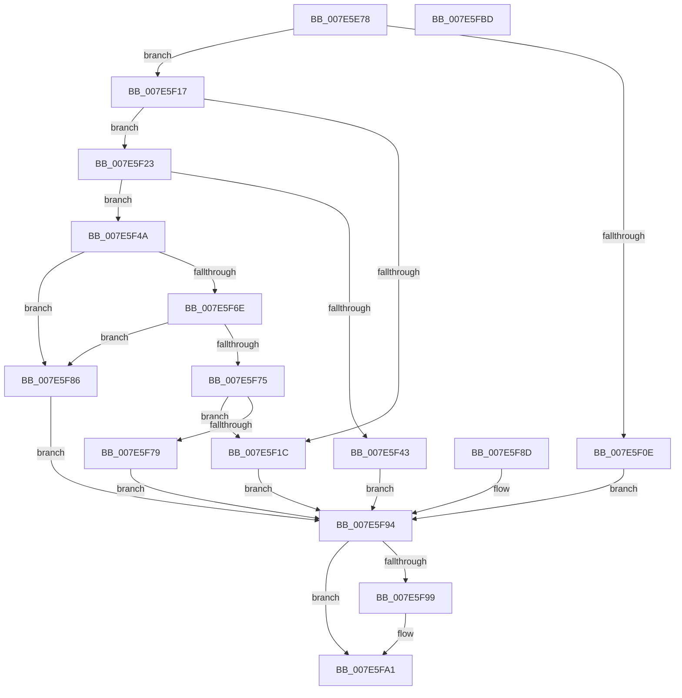

# CmUpdateFeatureUsageSubscription

- RVA: `0x007E5E78`–`0x007E5FBE` (길이 `326` bytes)
- VA: `0x00000001407E5E78`
- 실행 섹션: `PAGE`
- PDB 이름 있음: `예`; PDB Function 태그: `아니요`
- unwind 정보 RVA: `0x000D6C34`
- 디코드: `89`개 명령, `326/326` bytes 표시
- 미해석 바이트: `0` (있으면 어셈블리에 `.byte`로 보존)

> 이 문서는 커널 이미지의 기계어와 PDB 기호를 분석해 생성했습니다. 4번과 5번은 함수 원형과 자료형을 바이너리 사용 방식에서 추정한 C 해석이며 원본 소스 복구 결과는 아닙니다.

## 1. Dependencies

- 직접 호출 지점: **7**; 고유 호출 대상: **7**
- 직접 호출자로 확인된 함수: **1**
- RIP 상대 이미지 참조: **2**

### Outgoing calls
- `0x007E5EB1` → [SeCaptureSubjectContext](../86/SeCaptureSubjectContext_function_0086B820.md) (function, `0x0086B820`)
- `0x007E5EF9` → [SeAccessCheck](../../text/3A/SeAccessCheck_function_003A6BC0.md) (function, `0x003A6BC0`)
- `0x007E5F05` → [SeReleaseSubjectContext](../86/SeReleaseSubjectContext_function_0086B710.md) (function, `0x0086B710`)
- `0x007E5F31` → [CmpAllocatePoolWithQuota](../../text/46/CmpAllocatePoolWithQuota_function_00461D6C.md) (function, `0x00461D6C`)
- `0x007E5F53` → [memcpy](../../text/6C/memcpy_function_006C6840.md) (function, `0x006C6840`)
- `0x007E5F7D` → [CmFcManagerUpdateFeatureUsageSubscriptions](../A4/CmFcManagerUpdateFeatureUsageSubscriptions_function_00A4490C.md) (function, `0x00A4490C`)
- `0x007E5F9C` → [CmSiFreeMemory](../../text/47/CmSiFreeMemory_function_00475D80.md) (function, `0x00475D80`)

### Direct callers
- [NtSetSystemInformation](../AF/NtSetSystemInformation_function_00AF4A60.md) at `0x00AF65A4`

### Static image references
- `0x007E5ED1` → RVA `0x00E0EC80` (`.data`; read)
- `0x007E5EF2` → RVA `0x00EF7A48` (`.data`; read)

## 2. Other-region calls and transfers

- 다른 실행 섹션으로 향하는 call: **4**
  - `0x007E5EF9` → [SeAccessCheck](../../text/3A/SeAccessCheck_function_003A6BC0.md) (`PAGE` → `.text`)
  - `0x007E5F31` → [CmpAllocatePoolWithQuota](../../text/46/CmpAllocatePoolWithQuota_function_00461D6C.md) (`PAGE` → `.text`)
  - `0x007E5F53` → [memcpy](../../text/6C/memcpy_function_006C6840.md) (`PAGE` → `.text`)
  - `0x007E5F9C` → [CmSiFreeMemory](../../text/47/CmSiFreeMemory_function_00475D80.md) (`PAGE` → `.text`)
- 별도 외부 분기/꼬리 이동을 확인하지 못했습니다.

## 3. Assembly (complete function range)

```asm
007E5E78  48 8B C4                        mov rax, rsp
007E5E7B  48 89 58 08                     mov qword ptr [rax + 8], rbx
007E5E7F  48 89 70 10                     mov qword ptr [rax + 0x10], rsi
007E5E83  48 89 78 18                     mov qword ptr [rax + 0x18], rdi
007E5E87  41 56                           push r14
007E5E89  48 81 EC 90 00 00 00            sub rsp, 0x90
007E5E90  41 8A D8                        mov bl, r8b
007E5E93  8B F2                           mov esi, edx
007E5E95  4C 8B F1                        mov r14, rcx
007E5E98  83 60 20 00                     and dword ptr [rax + 0x20], 0
007E5E9C  83 60 BC 00                     and dword ptr [rax - 0x44], 0
007E5EA0  0F 57 C0                        xorps xmm0, xmm0
007E5EA3  0F 11 40 D0                     movups xmmword ptr [rax - 0x30], xmm0
007E5EA7  0F 11 40 E0                     movups xmmword ptr [rax - 0x20], xmm0
007E5EAB  33 FF                           xor edi, edi
007E5EAD  48 8D 48 D0                     lea rcx, [rax - 0x30]
007E5EB1  E8 6A 59 08 00                  call 0x14086b820
007E5EB6  48 8D 84 24 B8 00 00 00         lea rax, [rsp + 0xb8]
007E5EBE  48 89 44 24 48                  mov qword ptr [rsp + 0x48], rax
007E5EC3  48 8D 44 24 54                  lea rax, [rsp + 0x54]
007E5EC8  48 89 44 24 40                  mov qword ptr [rsp + 0x40], rax
007E5ECD  88 5C 24 38                     mov byte ptr [rsp + 0x38], bl
007E5ED1  48 8D 05 A8 8D 62 00            lea rax, [rip + 0x628da8]
007E5ED8  48 89 44 24 30                  mov qword ptr [rsp + 0x30], rax
007E5EDD  48 21 7C 24 28                  and qword ptr [rsp + 0x28], rdi
007E5EE2  21 7C 24 20                     and dword ptr [rsp + 0x20], edi
007E5EE6  44 8D 4F 02                     lea r9d, [rdi + 2]
007E5EEA  45 33 C0                        xor r8d, r8d
007E5EED  48 8D 54 24 68                  lea rdx, [rsp + 0x68]
007E5EF2  48 8B 0D 4F 1B 71 00            mov rcx, qword ptr [rip + 0x711b4f]
007E5EF9  E8 C2 0C BC FF                  call 0x1403a6bc0
007E5EFE  8A D8                           mov bl, al
007E5F00  48 8D 4C 24 68                  lea rcx, [rsp + 0x68]
007E5F05  E8 06 58 08 00                  call 0x14086b710
007E5F0A  84 DB                           test bl, bl
007E5F0C  75 09                           jne 0x1407e5f17
007E5F0E  8B 9C 24 B8 00 00 00            mov ebx, dword ptr [rsp + 0xb8]
007E5F15  EB 7D                           jmp 0x1407e5f94
007E5F17  83 FE 04                        cmp esi, 4
007E5F1A  73 07                           jae 0x1407e5f23
007E5F1C  BB 04 00 00 C0                  mov ebx, 0xc0000004
007E5F21  EB 71                           jmp 0x1407e5f94
007E5F23  41 B8 43 6D 46 63               mov r8d, 0x63466d43
007E5F29  48 8B D6                        mov rdx, rsi
007E5F2C  B9 00 01 00 00                  mov ecx, 0x100
007E5F31  E8 36 BE C7 FF                  call 0x140461d6c
007E5F36  48 8B F8                        mov rdi, rax
007E5F39  48 89 44 24 60                  mov qword ptr [rsp + 0x60], rax
007E5F3E  48 85 C0                        test rax, rax
007E5F41  75 07                           jne 0x1407e5f4a
007E5F43  BB 9A 00 00 C0                  mov ebx, 0xc000009a
007E5F48  EB 4A                           jmp 0x1407e5f94
007E5F4A  4C 8B C6                        mov r8, rsi
007E5F4D  49 8B D6                        mov rdx, r14
007E5F50  48 8B CF                        mov rcx, rdi
007E5F53  E8 E8 08 EE FF                  call 0x1406c6840
007E5F58  90                              nop
007E5F59  44 8B 07                        mov r8d, dword ptr [rdi]
007E5F5C  4B 8D 04 80                     lea rax, [r8 + r8*4]
007E5F60  48 C1 E0 02                     shl rax, 2
007E5F64  B9 FF FF FF FF                  mov ecx, 0xffffffff
007E5F69  48 3B C1                        cmp rax, rcx
007E5F6C  77 18                           ja 0x1407e5f86
007E5F6E  8D 48 04                        lea ecx, [rax + 4]
007E5F71  3B C8                           cmp ecx, eax
007E5F73  72 11                           jb 0x1407e5f86
007E5F75  3B CE                           cmp ecx, esi
007E5F77  75 A3                           jne 0x1407e5f1c
007E5F79  48 8D 57 04                     lea rdx, [rdi + 4]
007E5F7D  E8 8A E9 25 00                  call 0x140a4490c
007E5F82  8B D8                           mov ebx, eax
007E5F84  EB 0E                           jmp 0x1407e5f94
007E5F86  BB 0D 00 00 C0                  mov ebx, 0xc000000d
007E5F8B  EB 07                           jmp 0x1407e5f94
007E5F8D  8B D8                           mov ebx, eax
007E5F8F  48 8B 7C 24 60                  mov rdi, qword ptr [rsp + 0x60]
007E5F94  48 85 FF                        test rdi, rdi
007E5F97  74 08                           je 0x1407e5fa1
007E5F99  48 8B CF                        mov rcx, rdi
007E5F9C  E8 DF FD C8 FF                  call 0x140475d80
007E5FA1  8B C3                           mov eax, ebx
007E5FA3  4C 8D 9C 24 90 00 00 00         lea r11, [rsp + 0x90]
007E5FAB  49 8B 5B 10                     mov rbx, qword ptr [r11 + 0x10]
007E5FAF  49 8B 73 18                     mov rsi, qword ptr [r11 + 0x18]
007E5FB3  49 8B 7B 20                     mov rdi, qword ptr [r11 + 0x20]
007E5FB7  49 8B E3                        mov rsp, r11
007E5FBA  41 5E                           pop r14
007E5FBC  C3                              ret
007E5FBD  CC                              int3
```

## 4. C-style interpretation (structured pseudocode)

```c
__int64 __fastcall CmUpdateFeatureUsageSubscription(__int64 a1, int a2, int a3)
{
    __int64 result;
    __int64 v_rdi;
    __int64 v_rsp;
    unsigned __int64 v_stack_m30;
    unsigned __int64 v_stack_m38;
    unsigned __int64 v_stack_m44;
    unsigned __int64 v_stack_m50;
    unsigned __int64 v_stack_m58;
    unsigned __int8 v_stack_m60;
    unsigned __int64 v_stack_m68;
    unsigned __int64 v_stack_m70;
    unsigned int v_stack_m78;
    unsigned __int64 v_stack_m8;
    unsigned __int64 v_stack_p20;

    *(unsigned __int64 *)(v_rsp + 8) = v_rbx;
    *(unsigned __int64 *)(v_rsp + 16) = v_rsi;
    *(unsigned __int64 *)(v_rsp + 24) = v_rdi;
    v_rsp = (v_rsp) - (144);
    *(unsigned __int64 *)(v_rsp - 48) = v_xmm0;
    *(unsigned __int64 *)(v_rsp - 32) = v_xmm0;
    v_rdi = 0;
    result = SeCaptureSubjectContext(v_rsp - 48, a2, a3, a4);
    v_stack_m50 = v_stack_p20;
    v_stack_m58 = v_stack_m44;
    v_stack_m60 = (unsigned __int8)((unsigned __int8)(a3));
    v_stack_m68 = v_rip + 6458792;
    a3 = 0;
    result = SeAccessCheck(*(unsigned __int64 *)(v_rip + 7412559), v_stack_m30, a3, v_rdi + 2);
    result = SeReleaseSubjectContext(v_stack_m30, v_stack_m30, a3, v_rdi + 2);
    if ((unsigned __int8)((unsigned __int8)(result)) != 0) goto loc_007E5F17;
    goto loc_007E5F94;
loc_007E5F17:
    if (((unsigned int)((unsigned int)(a2))) >= 4) goto loc_007E5F23;
loc_007E5F1C:
    goto loc_007E5F94;
loc_007E5F23:
    result = CmpAllocatePoolWithQuota(256, (unsigned int)(a2), (unsigned int)(0x63466D43ULL), v_rdi + 2);
    v_stack_m38 = result;
    if (result != 0) goto loc_007E5F4A;
    goto loc_007E5F94;
loc_007E5F4A:
    result = memcpy(result, a1, (unsigned int)(a2), v_rdi + 2);
    result = ((unsigned int)(*(unsigned int *)(result)) + (unsigned int)(*(unsigned int *)(result)) * 4) << (2);
    if (result > ((unsigned int)(0xFFFFFFFFULL))) goto loc_007E5F86;
    if (((unsigned int)(result + 4)) < ((unsigned int)(result))) goto loc_007E5F86;
    if (((unsigned int)(result + 4)) != ((unsigned int)((unsigned int)(a2)))) goto loc_007E5F1C;
    result = CmFcManagerUpdateFeatureUsageSubscriptions(result + 4, result + 4, (unsigned int)(*(unsigned int *)(result)), v_rdi + 2);
    goto loc_007E5F94;
loc_007E5F86:
    goto loc_007E5F94;
loc_007E5F94:
    if (result != 0) {
        a1 = result;
        result = CmSiFreeMemory(a1, result + 4, (unsigned int)(*(unsigned int *)(result)), v_rdi + 2);
    }
    return (unsigned int)((unsigned int)((unsigned int)(0xC000000DULL)));
}
```

## 5. (Beta) C Style

```c
int64_t CmUpdateFeatureUsageSubscription(int64_t Arg1, int32_t Arg2, int32_t Arg3)
{
    int64_t result;
    int64_t local_rdi;
    int64_t local_rsp;
    uint64_t v_stack_m30;
    uint64_t v_stack_m38;
    uint64_t v_stack_m44;
    uint64_t v_stack_m50;
    uint64_t v_stack_m58;
    uint8_t v_stack_m60;
    uint64_t v_stack_m68;
    uint64_t v_stack_m70;
    uint32_t v_stack_m78;
    uint64_t v_stack_m8;
    uint64_t v_stack_p20;

    *(uint64_t *)(local_rsp + 0x8) = local_rbx;
    *(uint64_t *)(local_rsp + 0x10) = local_rsi;
    *(uint64_t *)(local_rsp + 0x18) = local_rdi;
    local_rsp = (local_rsp) - (144);
    *(uint64_t *)(local_rsp - 0x30) = v_xmm0;
    *(uint64_t *)(local_rsp - 0x20) = v_xmm0;
    local_rdi = 0;
    result = SeCaptureSubjectContext(local_rsp - 48, Arg2, Arg3, a4);
    v_stack_m50 = v_stack_p20;
    v_stack_m58 = v_stack_m44;
    v_stack_m60 = (uint8_t)((uint8_t)(Arg3));
    v_stack_m68 = v_rip + 6458792;
    Arg3 = 0;
    result = SeAccessCheck(*(uint64_t *)(v_rip + 0x711B4F), v_stack_m30, Arg3, local_rdi + 2);
    result = SeReleaseSubjectContext(v_stack_m30, v_stack_m30, Arg3, local_rdi + 2);
    if ((uint8_t)((uint8_t)(result)) != 0) goto loc_007E5F17;
    goto loc_007E5F94;
loc_007E5F17:
    if (((uint32_t)((uint32_t)(Arg2))) >= 4) goto loc_007E5F23;
loc_007E5F1C:
    goto loc_007E5F94;
loc_007E5F23:
    result = CmpAllocatePoolWithQuota(256, (uint32_t)(Arg2), (uint32_t)(0x63466D43ULL), local_rdi + 2);
    v_stack_m38 = result;
    if (result != 0) goto loc_007E5F4A;
    goto loc_007E5F94;
loc_007E5F4A:
    result = memcpy(result, Arg1, (uint32_t)(Arg2), local_rdi + 2);
    result = ((uint32_t)(*(uint32_t *)(result)) + (uint32_t)(*(uint32_t *)(result)) * 4) << (2);
    if (result > ((uint32_t)(0xFFFFFFFFULL))) goto loc_007E5F86;
    if (((uint32_t)(result + 4)) < ((uint32_t)(result))) goto loc_007E5F86;
    if (((uint32_t)(result + 4)) != ((uint32_t)((uint32_t)(Arg2)))) goto loc_007E5F1C;
    result = CmFcManagerUpdateFeatureUsageSubscriptions(result + 4, result + 4, (uint32_t)(*(uint32_t *)(result)), local_rdi + 2);
    goto loc_007E5F94;
loc_007E5F86:
    goto loc_007E5F94;
loc_007E5F94:
    if (result != 0) {
        Arg1 = result;
        result = CmSiFreeMemory(Arg1, result + 4, (uint32_t)(*(uint32_t *)(result)), local_rdi + 2);
    }
    return (uint32_t)((uint32_t)((uint32_t)(0xC000000DULL)));
}
```

## 6. Execution-region graph

[열기: 2D/3D 그래프와 함수 탐색 컨트롤 패널](../../../control-panel.html?section=page&rva=0x007E5E78&view=graph)

- 2D 그래프는 위에서 아래로 흐르고, 3D 그래프는 빈 공간을 드래그해 회전합니다. Shift+드래그는 이동, 휠은 확대·축소, 함수 노드 선택은 대상 보고서 이동입니다.

### Static fallback


