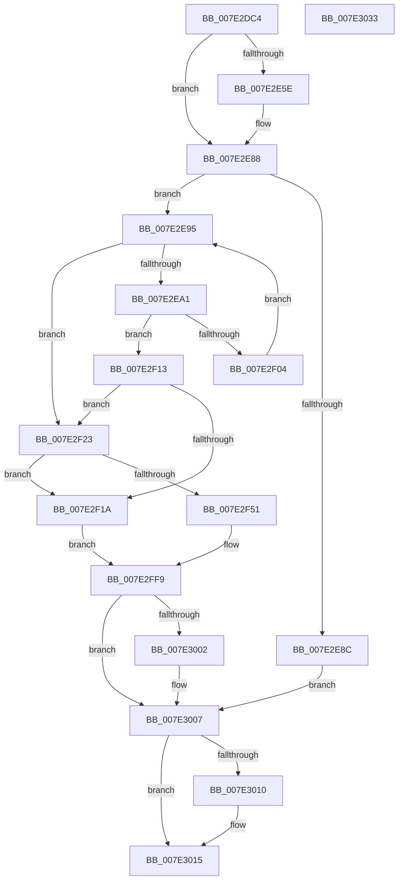

# CmpAddAcpiAliasEntry

- RVA: `0x007E2DC4`–`0x007E3034` (길이 `624` bytes)
- VA: `0x00000001407E2DC4`
- 실행 섹션: `PAGE`
- PDB 이름 있음: `예`; PDB Function 태그: `아니요`
- unwind 정보 RVA: `0x000D2104`
- 디코드: `159`개 명령, `624/624` bytes 표시
- 미해석 바이트: `0` (있으면 어셈블리에 `.byte`로 보존)

> 이 문서는 커널 이미지의 기계어와 PDB 기호를 분석해 생성했습니다. 4번과 5번은 함수 원형과 자료형을 바이너리 사용 방식에서 추정한 C 해석이며 원본 소스 복구 결과는 아닙니다.

## 1. Dependencies

- 직접 호출 지점: **16**; 고유 호출 대상: **6**
- 직접 호출자로 확인된 함수: **1**
- RIP 상대 이미지 참조: **5**

### Outgoing calls
- `0x007E2E1C` → [RtlInitUnicodeString](../../text/42/RtlInitUnicodeString_function_0042A780.md) (function, `0x0042A780`)
- `0x007E2E50` → [ZwOpenKey](../../text/6A/ZwOpenKey_function_006AD310.md) (function, `0x006AD310`)
- `0x007E2E81` → [ZwCreateKey](../../text/6A/ZwCreateKey_function_006AD470.md) (function, `0x006AD470`)
- `0x007E2EB5` → [swprintf_s](../../text/50/swprintf_s_function_00504B20.md) (function, `0x00504B20`)
- `0x007E2EC1` → [RtlInitUnicodeString](../../text/42/RtlInitUnicodeString_function_0042A780.md) (function, `0x0042A780`)
- `0x007E2EF9` → [ZwOpenKey](../../text/6A/ZwOpenKey_function_006AD310.md) (function, `0x006AD310`)
- `0x007E2F08` → [ZwClose](../../text/6A/ZwClose_function_006AD2B0.md) (function, `0x006AD2B0`)
- `0x007E2F46` → [ZwCreateKey](../../text/6A/ZwCreateKey_function_006AD470.md) (function, `0x006AD470`)
- `0x007E2F63` → [RtlInitUnicodeString](../../text/42/RtlInitUnicodeString_function_0042A780.md) (function, `0x0042A780`)
- `0x007E2F88` → [ZwSetValueKey](../../text/6A/ZwSetValueKey_function_006ADCD0.md) (function, `0x006ADCD0`)
- `0x007E2F98` → [RtlInitUnicodeString](../../text/42/RtlInitUnicodeString_function_0042A780.md) (function, `0x0042A780`)
- `0x007E2FBE` → [ZwSetValueKey](../../text/6A/ZwSetValueKey_function_006ADCD0.md) (function, `0x006ADCD0`)
- `0x007E2FD2` → [RtlInitUnicodeString](../../text/42/RtlInitUnicodeString_function_0042A780.md) (function, `0x0042A780`)
- `0x007E2FF2` → [ZwSetValueKey](../../text/6A/ZwSetValueKey_function_006ADCD0.md) (function, `0x006ADCD0`)
- `0x007E3002` → [ZwClose](../../text/6A/ZwClose_function_006AD2B0.md) (function, `0x006AD2B0`)
- `0x007E3010` → [ZwClose](../../text/6A/ZwClose_function_006AD2B0.md) (function, `0x006AD2B0`)

### Direct callers
- [CmSetAcpiHwProfile](CmSetAcpiHwProfile_function_007E2584.md) at `0x007E2CDC`

### Static image references
- `0x007E2DF4` → RVA `0x00B092F0` (` ?? ::NNGAKEGL::`string'`; read)
- `0x007E2EA3` → RVA `0x00B09280` (` ?? ::NNGAKEGL::`string'`; read)
- `0x007E2F55` → RVA `0x00B092B0` (` ?? ::NNGAKEGL::`string'`; read)
- `0x007E2F8D` → RVA `0x00B09250` (` ?? ::NNGAKEGL::`string'`; read)
- `0x007E2FC3` → RVA `0x00B09290` (` ?? ::NNGAKEGL::`string'`; read)

## 2. Other-region calls and transfers

- 다른 실행 섹션으로 향하는 call: **16**
  - `0x007E2E1C` → [RtlInitUnicodeString](../../text/42/RtlInitUnicodeString_function_0042A780.md) (`PAGE` → `.text`)
  - `0x007E2E50` → [ZwOpenKey](../../text/6A/ZwOpenKey_function_006AD310.md) (`PAGE` → `.text`)
  - `0x007E2E81` → [ZwCreateKey](../../text/6A/ZwCreateKey_function_006AD470.md) (`PAGE` → `.text`)
  - `0x007E2EB5` → [swprintf_s](../../text/50/swprintf_s_function_00504B20.md) (`PAGE` → `.text`)
  - `0x007E2EC1` → [RtlInitUnicodeString](../../text/42/RtlInitUnicodeString_function_0042A780.md) (`PAGE` → `.text`)
  - `0x007E2EF9` → [ZwOpenKey](../../text/6A/ZwOpenKey_function_006AD310.md) (`PAGE` → `.text`)
  - `0x007E2F08` → [ZwClose](../../text/6A/ZwClose_function_006AD2B0.md) (`PAGE` → `.text`)
  - `0x007E2F46` → [ZwCreateKey](../../text/6A/ZwCreateKey_function_006AD470.md) (`PAGE` → `.text`)
  - `0x007E2F63` → [RtlInitUnicodeString](../../text/42/RtlInitUnicodeString_function_0042A780.md) (`PAGE` → `.text`)
  - `0x007E2F88` → [ZwSetValueKey](../../text/6A/ZwSetValueKey_function_006ADCD0.md) (`PAGE` → `.text`)
  - `0x007E2F98` → [RtlInitUnicodeString](../../text/42/RtlInitUnicodeString_function_0042A780.md) (`PAGE` → `.text`)
  - `0x007E2FBE` → [ZwSetValueKey](../../text/6A/ZwSetValueKey_function_006ADCD0.md) (`PAGE` → `.text`)
  - `0x007E2FD2` → [RtlInitUnicodeString](../../text/42/RtlInitUnicodeString_function_0042A780.md) (`PAGE` → `.text`)
  - `0x007E2FF2` → [ZwSetValueKey](../../text/6A/ZwSetValueKey_function_006ADCD0.md) (`PAGE` → `.text`)
  - `0x007E3002` → [ZwClose](../../text/6A/ZwClose_function_006AD2B0.md) (`PAGE` → `.text`)
  - `0x007E3010` → [ZwClose](../../text/6A/ZwClose_function_006AD2B0.md) (`PAGE` → `.text`)
- 별도 외부 분기/꼬리 이동을 확인하지 못했습니다.

## 3. Assembly (complete function range)

```asm
007E2DC4  48 89 5C 24 10                  mov qword ptr [rsp + 0x10], rbx
007E2DC9  48 89 74 24 18                  mov qword ptr [rsp + 0x18], rsi
007E2DCE  55                              push rbp
007E2DCF  57                              push rdi
007E2DD0  41 54                           push r12
007E2DD2  41 56                           push r14
007E2DD4  41 57                           push r15
007E2DD6  48 8B EC                        mov rbp, rsp
007E2DD9  48 81 EC 80 00 00 00            sub rsp, 0x80
007E2DE0  45 33 E4                        xor r12d, r12d
007E2DE3  4C 8B F2                        mov r14, rdx
007E2DE6  48 8B D9                        mov rbx, rcx
007E2DE9  44 89 65 D4                     mov dword ptr [rbp - 0x2c], r12d
007E2DED  0F 57 C0                        xorps xmm0, xmm0
007E2DF0  44 89 65 EC                     mov dword ptr [rbp - 0x14], r12d
007E2DF4  48 8D 15 F5 64 32 00            lea rdx, [rip + 0x3264f5]
007E2DFB  4C 89 65 58                     mov qword ptr [rbp + 0x58], r12
007E2DFF  48 8D 4D C0                     lea rcx, [rbp - 0x40]
007E2E03  4C 89 65 30                     mov qword ptr [rbp + 0x30], r12
007E2E07  0F 11 45 C0                     movups xmmword ptr [rbp - 0x40], xmm0
007E2E0B  44 89 65 68                     mov dword ptr [rbp + 0x68], r12d
007E2E0F  41 8B FC                        mov edi, r12d
007E2E12  44 89 65 50                     mov dword ptr [rbp + 0x50], r12d
007E2E16  49 8B F1                        mov rsi, r9
007E2E19  45 8B F8                        mov r15d, r8d
007E2E1C  E8 5F 79 C4 FF                  call 0x14042a780
007E2E21  48 8D 45 C0                     lea rax, [rbp - 0x40]
007E2E25  C7 45 D0 30 00 00 00            mov dword ptr [rbp - 0x30], 0x30
007E2E2C  0F 57 C0                        xorps xmm0, xmm0
007E2E2F  48 89 45 E0                     mov qword ptr [rbp - 0x20], rax
007E2E33  4C 8D 45 D0                     lea r8, [rbp - 0x30]
007E2E37  48 89 5D D8                     mov qword ptr [rbp - 0x28], rbx
007E2E3B  BA 1F 00 02 00                  mov edx, 0x2001f
007E2E40  C7 45 E8 40 02 00 00            mov dword ptr [rbp - 0x18], 0x240
007E2E47  48 8D 4D 58                     lea rcx, [rbp + 0x58]
007E2E4B  F3 0F 7F 45 F0                  movdqu xmmword ptr [rbp - 0x10], xmm0
007E2E50  E8 BB A4 EC FF                  call 0x1406ad310
007E2E55  8B D8                           mov ebx, eax
007E2E57  3D 34 00 00 C0                  cmp eax, 0xc0000034
007E2E5C  75 2A                           jne 0x1407e2e88
007E2E5E  48 8D 45 50                     lea rax, [rbp + 0x50]
007E2E62  45 33 C9                        xor r9d, r9d
007E2E65  48 89 44 24 30                  mov qword ptr [rsp + 0x30], rax
007E2E6A  4C 8D 45 D0                     lea r8, [rbp - 0x30]
007E2E6E  44 89 64 24 28                  mov dword ptr [rsp + 0x28], r12d
007E2E73  48 8D 4D 58                     lea rcx, [rbp + 0x58]
007E2E77  BA 1F 00 02 00                  mov edx, 0x2001f
007E2E7C  4C 89 64 24 20                  mov qword ptr [rsp + 0x20], r12
007E2E81  E8 EA A5 EC FF                  call 0x1406ad470
007E2E86  8B D8                           mov ebx, eax
007E2E88  85 DB                           test ebx, ebx
007E2E8A  79 09                           jns 0x1407e2e95
007E2E8C  4C 89 65 58                     mov qword ptr [rbp + 0x58], r12
007E2E90  E9 72 01 00 00                  jmp 0x1407e3007
007E2E95  81 FF C8 00 00 00               cmp edi, 0xc8
007E2E9B  0F 83 82 00 00 00               jae 0x1407e2f23
007E2EA1  FF C7                           inc edi
007E2EA3  4C 8D 05 D6 63 32 00            lea r8, [rip + 0x3263d6]
007E2EAA  44 8B CF                        mov r9d, edi
007E2EAD  BA 80 00 00 00                  mov edx, 0x80
007E2EB2  48 8B CE                        mov rcx, rsi
007E2EB5  E8 66 1C D2 FF                  call 0x140504b20
007E2EBA  48 8B D6                        mov rdx, rsi
007E2EBD  48 8D 4D C0                     lea rcx, [rbp - 0x40]
007E2EC1  E8 BA 78 C4 FF                  call 0x14042a780
007E2EC6  48 8B 45 58                     mov rax, qword ptr [rbp + 0x58]
007E2ECA  4C 8D 45 D0                     lea r8, [rbp - 0x30]
007E2ECE  48 89 45 D8                     mov qword ptr [rbp - 0x28], rax
007E2ED2  48 8D 4D 30                     lea rcx, [rbp + 0x30]
007E2ED6  48 8D 45 C0                     lea rax, [rbp - 0x40]
007E2EDA  C7 45 D0 30 00 00 00            mov dword ptr [rbp - 0x30], 0x30
007E2EE1  0F 57 C0                        xorps xmm0, xmm0
007E2EE4  48 89 45 E0                     mov qword ptr [rbp - 0x20], rax
007E2EE8  BA 1F 00 02 00                  mov edx, 0x2001f
007E2EED  C7 45 E8 40 02 00 00            mov dword ptr [rbp - 0x18], 0x240
007E2EF4  F3 0F 7F 45 F0                  movdqu xmmword ptr [rbp - 0x10], xmm0
007E2EF9  E8 12 A4 EC FF                  call 0x1406ad310
007E2EFE  8B D8                           mov ebx, eax
007E2F00  85 C0                           test eax, eax
007E2F02  78 0F                           js 0x1407e2f13
007E2F04  48 8B 4D 30                     mov rcx, qword ptr [rbp + 0x30]
007E2F08  E8 A3 A3 EC FF                  call 0x1406ad2b0
007E2F0D  4C 89 65 30                     mov qword ptr [rbp + 0x30], r12
007E2F11  EB 82                           jmp 0x1407e2e95
007E2F13  3D 34 00 00 C0                  cmp eax, 0xc0000034
007E2F18  74 09                           je 0x1407e2f23
007E2F1A  4C 89 65 30                     mov qword ptr [rbp + 0x30], r12
007E2F1E  E9 D6 00 00 00                  jmp 0x1407e2ff9
007E2F23  48 8D 45 50                     lea rax, [rbp + 0x50]
007E2F27  45 33 C9                        xor r9d, r9d
007E2F2A  48 89 44 24 30                  mov qword ptr [rsp + 0x30], rax
007E2F2F  4C 8D 45 D0                     lea r8, [rbp - 0x30]
007E2F33  44 89 64 24 28                  mov dword ptr [rsp + 0x28], r12d
007E2F38  48 8D 4D 30                     lea rcx, [rbp + 0x30]
007E2F3C  BA 1F 00 02 00                  mov edx, 0x2001f
007E2F41  4C 89 64 24 20                  mov qword ptr [rsp + 0x20], r12
007E2F46  E8 25 A5 EC FF                  call 0x1406ad470
007E2F4B  8B D8                           mov ebx, eax
007E2F4D  85 C0                           test eax, eax
007E2F4F  78 C9                           js 0x1407e2f1a
007E2F51  41 0F B7 06                     movzx eax, word ptr [r14]
007E2F55  48 8D 15 54 63 32 00            lea rdx, [rip + 0x326354]
007E2F5C  48 8D 4D C0                     lea rcx, [rbp - 0x40]
007E2F60  89 45 68                        mov dword ptr [rbp + 0x68], eax
007E2F63  E8 18 78 C4 FF                  call 0x14042a780
007E2F68  48 8B 4D 30                     mov rcx, qword ptr [rbp + 0x30]
007E2F6C  48 8D 45 68                     lea rax, [rbp + 0x68]
007E2F70  BB 04 00 00 00                  mov ebx, 4
007E2F75  48 8D 55 C0                     lea rdx, [rbp - 0x40]
007E2F79  89 5C 24 28                     mov dword ptr [rsp + 0x28], ebx
007E2F7D  44 8B CB                        mov r9d, ebx
007E2F80  45 33 C0                        xor r8d, r8d
007E2F83  48 89 44 24 20                  mov qword ptr [rsp + 0x20], rax
007E2F88  E8 43 AD EC FF                  call 0x1406adcd0
007E2F8D  48 8D 15 BC 62 32 00            lea rdx, [rip + 0x3262bc]
007E2F94  48 8D 4D C0                     lea rcx, [rbp - 0x40]
007E2F98  E8 E3 77 C4 FF                  call 0x14042a780
007E2F9D  41 0F B7 46 02                  movzx eax, word ptr [r14 + 2]
007E2FA2  49 8D 4E 04                     lea rcx, [r14 + 4]
007E2FA6  89 44 24 28                     mov dword ptr [rsp + 0x28], eax
007E2FAA  44 8D 4B FF                     lea r9d, [rbx - 1]
007E2FAE  48 89 4C 24 20                  mov qword ptr [rsp + 0x20], rcx
007E2FB3  48 8D 55 C0                     lea rdx, [rbp - 0x40]
007E2FB7  48 8B 4D 30                     mov rcx, qword ptr [rbp + 0x30]
007E2FBB  45 33 C0                        xor r8d, r8d
007E2FBE  E8 0D AD EC FF                  call 0x1406adcd0
007E2FC3  48 8D 15 C6 62 32 00            lea rdx, [rip + 0x3262c6]
007E2FCA  44 89 7D 68                     mov dword ptr [rbp + 0x68], r15d
007E2FCE  48 8D 4D C0                     lea rcx, [rbp - 0x40]
007E2FD2  E8 A9 77 C4 FF                  call 0x14042a780
007E2FD7  48 8B 4D 30                     mov rcx, qword ptr [rbp + 0x30]
007E2FDB  48 8D 45 68                     lea rax, [rbp + 0x68]
007E2FDF  89 5C 24 28                     mov dword ptr [rsp + 0x28], ebx
007E2FE3  48 8D 55 C0                     lea rdx, [rbp - 0x40]
007E2FE7  44 8B CB                        mov r9d, ebx
007E2FEA  48 89 44 24 20                  mov qword ptr [rsp + 0x20], rax
007E2FEF  45 33 C0                        xor r8d, r8d
007E2FF2  E8 D9 AC EC FF                  call 0x1406adcd0
007E2FF7  8B D8                           mov ebx, eax
007E2FF9  48 8B 4D 58                     mov rcx, qword ptr [rbp + 0x58]
007E2FFD  48 85 C9                        test rcx, rcx
007E3000  74 05                           je 0x1407e3007
007E3002  E8 A9 A2 EC FF                  call 0x1406ad2b0
007E3007  48 8B 4D 30                     mov rcx, qword ptr [rbp + 0x30]
007E300B  48 85 C9                        test rcx, rcx
007E300E  74 05                           je 0x1407e3015
007E3010  E8 9B A2 EC FF                  call 0x1406ad2b0
007E3015  4C 8D 9C 24 80 00 00 00         lea r11, [rsp + 0x80]
007E301D  8B C3                           mov eax, ebx
007E301F  49 8B 5B 38                     mov rbx, qword ptr [r11 + 0x38]
007E3023  49 8B 73 40                     mov rsi, qword ptr [r11 + 0x40]
007E3027  49 8B E3                        mov rsp, r11
007E302A  41 5F                           pop r15
007E302C  41 5E                           pop r14
007E302E  41 5C                           pop r12
007E3030  5F                              pop rdi
007E3031  5D                              pop rbp
007E3032  C3                              ret
007E3033  CC                              int3
```

## 4. C-style interpretation (structured pseudocode)

```c
__int64 __fastcall CmpAddAcpiAliasEntry(__int64 a1, __int64 a2, int a3, __int64 a4, __int64 a5, __int64 a6, __int64 a7, __int64 a8)
{
    __int64 result;
    __int64 v_r12;
    __int64 v_rbx;
    __int64 v_rdi;
    __int64 v_rsp;
    unsigned __int64 v_stack_m28;
    unsigned __int64 v_stack_m38;
    unsigned int v_stack_m3C;
    unsigned int v_stack_m40;
    unsigned __int64 v_stack_m48;
    unsigned __int64 v_stack_m50;
    unsigned int v_stack_m54;
    unsigned int v_stack_m58;
    unsigned __int64 v_stack_m68;
    unsigned __int64 v_stack_m78;
    unsigned int v_stack_m80;
    unsigned __int64 v_stack_m88;
    unsigned __int64 v_stack_p10;
    unsigned __int64 v_stack_p18;
    unsigned int v_stack_p28;
    unsigned __int64 v_stack_p30;
    unsigned int v_stack_p40;
    unsigned __int64 v_stack_p8;

    v_stack_p10 = v_rbx;
    v_stack_p18 = v_rsi;
    v_rsp = (v_rsp) - (128);
    v_r12 = 0;
    v_stack_m54 = 0;
    v_stack_m3C = 0;
    v_stack_p30 = 0;
    v_stack_p8 = 0;
    v_stack_m68 = v_xmm0;
    v_stack_p40 = 0;
    v_stack_p28 = 0;
    result = RtlInitUnicodeString(v_stack_m68, v_rip + 3302645, a3, a4);
    v_stack_m58 = 48;
    v_stack_m48 = v_stack_m68;
    v_stack_m50 = a1;
    v_stack_m40 = 576;
    v_stack_m38 = v_xmm0;
    result = ZwOpenKey(a6, (unsigned int)(0x2001FULL), v_stack_m58, a4);
    v_rbx = (unsigned int)((unsigned int)(result));
    if (((unsigned int)(result)) == 0xC0000034ULL) {
        result = a5;
        a4 = 0;
        v_stack_m78 = result;
        a3 = v_stack_m58;
        v_stack_m80 = 0;
        a1 = a6;
        a2 = 0x2001FULL;
        v_stack_m88 = 0;
        result = ZwCreateKey(a1, a2, a3, a4);
        v_rbx = (unsigned int)(result);
    }
    if (!sign_flag) goto loc_007E2E95;
    v_stack_p30 = 0;
    goto loc_007E3007;
loc_007E2E95:
    if (0 >= 200) goto loc_007E2F23;
    v_rdi = (unsigned int)((0) + 1);
    result = swprintf_s(0, 128, v_rip + 3302358, (unsigned int)((unsigned int)(v_rdi)));
    result = RtlInitUnicodeString(v_stack_m68, 0, v_rip + 3302358, (unsigned int)((unsigned int)(v_rdi)));
    v_stack_m50 = a6;
    v_stack_m58 = 48;
    v_stack_m48 = v_stack_m68;
    v_stack_m40 = 576;
    v_stack_m38 = v_xmm0;
    result = ZwOpenKey(v_stack_p8, (unsigned int)(0x2001FULL), v_stack_m58, (unsigned int)((unsigned int)(v_rdi)));
    if (sign_flag) goto loc_007E2F13;
    result = ZwClose(v_stack_p8, (unsigned int)(0x2001FULL), v_stack_m58, (unsigned int)((unsigned int)(v_rdi)));
    v_stack_p8 = 0;
    goto loc_007E2E95;
loc_007E2F13:
    if (((unsigned int)(result)) == 0xC0000034ULL) goto loc_007E2F23;
loc_007E2F1A:
    v_stack_p8 = 0;
    goto loc_007E2FF9;
loc_007E2F23:
    a4 = 0;
    v_stack_m78 = a5;
    v_stack_m80 = 0;
    v_stack_m88 = 0;
    result = ZwCreateKey(v_stack_p8, (unsigned int)(0x2001FULL), v_stack_m58, a4);
    if (sign_flag) goto loc_007E2F1A;
    v_stack_p40 = (unsigned int)(*(unsigned __int16 *)(a2));
    result = RtlInitUnicodeString(v_stack_m68, v_rip + 3302228, v_stack_m58, a4);
    v_stack_m80 = 4;
    a3 = 0;
    v_stack_m88 = a8;
    result = ZwSetValueKey(v_stack_p8, v_stack_m68, a3, 4);
    result = RtlInitUnicodeString(v_stack_m68, v_rip + 3302076, a3, 4);
    v_stack_m80 = (unsigned int)(*(unsigned __int16 *)(a2 + 2));
    v_stack_m88 = a2 + 4;
    a3 = 0;
    result = ZwSetValueKey(v_stack_p8, v_stack_m68, a3, 4 - 1);
    v_stack_p40 = (unsigned int)((unsigned int)(a3));
    result = RtlInitUnicodeString(v_stack_m68, v_rip + 3302086, a3, 4 - 1);
    v_stack_m80 = 4;
    v_stack_m88 = a8;
    a3 = 0;
    result = ZwSetValueKey(v_stack_p8, v_stack_m68, a3, 4);
loc_007E2FF9:
    if (a6 != 0) {
        result = ZwClose(a6, v_stack_m68, a3, 4);
    }
    if (v_stack_p8 != 0) {
        result = ZwClose(v_stack_p8, v_stack_m68, a3, 4);
    }
    return (unsigned int)((unsigned int)((unsigned int)((unsigned int)(result))));
}
```

## 5. (Beta) C Style

```c
int64_t CmpAddAcpiAliasEntry(int64_t Arg1, void *Arg2, int32_t Arg3, int64_t Arg4, int64_t Arg5, int64_t Arg6, uint64_t Arg7, int64_t Arg8)
{
    uint8_t *arg2 = (uint8_t *)Arg2;

    int64_t result;
    int64_t local_r12;
    int64_t local_rbx;
    int64_t local_rdi;
    int64_t local_rsp;
    uint64_t v_stack_m28;
    uint64_t v_stack_m38;
    uint32_t v_stack_m3C;
    uint32_t v_stack_m40;
    uint64_t v_stack_m48;
    uint64_t v_stack_m50;
    uint32_t v_stack_m54;
    uint32_t v_stack_m58;
    uint64_t v_stack_m68;
    uint64_t v_stack_m78;
    uint32_t v_stack_m80;
    uint64_t v_stack_m88;
    uint64_t v_stack_p10;
    uint64_t v_stack_p18;
    uint32_t v_stack_p28;
    uint64_t v_stack_p30;
    uint32_t v_stack_p40;
    uint64_t v_stack_p8;

    v_stack_p10 = local_rbx;
    v_stack_p18 = local_rsi;
    local_rsp = (local_rsp) - (128);
    local_r12 = 0;
    v_stack_m54 = 0;
    v_stack_m3C = 0;
    v_stack_p30 = 0;
    v_stack_p8 = 0;
    v_stack_m68 = v_xmm0;
    v_stack_p40 = 0;
    v_stack_p28 = 0;
    result = RtlInitUnicodeString(v_stack_m68, v_rip + 3302645, Arg3, Arg4);
    v_stack_m58 = 48;
    v_stack_m48 = v_stack_m68;
    v_stack_m50 = Arg1;
    v_stack_m40 = 576;
    v_stack_m38 = v_xmm0;
    result = ZwOpenKey(Arg6, (uint32_t)(0x2001FULL), v_stack_m58, Arg4);
    local_rbx = (uint32_t)((uint32_t)(result));
    if (((uint32_t)(result)) == 0xC0000034ULL) {
        result = Arg5;
        Arg4 = 0;
        v_stack_m78 = result;
        Arg3 = v_stack_m58;
        v_stack_m80 = 0;
        Arg1 = Arg6;
        Arg2 = 0x2001FULL;
        v_stack_m88 = 0;
        result = ZwCreateKey(Arg1, Arg2, Arg3, Arg4);
        local_rbx = (uint32_t)(result);
    }
    if (!sign_flag) goto loc_007E2E95;
    v_stack_p30 = 0;
    goto loc_007E3007;
loc_007E2E95:
    if (0 >= 200) goto loc_007E2F23;
    local_rdi = (uint32_t)((0) + 1);
    result = swprintf_s(0, 128, v_rip + 3302358, (uint32_t)((uint32_t)(local_rdi)));
    result = RtlInitUnicodeString(v_stack_m68, 0, v_rip + 3302358, (uint32_t)((uint32_t)(local_rdi)));
    v_stack_m50 = Arg6;
    v_stack_m58 = 48;
    v_stack_m48 = v_stack_m68;
    v_stack_m40 = 576;
    v_stack_m38 = v_xmm0;
    result = ZwOpenKey(v_stack_p8, (uint32_t)(0x2001FULL), v_stack_m58, (uint32_t)((uint32_t)(local_rdi)));
    if (sign_flag) goto loc_007E2F13;
    result = ZwClose(v_stack_p8, (uint32_t)(0x2001FULL), v_stack_m58, (uint32_t)((uint32_t)(local_rdi)));
    v_stack_p8 = 0;
    goto loc_007E2E95;
loc_007E2F13:
    if (((uint32_t)(result)) == 0xC0000034ULL) goto loc_007E2F23;
loc_007E2F1A:
    v_stack_p8 = 0;
    goto loc_007E2FF9;
loc_007E2F23:
    Arg4 = 0;
    v_stack_m78 = Arg5;
    v_stack_m80 = 0;
    v_stack_m88 = 0;
    result = ZwCreateKey(v_stack_p8, (uint32_t)(0x2001FULL), v_stack_m58, Arg4);
    if (sign_flag) goto loc_007E2F1A;
    v_stack_p40 = (uint32_t)(*(uint16_t *)(arg2));
    result = RtlInitUnicodeString(v_stack_m68, v_rip + 3302228, v_stack_m58, Arg4);
    v_stack_m80 = 4;
    Arg3 = 0;
    v_stack_m88 = Arg8;
    result = ZwSetValueKey(v_stack_p8, v_stack_m68, Arg3, 4);
    result = RtlInitUnicodeString(v_stack_m68, v_rip + 3302076, Arg3, 4);
    v_stack_m80 = (uint32_t)(*(uint16_t *)(arg2 + 0x2));
    v_stack_m88 = Arg2 + 4;
    Arg3 = 0;
    result = ZwSetValueKey(v_stack_p8, v_stack_m68, Arg3, 4 - 1);
    v_stack_p40 = (uint32_t)((uint32_t)(Arg3));
    result = RtlInitUnicodeString(v_stack_m68, v_rip + 3302086, Arg3, 4 - 1);
    v_stack_m80 = 4;
    v_stack_m88 = Arg8;
    Arg3 = 0;
    result = ZwSetValueKey(v_stack_p8, v_stack_m68, Arg3, 4);
loc_007E2FF9:
    if (Arg6 != 0) {
        result = ZwClose(Arg6, v_stack_m68, Arg3, 4);
    }
    if (v_stack_p8 != 0) {
        result = ZwClose(v_stack_p8, v_stack_m68, Arg3, 4);
    }
    return (uint32_t)((uint32_t)((uint32_t)((uint32_t)(result))));
}
```

### 관측된 메모리 오프셋

구조체 형식이 확인되지 않은 접근은 인자 기준의 오프셋으로만 기록했습니다.

| 기준 인자 | 오프셋 표현 | 폭 (bit) | 접근 |
|---|---:|---:|---|
| `Arg2` | `+ 0x0` | `16` | `R` |
| `Arg2` | `+ 0x2` | `16` | `R` |
| `Arg2` | `+ 0x4` | `64` | `R` |

## 6. Execution-region graph

[열기: 2D/3D 그래프와 함수 탐색 컨트롤 패널](../../../control-panel.html?section=page&rva=0x007E2DC4&view=graph)

- 2D 그래프는 위에서 아래로 흐르고, 3D 그래프는 빈 공간을 드래그해 회전합니다. Shift+드래그는 이동, 휠은 확대·축소, 함수 노드 선택은 대상 보고서 이동입니다.

### Static fallback


