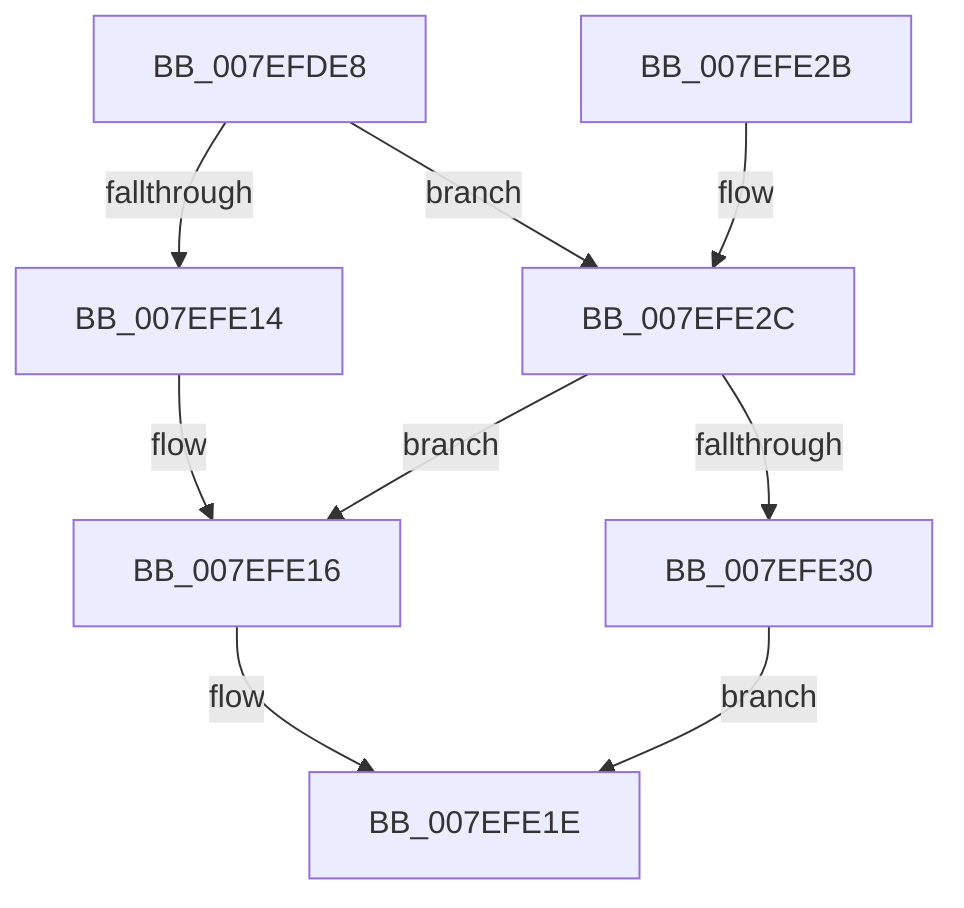

# CmpAddEnlistmentToRollbackPacket

- RVA: `0x007EFDE8`–`0x007EFE34` (길이 `76` bytes)
- VA: `0x00000001407EFDE8`
- 실행 섹션: `PAGE`
- PDB 이름 있음: `예`; PDB Function 태그: `아니요`
- unwind 정보 RVA: `0x0007B104`
- 디코드: `26`개 명령, `76/76` bytes 표시
- 미해석 바이트: `0` (있으면 어셈블리에 `.byte`로 보존)

> 이 문서는 커널 이미지의 기계어와 PDB 기호를 분석해 생성했습니다. 4번과 5번은 함수 원형과 자료형을 바이너리 사용 방식에서 추정한 C 해석이며 원본 소스 복구 결과는 아닙니다.

## 1. Dependencies

- 직접 호출 지점: **3**; 고유 호출 대상: **3**
- 직접 호출자로 확인된 함수: **1**
- RIP 상대 이미지 참조: **0**

### Outgoing calls
- `0x007EFDFB` → [ObfReferenceObject](../../text/20/ObfReferenceObject_function_0020FA20.md) (function, `0x0020FA20`)
- `0x007EFE06` → [CmpAddPointerToRollbackPacket](CmpAddPointerToRollbackPacket_function_007EFE3C.md) (function, `0x007EFE3C`)
- `0x007EFE19` → [ObfDereferenceObject](../../text/2F/ObfDereferenceObject_function_002F9350.md) (function, `0x002F9350`)

### Direct callers
- [CmSnapshotRMTxArray](../9A/CmSnapshotRMTxArray_function_009AEC9C.md) at `0x009AED2C`

### Static image references
- 디코드된 RIP-relative 메모리 참조가 없습니다.

## 2. Other-region calls and transfers

- 다른 실행 섹션으로 향하는 call: **2**
  - `0x007EFDFB` → [ObfReferenceObject](../../text/20/ObfReferenceObject_function_0020FA20.md) (`PAGE` → `.text`)
  - `0x007EFE19` → [ObfDereferenceObject](../../text/2F/ObfDereferenceObject_function_002F9350.md) (`PAGE` → `.text`)
- 별도 외부 분기/꼬리 이동을 확인하지 못했습니다.

## 3. Assembly (complete function range)

```asm
007EFDE8  48 89 5C 24 08                  mov qword ptr [rsp + 8], rbx
007EFDED  57                              push rdi
007EFDEE  48 83 EC 20                     sub rsp, 0x20
007EFDF2  48 8B D9                        mov rbx, rcx
007EFDF5  48 8B FA                        mov rdi, rdx
007EFDF8  48 8B CA                        mov rcx, rdx
007EFDFB  E8 20 FC A1 FF                  call 0x14020fa20
007EFE00  48 8B D7                        mov rdx, rdi
007EFE03  48 8B CB                        mov rcx, rbx
007EFE06  E8 31 00 00 00                  call 0x1407efe3c
007EFE0B  8B D8                           mov ebx, eax
007EFE0D  3D 18 07 00 C0                  cmp eax, 0xc0000718
007EFE12  75 18                           jne 0x1407efe2c
007EFE14  33 DB                           xor ebx, ebx
007EFE16  48 8B CF                        mov rcx, rdi
007EFE19  E8 32 95 B0 FF                  call 0x1402f9350
007EFE1E  8B C3                           mov eax, ebx
007EFE20  48 8B 5C 24 30                  mov rbx, qword ptr [rsp + 0x30]
007EFE25  48 83 C4 20                     add rsp, 0x20
007EFE29  5F                              pop rdi
007EFE2A  C3                              ret
007EFE2B  CC                              int3
007EFE2C  85 C0                           test eax, eax
007EFE2E  78 E6                           js 0x1407efe16
007EFE30  33 DB                           xor ebx, ebx
007EFE32  EB EA                           jmp 0x1407efe1e
```

## 4. C-style interpretation (structured pseudocode)

```c
__int64 __fastcall CmpAddEnlistmentToRollbackPacket(__int64 a1, __int64 a2)
{
    __int64 result;
    __int64 v_rbx;
    __int64 v_rsp;
    unsigned __int64 v_stack_p8;

    v_stack_p8 = v_rbx;
    v_rsp = (v_rsp) - (32);
    result = ObfReferenceObject(a2, a2, a3, a4);
    result = CmpAddPointerToRollbackPacket(a1, a2, a3, a4);
    if (((unsigned int)(result)) != 0xC0000718ULL) goto loc_007EFE2C;
    v_rbx = 0;
loc_007EFE16:
    result = ObfDereferenceObject(a2, a2, a3, a4);
loc_007EFE1E:
    v_rsp = (v_rsp) + (32);
    return 0;
loc_007EFE2C:
    if (sign_flag) goto loc_007EFE16;
    v_rbx = 0;
    goto loc_007EFE1E;
}
```

## 5. (Beta) C Style

```c
int64_t CmpAddEnlistmentToRollbackPacket(int64_t Arg1, int64_t Arg2)
{
    int64_t result;
    int64_t local_rbx;
    int64_t local_rsp;
    uint64_t v_stack_p8;

    v_stack_p8 = local_rbx;
    local_rsp = (local_rsp) - (32);
    result = ObfReferenceObject(Arg2, Arg2, a3, a4);
    result = CmpAddPointerToRollbackPacket(Arg1, Arg2, a3, a4);
    if (((uint32_t)(result)) != 0xC0000718ULL) goto loc_007EFE2C;
    local_rbx = 0;
loc_007EFE16:
    result = ObfDereferenceObject(Arg2, Arg2, a3, a4);
loc_007EFE1E:
    local_rsp = (local_rsp) + (32);
    return 0;
loc_007EFE2C:
    if (sign_flag) goto loc_007EFE16;
    local_rbx = 0;
    goto loc_007EFE1E;
}
```

## 6. Execution-region graph

[열기: 2D/3D 그래프와 함수 탐색 컨트롤 패널](../../../control-panel.html?section=page&rva=0x007EFDE8&view=graph)

- 2D 그래프는 위에서 아래로 흐르고, 3D 그래프는 빈 공간을 드래그해 회전합니다. Shift+드래그는 이동, 휠은 확대·축소, 함수 노드 선택은 대상 보고서 이동입니다.

### Static fallback


