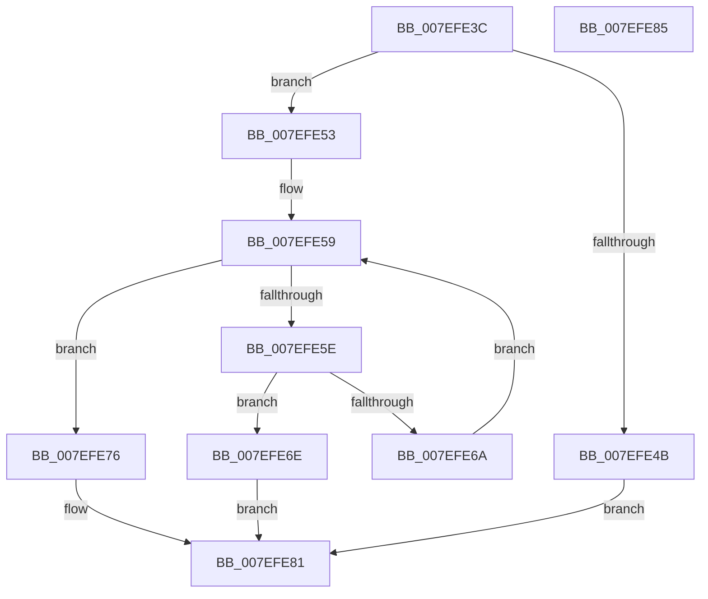

# CmpAddPointerToRollbackPacket

- RVA: `0x007EFE3C`–`0x007EFE86` (길이 `74` bytes)
- VA: `0x00000001407EFE3C`
- 실행 섹션: `PAGE`
- PDB 이름 있음: `예`; PDB Function 태그: `아니요`
- unwind 정보 RVA: `0x000DB714`
- 디코드: `25`개 명령, `74/74` bytes 표시
- 미해석 바이트: `0` (있으면 어셈블리에 `.byte`로 보존)

> 이 문서는 커널 이미지의 기계어와 PDB 기호를 분석해 생성했습니다. 4번과 5번은 함수 원형과 자료형을 바이너리 사용 방식에서 추정한 C 해석이며 원본 소스 복구 결과는 아닙니다.

## 1. Dependencies

- 직접 호출 지점: **0**; 고유 호출 대상: **0**
- 직접 호출자로 확인된 함수: **2**
- RIP 상대 이미지 참조: **0**

### Outgoing calls
- 직접 디코드된 call 명령이 없습니다.

### Direct callers
- [CmpAddEnlistmentToRollbackPacket](CmpAddEnlistmentToRollbackPacket_function_007EFDE8.md) at `0x007EFE06`
- [CmpAddUoWToRollbackPacket](CmpAddUoWToRollbackPacket_function_007EFE8C.md) at `0x007EFECB`

### Static image references
- 디코드된 RIP-relative 메모리 참조가 없습니다.

## 2. Other-region calls and transfers

- 다른 실행 섹션으로 향하는 call: **0**
- 별도 외부 분기/꼬리 이동을 확인하지 못했습니다.

## 3. Assembly (complete function range)

```asm
007EFE3C  44 8B 11                        mov r10d, dword ptr [rcx]
007EFE3F  4C 8B DA                        mov r11, rdx
007EFE42  4C 8B C9                        mov r9, rcx
007EFE45  44 39 51 04                     cmp dword ptr [rcx + 4], r10d
007EFE49  75 08                           jne 0x1407efe53
007EFE4B  41 B8 9A 00 00 C0               mov r8d, 0xc000009a
007EFE51  EB 2E                           jmp 0x1407efe81
007EFE53  45 33 C0                        xor r8d, r8d
007EFE56  41 8B D0                        mov edx, r8d
007EFE59  41 3B D2                        cmp edx, r10d
007EFE5C  73 18                           jae 0x1407efe76
007EFE5E  49 8B 41 08                     mov rax, qword ptr [r9 + 8]
007EFE62  8B CA                           mov ecx, edx
007EFE64  4C 39 1C C8                     cmp qword ptr [rax + rcx*8], r11
007EFE68  74 04                           je 0x1407efe6e
007EFE6A  FF C2                           inc edx
007EFE6C  EB EB                           jmp 0x1407efe59
007EFE6E  41 B8 18 07 00 C0               mov r8d, 0xc0000718
007EFE74  EB 0B                           jmp 0x1407efe81
007EFE76  49 8B 49 08                     mov rcx, qword ptr [r9 + 8]
007EFE7A  4E 89 1C D1                     mov qword ptr [rcx + r10*8], r11
007EFE7E  41 FF 01                        inc dword ptr [r9]
007EFE81  41 8B C0                        mov eax, r8d
007EFE84  C3                              ret
007EFE85  CC                              int3
```

## 4. C-style interpretation (structured pseudocode)

```c
__int64 __fastcall CmpAddPointerToRollbackPacket(__int64 a1, __int64 a2)
{
    if ((*(unsigned int *)(a1 + 4)) != ((unsigned int)((unsigned int)(*(unsigned int *)(a1))))) goto loc_007EFE53;
    goto loc_007EFE81;
loc_007EFE53:
    a3 = 0;
loc_007EFE59:
    if (0 >= ((unsigned int)((unsigned int)(*(unsigned int *)(a1))))) goto loc_007EFE76;
    if ((*(unsigned __int64 *)(*(unsigned __int64 *)(a1 + 8) + 0 * 8)) == a2) goto loc_007EFE6E;
    a2 = (unsigned int)((0) + 1);
    goto loc_007EFE59;
loc_007EFE6E:
    goto loc_007EFE81;
loc_007EFE76:
    *(unsigned __int64 *)(*(unsigned __int64 *)(a1 + 8) + (unsigned int)(*(unsigned int *)(a1)) * 8) = a2;
loc_007EFE81:
    return (unsigned int)((unsigned int)((unsigned int)(0xC0000718ULL)));
}
```

## 5. (Beta) C Style

```c
int64_t CmpAddPointerToRollbackPacket(void *Arg1, int64_t Arg2)
{
    uint8_t *arg1 = (uint8_t *)Arg1;

    if ((*(uint32_t *)(arg1 + 0x4)) != ((uint32_t)((uint32_t)(*(uint32_t *)(arg1))))) goto loc_007EFE53;
    goto loc_007EFE81;
loc_007EFE53:
    a3 = 0;
loc_007EFE59:
    if (0 >= ((uint32_t)((uint32_t)(*(uint32_t *)(arg1))))) goto loc_007EFE76;
    if ((*(uint64_t *)(*(uint64_t *)(arg1 + 0x8) + 0x0 * 8)) == Arg2) goto loc_007EFE6E;
    Arg2 = (uint32_t)((0) + 1);
    goto loc_007EFE59;
loc_007EFE6E:
    goto loc_007EFE81;
loc_007EFE76:
    *(uint64_t *)(*(uint64_t *)(arg1 + 0x8) + (uint32_t)(*(uint32_t *)(arg1)) * 8) = Arg2;
loc_007EFE81:
    return (uint32_t)((uint32_t)((uint32_t)(0xC0000718ULL)));
}
```

### 관측된 메모리 오프셋

구조체 형식이 확인되지 않은 접근은 인자 기준의 오프셋으로만 기록했습니다.

| 기준 인자 | 오프셋 표현 | 폭 (bit) | 접근 |
|---|---:|---:|---|
| `Arg1` | `+ 0x0` | `32` | `R` |
| `Arg1` | `+ 0x0` | `32` | `R/W` |
| `Arg1` | `+ 0x4` | `32` | `R` |
| `Arg1` | `+ 0x8` | `64` | `R` |

## 6. Execution-region graph

[열기: 2D/3D 그래프와 함수 탐색 컨트롤 패널](../../../control-panel.html?section=page&rva=0x007EFE3C&view=graph)

- 2D 그래프는 위에서 아래로 흐르고, 3D 그래프는 빈 공간을 드래그해 회전합니다. Shift+드래그는 이동, 휠은 확대·축소, 함수 노드 선택은 대상 보고서 이동입니다.

### Static fallback


