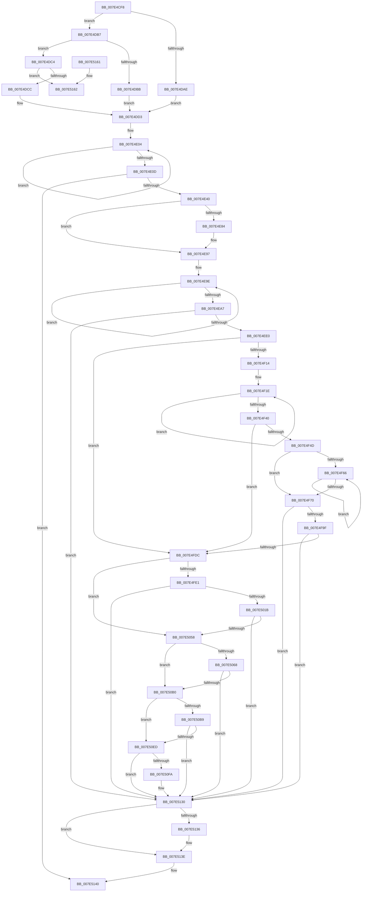

# CmpAddProcessorConfigurationEntry

- RVA: `0x007E4CF8`–`0x007E516D` (길이 `1,141` bytes)
- VA: `0x00000001407E4CF8`
- 실행 섹션: `PAGE`
- PDB 이름 있음: `예`; PDB Function 태그: `아니요`
- unwind 정보 RVA: `0x000D6AA8`
- 디코드: `285`개 명령, `1,141/1,141` bytes 표시
- 미해석 바이트: `0` (있으면 어셈블리에 `.byte`로 보존)

> 이 문서는 커널 이미지의 기계어와 PDB 기호를 분석해 생성했습니다. 4번과 5번은 함수 원형과 자료형을 바이너리 사용 방식에서 추정한 C 해석이며 원본 소스 복구 결과는 아닙니다.

## 1. Dependencies

- 직접 호출 지점: **26**; 고유 호출 대상: **12**
- 직접 호출자로 확인된 함수: **2**
- RIP 상대 이미지 참조: **11**

### Outgoing calls
- `0x007E4D6E` → [memset](../../text/6C/memset_function_006C6C40.md) (function, `0x006C6C40`)
- `0x007E4DF8` → [sprintf_s](../../text/50/sprintf_s_function_00505E40.md) (function, `0x00505E40`)
- `0x007E4E33` → [CmpInitializeRegistryNode](CmpInitializeRegistryNode_function_007EE81C.md) (function, `0x007EE81C`)
- `0x007E4E4A` → [memset](../../text/6C/memset_function_006C6C40.md) (function, `0x006C6C40`)
- `0x007E4E92` → [strcpy_s](../../text/50/strcpy_s_function_00505FB0.md) (function, `0x00505FB0`)
- `0x007E4ECC` → [CmpInitializeRegistryNode](CmpInitializeRegistryNode_function_007EE81C.md) (function, `0x007EE81C`)
- `0x007E4EE4` → [ZwClose](../../text/6A/ZwClose_function_006AD2B0.md) (function, `0x006AD2B0`)
- `0x007E4F59` → [RtlInitUnicodeString](../../text/42/RtlInitUnicodeString_function_0042A780.md) (function, `0x0042A780`)
- `0x007E4F7E` → [RtlInitAnsiString](../../text/47/RtlInitAnsiString_function_00470F40.md) (function, `0x00470F40`)
- `0x007E4F90` → [RtlAnsiStringToUnicodeString](../90/RtlAnsiStringToUnicodeString_function_0090BEA0.md) (function, `0x0090BEA0`)
- `0x007E4FC3` → [ZwSetValueKey](../../text/6A/ZwSetValueKey_function_006ADCD0.md) (function, `0x006ADCD0`)
- `0x007E4FCF` → [RtlFreeAnsiString](../9C/RtlFreeAnsiString_function_009C0800.md) (function, `0x009C0800`)
- `0x007E4FED` → [RtlInitUnicodeString](../../text/42/RtlInitUnicodeString_function_0042A780.md) (function, `0x0042A780`)
- `0x007E4FFA` → [RtlInitAnsiString](../../text/47/RtlInitAnsiString_function_00470F40.md) (function, `0x00470F40`)
- `0x007E500C` → [RtlAnsiStringToUnicodeString](../90/RtlAnsiStringToUnicodeString_function_0090BEA0.md) (function, `0x0090BEA0`)
- `0x007E503F` → [ZwSetValueKey](../../text/6A/ZwSetValueKey_function_006ADCD0.md) (function, `0x006ADCD0`)
- `0x007E504B` → [RtlFreeAnsiString](../9C/RtlFreeAnsiString_function_009C0800.md) (function, `0x009C0800`)
- `0x007E507F` → [RtlInitUnicodeString](../../text/42/RtlInitUnicodeString_function_0042A780.md) (function, `0x0042A780`)
- `0x007E50A1` → [ZwSetValueKey](../../text/6A/ZwSetValueKey_function_006ADCD0.md) (function, `0x006ADCD0`)
- `0x007E50C5` → [RtlInitUnicodeString](../../text/42/RtlInitUnicodeString_function_0042A780.md) (function, `0x0042A780`)
- `0x007E50E2` → [ZwSetValueKey](../../text/6A/ZwSetValueKey_function_006ADCD0.md) (function, `0x006ADCD0`)
- `0x007E5106` → [RtlInitUnicodeString](../../text/42/RtlInitUnicodeString_function_0042A780.md) (function, `0x0042A780`)
- `0x007E5129` → [ZwSetValueKey](../../text/6A/ZwSetValueKey_function_006ADCD0.md) (function, `0x006ADCD0`)
- `0x007E5139` → [ZwClose](../../text/6A/ZwClose_function_006AD2B0.md) (function, `0x006AD2B0`)
- `0x007E514A` → [_security_check_cookie](../../text/6A/_security_check_cookie_function_006AC640.md) (function, `0x006AC640`)
- `0x007E5167` → [KeBugCheck](../../text/4F/KeBugCheck_function_004FD640.md) (function, `0x004FD640`)

### Direct callers
- [CmInitializeProcessor](CmInitializeProcessor_function_007E4BAC.md) at `0x007E4CA1`
- [CmpInitializeMachineDependentConfiguration](../../init/C5/CmpInitializeMachineDependentConfiguration_function_00C5A02C.md) at `0x00C5A30D`

### Static image references
- `0x007E4D12` → RVA `0x00E0A740` (`.data`; read)
- `0x007E4DAE` → RVA `0x00B812C0` (`CmpProcessorStringAmd`; read)
- `0x007E4DBB` → RVA `0x00B81310` (`CmpProcessorStringIntel`; read)
- `0x007E4DCC` → RVA `0x00B812E8` (`CmpProcessorStringVia`; read)
- `0x007E4E1C` → RVA `0x00EF7B40` (`.data`; read)
- `0x007E4E84` → RVA `0x00B09420` (` ?? ::NNGAKEGL::`string'`; read)
- `0x007E4F4D` → RVA `0x00B81338` (`CmpProcessorNameString`; read)
- `0x007E4FE1` → RVA `0x00B81298` (`CmpVendorID`; read)
- `0x007E506F` → RVA `0x00B81260` (`CmpFeatureBits`; read)
- `0x007E50B9` → RVA `0x00B81250` (`CmpMHz`; read)
- `0x007E50FA` → RVA `0x00B81278` (`CmpUpdateRevision`; read)

## 2. Other-region calls and transfers

- 다른 실행 섹션으로 향하는 call: **20**
  - `0x007E4D6E` → [memset](../../text/6C/memset_function_006C6C40.md) (`PAGE` → `.text`)
  - `0x007E4DF8` → [sprintf_s](../../text/50/sprintf_s_function_00505E40.md) (`PAGE` → `.text`)
  - `0x007E4E4A` → [memset](../../text/6C/memset_function_006C6C40.md) (`PAGE` → `.text`)
  - `0x007E4E92` → [strcpy_s](../../text/50/strcpy_s_function_00505FB0.md) (`PAGE` → `.text`)
  - `0x007E4EE4` → [ZwClose](../../text/6A/ZwClose_function_006AD2B0.md) (`PAGE` → `.text`)
  - `0x007E4F59` → [RtlInitUnicodeString](../../text/42/RtlInitUnicodeString_function_0042A780.md) (`PAGE` → `.text`)
  - `0x007E4F7E` → [RtlInitAnsiString](../../text/47/RtlInitAnsiString_function_00470F40.md) (`PAGE` → `.text`)
  - `0x007E4FC3` → [ZwSetValueKey](../../text/6A/ZwSetValueKey_function_006ADCD0.md) (`PAGE` → `.text`)
  - `0x007E4FED` → [RtlInitUnicodeString](../../text/42/RtlInitUnicodeString_function_0042A780.md) (`PAGE` → `.text`)
  - `0x007E4FFA` → [RtlInitAnsiString](../../text/47/RtlInitAnsiString_function_00470F40.md) (`PAGE` → `.text`)
  - `0x007E503F` → [ZwSetValueKey](../../text/6A/ZwSetValueKey_function_006ADCD0.md) (`PAGE` → `.text`)
  - `0x007E507F` → [RtlInitUnicodeString](../../text/42/RtlInitUnicodeString_function_0042A780.md) (`PAGE` → `.text`)
  - `0x007E50A1` → [ZwSetValueKey](../../text/6A/ZwSetValueKey_function_006ADCD0.md) (`PAGE` → `.text`)
  - `0x007E50C5` → [RtlInitUnicodeString](../../text/42/RtlInitUnicodeString_function_0042A780.md) (`PAGE` → `.text`)
  - `0x007E50E2` → [ZwSetValueKey](../../text/6A/ZwSetValueKey_function_006ADCD0.md) (`PAGE` → `.text`)
  - `0x007E5106` → [RtlInitUnicodeString](../../text/42/RtlInitUnicodeString_function_0042A780.md) (`PAGE` → `.text`)
  - `0x007E5129` → [ZwSetValueKey](../../text/6A/ZwSetValueKey_function_006ADCD0.md) (`PAGE` → `.text`)
  - `0x007E5139` → [ZwClose](../../text/6A/ZwClose_function_006AD2B0.md) (`PAGE` → `.text`)
  - `0x007E514A` → [_security_check_cookie](../../text/6A/_security_check_cookie_function_006AC640.md) (`PAGE` → `.text`)
  - `0x007E5167` → [KeBugCheck](../../text/4F/KeBugCheck_function_004FD640.md) (`PAGE` → `.text`)
- 별도 외부 분기/꼬리 이동을 확인하지 못했습니다.

## 3. Assembly (complete function range)

```asm
007E4CF8  40 55                           push rbp
007E4CFA  53                              push rbx
007E4CFB  56                              push rsi
007E4CFC  57                              push rdi
007E4CFD  41 55                           push r13
007E4CFF  41 56                           push r14
007E4D01  41 57                           push r15
007E4D03  48 8D AC 24 50 FF FF FF         lea rbp, [rsp - 0xb0]
007E4D0B  48 81 EC B0 01 00 00            sub rsp, 0x1b0
007E4D12  48 8B 05 27 5A 62 00            mov rax, qword ptr [rip + 0x625a27]
007E4D19  48 33 C4                        xor rax, rsp
007E4D1C  48 89 85 A0 00 00 00            mov qword ptr [rbp + 0xa0], rax
007E4D23  83 64 24 40 00                  and dword ptr [rsp + 0x40], 0
007E4D28  0F 57 C0                        xorps xmm0, xmm0
007E4D2B  48 83 65 D0 00                  and qword ptr [rbp - 0x30], 0
007E4D30  33 C0                           xor eax, eax
007E4D32  49 8B F8                        mov rdi, r8
007E4D35  89 45 10                        mov dword ptr [rbp + 0x10], eax
007E4D38  8B DA                           mov ebx, edx
007E4D3A  4C 8B F1                        mov r14, rcx
007E4D3D  0F 57 C9                        xorps xmm1, xmm1
007E4D40  48 8D 4D 80                     lea rcx, [rbp - 0x80]
007E4D44  48 83 CE FF                     or rsi, 0xffffffffffffffff
007E4D48  44 8D 40 48                     lea r8d, [rax + 0x48]
007E4D4C  33 D2                           xor edx, edx
007E4D4E  48 89 74 24 68                  mov qword ptr [rsp + 0x68], rsi
007E4D53  0F 11 44 24 70                  movups xmmword ptr [rsp + 0x70], xmm0
007E4D58  0F 11 45 E0                     movups xmmword ptr [rbp - 0x20], xmm0
007E4D5C  0F 11 45 F0                     movups xmmword ptr [rbp - 0x10], xmm0
007E4D60  0F 11 45 00                     movups xmmword ptr [rbp], xmm0
007E4D64  0F 11 44 24 58                  movups xmmword ptr [rsp + 0x58], xmm0
007E4D69  0F 11 4C 24 48                  movups xmmword ptr [rsp + 0x48], xmm1
007E4D6E  E8 CD 1E EE FF                  call 0x1406c6c40
007E4D73  41 0F B6 86 D0 00 00 00         movzx eax, byte ptr [r14 + 0xd0]
007E4D7B  44 8D 6E 02                     lea r13d, [rsi + 2]
007E4D7F  66 89 45 AC                     mov word ptr [rbp - 0x54], ax
007E4D83  41 0F B6 86 D1 00 00 00         movzx eax, byte ptr [r14 + 0xd1]
007E4D8B  66 89 45 AE                     mov word ptr [rbp - 0x52], ax
007E4D8F  48 8D 45 20                     lea rax, [rbp + 0x20]
007E4D93  48 89 45 B8                     mov qword ptr [rbp - 0x48], rax
007E4D97  41 8A 86 8D 00 00 00            mov al, byte ptr [r14 + 0x8d]
007E4D9E  44 89 6D 98                     mov dword ptr [rbp - 0x68], r13d
007E4DA2  44 89 6D 9C                     mov dword ptr [rbp - 0x64], r13d
007E4DA6  89 5D A8                        mov dword ptr [rbp - 0x58], ebx
007E4DA9  41 3A C5                        cmp al, r13b
007E4DAC  75 09                           jne 0x1407e4db7
007E4DAE  4C 8D 05 0B C5 39 00            lea r8, [rip + 0x39c50b]
007E4DB5  EB 1C                           jmp 0x1407e4dd3
007E4DB7  3C 02                           cmp al, 2
007E4DB9  75 09                           jne 0x1407e4dc4
007E4DBB  4C 8D 05 4E C5 39 00            lea r8, [rip + 0x39c54e]
007E4DC2  EB 0F                           jmp 0x1407e4dd3
007E4DC4  3C 03                           cmp al, 3
007E4DC6  0F 85 96 03 00 00               jne 0x1407e5162
007E4DCC  4C 8D 05 15 C5 39 00            lea r8, [rip + 0x39c515]
007E4DD3  41 0F B7 4E 42                  movzx ecx, word ptr [r14 + 0x42]
007E4DD8  41 BF 80 00 00 00               mov r15d, 0x80
007E4DDE  45 0F BE 4E 40                  movsx r9d, byte ptr [r14 + 0x40]
007E4DE3  41 8B D7                        mov edx, r15d
007E4DE6  0F B6 C1                        movzx eax, cl
007E4DE9  C1 E9 08                        shr ecx, 8
007E4DEC  89 44 24 28                     mov dword ptr [rsp + 0x28], eax
007E4DF0  89 4C 24 20                     mov dword ptr [rsp + 0x20], ecx
007E4DF4  48 8D 4D 20                     lea rcx, [rbp + 0x20]
007E4DF8  E8 43 10 D2 FF                  call 0x140505e40
007E4DFD  48 8D 4D 20                     lea rcx, [rbp + 0x20]
007E4E01  48 8B C6                        mov rax, rsi
007E4E04  48 FF C0                        inc rax
007E4E07  80 3C 01 00                     cmp byte ptr [rcx + rax], 0
007E4E0B  75 F7                           jne 0x1407e4e04
007E4E0D  41 03 C5                        add eax, r13d
007E4E10  4C 8D 44 24 68                  lea r8, [rsp + 0x68]
007E4E15  89 45 B4                        mov dword ptr [rbp - 0x4c], eax
007E4E18  48 8D 4D 80                     lea rcx, [rbp - 0x80]
007E4E1C  48 8D 05 1D 2D 71 00            lea rax, [rip + 0x712d1d]
007E4E23  44 8B CE                        mov r9d, esi
007E4E26  48 89 44 24 28                  mov qword ptr [rsp + 0x28], rax
007E4E2B  48 8B D7                        mov rdx, rdi
007E4E2E  83 4C 24 20 FF                  or dword ptr [rsp + 0x20], 0xffffffff
007E4E33  E8 E4 99 00 00                  call 0x1407ee81c
007E4E38  85 C0                           test eax, eax
007E4E3A  0F 88 00 03 00 00               js 0x1407e5140
007E4E40  33 D2                           xor edx, edx
007E4E42  48 8D 4D 80                     lea rcx, [rbp - 0x80]
007E4E46  44 8D 42 48                     lea r8d, [rdx + 0x48]
007E4E4A  E8 F1 1D EE FF                  call 0x1406c6c40
007E4E4F  41 80 7E 40 03                  cmp byte ptr [r14 + 0x40], 3
007E4E54  41 0F B6 86 D0 00 00 00         movzx eax, byte ptr [r14 + 0xd0]
007E4E5C  66 89 45 AC                     mov word ptr [rbp - 0x54], ax
007E4E60  41 0F B6 86 D1 00 00 00         movzx eax, byte ptr [r14 + 0xd1]
007E4E68  66 89 45 AE                     mov word ptr [rbp - 0x52], ax
007E4E6C  48 8D 45 20                     lea rax, [rbp + 0x20]
007E4E70  48 89 45 B8                     mov qword ptr [rbp - 0x48], rax
007E4E74  44 89 6D 98                     mov dword ptr [rbp - 0x68], r13d
007E4E78  C7 45 9C 02 00 00 00            mov dword ptr [rbp - 0x64], 2
007E4E7F  89 5D A8                        mov dword ptr [rbp - 0x58], ebx
007E4E82  75 13                           jne 0x1407e4e97
007E4E84  4C 8D 05 95 45 32 00            lea r8, [rip + 0x324595]
007E4E8B  49 8B D7                        mov rdx, r15
007E4E8E  48 8D 4D 20                     lea rcx, [rbp + 0x20]
007E4E92  E8 19 11 D2 FF                  call 0x140505fb0
007E4E97  48 8D 4D 20                     lea rcx, [rbp + 0x20]
007E4E9B  48 8B C6                        mov rax, rsi
007E4E9E  48 FF C0                        inc rax
007E4EA1  80 3C 01 00                     cmp byte ptr [rcx + rax], 0
007E4EA5  75 F7                           jne 0x1407e4e9e
007E4EA7  41 03 C5                        add eax, r13d
007E4EAA  4C 8D 45 D0                     lea r8, [rbp - 0x30]
007E4EAE  89 45 B4                        mov dword ptr [rbp - 0x4c], eax
007E4EB1  48 8D 4D 80                     lea rcx, [rbp - 0x80]
007E4EB5  48 8D 05 84 2C 71 00            lea rax, [rip + 0x712c84]
007E4EBC  44 8B CE                        mov r9d, esi
007E4EBF  48 89 44 24 28                  mov qword ptr [rsp + 0x28], rax
007E4EC4  48 8B D7                        mov rdx, rdi
007E4EC7  83 4C 24 20 FF                  or dword ptr [rsp + 0x20], 0xffffffff
007E4ECC  E8 4B 99 00 00                  call 0x1407ee81c
007E4ED1  48 8B 74 24 68                  mov rsi, qword ptr [rsp + 0x68]
007E4ED6  8B F8                           mov edi, eax
007E4ED8  85 C0                           test eax, eax
007E4EDA  0F 88 50 02 00 00               js 0x1407e5130
007E4EE0  48 8B 4D D0                     mov rcx, qword ptr [rbp - 0x30]
007E4EE4  E8 C7 83 EC FF                  call 0x1406ad2b0
007E4EE9  41 8A 4E 41                     mov cl, byte ptr [r14 + 0x41]
007E4EED  49 8D 96 90 8F 00 00            lea rdx, [r14 + 0x8f90]
007E4EF4  F6 D9                           neg cl
007E4EF6  B8 00 00 00 80                  mov eax, 0x80000000
007E4EFB  41 BA 04 00 00 80               mov r10d, 0x80000004
007E4F01  4D 1B FF                        sbb r15, r15
007E4F04  33 C9                           xor ecx, ecx
007E4F06  4C 23 FA                        and r15, rdx
007E4F09  0F A2                           cpuid
007E4F0B  41 3B C2                        cmp eax, r10d
007E4F0E  0F 82 C8 00 00 00               jb 0x1407e4fdc
007E4F14  4C 8D 45 E0                     lea r8, [rbp - 0x20]
007E4F18  41 B9 02 00 00 80               mov r9d, 0x80000002
007E4F1E  41 8B C1                        mov eax, r9d
007E4F21  33 C9                           xor ecx, ecx
007E4F23  0F A2                           cpuid
007E4F25  41 89 00                        mov dword ptr [r8], eax
007E4F28  45 03 CD                        add r9d, r13d
007E4F2B  41 89 58 04                     mov dword ptr [r8 + 4], ebx
007E4F2F  41 89 48 08                     mov dword ptr [r8 + 8], ecx
007E4F33  41 89 50 0C                     mov dword ptr [r8 + 0xc], edx
007E4F37  49 83 C0 10                     add r8, 0x10
007E4F3B  45 3B CA                        cmp r9d, r10d
007E4F3E  76 DE                           jbe 0x1407e4f1e
007E4F40  C6 45 10 00                     mov byte ptr [rbp + 0x10], 0
007E4F44  4D 85 C0                        test r8, r8
007E4F47  0F 84 8F 00 00 00               je 0x1407e4fdc
007E4F4D  48 8D 15 E4 C3 39 00            lea rdx, [rip + 0x39c3e4]
007E4F54  48 8D 4C 24 48                  lea rcx, [rsp + 0x48]
007E4F59  E8 22 58 C4 FF                  call 0x14042a780
007E4F5E  33 C9                           xor ecx, ecx
007E4F60  80 7D E0 20                     cmp byte ptr [rbp - 0x20], 0x20
007E4F64  75 0A                           jne 0x1407e4f70
007E4F66  41 03 CD                        add ecx, r13d
007E4F69  80 7C 0D E0 20                  cmp byte ptr [rbp + rcx - 0x20], 0x20
007E4F6E  74 F6                           je 0x1407e4f66
007E4F70  8B C1                           mov eax, ecx
007E4F72  48 8D 55 E0                     lea rdx, [rbp - 0x20]
007E4F76  48 03 D0                        add rdx, rax
007E4F79  48 8D 4C 24 70                  lea rcx, [rsp + 0x70]
007E4F7E  E8 BD BF C8 FF                  call 0x140470f40
007E4F83  45 8A C5                        mov r8b, r13b
007E4F86  48 8D 54 24 70                  lea rdx, [rsp + 0x70]
007E4F8B  48 8D 4C 24 58                  lea rcx, [rsp + 0x58]
007E4F90  E8 0B 6F 12 00                  call 0x14090bea0
007E4F95  8B F8                           mov edi, eax
007E4F97  85 C0                           test eax, eax
007E4F99  0F 88 91 01 00 00               js 0x1407e5130
007E4F9F  0F B7 44 24 58                  movzx eax, word ptr [rsp + 0x58]
007E4FA4  48 8D 54 24 48                  lea rdx, [rsp + 0x48]
007E4FA9  83 C0 02                        add eax, 2
007E4FAC  45 8B CD                        mov r9d, r13d
007E4FAF  89 44 24 28                     mov dword ptr [rsp + 0x28], eax
007E4FB3  45 33 C0                        xor r8d, r8d
007E4FB6  48 8B 44 24 60                  mov rax, qword ptr [rsp + 0x60]
007E4FBB  48 8B CE                        mov rcx, rsi
007E4FBE  48 89 44 24 20                  mov qword ptr [rsp + 0x20], rax
007E4FC3  E8 08 8D EC FF                  call 0x1406adcd0
007E4FC8  48 8D 4C 24 58                  lea rcx, [rsp + 0x58]
007E4FCD  8B F8                           mov edi, eax
007E4FCF  E8 2C B8 1D 00                  call 0x1409c0800
007E4FD4  85 FF                           test edi, edi
007E4FD6  0F 88 54 01 00 00               js 0x1407e5130
007E4FDC  4D 85 FF                        test r15, r15
007E4FDF  74 77                           je 0x1407e5058
007E4FE1  48 8D 15 B0 C2 39 00            lea rdx, [rip + 0x39c2b0]
007E4FE8  48 8D 4C 24 48                  lea rcx, [rsp + 0x48]
007E4FED  E8 8E 57 C4 FF                  call 0x14042a780
007E4FF2  49 8B D7                        mov rdx, r15
007E4FF5  48 8D 4C 24 70                  lea rcx, [rsp + 0x70]
007E4FFA  E8 41 BF C8 FF                  call 0x140470f40
007E4FFF  45 8A C5                        mov r8b, r13b
007E5002  48 8D 54 24 70                  lea rdx, [rsp + 0x70]
007E5007  48 8D 4C 24 58                  lea rcx, [rsp + 0x58]
007E500C  E8 8F 6E 12 00                  call 0x14090bea0
007E5011  8B F8                           mov edi, eax
007E5013  85 C0                           test eax, eax
007E5015  0F 88 15 01 00 00               js 0x1407e5130
007E501B  0F B7 44 24 58                  movzx eax, word ptr [rsp + 0x58]
007E5020  48 8D 54 24 48                  lea rdx, [rsp + 0x48]
007E5025  83 C0 02                        add eax, 2
007E5028  45 8B CD                        mov r9d, r13d
007E502B  89 44 24 28                     mov dword ptr [rsp + 0x28], eax
007E502F  45 33 C0                        xor r8d, r8d
007E5032  48 8B 44 24 60                  mov rax, qword ptr [rsp + 0x60]
007E5037  48 8B CE                        mov rcx, rsi
007E503A  48 89 44 24 20                  mov qword ptr [rsp + 0x20], rax
007E503F  E8 8C 8C EC FF                  call 0x1406adcd0
007E5044  48 8D 4C 24 58                  lea rcx, [rsp + 0x58]
007E5049  8B F8                           mov edi, eax
007E504B  E8 B0 B7 1D 00                  call 0x1409c0800
007E5050  85 FF                           test edi, edi
007E5052  0F 88 D8 00 00 00               js 0x1407e5130
007E5058  49 83 BE A0 8F 00 00 00         cmp qword ptr [r14 + 0x8fa0], 0
007E5060  41 BF 04 00 00 00               mov r15d, 4
007E5066  74 48                           je 0x1407e50b0
007E5068  41 8B 86 A0 8F 00 00            mov eax, dword ptr [r14 + 0x8fa0]
007E506F  48 8D 15 EA C1 39 00            lea rdx, [rip + 0x39c1ea]
007E5076  48 8D 4C 24 48                  lea rcx, [rsp + 0x48]
007E507B  89 44 24 40                     mov dword ptr [rsp + 0x40], eax
007E507F  E8 FC 56 C4 FF                  call 0x14042a780
007E5084  48 8D 44 24 40                  lea rax, [rsp + 0x40]
007E5089  44 89 7C 24 28                  mov dword ptr [rsp + 0x28], r15d
007E508E  45 8B CF                        mov r9d, r15d
007E5091  48 89 44 24 20                  mov qword ptr [rsp + 0x20], rax
007E5096  45 33 C0                        xor r8d, r8d
007E5099  48 8D 54 24 48                  lea rdx, [rsp + 0x48]
007E509E  48 8B CE                        mov rcx, rsi
007E50A1  E8 2A 8C EC FF                  call 0x1406adcd0
007E50A6  8B F8                           mov edi, eax
007E50A8  85 C0                           test eax, eax
007E50AA  0F 88 80 00 00 00               js 0x1407e5130
007E50B0  49 8D 5E 44                     lea rbx, [r14 + 0x44]
007E50B4  83 3B 00                        cmp dword ptr [rbx], 0
007E50B7  74 34                           je 0x1407e50ed
007E50B9  48 8D 15 90 C1 39 00            lea rdx, [rip + 0x39c190]
007E50C0  48 8D 4C 24 48                  lea rcx, [rsp + 0x48]
007E50C5  E8 B6 56 C4 FF                  call 0x14042a780
007E50CA  45 8B CF                        mov r9d, r15d
007E50CD  44 89 7C 24 28                  mov dword ptr [rsp + 0x28], r15d
007E50D2  45 33 C0                        xor r8d, r8d
007E50D5  48 89 5C 24 20                  mov qword ptr [rsp + 0x20], rbx
007E50DA  48 8D 54 24 48                  lea rdx, [rsp + 0x48]
007E50DF  48 8B CE                        mov rcx, rsi
007E50E2  E8 E9 8B EC FF                  call 0x1406adcd0
007E50E7  8B F8                           mov edi, eax
007E50E9  85 C0                           test eax, eax
007E50EB  78 43                           js 0x1407e5130
007E50ED  49 81 C6 A8 8F 00 00            add r14, 0x8fa8
007E50F4  49 83 3E 00                     cmp qword ptr [r14], 0
007E50F8  74 36                           je 0x1407e5130
007E50FA  48 8D 15 77 C1 39 00            lea rdx, [rip + 0x39c177]
007E5101  48 8D 4C 24 48                  lea rcx, [rsp + 0x48]
007E5106  E8 75 56 C4 FF                  call 0x14042a780
007E510B  41 B9 03 00 00 00               mov r9d, 3
007E5111  C7 44 24 28 08 00 00 00         mov dword ptr [rsp + 0x28], 8
007E5119  45 33 C0                        xor r8d, r8d
007E511C  4C 89 74 24 20                  mov qword ptr [rsp + 0x20], r14
007E5121  48 8D 54 24 48                  lea rdx, [rsp + 0x48]
007E5126  48 8B CE                        mov rcx, rsi
007E5129  E8 A2 8B EC FF                  call 0x1406adcd0
007E512E  8B F8                           mov edi, eax
007E5130  48 83 FE FF                     cmp rsi, -1
007E5134  74 08                           je 0x1407e513e
007E5136  48 8B CE                        mov rcx, rsi
007E5139  E8 72 81 EC FF                  call 0x1406ad2b0
007E513E  8B C7                           mov eax, edi
007E5140  48 8B 8D A0 00 00 00            mov rcx, qword ptr [rbp + 0xa0]
007E5147  48 33 CC                        xor rcx, rsp
007E514A  E8 F1 74 EC FF                  call 0x1406ac640
007E514F  48 81 C4 B0 01 00 00            add rsp, 0x1b0
007E5156  41 5F                           pop r15
007E5158  41 5E                           pop r14
007E515A  41 5D                           pop r13
007E515C  5F                              pop rdi
007E515D  5E                              pop rsi
007E515E  5B                              pop rbx
007E515F  5D                              pop rbp
007E5160  C3                              ret
007E5161  CC                              int3
007E5162  B9 5D 00 00 00                  mov ecx, 0x5d
007E5167  E8 D4 84 D1 FF                  call 0x1404fd640
007E516C  CC                              int3
```

## 4. C-style interpretation (structured pseudocode)

```c
__int64 __fastcall CmpAddProcessorConfigurationEntry(__int64 a1, int a2, __int64 a3)
{
    __int64 result;
    __int64 v_r14;
    __int64 v_r15;
    __int64 v_rdi;
    __int64 v_rsi;
    __int64 v_rsp;
    unsigned __int64 v_stack_m108;
    unsigned __int64 v_stack_m118;
    unsigned __int64 v_stack_m130;
    unsigned int v_stack_m134;
    unsigned __int16 v_stack_m13A;
    unsigned __int16 v_stack_m13C;
    unsigned int v_stack_m140;
    unsigned int v_stack_m14C;
    unsigned int v_stack_m150;
    unsigned __int64 v_stack_m168;
    unsigned __int64 v_stack_m178;
    unsigned __int64 v_stack_m180;
    unsigned __int64 v_stack_m188;
    unsigned __int64 v_stack_m190;
    unsigned __int64 v_stack_m1A0;
    unsigned int v_stack_m1A8;
    unsigned int v_stack_m1C0;
    unsigned int v_stack_m1C8;
    unsigned __int64 v_stack_m48;
    unsigned __int64 v_stack_mC8;
    unsigned int v_stack_mD8;
    unsigned __int64 v_stack_mE8;
    unsigned __int64 v_stack_mF8;

    v_rsp = (v_rsp) - (432);
    result = (*(unsigned __int64 *)(v_rip + 6445607)) ^ (v_rsp);
    v_stack_m48 = result;
    result = 0;
    v_stack_mD8 = 0;
    v_rsi = (v_rsi) | (-1);
    a2 = 0;
    v_stack_m180 = v_rsi;
    v_stack_m178 = v_xmm0;
    v_stack_m108 = v_xmm0;
    v_stack_mF8 = v_xmm0;
    v_stack_mE8 = v_xmm0;
    v_stack_m190 = v_xmm0;
    v_stack_m1A0 = v_xmm1;
    result = memset(v_stack_m168, a2, result + 72, a4);
    v_stack_m13C = (unsigned __int16)(*(unsigned __int8 *)(a1 + 208));
    v_stack_m13A = (unsigned __int16)(*(unsigned __int8 *)(a1 + 209));
    v_stack_m130 = v_stack_mC8;
    v_stack_m150 = (unsigned int)(v_rsi + 2);
    v_stack_m14C = (unsigned int)(v_rsi + 2);
    v_stack_m140 = (unsigned int)((unsigned int)(a2));
    if (((unsigned __int8)(*(unsigned __int8 *)(a1 + 141))) != ((unsigned __int8)(v_rsi + 2))) goto loc_007E4DB7;
    goto loc_007E4DD3;
loc_007E4DB7:
    if (((unsigned __int8)(*(unsigned __int8 *)(a1 + 141))) != 2) goto loc_007E4DC4;
    goto loc_007E4DD3;
loc_007E4DC4:
    if (((unsigned __int8)(*(unsigned __int8 *)(a1 + 141))) != 3) goto loc_007E5162;
loc_007E4DD3:
    a1 = (unsigned int)((*(unsigned __int16 *)(a1 + 66)) >> (8));
    v_stack_m1C0 = (unsigned int)((unsigned __int8)(*(unsigned __int16 *)(a1 + 66)));
    v_stack_m1C8 = (unsigned int)(a1);
    result = sprintf_s(v_stack_mC8, 128, v_rip + 3786005, (__int8)(*(unsigned __int8 *)(a1 + 64)));
loc_007E4E04:
    result = (v_rsi) + 1;
    if ((*(unsigned __int8 *)(v_stack_mC8 + result * 1)) != 0) goto loc_007E4E04;
    result = (unsigned int)((result) + ((unsigned int)(v_rsi + 2)));
    v_stack_m134 = (unsigned int)(result);
    v_stack_m1C0 = v_rip + 7417117;
    result = CmpInitializeRegistryNode(v_stack_m168, a3, v_stack_m180, (unsigned int)((unsigned int)(v_rsi)));
    if (sign_flag) goto loc_007E5140;
    a2 = 0;
    result = memset(v_stack_m168, a2, a2 + 72, (unsigned int)((unsigned int)(v_rsi)));
    v_stack_m13C = (unsigned __int16)(*(unsigned __int8 *)(a1 + 208));
    v_stack_m13A = (unsigned __int16)(*(unsigned __int8 *)(a1 + 209));
    v_stack_m130 = v_stack_mC8;
    v_stack_m150 = (unsigned int)(v_rsi + 2);
    v_stack_m14C = 2;
    v_stack_m140 = (unsigned int)((unsigned int)(a2));
    result = v_stack_mC8;
    if ((*(unsigned __int8 *)(a1 + 64)) == 3) {
        a3 = v_rip + 3294613;
        a2 = 128;
        a1 = v_stack_mC8;
        result = strcpy_s(a1, a2, a3, (unsigned int)((unsigned int)(v_rsi)));
    }
loc_007E4E9E:
    result = (v_rsi) + 1;
    if ((*(unsigned __int8 *)(v_stack_mC8 + result * 1)) != 0) goto loc_007E4E9E;
    result = (unsigned int)((result) + ((unsigned int)(v_rsi + 2)));
    v_stack_m134 = (unsigned int)(result);
    v_stack_m1C0 = v_rip + 7416964;
    result = CmpInitializeRegistryNode(v_stack_m168, a3, v_stack_m118, (unsigned int)((unsigned int)(v_rsi)));
    if (sign_flag) goto loc_007E5130;
    result = ZwClose(v_stack_m118, a3, v_stack_m118, (unsigned int)((unsigned int)(v_rsi)));
    a1 = (unsigned __int8)(-(*(unsigned __int8 *)(a1 + 65)));
    a1 = 0;
    v_r15 = (128) & (a1 + 36752);
    if (((unsigned int)((unsigned int)(0x80000000ULL))) < ((unsigned int)((unsigned int)(0x80000004ULL)))) goto loc_007E4FDC;
loc_007E4F1E:
    a1 = 0;
    *(unsigned int *)(v_stack_m108) = (unsigned int)((unsigned int)((unsigned int)((unsigned int)(0x80000002ULL))));
    a4 = (unsigned int)(((unsigned int)(0x80000002ULL)) + ((unsigned int)(v_rsi + 2)));
    *(unsigned int *)(v_stack_m108 + 4) = (unsigned int)((unsigned int)(a2));
    *(unsigned int *)(v_stack_m108 + 8) = 0;
    *(unsigned int *)(v_stack_m108 + 12) = (unsigned int)(a1 + 36752);
    a3 = (v_stack_m108) + (16);
    if (((unsigned int)(a4)) <= ((unsigned int)((unsigned int)(0x80000004ULL)))) goto loc_007E4F1E;
    v_stack_mD8 = 0;
    if (a3 == 0) goto loc_007E4FDC;
    result = RtlInitUnicodeString(v_stack_m1A0, v_rip + 3785700, a3, a4);
    a1 = 0;
    if (v_stack_m108 != 32) goto loc_007E4F70;
loc_007E4F66:
    a1 = (unsigned int)((a1) + ((unsigned int)(v_rsi + 2)));
    if ((*(unsigned __int8 *)(v_stack_mE8 + a1 * 1 - 32)) == 32) goto loc_007E4F66;
loc_007E4F70:
    a2 = (v_stack_m108) + ((unsigned int)((unsigned int)(a1)));
    result = RtlInitAnsiString(v_stack_m178, a2, a3, a4);
    result = RtlAnsiStringToUnicodeString(v_stack_m190, v_stack_m178, (unsigned __int8)(v_rsi + 2), a4);
    if (sign_flag) goto loc_007E5130;
    result = (unsigned int)((v_stack_m190) + (2));
    v_stack_m1C0 = (unsigned int)(result);
    a3 = 0;
    v_stack_m1C8 = v_stack_m188;
    result = ZwSetValueKey(v_stack_m180, v_stack_m1A0, a3, (unsigned int)((unsigned int)(v_rsi + 2)));
    result = RtlFreeAnsiString(v_stack_m190, v_stack_m1A0, a3, (unsigned int)((unsigned int)(v_rsi + 2)));
    if (sign_flag) goto loc_007E5130;
loc_007E4FDC:
    if (v_r15 == 0) goto loc_007E5058;
    result = RtlInitUnicodeString(v_stack_m1A0, v_rip + 3785392, a3, (unsigned int)((unsigned int)(v_rsi + 2)));
    result = RtlInitAnsiString(v_stack_m178, v_r15, a3, (unsigned int)((unsigned int)(v_rsi + 2)));
    result = RtlAnsiStringToUnicodeString(v_stack_m190, v_stack_m178, (unsigned __int8)(v_rsi + 2), (unsigned int)((unsigned int)(v_rsi + 2)));
    if (sign_flag) goto loc_007E5130;
    result = (unsigned int)((v_stack_m190) + (2));
    v_stack_m1C0 = (unsigned int)(result);
    a3 = 0;
    v_stack_m1C8 = v_stack_m188;
    result = ZwSetValueKey(v_stack_m180, v_stack_m1A0, a3, (unsigned int)((unsigned int)(v_rsi + 2)));
    result = RtlFreeAnsiString(v_stack_m190, v_stack_m1A0, a3, (unsigned int)((unsigned int)(v_rsi + 2)));
    if (sign_flag) goto loc_007E5130;
loc_007E5058:
    if ((*(unsigned __int64 *)(a1 + 36768)) == 0) goto loc_007E50B0;
    v_stack_m1A8 = (unsigned int)((unsigned int)(*(unsigned int *)(a1 + 36768)));
    result = RtlInitUnicodeString(v_stack_m1A0, v_rip + 3785194, a3, (unsigned int)((unsigned int)(v_rsi + 2)));
    v_stack_m1C0 = 4;
    v_stack_m1C8 = v_stack_m1A8;
    a3 = 0;
    result = ZwSetValueKey(v_stack_m180, v_stack_m1A0, a3, 4);
    if (sign_flag) goto loc_007E5130;
loc_007E50B0:
    if ((*(unsigned int *)(a1 + 68)) == 0) goto loc_007E50ED;
    result = RtlInitUnicodeString(v_stack_m1A0, v_rip + 3785104, a3, 4);
    v_stack_m1C0 = 4;
    a3 = 0;
    v_stack_m1C8 = a1 + 68;
    result = ZwSetValueKey(v_stack_m180, v_stack_m1A0, a3, 4);
    if (sign_flag) goto loc_007E5130;
loc_007E50ED:
    v_r14 = (a1) + (0x8FA8ULL);
    v_rdi = (unsigned int)((unsigned int)(result));
    if ((*(unsigned __int64 *)(v_r14)) != 0) {
        a2 = v_rip + 3785079;
        a1 = v_stack_m1A0;
        result = RtlInitUnicodeString(a1, a2, a3, 4);
        a4 = 3;
        v_stack_m1C0 = 8;
        a3 = 0;
        v_stack_m1C8 = v_r14;
        a2 = v_stack_m1A0;
        a1 = v_stack_m180;
        result = ZwSetValueKey(a1, a2, a3, a4);
        v_rdi = (unsigned int)(result);
    }
    if (v_stack_m180 != -1) {
        a1 = v_stack_m180;
        result = ZwClose(a1, a2, a3, a4);
    }
loc_007E5140:
    a1 = (v_stack_m48) ^ (v_rsp);
    result = _security_check_cookie(a1, a2, a3, a4);
    v_rsp = (v_rsp) + (432);
    return result;
loc_007E5162:
    result = KeBugCheck(93, a2, a3, a4);
    return result;
}
```

## 5. (Beta) C Style

```c
int64_t CmpAddProcessorConfigurationEntry(void *Arg1, int32_t Arg2, int64_t Arg3)
{
    uint8_t *arg1 = (uint8_t *)Arg1;

    int64_t result;
    int64_t local_r14;
    int64_t local_r15;
    int64_t local_rdi;
    int64_t local_rsi;
    int64_t local_rsp;
    uint64_t v_stack_m108;
    uint64_t v_stack_m118;
    uint64_t v_stack_m130;
    uint32_t v_stack_m134;
    uint16_t v_stack_m13A;
    uint16_t v_stack_m13C;
    uint32_t v_stack_m140;
    uint32_t v_stack_m14C;
    uint32_t v_stack_m150;
    uint64_t v_stack_m168;
    uint64_t v_stack_m178;
    uint64_t v_stack_m180;
    uint64_t v_stack_m188;
    uint64_t v_stack_m190;
    uint64_t v_stack_m1A0;
    uint32_t v_stack_m1A8;
    uint32_t v_stack_m1C0;
    uint32_t v_stack_m1C8;
    uint64_t v_stack_m48;
    uint64_t v_stack_mC8;
    uint32_t v_stack_mD8;
    uint64_t v_stack_mE8;
    uint64_t v_stack_mF8;

    local_rsp = (local_rsp) - (432);
    result = (*(uint64_t *)(v_rip + 0x625A27)) ^ (local_rsp);
    v_stack_m48 = result;
    result = 0;
    v_stack_mD8 = 0;
    local_rsi = (local_rsi) | (-1);
    Arg2 = 0;
    v_stack_m180 = local_rsi;
    v_stack_m178 = v_xmm0;
    v_stack_m108 = v_xmm0;
    v_stack_mF8 = v_xmm0;
    v_stack_mE8 = v_xmm0;
    v_stack_m190 = v_xmm0;
    v_stack_m1A0 = v_xmm1;
    result = memset(v_stack_m168, Arg2, result + 72, a4);
    v_stack_m13C = (uint16_t)(*(uint8_t *)(arg1 + 0xD0));
    v_stack_m13A = (uint16_t)(*(uint8_t *)(arg1 + 0xD1));
    v_stack_m130 = v_stack_mC8;
    v_stack_m150 = (uint32_t)(local_rsi + 2);
    v_stack_m14C = (uint32_t)(local_rsi + 2);
    v_stack_m140 = (uint32_t)((uint32_t)(Arg2));
    if (((uint8_t)(*(uint8_t *)(arg1 + 0x8D))) != ((uint8_t)(local_rsi + 2))) goto loc_007E4DB7;
    goto loc_007E4DD3;
loc_007E4DB7:
    if (((uint8_t)(*(uint8_t *)(arg1 + 0x8D))) != 2) goto loc_007E4DC4;
    goto loc_007E4DD3;
loc_007E4DC4:
    if (((uint8_t)(*(uint8_t *)(arg1 + 0x8D))) != 3) goto loc_007E5162;
loc_007E4DD3:
    Arg1 = (uint32_t)((*(uint16_t *)(arg1 + 0x42)) >> (8));
    v_stack_m1C0 = (uint32_t)((uint8_t)(*(uint16_t *)(arg1 + 0x42)));
    v_stack_m1C8 = (uint32_t)(Arg1);
    result = sprintf_s(v_stack_mC8, 128, v_rip + 3786005, (int8_t)(*(uint8_t *)(arg1 + 0x40)));
loc_007E4E04:
    result = (local_rsi) + 1;
    if ((*(uint8_t *)(v_stack_mC8 + result * 1)) != 0) goto loc_007E4E04;
    result = (uint32_t)((result) + ((uint32_t)(local_rsi + 2)));
    v_stack_m134 = (uint32_t)(result);
    v_stack_m1C0 = v_rip + 7417117;
    result = CmpInitializeRegistryNode(v_stack_m168, Arg3, v_stack_m180, (uint32_t)((uint32_t)(local_rsi)));
    if (sign_flag) goto loc_007E5140;
    Arg2 = 0;
    result = memset(v_stack_m168, Arg2, Arg2 + 72, (uint32_t)((uint32_t)(local_rsi)));
    v_stack_m13C = (uint16_t)(*(uint8_t *)(arg1 + 0xD0));
    v_stack_m13A = (uint16_t)(*(uint8_t *)(arg1 + 0xD1));
    v_stack_m130 = v_stack_mC8;
    v_stack_m150 = (uint32_t)(local_rsi + 2);
    v_stack_m14C = 2;
    v_stack_m140 = (uint32_t)((uint32_t)(Arg2));
    result = v_stack_mC8;
    if ((*(uint8_t *)(arg1 + 0x40)) == 3) {
        Arg3 = v_rip + 3294613;
        Arg2 = 128;
        Arg1 = v_stack_mC8;
        result = strcpy_s(Arg1, Arg2, Arg3, (uint32_t)((uint32_t)(local_rsi)));
    }
loc_007E4E9E:
    result = (local_rsi) + 1;
    if ((*(uint8_t *)(v_stack_mC8 + result * 1)) != 0) goto loc_007E4E9E;
    result = (uint32_t)((result) + ((uint32_t)(local_rsi + 2)));
    v_stack_m134 = (uint32_t)(result);
    v_stack_m1C0 = v_rip + 7416964;
    result = CmpInitializeRegistryNode(v_stack_m168, Arg3, v_stack_m118, (uint32_t)((uint32_t)(local_rsi)));
    if (sign_flag) goto loc_007E5130;
    result = ZwClose(v_stack_m118, Arg3, v_stack_m118, (uint32_t)((uint32_t)(local_rsi)));
    Arg1 = (uint8_t)(-(*(uint8_t *)(arg1 + 0x41)));
    Arg1 = 0;
    local_r15 = (128) & (Arg1 + 36752);
    if (((uint32_t)((uint32_t)(0x80000000ULL))) < ((uint32_t)((uint32_t)(0x80000004ULL)))) goto loc_007E4FDC;
loc_007E4F1E:
    Arg1 = 0;
    *(uint32_t *)(v_stack_m108) = (uint32_t)((uint32_t)((uint32_t)((uint32_t)(0x80000002ULL))));
    a4 = (uint32_t)(((uint32_t)(0x80000002ULL)) + ((uint32_t)(local_rsi + 2)));
    *(uint32_t *)(v_stack_m108 + 0x4) = (uint32_t)((uint32_t)(Arg2));
    *(uint32_t *)(v_stack_m108 + 0x8) = 0;
    *(uint32_t *)(v_stack_m108 + 0xC) = (uint32_t)(Arg1 + 36752);
    Arg3 = (v_stack_m108) + (16);
    if (((uint32_t)(a4)) <= ((uint32_t)((uint32_t)(0x80000004ULL)))) goto loc_007E4F1E;
    v_stack_mD8 = 0;
    if (Arg3 == 0) goto loc_007E4FDC;
    result = RtlInitUnicodeString(v_stack_m1A0, v_rip + 3785700, Arg3, a4);
    Arg1 = 0;
    if (v_stack_m108 != 32) goto loc_007E4F70;
loc_007E4F66:
    Arg1 = (uint32_t)((Arg1) + ((uint32_t)(local_rsi + 2)));
    if ((*(uint8_t *)(v_stack_mE8 + arg1 * 1 - 0x20)) == 32) goto loc_007E4F66;
loc_007E4F70:
    Arg2 = (v_stack_m108) + ((uint32_t)((uint32_t)(Arg1)));
    result = RtlInitAnsiString(v_stack_m178, Arg2, Arg3, a4);
    result = RtlAnsiStringToUnicodeString(v_stack_m190, v_stack_m178, (uint8_t)(local_rsi + 2), a4);
    if (sign_flag) goto loc_007E5130;
    result = (uint32_t)((v_stack_m190) + (2));
    v_stack_m1C0 = (uint32_t)(result);
    Arg3 = 0;
    v_stack_m1C8 = v_stack_m188;
    result = ZwSetValueKey(v_stack_m180, v_stack_m1A0, Arg3, (uint32_t)((uint32_t)(local_rsi + 2)));
    result = RtlFreeAnsiString(v_stack_m190, v_stack_m1A0, Arg3, (uint32_t)((uint32_t)(local_rsi + 2)));
    if (sign_flag) goto loc_007E5130;
loc_007E4FDC:
    if (local_r15 == 0) goto loc_007E5058;
    result = RtlInitUnicodeString(v_stack_m1A0, v_rip + 3785392, Arg3, (uint32_t)((uint32_t)(local_rsi + 2)));
    result = RtlInitAnsiString(v_stack_m178, local_r15, Arg3, (uint32_t)((uint32_t)(local_rsi + 2)));
    result = RtlAnsiStringToUnicodeString(v_stack_m190, v_stack_m178, (uint8_t)(local_rsi + 2), (uint32_t)((uint32_t)(local_rsi + 2)));
    if (sign_flag) goto loc_007E5130;
    result = (uint32_t)((v_stack_m190) + (2));
    v_stack_m1C0 = (uint32_t)(result);
    Arg3 = 0;
    v_stack_m1C8 = v_stack_m188;
    result = ZwSetValueKey(v_stack_m180, v_stack_m1A0, Arg3, (uint32_t)((uint32_t)(local_rsi + 2)));
    result = RtlFreeAnsiString(v_stack_m190, v_stack_m1A0, Arg3, (uint32_t)((uint32_t)(local_rsi + 2)));
    if (sign_flag) goto loc_007E5130;
loc_007E5058:
    if ((*(uint64_t *)(arg1 + 0x8FA0)) == 0) goto loc_007E50B0;
    v_stack_m1A8 = (uint32_t)((uint32_t)(*(uint32_t *)(arg1 + 0x8FA0)));
    result = RtlInitUnicodeString(v_stack_m1A0, v_rip + 3785194, Arg3, (uint32_t)((uint32_t)(local_rsi + 2)));
    v_stack_m1C0 = 4;
    v_stack_m1C8 = v_stack_m1A8;
    Arg3 = 0;
    result = ZwSetValueKey(v_stack_m180, v_stack_m1A0, Arg3, 4);
    if (sign_flag) goto loc_007E5130;
loc_007E50B0:
    if ((*(uint32_t *)(arg1 + 0x44)) == 0) goto loc_007E50ED;
    result = RtlInitUnicodeString(v_stack_m1A0, v_rip + 3785104, Arg3, 4);
    v_stack_m1C0 = 4;
    Arg3 = 0;
    v_stack_m1C8 = Arg1 + 68;
    result = ZwSetValueKey(v_stack_m180, v_stack_m1A0, Arg3, 4);
    if (sign_flag) goto loc_007E5130;
loc_007E50ED:
    local_r14 = (Arg1) + (0x8FA8ULL);
    local_rdi = (uint32_t)((uint32_t)(result));
    if ((*(uint64_t *)(local_r14)) != 0) {
        Arg2 = v_rip + 3785079;
        Arg1 = v_stack_m1A0;
        result = RtlInitUnicodeString(Arg1, Arg2, Arg3, 4);
        a4 = 3;
        v_stack_m1C0 = 8;
        Arg3 = 0;
        v_stack_m1C8 = local_r14;
        Arg2 = v_stack_m1A0;
        Arg1 = v_stack_m180;
        result = ZwSetValueKey(Arg1, Arg2, Arg3, a4);
        local_rdi = (uint32_t)(result);
    }
    if (v_stack_m180 != -1) {
        Arg1 = v_stack_m180;
        result = ZwClose(Arg1, Arg2, Arg3, a4);
    }
loc_007E5140:
    Arg1 = (v_stack_m48) ^ (local_rsp);
    result = _security_check_cookie(Arg1, Arg2, Arg3, a4);
    local_rsp = (local_rsp) + (432);
    return result;
loc_007E5162:
    result = KeBugCheck(93, Arg2, Arg3, a4);
    return result;
}
```

### 관측된 메모리 오프셋

구조체 형식이 확인되지 않은 접근은 인자 기준의 오프셋으로만 기록했습니다.

| 기준 인자 | 오프셋 표현 | 폭 (bit) | 접근 |
|---|---:|---:|---|
| `Arg1` | `+ 0x0` | `32` | `R` |
| `Arg1` | `+ 0x0` | `64` | `R` |
| `Arg1` | `+ 0x40` | `8` | `R` |
| `Arg1` | `+ 0x41` | `8` | `R` |
| `Arg1` | `+ 0x42` | `16` | `R` |
| `Arg1` | `+ 0x44` | `64` | `R` |
| `Arg1` | `+ 0x8D` | `8` | `R` |
| `Arg1` | `+ 0xD0` | `8` | `R` |
| `Arg1` | `+ 0xD1` | `8` | `R` |
| `Arg1` | `+ 0x8F90` | `64` | `R` |
| `Arg1` | `+ 0x8FA0` | `32` | `R` |
| `Arg1` | `+ 0x8FA0` | `64` | `R` |

## 6. Execution-region graph

[열기: 2D/3D 그래프와 함수 탐색 컨트롤 패널](../../../control-panel.html?section=page&rva=0x007E4CF8&view=graph)

- 2D 그래프는 위에서 아래로 흐르고, 3D 그래프는 빈 공간을 드래그해 회전합니다. Shift+드래그는 이동, 휠은 확대·축소, 함수 노드 선택은 대상 보고서 이동입니다.

### Static fallback


