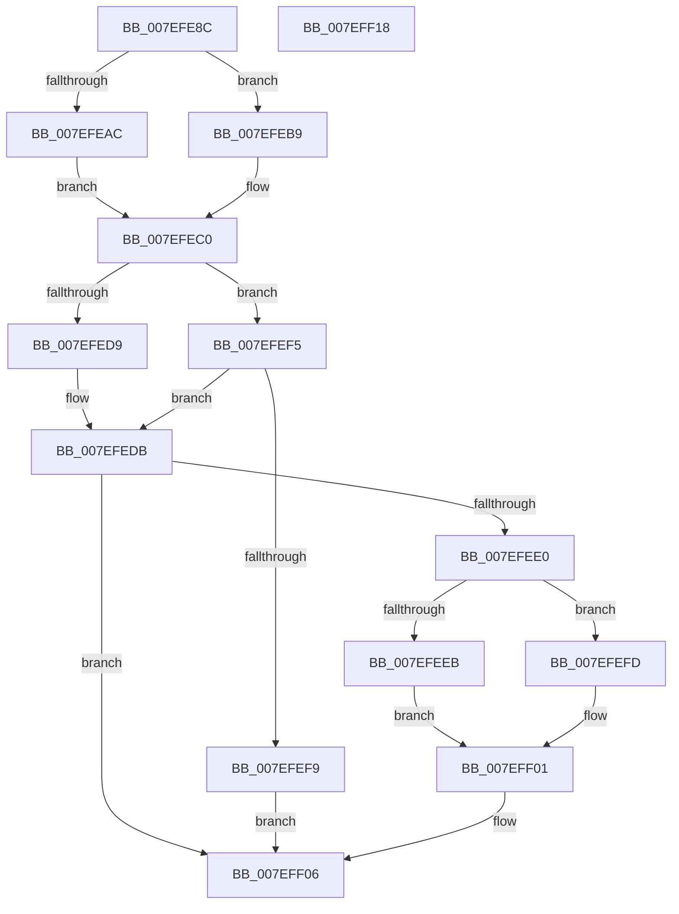

# CmpAddUoWToRollbackPacket

- RVA: `0x007EFE8C`–`0x007EFF19` (길이 `141` bytes)
- VA: `0x00000001407EFE8C`
- 실행 섹션: `PAGE`
- PDB 이름 있음: `예`; PDB Function 태그: `아니요`
- unwind 정보 RVA: `0x00060BC4`
- 디코드: `46`개 명령, `141/141` bytes 표시
- 미해석 바이트: `0` (있으면 어셈블리에 `.byte`로 보존)

> 이 문서는 커널 이미지의 기계어와 PDB 기호를 분석해 생성했습니다. 4번과 5번은 함수 원형과 자료형을 바이너리 사용 방식에서 추정한 C 해석이며 원본 소스 복구 결과는 아닙니다.

## 1. Dependencies

- 직접 호출 지점: **3**; 고유 호출 대상: **3**
- 직접 호출자로 확인된 함수: **1**
- RIP 상대 이미지 참조: **0**

### Outgoing calls
- `0x007EFEC0` → [ObfReferenceObject](../../text/20/ObfReferenceObject_function_0020FA20.md) (function, `0x0020FA20`)
- `0x007EFECB` → [CmpAddPointerToRollbackPacket](CmpAddPointerToRollbackPacket_function_007EFE3C.md) (function, `0x007EFE3C`)
- `0x007EFF01` → [ObfDereferenceObject](../../text/2F/ObfDereferenceObject_function_002F9350.md) (function, `0x002F9350`)

### Direct callers
- [CmpSnapshotTxOwnerArrayToRollbackPacket](../7F/CmpSnapshotTxOwnerArrayToRollbackPacket_function_007F0118.md) at `0x007F015B`
- [CmpSnapshotTxOwnerArrayToRollbackPacket](../7F/CmpSnapshotTxOwnerArrayToRollbackPacket_function_007F0118.md) at `0x007F0173`

### Static image references
- 디코드된 RIP-relative 메모리 참조가 없습니다.

## 2. Other-region calls and transfers

- 다른 실행 섹션으로 향하는 call: **2**
  - `0x007EFEC0` → [ObfReferenceObject](../../text/20/ObfReferenceObject_function_0020FA20.md) (`PAGE` → `.text`)
  - `0x007EFF01` → [ObfDereferenceObject](../../text/2F/ObfDereferenceObject_function_002F9350.md) (`PAGE` → `.text`)
- 별도 외부 분기/꼬리 이동을 확인하지 못했습니다.

## 3. Assembly (complete function range)

```asm
007EFE8C  48 89 5C 24 08                  mov qword ptr [rsp + 8], rbx
007EFE91  48 89 74 24 10                  mov qword ptr [rsp + 0x10], rsi
007EFE96  57                              push rdi
007EFE97  48 83 EC 20                     sub rsp, 0x20
007EFE9B  48 8B 7A 38                     mov rdi, qword ptr [rdx + 0x38]
007EFE9F  48 8B F2                        mov rsi, rdx
007EFEA2  48 8B D9                        mov rbx, rcx
007EFEA5  8B 47 30                        mov eax, dword ptr [rdi + 0x30]
007EFEA8  84 C0                           test al, al
007EFEAA  79 0D                           jns 0x1407efeb9
007EFEAC  48 8B 7F 38                     mov rdi, qword ptr [rdi + 0x38]
007EFEB0  48 8B CF                        mov rcx, rdi
007EFEB3  48 83 E1 FE                     and rcx, 0xfffffffffffffffe
007EFEB7  EB 07                           jmp 0x1407efec0
007EFEB9  48 8B 7F 48                     mov rdi, qword ptr [rdi + 0x48]
007EFEBD  48 8B CF                        mov rcx, rdi
007EFEC0  E8 5B FB A1 FF                  call 0x14020fa20
007EFEC5  48 8B D7                        mov rdx, rdi
007EFEC8  48 8B CB                        mov rcx, rbx
007EFECB  E8 6C FF FF FF                  call 0x1407efe3c
007EFED0  8B D8                           mov ebx, eax
007EFED2  3D 18 07 00 C0                  cmp eax, 0xc0000718
007EFED7  75 1C                           jne 0x1407efef5
007EFED9  33 DB                           xor ebx, ebx
007EFEDB  48 85 FF                        test rdi, rdi
007EFEDE  74 26                           je 0x1407eff06
007EFEE0  48 8B 4E 38                     mov rcx, qword ptr [rsi + 0x38]
007EFEE4  8B 41 30                        mov eax, dword ptr [rcx + 0x30]
007EFEE7  84 C0                           test al, al
007EFEE9  79 12                           jns 0x1407efefd
007EFEEB  48 8B 49 38                     mov rcx, qword ptr [rcx + 0x38]
007EFEEF  48 83 E1 FE                     and rcx, 0xfffffffffffffffe
007EFEF3  EB 0C                           jmp 0x1407eff01
007EFEF5  85 C0                           test eax, eax
007EFEF7  78 E2                           js 0x1407efedb
007EFEF9  33 DB                           xor ebx, ebx
007EFEFB  EB 09                           jmp 0x1407eff06
007EFEFD  48 8B 49 48                     mov rcx, qword ptr [rcx + 0x48]
007EFF01  E8 4A 94 B0 FF                  call 0x1402f9350
007EFF06  48 8B 74 24 38                  mov rsi, qword ptr [rsp + 0x38]
007EFF0B  8B C3                           mov eax, ebx
007EFF0D  48 8B 5C 24 30                  mov rbx, qword ptr [rsp + 0x30]
007EFF12  48 83 C4 20                     add rsp, 0x20
007EFF16  5F                              pop rdi
007EFF17  C3                              ret
007EFF18  CC                              int3
```

## 4. C-style interpretation (structured pseudocode)

```c
__int64 __fastcall CmpAddUoWToRollbackPacket(__int64 a1, __int64 a2)
{
    __int64 result;
    __int64 v_rbx;
    __int64 v_rsp;
    unsigned __int64 v_stack_p10;
    unsigned __int64 v_stack_p8;

    v_stack_p8 = v_rbx;
    v_stack_p10 = v_rsi;
    v_rsp = (v_rsp) - (32);
    if (!sign_flag) goto loc_007EFEB9;
    a1 = (*(unsigned __int64 *)(*(unsigned __int64 *)(a2 + 56) + 56)) & (-2);
    goto loc_007EFEC0;
loc_007EFEB9:
loc_007EFEC0:
    result = ObfReferenceObject(*(unsigned __int64 *)(*(unsigned __int64 *)(*(unsigned __int64 *)(a2 + 56) + 56) + 72), a2, a3, a4);
    result = CmpAddPointerToRollbackPacket(a1, *(unsigned __int64 *)(*(unsigned __int64 *)(*(unsigned __int64 *)(a2 + 56) + 56) + 72), a3, a4);
    if (((unsigned int)(result)) != 0xC0000718ULL) goto loc_007EFEF5;
    v_rbx = 0;
loc_007EFEDB:
    if (*(unsigned __int64 *)(*(unsigned __int64 *)(*(unsigned __int64 *)(a2 + 56) + 56) + 72) == 0) goto loc_007EFF06;
    if (!sign_flag) goto loc_007EFEFD;
    a1 = (*(unsigned __int64 *)(*(unsigned __int64 *)(a2 + 56) + 56)) & (-2);
    goto loc_007EFF01;
loc_007EFEF5:
    if (sign_flag) goto loc_007EFEDB;
    v_rbx = 0;
    goto loc_007EFF06;
loc_007EFEFD:
loc_007EFF01:
    result = ObfDereferenceObject(*(unsigned __int64 *)(a1 + 72), *(unsigned __int64 *)(*(unsigned __int64 *)(*(unsigned __int64 *)(a2 + 56) + 56) + 72), a3, a4);
loc_007EFF06:
    v_rsp = (v_rsp) + (32);
    return 0;
}
```

## 5. (Beta) C Style

```c
int64_t CmpAddUoWToRollbackPacket(int64_t Arg1, void *Arg2)
{
    uint8_t *arg2 = (uint8_t *)Arg2;

    int64_t result;
    int64_t local_rbx;
    int64_t local_rsp;
    uint64_t v_stack_p10;
    uint64_t v_stack_p8;

    v_stack_p8 = local_rbx;
    v_stack_p10 = local_rsi;
    local_rsp = (local_rsp) - (32);
    if (!sign_flag) goto loc_007EFEB9;
    Arg1 = (*(uint64_t *)(*(uint64_t *)(arg2 + 0x38) + 0x38)) & (-2);
    goto loc_007EFEC0;
loc_007EFEB9:
loc_007EFEC0:
    result = ObfReferenceObject(*(uint64_t *)(*(uint64_t *)(*(uint64_t *)(arg2 + 0x38) + 0x38) + 0x48), Arg2, a3, a4);
    result = CmpAddPointerToRollbackPacket(Arg1, *(uint64_t *)(*(uint64_t *)(*(uint64_t *)(arg2 + 0x38) + 0x38) + 0x48), a3, a4);
    if (((uint32_t)(result)) != 0xC0000718ULL) goto loc_007EFEF5;
    local_rbx = 0;
loc_007EFEDB:
    if (*(uint64_t *)(*(uint64_t *)(*(uint64_t *)(arg2 + 0x38) + 0x38) + 0x48) == 0) goto loc_007EFF06;
    if (!sign_flag) goto loc_007EFEFD;
    Arg1 = (*(uint64_t *)(*(uint64_t *)(arg2 + 0x38) + 0x38)) & (-2);
    goto loc_007EFF01;
loc_007EFEF5:
    if (sign_flag) goto loc_007EFEDB;
    local_rbx = 0;
    goto loc_007EFF06;
loc_007EFEFD:
loc_007EFF01:
    result = ObfDereferenceObject(*(uint64_t *)(Arg1 + 0x48), *(uint64_t *)(*(uint64_t *)(*(uint64_t *)(arg2 + 0x38) + 0x38) + 0x48), a3, a4);
loc_007EFF06:
    local_rsp = (local_rsp) + (32);
    return 0;
}
```

### 관측된 메모리 오프셋

구조체 형식이 확인되지 않은 접근은 인자 기준의 오프셋으로만 기록했습니다.

| 기준 인자 | 오프셋 표현 | 폭 (bit) | 접근 |
|---|---:|---:|---|
| `Arg2` | `+ 0x38` | `64` | `R` |

## 6. Execution-region graph

[열기: 2D/3D 그래프와 함수 탐색 컨트롤 패널](../../../control-panel.html?section=page&rva=0x007EFE8C&view=graph)

- 2D 그래프는 위에서 아래로 흐르고, 3D 그래프는 빈 공간을 드래그해 회전합니다. Shift+드래그는 이동, 휠은 확대·축소, 함수 노드 선택은 대상 보고서 이동입니다.

### Static fallback


