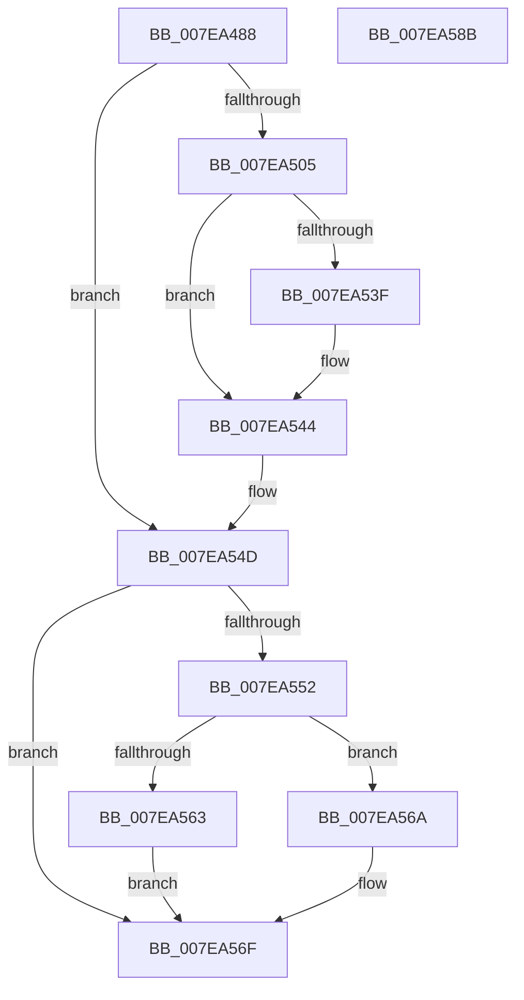

# CmpAddValueKeyTombstone

- RVA: `0x007EA488`–`0x007EA58C` (길이 `260` bytes)
- VA: `0x00000001407EA488`
- 실행 섹션: `PAGE`
- PDB 이름 있음: `예`; PDB Function 태그: `아니요`
- unwind 정보 RVA: `0x0007EE78`
- 디코드: `73`개 명령, `260/260` bytes 표시
- 미해석 바이트: `0` (있으면 어셈블리에 `.byte`로 보존)

> 이 문서는 커널 이미지의 기계어와 PDB 기호를 분석해 생성했습니다. 4번과 5번은 함수 원형과 자료형을 바이너리 사용 방식에서 추정한 C 해석이며 원본 소스 복구 결과는 아닙니다.

## 1. Dependencies

- 직접 호출 지점: **7**; 고유 호출 대상: **7**
- 직접 호출자로 확인된 함수: **1**
- RIP 상대 이미지 참조: **0**

### Outgoing calls
- `0x007EA4BE` → [HvpGetCellContextInitialize](../85/HvpGetCellContextInitialize_function_00855F10.md) (function, `0x00855F10`)
- `0x007EA4C6` → [CmpNameSize](../85/CmpNameSize_function_0085ABC4.md) (function, `0x0085ABC4`)
- `0x007EA4F5` → [HvAllocateCell](../85/HvAllocateCell_function_00859C94.md) (function, `0x00859C94`)
- `0x007EA50D` → [memset](../../text/6C/memset_function_006C6C40.md) (function, `0x006C6C40`)
- `0x007EA530` → [CmpCopyName](../85/CmpCopyName_function_0085AF98.md) (function, `0x0085AF98`)
- `0x007EA563` → [HvpReleaseCellFlat](../85/HvpReleaseCellFlat_function_0085CC20.md) (function, `0x0085CC20`)
- `0x007EA56A` → [HvpReleaseCellPaged](../85/HvpReleaseCellPaged_function_00855F40.md) (function, `0x00855F40`)

### Direct callers
- [CmpSetValueKeyTombstone](../AC/CmpSetValueKeyTombstone_function_00AC5D64.md) at `0x00AC5DB1`

### Static image references
- 디코드된 RIP-relative 메모리 참조가 없습니다.

## 2. Other-region calls and transfers

- 다른 실행 섹션으로 향하는 call: **1**
  - `0x007EA50D` → [memset](../../text/6C/memset_function_006C6C40.md) (`PAGE` → `.text`)
- 별도 외부 분기/꼬리 이동을 확인하지 못했습니다.

## 3. Assembly (complete function range)

```asm
007EA488  48 8B C4                        mov rax, rsp
007EA48B  48 89 58 08                     mov qword ptr [rax + 8], rbx
007EA48F  48 89 68 10                     mov qword ptr [rax + 0x10], rbp
007EA493  48 89 70 18                     mov qword ptr [rax + 0x18], rsi
007EA497  57                              push rdi
007EA498  41 56                           push r14
007EA49A  41 57                           push r15
007EA49C  48 83 EC 50                     sub rsp, 0x50
007EA4A0  48 83 60 D0 00                  and qword ptr [rax - 0x30], 0
007EA4A5  48 8B F9                        mov rdi, rcx
007EA4A8  83 48 C8 FF                     or dword ptr [rax - 0x38], 0xffffffff
007EA4AC  48 8D 48 D0                     lea rcx, [rax - 0x30]
007EA4B0  48 83 60 D8 00                  and qword ptr [rax - 0x28], 0
007EA4B5  4D 8B F9                        mov r15, r9
007EA4B8  45 8B D0                        mov r10d, r8d
007EA4BB  48 8B EA                        mov rbp, rdx
007EA4BE  E8 4D BA 06 00                  call 0x140855f10
007EA4C3  48 8B CA                        mov rcx, rdx
007EA4C6  E8 F9 06 07 00                  call 0x14085abc4
007EA4CB  44 0F B7 F0                     movzx r14d, ax
007EA4CF  4C 8D 4C 24 30                  lea r9, [rsp + 0x30]
007EA4D4  48 8D 44 24 38                  lea rax, [rsp + 0x38]
007EA4D9  41 83 C6 14                     add r14d, 0x14
007EA4DD  48 89 44 24 28                  mov qword ptr [rsp + 0x28], rax
007EA4E2  45 8B C2                        mov r8d, r10d
007EA4E5  48 8D 44 24 40                  lea rax, [rsp + 0x40]
007EA4EA  41 8B D6                        mov edx, r14d
007EA4ED  48 8B CF                        mov rcx, rdi
007EA4F0  48 89 44 24 20                  mov qword ptr [rsp + 0x20], rax
007EA4F5  E8 9A F7 06 00                  call 0x140859c94
007EA4FA  48 8B 5C 24 40                  mov rbx, qword ptr [rsp + 0x40]
007EA4FF  8B F0                           mov esi, eax
007EA501  85 C0                           test eax, eax
007EA503  78 48                           js 0x1407ea54d
007EA505  45 8B C6                        mov r8d, r14d
007EA508  33 D2                           xor edx, edx
007EA50A  48 8B CB                        mov rcx, rbx
007EA50D  E8 2E C7 ED FF                  call 0x1406c6c40
007EA512  66 C7 03 76 6B                  mov word ptr [rbx], 0x6b76
007EA517  48 8D 4B 14                     lea rcx, [rbx + 0x14]
007EA51B  66 C7 43 10 02 00               mov word ptr [rbx + 0x10], 2
007EA521  48 8B D5                        mov rdx, rbp
007EA524  83 63 04 00                     and dword ptr [rbx + 4], 0
007EA528  83 4B 08 FF                     or dword ptr [rbx + 8], 0xffffffff
007EA52C  83 63 0C 00                     and dword ptr [rbx + 0xc], 0
007EA530  E8 63 0A 07 00                  call 0x14085af98
007EA535  66 89 43 02                     mov word ptr [rbx + 2], ax
007EA539  66 3B 45 00                     cmp ax, word ptr [rbp]
007EA53D  73 05                           jae 0x1407ea544
007EA53F  66 83 4B 10 01                  or word ptr [rbx + 0x10], 1
007EA544  8B 44 24 30                     mov eax, dword ptr [rsp + 0x30]
007EA548  33 F6                           xor esi, esi
007EA54A  41 89 07                        mov dword ptr [r15], eax
007EA54D  48 85 DB                        test rbx, rbx
007EA550  74 1D                           je 0x1407ea56f
007EA552  F6 87 8C 00 00 00 01            test byte ptr [rdi + 0x8c], 1
007EA559  48 8D 54 24 38                  lea rdx, [rsp + 0x38]
007EA55E  48 8B CF                        mov rcx, rdi
007EA561  74 07                           je 0x1407ea56a
007EA563  E8 B8 26 07 00                  call 0x14085cc20
007EA568  EB 05                           jmp 0x1407ea56f
007EA56A  E8 D1 B9 06 00                  call 0x140855f40
007EA56F  4C 8D 5C 24 50                  lea r11, [rsp + 0x50]
007EA574  8B C6                           mov eax, esi
007EA576  49 8B 5B 20                     mov rbx, qword ptr [r11 + 0x20]
007EA57A  49 8B 6B 28                     mov rbp, qword ptr [r11 + 0x28]
007EA57E  49 8B 73 30                     mov rsi, qword ptr [r11 + 0x30]
007EA582  49 8B E3                        mov rsp, r11
007EA585  41 5F                           pop r15
007EA587  41 5E                           pop r14
007EA589  5F                              pop rdi
007EA58A  C3                              ret
007EA58B  CC                              int3
```

## 4. C-style interpretation (structured pseudocode)

```c
__int64 __fastcall CmpAddValueKeyTombstone(__int64 a1, __int64 a2, int a3, __int64 a4)
{
    __int64 result;
    __int64 v_r14;
    __int64 v_rsi;
    __int64 v_rsp;
    unsigned __int64 v_stack_m18;
    unsigned __int64 v_stack_m28;
    unsigned __int64 v_stack_m30;
    unsigned __int64 v_stack_m38;
    unsigned __int64 v_stack_m40;
    unsigned __int64 v_stack_m48;

    *(unsigned __int64 *)(v_rsp + 8) = v_rbx;
    *(unsigned __int64 *)(v_rsp + 16) = v_rbp;
    *(unsigned __int64 *)(v_rsp + 24) = v_rsi;
    v_rsp = (v_rsp) - (80);
    result = HvpGetCellContextInitialize(v_rsp - 48, a2, a3, a4);
    result = CmpNameSize(a2, a2, a3, a4);
    v_r14 = (unsigned int)(((unsigned __int16)(result)) + (20));
    v_stack_m40 = v_stack_m30;
    v_stack_m48 = v_stack_m28;
    result = HvAllocateCell(a1, (unsigned int)((unsigned int)(v_r14)), (unsigned int)((unsigned int)((unsigned int)(a3))), v_stack_m38);
    if (sign_flag) goto loc_007EA54D;
    a2 = 0;
    result = memset(v_stack_m28, a2, (unsigned int)((unsigned int)(v_r14)), v_stack_m38);
    *(unsigned __int16 *)(v_stack_m28) = 0x6B76ULL;
    *(unsigned __int16 *)(v_stack_m28 + 16) = 2;
    result = CmpCopyName(v_stack_m28 + 20, 0, (unsigned int)((unsigned int)(v_r14)), v_stack_m38);
    *(unsigned __int16 *)(v_stack_m28 + 2) = (unsigned __int16)(result);
    if (((unsigned __int16)(result)) < (*(unsigned __int16 *)(a2))) {
    }
    v_rsi = 0;
    *(unsigned int *)(a4) = (unsigned int)((unsigned int)(v_stack_m38));
loc_007EA54D:
    if (v_stack_m28 == 0) goto loc_007EA56F;
    if (((*(unsigned __int8 *)(a1 + 140)) & (1)) == 0) goto loc_007EA56A;
    result = HvpReleaseCellFlat(a1, v_stack_m30, (unsigned int)((unsigned int)(v_r14)), v_stack_m38);
    goto loc_007EA56F;
loc_007EA56A:
    result = HvpReleaseCellPaged(a1, v_stack_m30, (unsigned int)((unsigned int)(v_r14)), v_stack_m38);
loc_007EA56F:
    return 0;
}
```

## 5. (Beta) C Style

```c
int64_t CmpAddValueKeyTombstone(void *Arg1, void *Arg2, int32_t Arg3, void *Arg4)
{
    uint8_t *arg1 = (uint8_t *)Arg1;
    uint8_t *arg2 = (uint8_t *)Arg2;
    uint8_t *arg4 = (uint8_t *)Arg4;

    int64_t result;
    int64_t local_r14;
    int64_t local_rsi;
    int64_t local_rsp;
    uint64_t v_stack_m18;
    uint64_t v_stack_m28;
    uint64_t v_stack_m30;
    uint64_t v_stack_m38;
    uint64_t v_stack_m40;
    uint64_t v_stack_m48;

    *(uint64_t *)(local_rsp + 0x8) = local_rbx;
    *(uint64_t *)(local_rsp + 0x10) = local_rbp;
    *(uint64_t *)(local_rsp + 0x18) = local_rsi;
    local_rsp = (local_rsp) - (80);
    result = HvpGetCellContextInitialize(local_rsp - 48, Arg2, Arg3, Arg4);
    result = CmpNameSize(Arg2, Arg2, Arg3, Arg4);
    local_r14 = (uint32_t)(((uint16_t)(result)) + (20));
    v_stack_m40 = v_stack_m30;
    v_stack_m48 = v_stack_m28;
    result = HvAllocateCell(Arg1, (uint32_t)((uint32_t)(local_r14)), (uint32_t)((uint32_t)((uint32_t)(Arg3))), v_stack_m38);
    if (sign_flag) goto loc_007EA54D;
    Arg2 = 0;
    result = memset(v_stack_m28, Arg2, (uint32_t)((uint32_t)(local_r14)), v_stack_m38);
    *(uint16_t *)(v_stack_m28) = 0x6B76ULL;
    *(uint16_t *)(v_stack_m28 + 0x10) = 2;
    result = CmpCopyName(v_stack_m28 + 20, 0, (uint32_t)((uint32_t)(local_r14)), v_stack_m38);
    *(uint16_t *)(v_stack_m28 + 0x2) = (uint16_t)(result);
    if (((uint16_t)(result)) < (*(uint16_t *)(arg2))) {
    }
    local_rsi = 0;
    *(uint32_t *)(arg4) = (uint32_t)((uint32_t)(v_stack_m38));
loc_007EA54D:
    if (v_stack_m28 == 0) goto loc_007EA56F;
    if (((*(uint8_t *)(arg1 + 0x8C)) & (1)) == 0) goto loc_007EA56A;
    result = HvpReleaseCellFlat(Arg1, v_stack_m30, (uint32_t)((uint32_t)(local_r14)), v_stack_m38);
    goto loc_007EA56F;
loc_007EA56A:
    result = HvpReleaseCellPaged(Arg1, v_stack_m30, (uint32_t)((uint32_t)(local_r14)), v_stack_m38);
loc_007EA56F:
    return 0;
}
```

### 관측된 메모리 오프셋

구조체 형식이 확인되지 않은 접근은 인자 기준의 오프셋으로만 기록했습니다.

| 기준 인자 | 오프셋 표현 | 폭 (bit) | 접근 |
|---|---:|---:|---|
| `Arg1` | `+ 0x8C` | `8` | `R` |
| `Arg2` | `+ 0x0` | `16` | `R` |
| `Arg4` | `+ 0x0` | `32` | `W` |

## 6. Execution-region graph

[열기: 2D/3D 그래프와 함수 탐색 컨트롤 패널](../../../control-panel.html?section=page&rva=0x007EA488&view=graph)

- 2D 그래프는 위에서 아래로 흐르고, 3D 그래프는 빈 공간을 드래그해 회전합니다. Shift+드래그는 이동, 휠은 확대·축소, 함수 노드 선택은 대상 보고서 이동입니다.

### Static fallback


