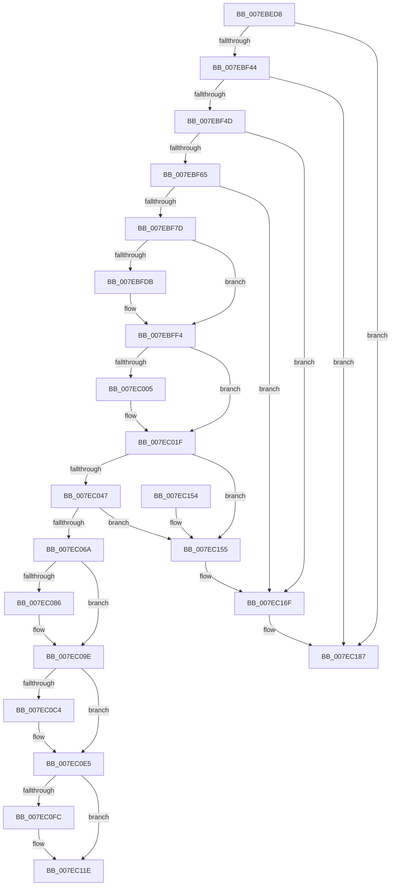

# CmpAdminSystemSecurityDescriptor

- RVA: `0x007EBED8`–`0x007EC1A0` (길이 `712` bytes)
- VA: `0x00000001407EBED8`
- 실행 섹션: `PAGE`
- PDB 이름 있음: `예`; PDB Function 태그: `아니요`
- unwind 정보 RVA: `0x000D6EC4`
- 디코드: `199`개 명령, `712/712` bytes 표시
- 미해석 바이트: `0` (있으면 어셈블리에 `.byte`로 보존)

> 이 문서는 커널 이미지의 기계어와 PDB 기호를 분석해 생성했습니다. 4번과 5번은 함수 원형과 자료형을 바이너리 사용 방식에서 추정한 C 해석이며 원본 소스 복구 결과는 아닙니다.

## 1. Dependencies

- 직접 호출 지점: **30**; 고유 호출 대상: **11**
- 직접 호출자로 확인된 함수: **1**
- RIP 상대 이미지 참조: **0**

### Outgoing calls
- `0x007EBF01` → [RtlLengthRequiredSid](../9C/RtlLengthRequiredSid_function_009CA4D0.md) (function, `0x009CA4D0`)
- `0x007EBF17` → [ExAllocatePool2](../../poolcode/B8/ExAllocatePool2_function_00B820F0.md) (function, `0x00B820F0`)
- `0x007EBF27` → [RtlLengthRequiredSid](../9C/RtlLengthRequiredSid_function_009CA4D0.md) (function, `0x009CA4D0`)
- `0x007EBF33` → [ExAllocatePool2](../../poolcode/B8/ExAllocatePool2_function_00B820F0.md) (function, `0x00B820F0`)
- `0x007EBF58` → [RtlInitializeSid](../9E/RtlInitializeSid_function_009EB720.md) (function, `0x009EB720`)
- `0x007EBF70` → [RtlInitializeSid](../9E/RtlInitializeSid_function_009EB720.md) (function, `0x009EB720`)
- `0x007EBF82` → [RtlSubAuthoritySid](../../text/45/RtlSubAuthoritySid_function_00456D10.md) (function, `0x00456D10`)
- `0x007EBF92` → [RtlSubAuthoritySid](../../text/45/RtlSubAuthoritySid_function_00456D10.md) (function, `0x00456D10`)
- `0x007EBFA5` → [RtlSubAuthoritySid](../../text/45/RtlSubAuthoritySid_function_00456D10.md) (function, `0x00456D10`)
- `0x007EBFCE` → [ExAllocatePool2](../../poolcode/B8/ExAllocatePool2_function_00B820F0.md) (function, `0x00B820F0`)
- `0x007EBFEE` → [KeBugCheckEx](../../text/4F/KeBugCheckEx_function_004FD660.md) (function, `0x004FD660`)
- `0x007EBFFC` → [RtlCreateAcl](../91/RtlCreateAcl_function_00916F00.md) (function, `0x00916F00`)
- `0x007EC019` → [KeBugCheckEx](../../text/4F/KeBugCheckEx_function_004FD660.md) (function, `0x004FD660`)
- `0x007EC03A` → [RtlpAddKnownAce](../92/RtlpAddKnownAce_function_00929A20.md) (function, `0x00929A20`)
- `0x007EC05D` → [RtlpAddKnownAce](../92/RtlpAddKnownAce_function_00929A20.md) (function, `0x00929A20`)
- `0x007EC079` → [ExAllocatePool2](../../poolcode/B8/ExAllocatePool2_function_00B820F0.md) (function, `0x00B820F0`)
- `0x007EC098` → [KeBugCheckEx](../../text/4F/KeBugCheckEx_function_004FD660.md) (function, `0x004FD660`)
- `0x007EC0A8` → [memcpy](../../text/6C/memcpy_function_006C6840.md) (function, `0x006C6840`)
- `0x007EC0B5` → [RtlCreateSecurityDescriptor](../9F/RtlCreateSecurityDescriptor_function_009F1DF0.md) (function, `0x009F1DF0`)
- `0x007EC0C6` → [ExFreePoolWithTag](../../poolcode/B8/ExFreePoolWithTag_function_00B82870.md) (function, `0x00B82870`)
- `0x007EC0DF` → [KeBugCheckEx](../../text/4F/KeBugCheckEx_function_004FD660.md) (function, `0x004FD660`)
- `0x007EC0EE` → [RtlSetDaclSecurityDescriptor](../9E/RtlSetDaclSecurityDescriptor_function_009EC210.md) (function, `0x009EC210`)
- `0x007EC0FF` → [ExFreePoolWithTag](../../poolcode/B8/ExFreePoolWithTag_function_00B82870.md) (function, `0x00B82870`)
- `0x007EC118` → [KeBugCheckEx](../../text/4F/KeBugCheckEx_function_004FD660.md) (function, `0x004FD660`)
- `0x007EC121` → [ExFreePoolWithTag](../../poolcode/B8/ExFreePoolWithTag_function_00B82870.md) (function, `0x00B82870`)
- `0x007EC12B` → [ExFreePoolWithTag](../../poolcode/B8/ExFreePoolWithTag_function_00B82870.md) (function, `0x00B82870`)
- `0x007EC135` → [ExFreePoolWithTag](../../poolcode/B8/ExFreePoolWithTag_function_00B82870.md) (function, `0x00B82870`)
- `0x007EC169` → [KeBugCheckEx](../../text/4F/KeBugCheckEx_function_004FD660.md) (function, `0x004FD660`)
- `0x007EC181` → [KeBugCheckEx](../../text/4F/KeBugCheckEx_function_004FD660.md) (function, `0x004FD660`)
- `0x007EC19A` → [KeBugCheckEx](../../text/4F/KeBugCheckEx_function_004FD660.md) (function, `0x004FD660`)

### Direct callers
- [CmInitSystem1](../../init/C5/CmInitSystem1_function_00C559CC.md) at `0x00C55C34`

### Static image references
- 디코드된 RIP-relative 메모리 참조가 없습니다.

## 2. Other-region calls and transfers

- 다른 실행 섹션으로 향하는 call: **21**
  - `0x007EBF17` → [ExAllocatePool2](../../poolcode/B8/ExAllocatePool2_function_00B820F0.md) (`PAGE` → `POOLCODE`)
  - `0x007EBF33` → [ExAllocatePool2](../../poolcode/B8/ExAllocatePool2_function_00B820F0.md) (`PAGE` → `POOLCODE`)
  - `0x007EBF82` → [RtlSubAuthoritySid](../../text/45/RtlSubAuthoritySid_function_00456D10.md) (`PAGE` → `.text`)
  - `0x007EBF92` → [RtlSubAuthoritySid](../../text/45/RtlSubAuthoritySid_function_00456D10.md) (`PAGE` → `.text`)
  - `0x007EBFA5` → [RtlSubAuthoritySid](../../text/45/RtlSubAuthoritySid_function_00456D10.md) (`PAGE` → `.text`)
  - `0x007EBFCE` → [ExAllocatePool2](../../poolcode/B8/ExAllocatePool2_function_00B820F0.md) (`PAGE` → `POOLCODE`)
  - `0x007EBFEE` → [KeBugCheckEx](../../text/4F/KeBugCheckEx_function_004FD660.md) (`PAGE` → `.text`)
  - `0x007EC019` → [KeBugCheckEx](../../text/4F/KeBugCheckEx_function_004FD660.md) (`PAGE` → `.text`)
  - `0x007EC079` → [ExAllocatePool2](../../poolcode/B8/ExAllocatePool2_function_00B820F0.md) (`PAGE` → `POOLCODE`)
  - `0x007EC098` → [KeBugCheckEx](../../text/4F/KeBugCheckEx_function_004FD660.md) (`PAGE` → `.text`)
  - `0x007EC0A8` → [memcpy](../../text/6C/memcpy_function_006C6840.md) (`PAGE` → `.text`)
  - `0x007EC0C6` → [ExFreePoolWithTag](../../poolcode/B8/ExFreePoolWithTag_function_00B82870.md) (`PAGE` → `POOLCODE`)
  - `0x007EC0DF` → [KeBugCheckEx](../../text/4F/KeBugCheckEx_function_004FD660.md) (`PAGE` → `.text`)
  - `0x007EC0FF` → [ExFreePoolWithTag](../../poolcode/B8/ExFreePoolWithTag_function_00B82870.md) (`PAGE` → `POOLCODE`)
  - `0x007EC118` → [KeBugCheckEx](../../text/4F/KeBugCheckEx_function_004FD660.md) (`PAGE` → `.text`)
  - `0x007EC121` → [ExFreePoolWithTag](../../poolcode/B8/ExFreePoolWithTag_function_00B82870.md) (`PAGE` → `POOLCODE`)
  - `0x007EC12B` → [ExFreePoolWithTag](../../poolcode/B8/ExFreePoolWithTag_function_00B82870.md) (`PAGE` → `POOLCODE`)
  - `0x007EC135` → [ExFreePoolWithTag](../../poolcode/B8/ExFreePoolWithTag_function_00B82870.md) (`PAGE` → `POOLCODE`)
  - `0x007EC169` → [KeBugCheckEx](../../text/4F/KeBugCheckEx_function_004FD660.md) (`PAGE` → `.text`)
  - `0x007EC181` → [KeBugCheckEx](../../text/4F/KeBugCheckEx_function_004FD660.md) (`PAGE` → `.text`)
  - `0x007EC19A` → [KeBugCheckEx](../../text/4F/KeBugCheckEx_function_004FD660.md) (`PAGE` → `.text`)
- 별도 외부 분기/꼬리 이동을 확인하지 못했습니다.

## 3. Assembly (complete function range)

```asm
007EBED8  48 8B C4                        mov rax, rsp
007EBEDB  48 89 58 10                     mov qword ptr [rax + 0x10], rbx
007EBEDF  48 89 68 18                     mov qword ptr [rax + 0x18], rbp
007EBEE3  56                              push rsi
007EBEE4  57                              push rdi
007EBEE5  41 54                           push r12
007EBEE7  41 56                           push r14
007EBEE9  41 57                           push r15
007EBEEB  48 83 EC 30                     sub rsp, 0x30
007EBEEF  45 33 E4                        xor r12d, r12d
007EBEF2  66 C7 40 0C 00 05               mov word ptr [rax + 0xc], 0x500
007EBEF8  44 89 60 08                     mov dword ptr [rax + 8], r12d
007EBEFC  41 8D 4C 24 01                  lea ecx, [r12 + 1]
007EBF01  E8 CA E5 1D 00                  call 0x1409ca4d0
007EBF06  BE 43 4D 20 20                  mov esi, 0x20204d43
007EBF0B  8B D0                           mov edx, eax
007EBF0D  BB 00 01 00 00                  mov ebx, 0x100
007EBF12  44 8B C6                        mov r8d, esi
007EBF15  8B CB                           mov ecx, ebx
007EBF17  E8 D4 61 39 00                  call 0x140b820f0
007EBF1C  45 8D 7C 24 02                  lea r15d, [r12 + 2]
007EBF21  48 8B E8                        mov rbp, rax
007EBF24  41 8B CF                        mov ecx, r15d
007EBF27  E8 A4 E5 1D 00                  call 0x1409ca4d0
007EBF2C  8B D0                           mov edx, eax
007EBF2E  44 8B C6                        mov r8d, esi
007EBF31  8B CB                           mov ecx, ebx
007EBF33  E8 B8 61 39 00                  call 0x140b820f0
007EBF38  48 8B F8                        mov rdi, rax
007EBF3B  48 85 ED                        test rbp, rbp
007EBF3E  0F 84 43 02 00 00               je 0x1407ec187
007EBF44  48 85 C0                        test rax, rax
007EBF47  0F 84 3A 02 00 00               je 0x1407ec187
007EBF4D  41 B0 01                        mov r8b, 1
007EBF50  48 8D 54 24 60                  lea rdx, [rsp + 0x60]
007EBF55  48 8B CD                        mov rcx, rbp
007EBF58  E8 C3 F7 1F 00                  call 0x1409eb720
007EBF5D  85 C0                           test eax, eax
007EBF5F  0F 88 0A 02 00 00               js 0x1407ec16f
007EBF65  45 8A C7                        mov r8b, r15b
007EBF68  48 8D 54 24 60                  lea rdx, [rsp + 0x60]
007EBF6D  48 8B CF                        mov rcx, rdi
007EBF70  E8 AB F7 1F 00                  call 0x1409eb720
007EBF75  85 C0                           test eax, eax
007EBF77  0F 88 F2 01 00 00               js 0x1407ec16f
007EBF7D  33 D2                           xor edx, edx
007EBF7F  48 8B CD                        mov rcx, rbp
007EBF82  E8 89 AD C6 FF                  call 0x140456d10
007EBF87  33 D2                           xor edx, edx
007EBF89  48 8B CF                        mov rcx, rdi
007EBF8C  C7 00 12 00 00 00               mov dword ptr [rax], 0x12
007EBF92  E8 79 AD C6 FF                  call 0x140456d10
007EBF97  41 8D 54 24 01                  lea edx, [r12 + 1]
007EBF9C  48 8B CF                        mov rcx, rdi
007EBF9F  C7 00 20 00 00 00               mov dword ptr [rax], 0x20
007EBFA5  E8 66 AD C6 FF                  call 0x140456d10
007EBFAA  44 8B C6                        mov r8d, esi
007EBFAD  C7 00 20 02 00 00               mov dword ptr [rax], 0x220
007EBFB3  0F B6 4F 01                     movzx ecx, byte ptr [rdi + 1]
007EBFB7  0F B6 45 01                     movzx eax, byte ptr [rbp + 1]
007EBFBB  03 C8                           add ecx, eax
007EBFBD  8D 1C 8D 28 00 00 00            lea ebx, [rcx*4 + 0x28]
007EBFC4  B9 00 01 00 00                  mov ecx, 0x100
007EBFC9  8B D3                           mov edx, ebx
007EBFCB  44 8B F3                        mov r14d, ebx
007EBFCE  E8 1D 61 39 00                  call 0x140b820f0
007EBFD3  48 8B F0                        mov rsi, rax
007EBFD6  48 85 C0                        test rax, rax
007EBFD9  75 19                           jne 0x1407ebff4
007EBFDB  45 33 C9                        xor r9d, r9d
007EBFDE  4C 89 64 24 20                  mov qword ptr [rsp + 0x20], r12
007EBFE3  8D 50 0B                        lea edx, [rax + 0xb]
007EBFE6  8D 48 51                        lea ecx, [rax + 0x51]
007EBFE9  45 8D 44 24 03                  lea r8d, [r12 + 3]
007EBFEE  E8 6D 16 D1 FF                  call 0x1404fd660
007EBFF3  CC                              int3
007EBFF4  45 8B C7                        mov r8d, r15d
007EBFF7  8B D3                           mov edx, ebx
007EBFF9  48 8B CE                        mov rcx, rsi
007EBFFC  E8 FF AE 12 00                  call 0x140916f00
007EC001  85 C0                           test eax, eax
007EC003  79 1A                           jns 0x1407ec01f
007EC005  BA 0B 00 00 00                  mov edx, 0xb
007EC00A  4C 63 C8                        movsxd r9, eax
007EC00D  4C 89 64 24 20                  mov qword ptr [rsp + 0x20], r12
007EC012  8D 4A 46                        lea ecx, [rdx + 0x46]
007EC015  44 8D 42 F9                     lea r8d, [rdx - 7]
007EC019  E8 42 16 D1 FF                  call 0x1404fd660
007EC01E  CC                              int3
007EC01F  BB FF 01 1F 00                  mov ebx, 0x1f01ff
007EC024  44 88 64 24 28                  mov byte ptr [rsp + 0x28], r12b
007EC029  44 8B CB                        mov r9d, ebx
007EC02C  48 89 6C 24 20                  mov qword ptr [rsp + 0x20], rbp
007EC031  45 33 C0                        xor r8d, r8d
007EC034  41 8B D7                        mov edx, r15d
007EC037  48 8B CE                        mov rcx, rsi
007EC03A  E8 E1 D9 13 00                  call 0x140929a20
007EC03F  85 C0                           test eax, eax
007EC041  0F 88 0E 01 00 00               js 0x1407ec155
007EC047  44 88 64 24 28                  mov byte ptr [rsp + 0x28], r12b
007EC04C  44 8B CB                        mov r9d, ebx
007EC04F  45 33 C0                        xor r8d, r8d
007EC052  48 89 7C 24 20                  mov qword ptr [rsp + 0x20], rdi
007EC057  41 8B D7                        mov edx, r15d
007EC05A  48 8B CE                        mov rcx, rsi
007EC05D  E8 BE D9 13 00                  call 0x140929a20
007EC062  85 C0                           test eax, eax
007EC064  0F 88 EB 00 00 00               js 0x1407ec155
007EC06A  49 8D 56 28                     lea rdx, [r14 + 0x28]
007EC06E  B9 00 01 00 00                  mov ecx, 0x100
007EC073  41 B8 43 4D 20 20               mov r8d, 0x20204d43
007EC079  E8 72 60 39 00                  call 0x140b820f0
007EC07E  48 8B D8                        mov rbx, rax
007EC081  48 85 C0                        test rax, rax
007EC084  75 18                           jne 0x1407ec09e
007EC086  45 33 C9                        xor r9d, r9d
007EC089  4C 89 64 24 20                  mov qword ptr [rsp + 0x20], r12
007EC08E  8D 50 0B                        lea edx, [rax + 0xb]
007EC091  8D 48 51                        lea ecx, [rax + 0x51]
007EC094  44 8D 40 06                     lea r8d, [rax + 6]
007EC098  E8 C3 15 D1 FF                  call 0x1404fd660
007EC09D  CC                              int3
007EC09E  4D 8B C6                        mov r8, r14
007EC0A1  48 8D 48 28                     lea rcx, [rax + 0x28]
007EC0A5  48 8B D6                        mov rdx, rsi
007EC0A8  E8 93 A7 ED FF                  call 0x1406c6840
007EC0AD  BA 01 00 00 00                  mov edx, 1
007EC0B2  48 8B CB                        mov rcx, rbx
007EC0B5  E8 36 5D 20 00                  call 0x1409f1df0
007EC0BA  4C 63 F0                        movsxd r14, eax
007EC0BD  48 8B CB                        mov rcx, rbx
007EC0C0  85 C0                           test eax, eax
007EC0C2  79 21                           jns 0x1407ec0e5
007EC0C4  33 D2                           xor edx, edx
007EC0C6  E8 A5 67 39 00                  call 0x140b82870
007EC0CB  BA 0B 00 00 00                  mov edx, 0xb
007EC0D0  4C 89 64 24 20                  mov qword ptr [rsp + 0x20], r12
007EC0D5  4D 8B CE                        mov r9, r14
007EC0D8  8D 4A 46                        lea ecx, [rdx + 0x46]
007EC0DB  44 8D 42 FC                     lea r8d, [rdx - 4]
007EC0DF  E8 7C 15 D1 FF                  call 0x1404fd660
007EC0E4  CC                              int3
007EC0E5  45 33 C9                        xor r9d, r9d
007EC0E8  4C 8D 43 28                     lea r8, [rbx + 0x28]
007EC0EC  B2 01                           mov dl, 1
007EC0EE  E8 1D 01 20 00                  call 0x1409ec210
007EC0F3  33 D2                           xor edx, edx
007EC0F5  4C 63 F0                        movsxd r14, eax
007EC0F8  85 C0                           test eax, eax
007EC0FA  79 22                           jns 0x1407ec11e
007EC0FC  48 8B CB                        mov rcx, rbx
007EC0FF  E8 6C 67 39 00                  call 0x140b82870
007EC104  BA 0B 00 00 00                  mov edx, 0xb
007EC109  4C 89 64 24 20                  mov qword ptr [rsp + 0x20], r12
007EC10E  4D 8B CE                        mov r9, r14
007EC111  8D 4A 46                        lea ecx, [rdx + 0x46]
007EC114  44 8D 42 FD                     lea r8d, [rdx - 3]
007EC118  E8 43 15 D1 FF                  call 0x1404fd660
007EC11D  CC                              int3
007EC11E  48 8B CD                        mov rcx, rbp
007EC121  E8 4A 67 39 00                  call 0x140b82870
007EC126  33 D2                           xor edx, edx
007EC128  48 8B CF                        mov rcx, rdi
007EC12B  E8 40 67 39 00                  call 0x140b82870
007EC130  33 D2                           xor edx, edx
007EC132  48 8B CE                        mov rcx, rsi
007EC135  E8 36 67 39 00                  call 0x140b82870
007EC13A  48 8B 6C 24 70                  mov rbp, qword ptr [rsp + 0x70]
007EC13F  48 8B C3                        mov rax, rbx
007EC142  48 8B 5C 24 68                  mov rbx, qword ptr [rsp + 0x68]
007EC147  48 83 C4 30                     add rsp, 0x30
007EC14B  41 5F                           pop r15
007EC14D  41 5E                           pop r14
007EC14F  41 5C                           pop r12
007EC151  5F                              pop rdi
007EC152  5E                              pop rsi
007EC153  C3                              ret
007EC154  CC                              int3
007EC155  BA 0B 00 00 00                  mov edx, 0xb
007EC15A  4C 63 C8                        movsxd r9, eax
007EC15D  4C 89 64 24 20                  mov qword ptr [rsp + 0x20], r12
007EC162  8D 4A 46                        lea ecx, [rdx + 0x46]
007EC165  44 8D 42 FA                     lea r8d, [rdx - 6]
007EC169  E8 F2 14 D1 FF                  call 0x1404fd660
007EC16E  CC                              int3
007EC16F  45 33 C9                        xor r9d, r9d
007EC172  4C 89 64 24 20                  mov qword ptr [rsp + 0x20], r12
007EC177  4D 8B C7                        mov r8, r15
007EC17A  41 8D 51 0B                     lea edx, [r9 + 0xb]
007EC17E  8D 4A 46                        lea ecx, [rdx + 0x46]
007EC181  E8 DA 14 D1 FF                  call 0x1404fd660
007EC186  CC                              int3
007EC187  45 33 C9                        xor r9d, r9d
007EC18A  4C 89 64 24 20                  mov qword ptr [rsp + 0x20], r12
007EC18F  41 8D 51 0B                     lea edx, [r9 + 0xb]
007EC193  8D 4A 46                        lea ecx, [rdx + 0x46]
007EC196  45 8D 41 01                     lea r8d, [r9 + 1]
007EC19A  E8 C1 14 D1 FF                  call 0x1404fd660
007EC19F  CC                              int3
```

## 4. C-style interpretation (structured pseudocode)

```c
__int64 __fastcall CmpAdminSystemSecurityDescriptor(__int64 a1, __int64 a2, __int64 a3, int a4)
{
    __int64 result;
    __int64 v_r12;
    __int64 v_rsp;
    unsigned __int8 v_stack_m30;
    unsigned __int64 v_stack_m38;
    unsigned __int64 v_stack_p10;
    unsigned __int64 v_stack_p18;
    unsigned __int64 v_stack_p20;
    unsigned __int64 v_stack_p8;

    *(unsigned __int64 *)(v_rsp + 16) = v_rbx;
    *(unsigned __int64 *)(v_rsp + 24) = v_rbp;
    v_rsp = (v_rsp) - (48);
    v_r12 = 0;
    *(unsigned __int16 *)(v_rsp + 12) = 0x500ULL;
    *(unsigned int *)(v_rsp + 8) = 0;
    result = RtlLengthRequiredSid(v_r12 + 1, a2, a3, a4);
    result = ExAllocatePool2(256, (unsigned int)((unsigned int)(result)), (unsigned int)((unsigned int)((unsigned int)(0x20204D43ULL))), a4);
    result = RtlLengthRequiredSid((unsigned int)((unsigned int)(v_r12 + 2)), (unsigned int)((unsigned int)(result)), (unsigned int)((unsigned int)((unsigned int)(0x20204D43ULL))), a4);
    result = ExAllocatePool2(256, (unsigned int)((unsigned int)(result)), (unsigned int)((unsigned int)((unsigned int)(0x20204D43ULL))), a4);
    if (result == 0) goto loc_007EC187;
    if (result == 0) goto loc_007EC187;
    result = RtlInitializeSid(result, v_stack_p8, 1, a4);
    if (sign_flag) goto loc_007EC16F;
    result = RtlInitializeSid(result, v_stack_p8, (unsigned __int8)(v_r12 + 2), a4);
    if (sign_flag) goto loc_007EC16F;
    a2 = 0;
    result = RtlSubAuthoritySid(result, a2, (unsigned __int8)(v_r12 + 2), a4);
    a2 = 0;
    *(unsigned int *)(result) = 18;
    result = RtlSubAuthoritySid(result, a2, (unsigned __int8)(v_r12 + 2), a4);
    *(unsigned int *)(result) = 32;
    result = RtlSubAuthoritySid(result, v_r12 + 1, (unsigned __int8)(v_r12 + 2), a4);
    *(unsigned int *)(result) = 544;
    a1 = (unsigned int)((*(unsigned __int8 *)(result + 1)) + ((unsigned int)(*(unsigned __int8 *)(result + 1))));
    result = ExAllocatePool2(256, (unsigned int)((unsigned int)(a1 * 4 + 40)), (unsigned int)((unsigned int)((unsigned int)(0x20204D43ULL))), a4);
    if (result == 0) {
        a4 = 0;
        v_stack_m38 = 0;
        a2 = result + 11;
        a1 = result + 81;
        a3 = v_r12 + 3;
        result = KeBugCheckEx(a1, a2, a3, a4);
    }
    result = RtlCreateAcl(result, (unsigned int)((unsigned int)(a1 * 4 + 40)), (unsigned int)((unsigned int)(v_r12 + 2)), a4);
    if (sign_flag) {
        a2 = 11;
        a4 = (int)((unsigned int)(result));
        v_stack_m38 = 0;
        a1 = a2 + 70;
        a3 = a2 - 7;
        result = KeBugCheckEx(a1, a2, a3, a4);
    }
    v_stack_m30 = 0;
    v_stack_m38 = result;
    a3 = 0;
    result = RtlpAddKnownAce(result, (unsigned int)((unsigned int)(v_r12 + 2)), a3, (unsigned int)((unsigned int)((unsigned int)(0x1F01FFULL))));
    if (sign_flag) goto loc_007EC155;
    v_stack_m30 = 0;
    a3 = 0;
    v_stack_m38 = result;
    result = RtlpAddKnownAce(result, (unsigned int)((unsigned int)(v_r12 + 2)), a3, (unsigned int)((unsigned int)((unsigned int)(0x1F01FFULL))));
    if (sign_flag) goto loc_007EC155;
    result = ExAllocatePool2(256, (unsigned int)((unsigned int)(a1 * 4 + 40)) + 40, (unsigned int)(0x20204D43ULL), (unsigned int)((unsigned int)((unsigned int)(0x1F01FFULL))));
    if (result == 0) {
        a4 = 0;
        v_stack_m38 = 0;
        a2 = result + 11;
        a1 = result + 81;
        a3 = result + 6;
        result = KeBugCheckEx(a1, a2, a3, a4);
    }
    result = memcpy(result + 40, result, (unsigned int)((unsigned int)(a1 * 4 + 40)), a4);
    result = RtlCreateSecurityDescriptor(result, 1, (unsigned int)((unsigned int)(a1 * 4 + 40)), a4);
    if (sign_flag) {
        a2 = 0;
        result = ExFreePoolWithTag(result, a2, (unsigned int)((unsigned int)(a1 * 4 + 40)), a4);
        a2 = 11;
        v_stack_m38 = 0;
        a4 = (int)((unsigned int)(result));
        a1 = a2 + 70;
        a3 = a2 - 4;
        result = KeBugCheckEx(a1, a2, a3, a4);
    }
    a4 = 0;
    result = RtlSetDaclSecurityDescriptor(a1, 1, result + 40, a4);
    a2 = 0;
    if (sign_flag) {
        a1 = result;
        result = ExFreePoolWithTag(a1, a2, result + 40, a4);
        a2 = 11;
        v_stack_m38 = 0;
        a4 = (int)((unsigned int)(result));
        a1 = a2 + 70;
        a3 = a2 - 3;
        result = KeBugCheckEx(a1, a2, a3, a4);
    }
    result = ExFreePoolWithTag(result, a2, a3, a4);
    a2 = 0;
    result = ExFreePoolWithTag(result, a2, a3, a4);
    a2 = 0;
    result = ExFreePoolWithTag(result, a2, a3, a4);
    v_rsp = (v_rsp) + (48);
    return result;
loc_007EC155:
    v_stack_p20 = 0;
    result = KeBugCheckEx(11 + 70, 11, 11 - 6, (int)((unsigned int)(result)));
loc_007EC16F:
    a4 = 0;
    v_stack_p20 = 0;
    result = KeBugCheckEx(a4 + 11 + 70, a4 + 11, v_r12 + 2, a4);
loc_007EC187:
    a4 = 0;
    v_stack_p20 = 0;
    result = KeBugCheckEx(a4 + 11 + 70, a4 + 11, a4 + 1, a4);
    return result;
}
```

## 5. (Beta) C Style

```c
int64_t CmpAdminSystemSecurityDescriptor(int64_t Arg1, int64_t Arg2, int64_t Arg3, int32_t Arg4)
{
    int64_t result;
    int64_t local_r12;
    int64_t local_rsp;
    uint8_t v_stack_m30;
    uint64_t v_stack_m38;
    uint64_t v_stack_p10;
    uint64_t v_stack_p18;
    uint64_t v_stack_p20;
    uint64_t v_stack_p8;

    *(uint64_t *)(local_rsp + 0x10) = local_rbx;
    *(uint64_t *)(local_rsp + 0x18) = local_rbp;
    local_rsp = (local_rsp) - (48);
    local_r12 = 0;
    *(uint16_t *)(local_rsp + 0xC) = 0x500ULL;
    *(uint32_t *)(local_rsp + 0x8) = 0;
    result = RtlLengthRequiredSid(local_r12 + 1, Arg2, Arg3, Arg4);
    result = ExAllocatePool2(256, (uint32_t)((uint32_t)(result)), (uint32_t)((uint32_t)((uint32_t)(0x20204D43ULL))), Arg4);
    result = RtlLengthRequiredSid((uint32_t)((uint32_t)(local_r12 + 2)), (uint32_t)((uint32_t)(result)), (uint32_t)((uint32_t)((uint32_t)(0x20204D43ULL))), Arg4);
    result = ExAllocatePool2(256, (uint32_t)((uint32_t)(result)), (uint32_t)((uint32_t)((uint32_t)(0x20204D43ULL))), Arg4);
    if (result == 0) goto loc_007EC187;
    if (result == 0) goto loc_007EC187;
    result = RtlInitializeSid(result, v_stack_p8, 1, Arg4);
    if (sign_flag) goto loc_007EC16F;
    result = RtlInitializeSid(result, v_stack_p8, (uint8_t)(local_r12 + 2), Arg4);
    if (sign_flag) goto loc_007EC16F;
    Arg2 = 0;
    result = RtlSubAuthoritySid(result, Arg2, (uint8_t)(local_r12 + 2), Arg4);
    Arg2 = 0;
    *(uint32_t *)(result) = 18;
    result = RtlSubAuthoritySid(result, Arg2, (uint8_t)(local_r12 + 2), Arg4);
    *(uint32_t *)(result) = 32;
    result = RtlSubAuthoritySid(result, local_r12 + 1, (uint8_t)(local_r12 + 2), Arg4);
    *(uint32_t *)(result) = 544;
    Arg1 = (uint32_t)((*(uint8_t *)(result + 0x1)) + ((uint32_t)(*(uint8_t *)(result + 0x1))));
    result = ExAllocatePool2(256, (uint32_t)((uint32_t)(Arg1 * 4 + 40)), (uint32_t)((uint32_t)((uint32_t)(0x20204D43ULL))), Arg4);
    if (result == 0) {
        Arg4 = 0;
        v_stack_m38 = 0;
        Arg2 = result + 11;
        Arg1 = result + 81;
        Arg3 = local_r12 + 3;
        result = KeBugCheckEx(Arg1, Arg2, Arg3, Arg4);
    }
    result = RtlCreateAcl(result, (uint32_t)((uint32_t)(Arg1 * 4 + 40)), (uint32_t)((uint32_t)(local_r12 + 2)), Arg4);
    if (sign_flag) {
        Arg2 = 11;
        Arg4 = (int32_t)((uint32_t)(result));
        v_stack_m38 = 0;
        Arg1 = Arg2 + 70;
        Arg3 = Arg2 - 7;
        result = KeBugCheckEx(Arg1, Arg2, Arg3, Arg4);
    }
    v_stack_m30 = 0;
    v_stack_m38 = result;
    Arg3 = 0;
    result = RtlpAddKnownAce(result, (uint32_t)((uint32_t)(local_r12 + 2)), Arg3, (uint32_t)((uint32_t)((uint32_t)(0x1F01FFULL))));
    if (sign_flag) goto loc_007EC155;
    v_stack_m30 = 0;
    Arg3 = 0;
    v_stack_m38 = result;
    result = RtlpAddKnownAce(result, (uint32_t)((uint32_t)(local_r12 + 2)), Arg3, (uint32_t)((uint32_t)((uint32_t)(0x1F01FFULL))));
    if (sign_flag) goto loc_007EC155;
    result = ExAllocatePool2(256, (uint32_t)((uint32_t)(Arg1 * 4 + 40)) + 40, (uint32_t)(0x20204D43ULL), (uint32_t)((uint32_t)((uint32_t)(0x1F01FFULL))));
    if (result == 0) {
        Arg4 = 0;
        v_stack_m38 = 0;
        Arg2 = result + 11;
        Arg1 = result + 81;
        Arg3 = result + 6;
        result = KeBugCheckEx(Arg1, Arg2, Arg3, Arg4);
    }
    result = memcpy(result + 40, result, (uint32_t)((uint32_t)(Arg1 * 4 + 40)), Arg4);
    result = RtlCreateSecurityDescriptor(result, 1, (uint32_t)((uint32_t)(Arg1 * 4 + 40)), Arg4);
    if (sign_flag) {
        Arg2 = 0;
        result = ExFreePoolWithTag(result, Arg2, (uint32_t)((uint32_t)(Arg1 * 4 + 40)), Arg4);
        Arg2 = 11;
        v_stack_m38 = 0;
        Arg4 = (int32_t)((uint32_t)(result));
        Arg1 = Arg2 + 70;
        Arg3 = Arg2 - 4;
        result = KeBugCheckEx(Arg1, Arg2, Arg3, Arg4);
    }
    Arg4 = 0;
    result = RtlSetDaclSecurityDescriptor(Arg1, 1, result + 40, Arg4);
    Arg2 = 0;
    if (sign_flag) {
        Arg1 = result;
        result = ExFreePoolWithTag(Arg1, Arg2, result + 40, Arg4);
        Arg2 = 11;
        v_stack_m38 = 0;
        Arg4 = (int32_t)((uint32_t)(result));
        Arg1 = Arg2 + 70;
        Arg3 = Arg2 - 3;
        result = KeBugCheckEx(Arg1, Arg2, Arg3, Arg4);
    }
    result = ExFreePoolWithTag(result, Arg2, Arg3, Arg4);
    Arg2 = 0;
    result = ExFreePoolWithTag(result, Arg2, Arg3, Arg4);
    Arg2 = 0;
    result = ExFreePoolWithTag(result, Arg2, Arg3, Arg4);
    local_rsp = (local_rsp) + (48);
    return result;
loc_007EC155:
    v_stack_p20 = 0;
    result = KeBugCheckEx(11 + 70, 11, 11 - 6, (int32_t)((uint32_t)(result)));
loc_007EC16F:
    Arg4 = 0;
    v_stack_p20 = 0;
    result = KeBugCheckEx(Arg4 + 11 + 70, Arg4 + 11, local_r12 + 2, Arg4);
loc_007EC187:
    Arg4 = 0;
    v_stack_p20 = 0;
    result = KeBugCheckEx(Arg4 + 11 + 70, Arg4 + 11, Arg4 + 1, Arg4);
    return result;
}
```

## 6. Execution-region graph

[열기: 2D/3D 그래프와 함수 탐색 컨트롤 패널](../../../control-panel.html?section=page&rva=0x007EBED8&view=graph)

- 2D 그래프는 위에서 아래로 흐르고, 3D 그래프는 빈 공간을 드래그해 회전합니다. Shift+드래그는 이동, 휠은 확대·축소, 함수 노드 선택은 대상 보고서 이동입니다.

### Static fallback


