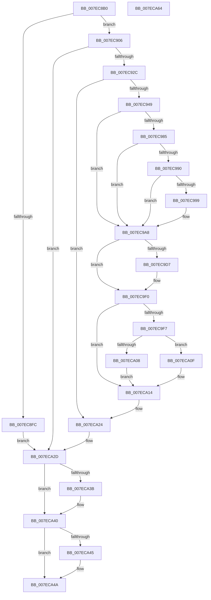

# CmpAssignKeySecurity

- RVA: `0x007EC8B0`–`0x007ECA65` (길이 `437` bytes)
- VA: `0x00000001407EC8B0`
- 실행 섹션: `PAGE`
- PDB 이름 있음: `예`; PDB Function 태그: `아니요`
- unwind 정보 RVA: `0x000BCF10`
- 디코드: `122`개 명령, `437/437` bytes 표시
- 미해석 바이트: `0` (있으면 어셈블리에 `.byte`로 보존)

> 이 문서는 커널 이미지의 기계어와 PDB 기호를 분석해 생성했습니다. 4번과 5번은 함수 원형과 자료형을 바이너리 사용 방식에서 추정한 C 해석이며 원본 소스 복구 결과는 아닙니다.

## 1. Dependencies

- 직접 호출 지점: **19**; 고유 호출 대상: **19**
- 직접 호출자로 확인된 함수: **1**
- RIP 상대 이미지 참조: **0**

### Outgoing calls
- `0x007EC8D9` → [HvpGetCellContextInitialize](../85/HvpGetCellContextInitialize_function_00855F10.md) (function, `0x00855F10`)
- `0x007EC8F0` → [CmpAcquireShutdownRundown](../../pagecmrc/BC/CmpAcquireShutdownRundown_function_00BC9400.md) (function, `0x00BC9400`)
- `0x007EC906` → [CmpLockRegistry](../../pagecmrc/BC/CmpLockRegistry_function_00BC9B34.md) (function, `0x00BC9B34`)
- `0x007EC91D` → [CmpStartKcbStackForTopLayerKcb](../84/CmpStartKcbStackForTopLayerKcb_function_00848390.md) (function, `0x00848390`)
- `0x007EC930` → [CmpLockKcbStackExclusive](../94/CmpLockKcbStackExclusive_function_009491C0.md) (function, `0x009491C0`)
- `0x007EC93A` → [CmpPerformKeyBodyDeletionCheck](../../pagecmrc/BC/CmpPerformKeyBodyDeletionCheck_function_00BC97D0.md) (function, `0x00BC97D0`)
- `0x007EC94C` → [HvLockHiveFlusherShared](../84/HvLockHiveFlusherShared_function_0084F95C.md) (function, `0x0084F95C`)
- `0x007EC954` → [CmLockHiveSecurityExclusive](../84/CmLockHiveSecurityExclusive_function_0084B1A8.md) (function, `0x0084B1A8`)
- `0x007EC963` → [CmpGetKeyNodeForKcb](../85/CmpGetKeyNodeForKcb_function_00856480.md) (function, `0x00856480`)
- `0x007EC9CC` → [CmpGetSecurityDescriptorNodeEx](../94/CmpGetSecurityDescriptorNodeEx_function_00949268.md) (function, `0x00949268`)
- `0x007EC9E9` → [CmpAssignSecurityToKcb](../9D/CmpAssignSecurityToKcb_function_009DA720.md) (function, `0x009DA720`)
- `0x007ECA08` → [HvpReleaseCellFlat](../85/HvpReleaseCellFlat_function_0085CC20.md) (function, `0x0085CC20`)
- `0x007ECA0F` → [HvpReleaseCellPaged](../85/HvpReleaseCellPaged_function_00855F40.md) (function, `0x00855F40`)
- `0x007ECA17` → [CmUnlockHiveSecurity](../../pagecmrc/BC/CmUnlockHiveSecurity_function_00BC99C8.md) (function, `0x00BC99C8`)
- `0x007ECA1F` → [HvUnlockHiveFlusherShared](../84/HvUnlockHiveFlusherShared_function_00848738.md) (function, `0x00848738`)
- `0x007ECA28` → [CmpUnlockKcbStack](../84/CmpUnlockKcbStack_function_00848460.md) (function, `0x00848460`)
- `0x007ECA31` → [CmpCleanupKcbStack](../94/CmpCleanupKcbStack_function_009470A0.md) (function, `0x009470A0`)
- `0x007ECA3B` → [CmpUnlockRegistry](../../pagecmrc/BC/CmpUnlockRegistry_function_00BC9A84.md) (function, `0x00BC9A84`)
- `0x007ECA45` → [CmpReleaseShutdownRundown](../../pagecmrc/BC/CmpReleaseShutdownRundown_function_00BC9880.md) (function, `0x00BC9880`)

### Direct callers
- [sub_00B176D6](../B1/Unknown_function_00B176D6.md) at `0x00B176E1`

### Static image references
- 디코드된 RIP-relative 메모리 참조가 없습니다.

## 2. Other-region calls and transfers

- 다른 실행 섹션으로 향하는 call: **6**
  - `0x007EC8F0` → [CmpAcquireShutdownRundown](../../pagecmrc/BC/CmpAcquireShutdownRundown_function_00BC9400.md) (`PAGE` → `PAGECMRC`)
  - `0x007EC906` → [CmpLockRegistry](../../pagecmrc/BC/CmpLockRegistry_function_00BC9B34.md) (`PAGE` → `PAGECMRC`)
  - `0x007EC93A` → [CmpPerformKeyBodyDeletionCheck](../../pagecmrc/BC/CmpPerformKeyBodyDeletionCheck_function_00BC97D0.md) (`PAGE` → `PAGECMRC`)
  - `0x007ECA17` → [CmUnlockHiveSecurity](../../pagecmrc/BC/CmUnlockHiveSecurity_function_00BC99C8.md) (`PAGE` → `PAGECMRC`)
  - `0x007ECA3B` → [CmpUnlockRegistry](../../pagecmrc/BC/CmpUnlockRegistry_function_00BC9A84.md) (`PAGE` → `PAGECMRC`)
  - `0x007ECA45` → [CmpReleaseShutdownRundown](../../pagecmrc/BC/CmpReleaseShutdownRundown_function_00BC9880.md) (`PAGE` → `PAGECMRC`)
- 별도 외부 분기/꼬리 이동을 확인하지 못했습니다.

## 3. Assembly (complete function range)

```asm
007EC8B0  48 89 5C 24 08                  mov qword ptr [rsp + 8], rbx
007EC8B5  55                              push rbp
007EC8B6  56                              push rsi
007EC8B7  57                              push rdi
007EC8B8  41 54                           push r12
007EC8BA  41 55                           push r13
007EC8BC  41 56                           push r14
007EC8BE  41 57                           push r15
007EC8C0  48 8B EC                        mov rbp, rsp
007EC8C3  48 83 EC 60                     sub rsp, 0x60
007EC8C7  48 83 65 50 00                  and qword ptr [rbp + 0x50], 0
007EC8CC  4C 8B E9                        mov r13, rcx
007EC8CF  48 8D 4D 50                     lea rcx, [rbp + 0x50]
007EC8D3  4C 8B FA                        mov r15, rdx
007EC8D6  45 32 F6                        xor r14b, r14b
007EC8D9  E8 32 96 06 00                  call 0x140855f10
007EC8DE  0F 57 C0                        xorps xmm0, xmm0
007EC8E1  83 C8 FF                        or eax, 0xffffffff
007EC8E4  0F 11 45 E0                     movups xmmword ptr [rbp - 0x20], xmm0
007EC8E8  66 89 45 E2                     mov word ptr [rbp - 0x1e], ax
007EC8EC  0F 11 45 F0                     movups xmmword ptr [rbp - 0x10], xmm0
007EC8F0  E8 0B CB 3D 00                  call 0x140bc9400
007EC8F5  44 8A E0                        mov r12b, al
007EC8F8  84 C0                           test al, al
007EC8FA  75 0A                           jne 0x1407ec906
007EC8FC  BB 89 01 00 C0                  mov ebx, 0xc0000189
007EC901  E9 27 01 00 00                  jmp 0x1407eca2d
007EC906  E8 29 D2 3D 00                  call 0x140bc9b34
007EC90B  49 8B 75 08                     mov rsi, qword ptr [r13 + 8]
007EC90F  48 8D 4D E0                     lea rcx, [rbp - 0x20]
007EC913  48 8B D6                        mov rdx, rsi
007EC916  41 B6 01                        mov r14b, 1
007EC919  48 8B 7E 20                     mov rdi, qword ptr [rsi + 0x20]
007EC91D  E8 6E BA 05 00                  call 0x140848390
007EC922  8B D8                           mov ebx, eax
007EC924  85 C0                           test eax, eax
007EC926  0F 88 01 01 00 00               js 0x1407eca2d
007EC92C  48 8D 4D E0                     lea rcx, [rbp - 0x20]
007EC930  E8 8B C8 15 00                  call 0x1409491c0
007EC935  33 D2                           xor edx, edx
007EC937  49 8B CD                        mov rcx, r13
007EC93A  E8 91 CE 3D 00                  call 0x140bc97d0
007EC93F  8B D8                           mov ebx, eax
007EC941  85 C0                           test eax, eax
007EC943  0F 88 DB 00 00 00               js 0x1407eca24
007EC949  48 8B CF                        mov rcx, rdi
007EC94C  E8 0B 30 06 00                  call 0x14084f95c
007EC951  48 8B CF                        mov rcx, rdi
007EC954  E8 4F E8 05 00                  call 0x14084b1a8
007EC959  45 8A C6                        mov r8b, r14b
007EC95C  48 8D 55 50                     lea rdx, [rbp + 0x50]
007EC960  48 8B CE                        mov rcx, rsi
007EC963  E8 18 9B 06 00                  call 0x140856480
007EC968  45 33 C0                        xor r8d, r8d
007EC96B  48 89 45 58                     mov qword ptr [rbp + 0x58], rax
007EC96F  4D 89 45 F8                     mov qword ptr [r13 - 8], r8
007EC973  65 48 8B 0C 25 88 01 00 00      mov rcx, qword ptr gs:[0x188]
007EC97C  44 38 81 32 02 00 00            cmp byte ptr [rcx + 0x232], r8b
007EC983  75 23                           jne 0x1407ec9a8
007EC985  8B 8F 10 10 00 00               mov ecx, dword ptr [rdi + 0x1010]
007EC98B  F6 C1 20                        test cl, 0x20
007EC98E  74 18                           je 0x1407ec9a8
007EC990  44 39 87 50 07 00 00            cmp dword ptr [rdi + 0x750], r8d
007EC997  74 0F                           je 0x1407ec9a8
007EC999  48 8B 8F 60 07 00 00            mov rcx, qword ptr [rdi + 0x760]
007EC9A0  4C 8B 79 08                     mov r15, qword ptr [rcx + 8]
007EC9A4  49 83 C7 20                     add r15, 0x20
007EC9A8  8B 56 28                        mov edx, dword ptr [rsi + 0x28]
007EC9AB  4C 8D 68 2C                     lea r13, [rax + 0x2c]
007EC9AF  48 8B 4E 20                     mov rcx, qword ptr [rsi + 0x20]
007EC9B3  44 8B CA                        mov r9d, edx
007EC9B6  4C 89 6C 24 30                  mov qword ptr [rsp + 0x30], r13
007EC9BB  44 88 44 24 28                  mov byte ptr [rsp + 0x28], r8b
007EC9C0  4C 8B C0                        mov r8, rax
007EC9C3  41 C1 E9 1F                     shr r9d, 0x1f
007EC9C7  4C 89 7C 24 20                  mov qword ptr [rsp + 0x20], r15
007EC9CC  E8 97 C8 15 00                  call 0x140949268
007EC9D1  8B D8                           mov ebx, eax
007EC9D3  85 C0                           test eax, eax
007EC9D5  78 19                           js 0x1407ec9f0
007EC9D7  41 8B 55 00                     mov edx, dword ptr [r13]
007EC9DB  45 8A CE                        mov r9b, r14b
007EC9DE  45 33 C0                        xor r8d, r8d
007EC9E1  C6 44 24 20 00                  mov byte ptr [rsp + 0x20], 0
007EC9E6  48 8B CE                        mov rcx, rsi
007EC9E9  E8 32 DD 1E 00                  call 0x1409da720
007EC9EE  33 DB                           xor ebx, ebx
007EC9F0  48 83 7D 58 00                  cmp qword ptr [rbp + 0x58], 0
007EC9F5  74 1D                           je 0x1407eca14
007EC9F7  48 8B 4E 20                     mov rcx, qword ptr [rsi + 0x20]
007EC9FB  48 8D 55 50                     lea rdx, [rbp + 0x50]
007EC9FF  44 84 B1 8C 00 00 00            test byte ptr [rcx + 0x8c], r14b
007ECA06  74 07                           je 0x1407eca0f
007ECA08  E8 13 02 07 00                  call 0x14085cc20
007ECA0D  EB 05                           jmp 0x1407eca14
007ECA0F  E8 2C 95 06 00                  call 0x140855f40
007ECA14  48 8B CF                        mov rcx, rdi
007ECA17  E8 AC CF 3D 00                  call 0x140bc99c8
007ECA1C  48 8B CF                        mov rcx, rdi
007ECA1F  E8 14 BD 05 00                  call 0x140848738
007ECA24  48 8D 4D E0                     lea rcx, [rbp - 0x20]
007ECA28  E8 33 BA 05 00                  call 0x140848460
007ECA2D  48 8D 4D E0                     lea rcx, [rbp - 0x20]
007ECA31  E8 6A A6 15 00                  call 0x1409470a0
007ECA36  45 84 F6                        test r14b, r14b
007ECA39  74 05                           je 0x1407eca40
007ECA3B  E8 44 D0 3D 00                  call 0x140bc9a84
007ECA40  45 84 E4                        test r12b, r12b
007ECA43  74 05                           je 0x1407eca4a
007ECA45  E8 36 CE 3D 00                  call 0x140bc9880
007ECA4A  8B C3                           mov eax, ebx
007ECA4C  48 8B 9C 24 A0 00 00 00         mov rbx, qword ptr [rsp + 0xa0]
007ECA54  48 83 C4 60                     add rsp, 0x60
007ECA58  41 5F                           pop r15
007ECA5A  41 5E                           pop r14
007ECA5C  41 5D                           pop r13
007ECA5E  41 5C                           pop r12
007ECA60  5F                              pop rdi
007ECA61  5E                              pop rsi
007ECA62  5D                              pop rbp
007ECA63  C3                              ret
007ECA64  CC                              int3
```

## 4. C-style interpretation (structured pseudocode)

```c
__int64 __fastcall CmpAssignKeySecurity(__int64 a1, __int64 a2)
{
    __int64 result;
    __int64 v_r14;
    __int64 v_r15;
    __int64 v_rbx;
    __int64 v_rsp;
    unsigned __int64 v_stack_m48;
    unsigned __int16 v_stack_m56;
    unsigned __int64 v_stack_m58;
    unsigned __int64 v_stack_m68;
    unsigned __int8 v_stack_m70;
    unsigned __int64 v_stack_m78;
    unsigned __int64 v_stack_p18;
    unsigned __int64 v_stack_p20;
    unsigned __int64 v_stack_p8;

    v_stack_p8 = v_rbx;
    v_rsp = (v_rsp) - (96);
    v_r14 = 0;
    result = HvpGetCellContextInitialize(v_stack_p18, a2, a3, a4);
    result = (unsigned int)((result) | (0xFFFFFFFFULL));
    v_stack_m58 = v_xmm0;
    v_stack_m56 = (unsigned __int16)(result);
    v_stack_m48 = v_xmm0;
    result = CmpAcquireShutdownRundown(v_stack_p18, a2, a3, a4);
    if ((unsigned __int8)(result) != 0) goto loc_007EC906;
    goto loc_007ECA2D;
loc_007EC906:
    result = CmpLockRegistry(v_stack_p18, a2, a3, a4);
    result = CmpStartKcbStackForTopLayerKcb(v_stack_m58, *(unsigned __int64 *)(a1 + 8), a3, a4);
    if (sign_flag) goto loc_007ECA2D;
    result = CmpLockKcbStackExclusive(v_stack_m58, *(unsigned __int64 *)(a1 + 8), a3, a4);
    a2 = 0;
    result = CmpPerformKeyBodyDeletionCheck(a1, a2, a3, a4);
    if (sign_flag) goto loc_007ECA24;
    result = HvLockHiveFlusherShared(*(unsigned __int64 *)(*(unsigned __int64 *)(a1 + 8) + 32), a2, a3, a4);
    result = CmLockHiveSecurityExclusive(*(unsigned __int64 *)(*(unsigned __int64 *)(a1 + 8) + 32), a2, a3, a4);
    result = CmpGetKeyNodeForKcb(*(unsigned __int64 *)(a1 + 8), v_stack_p18, 1, a4);
    a3 = 0;
    v_stack_p20 = result;
    *(unsigned __int64 *)(a1 - 8) = 0;
    if ((*(unsigned __int8 *)(*(unsigned __int64 *)(gs_base + (0 + 392)) + 562)) != 0) goto loc_007EC9A8;
    if ((((unsigned __int8)((unsigned int)(*(unsigned int *)(*(unsigned __int64 *)(*(unsigned __int64 *)(a1 + 8) + 32) + 4112)))) & (32)) == 0) goto loc_007EC9A8;
    v_r15 = a2;
    if ((*(unsigned int *)(*(unsigned __int64 *)(*(unsigned __int64 *)(a1 + 8) + 32) + 1872)) != 0) {
        a1 = *(unsigned __int64 *)(*(unsigned __int64 *)(*(unsigned __int64 *)(a1 + 8) + 32) + 1888);
        v_r15 = *(unsigned __int64 *)(a1 + 8);
        v_r15 = (v_r15) + (32);
    }
    v_stack_m68 = result + 44;
    v_stack_m70 = 0;
    a4 = (unsigned int)(((unsigned int)((unsigned int)((unsigned int)(*(unsigned int *)(*(unsigned __int64 *)(a1 + 8) + 40))))) >> (31));
    v_stack_m78 = v_r15;
    result = CmpGetSecurityDescriptorNodeEx(*(unsigned __int64 *)(*(unsigned __int64 *)(a1 + 8) + 32), (unsigned int)(*(unsigned int *)(*(unsigned __int64 *)(a1 + 8) + 40)), result, a4);
    v_rbx = (unsigned int)((unsigned int)(result));
    if (!(sign_flag)) {
        a2 = *(unsigned int *)(result + 44);
        a4 = 1;
        a3 = 0;
        v_stack_m78 = 0;
        a1 = *(unsigned __int64 *)(a1 + 8);
        result = CmpAssignSecurityToKcb(a1, a2, a3, a4);
        v_rbx = 0;
    }
    if (v_stack_p20 == 0) goto loc_007ECA14;
    if (((*(unsigned __int8 *)(*(unsigned __int64 *)(*(unsigned __int64 *)(a1 + 8) + 32) + 140)) & (1)) == 0) goto loc_007ECA0F;
    result = HvpReleaseCellFlat(*(unsigned __int64 *)(*(unsigned __int64 *)(a1 + 8) + 32), v_stack_p18, a3, a4);
    goto loc_007ECA14;
loc_007ECA0F:
    result = HvpReleaseCellPaged(*(unsigned __int64 *)(*(unsigned __int64 *)(a1 + 8) + 32), v_stack_p18, a3, a4);
loc_007ECA14:
    result = CmUnlockHiveSecurity(*(unsigned __int64 *)(*(unsigned __int64 *)(a1 + 8) + 32), v_stack_p18, a3, a4);
    result = HvUnlockHiveFlusherShared(*(unsigned __int64 *)(*(unsigned __int64 *)(a1 + 8) + 32), v_stack_p18, a3, a4);
loc_007ECA24:
    result = CmpUnlockKcbStack(v_stack_m58, v_stack_p18, a3, a4);
loc_007ECA2D:
    result = CmpCleanupKcbStack(v_stack_m58, v_stack_p18, a3, a4);
    if (1 != 0) {
        result = CmpUnlockRegistry(v_stack_m58, v_stack_p18, a3, a4);
    }
    if ((unsigned __int8)((unsigned __int8)(result)) != 0) {
        result = CmpReleaseShutdownRundown(v_stack_m58, v_stack_p18, a3, a4);
    }
    v_rsp = (v_rsp) + (96);
    return 0;
}
```

## 5. (Beta) C Style

```c
int64_t CmpAssignKeySecurity(void *Arg1, int64_t Arg2)
{
    uint8_t *arg1 = (uint8_t *)Arg1;

    int64_t result;
    int64_t local_r14;
    int64_t local_r15;
    int64_t local_rbx;
    int64_t local_rsp;
    uint64_t v_stack_m48;
    uint16_t v_stack_m56;
    uint64_t v_stack_m58;
    uint64_t v_stack_m68;
    uint8_t v_stack_m70;
    uint64_t v_stack_m78;
    uint64_t v_stack_p18;
    uint64_t v_stack_p20;
    uint64_t v_stack_p8;

    v_stack_p8 = local_rbx;
    local_rsp = (local_rsp) - (96);
    local_r14 = 0;
    result = HvpGetCellContextInitialize(v_stack_p18, Arg2, a3, a4);
    result = (uint32_t)((result) | (0xFFFFFFFFULL));
    v_stack_m58 = v_xmm0;
    v_stack_m56 = (uint16_t)(result);
    v_stack_m48 = v_xmm0;
    result = CmpAcquireShutdownRundown(v_stack_p18, Arg2, a3, a4);
    if ((uint8_t)(result) != 0) goto loc_007EC906;
    goto loc_007ECA2D;
loc_007EC906:
    result = CmpLockRegistry(v_stack_p18, Arg2, a3, a4);
    result = CmpStartKcbStackForTopLayerKcb(v_stack_m58, *(uint64_t *)(arg1 + 0x8), a3, a4);
    if (sign_flag) goto loc_007ECA2D;
    result = CmpLockKcbStackExclusive(v_stack_m58, *(uint64_t *)(arg1 + 0x8), a3, a4);
    Arg2 = 0;
    result = CmpPerformKeyBodyDeletionCheck(Arg1, Arg2, a3, a4);
    if (sign_flag) goto loc_007ECA24;
    result = HvLockHiveFlusherShared(*(uint64_t *)(*(uint64_t *)(arg1 + 0x8) + 0x20), Arg2, a3, a4);
    result = CmLockHiveSecurityExclusive(*(uint64_t *)(*(uint64_t *)(arg1 + 0x8) + 0x20), Arg2, a3, a4);
    result = CmpGetKeyNodeForKcb(*(uint64_t *)(arg1 + 0x8), v_stack_p18, 1, a4);
    a3 = 0;
    v_stack_p20 = result;
    *(uint64_t *)(arg1 - 0x8) = 0;
    if ((*(uint8_t *)(*(uint64_t *)(gs_base + (0 + 0x188)) + 0x232)) != 0) goto loc_007EC9A8;
    if ((((uint8_t)((uint32_t)(*(uint32_t *)(*(uint64_t *)(*(uint64_t *)(arg1 + 0x8) + 0x20) + 0x1010)))) & (32)) == 0) goto loc_007EC9A8;
    local_r15 = Arg2;
    if ((*(uint32_t *)(*(uint64_t *)(*(uint64_t *)(arg1 + 0x8) + 0x20) + 0x750)) != 0) {
        Arg1 = *(uint64_t *)(*(uint64_t *)(*(uint64_t *)(arg1 + 0x8) + 0x20) + 0x760);
        local_r15 = *(uint64_t *)(arg1 + 0x8);
        local_r15 = (local_r15) + (32);
    }
    v_stack_m68 = result + 44;
    v_stack_m70 = 0;
    a4 = (uint32_t)(((uint32_t)((uint32_t)((uint32_t)(*(uint32_t *)(*(uint64_t *)(arg1 + 0x8) + 0x28))))) >> (31));
    v_stack_m78 = local_r15;
    result = CmpGetSecurityDescriptorNodeEx(*(uint64_t *)(*(uint64_t *)(arg1 + 0x8) + 0x20), (uint32_t)(*(uint32_t *)(*(uint64_t *)(arg1 + 0x8) + 0x28)), result, a4);
    local_rbx = (uint32_t)((uint32_t)(result));
    if (!(sign_flag)) {
        Arg2 = *(uint32_t *)(result + 0x2C);
        a4 = 1;
        a3 = 0;
        v_stack_m78 = 0;
        Arg1 = *(uint64_t *)(arg1 + 0x8);
        result = CmpAssignSecurityToKcb(Arg1, Arg2, a3, a4);
        local_rbx = 0;
    }
    if (v_stack_p20 == 0) goto loc_007ECA14;
    if (((*(uint8_t *)(*(uint64_t *)(*(uint64_t *)(arg1 + 0x8) + 0x20) + 0x8C)) & (1)) == 0) goto loc_007ECA0F;
    result = HvpReleaseCellFlat(*(uint64_t *)(*(uint64_t *)(arg1 + 0x8) + 0x20), v_stack_p18, a3, a4);
    goto loc_007ECA14;
loc_007ECA0F:
    result = HvpReleaseCellPaged(*(uint64_t *)(*(uint64_t *)(arg1 + 0x8) + 0x20), v_stack_p18, a3, a4);
loc_007ECA14:
    result = CmUnlockHiveSecurity(*(uint64_t *)(*(uint64_t *)(arg1 + 0x8) + 0x20), v_stack_p18, a3, a4);
    result = HvUnlockHiveFlusherShared(*(uint64_t *)(*(uint64_t *)(arg1 + 0x8) + 0x20), v_stack_p18, a3, a4);
loc_007ECA24:
    result = CmpUnlockKcbStack(v_stack_m58, v_stack_p18, a3, a4);
loc_007ECA2D:
    result = CmpCleanupKcbStack(v_stack_m58, v_stack_p18, a3, a4);
    if (1 != 0) {
        result = CmpUnlockRegistry(v_stack_m58, v_stack_p18, a3, a4);
    }
    if ((uint8_t)((uint8_t)(result)) != 0) {
        result = CmpReleaseShutdownRundown(v_stack_m58, v_stack_p18, a3, a4);
    }
    local_rsp = (local_rsp) + (96);
    return 0;
}
```

### 관측된 메모리 오프셋

구조체 형식이 확인되지 않은 접근은 인자 기준의 오프셋으로만 기록했습니다.

| 기준 인자 | 오프셋 표현 | 폭 (bit) | 접근 |
|---|---:|---:|---|
| `Arg1` | `- 0x8` | `64` | `W` |
| `Arg1` | `+ 0x8` | `64` | `R` |

## 6. Execution-region graph

[열기: 2D/3D 그래프와 함수 탐색 컨트롤 패널](../../../control-panel.html?section=page&rva=0x007EC8B0&view=graph)

- 2D 그래프는 위에서 아래로 흐르고, 3D 그래프는 빈 공간을 드래그해 회전합니다. Shift+드래그는 이동, 휠은 확대·축소, 함수 노드 선택은 대상 보고서 이동입니다.

### Static fallback


