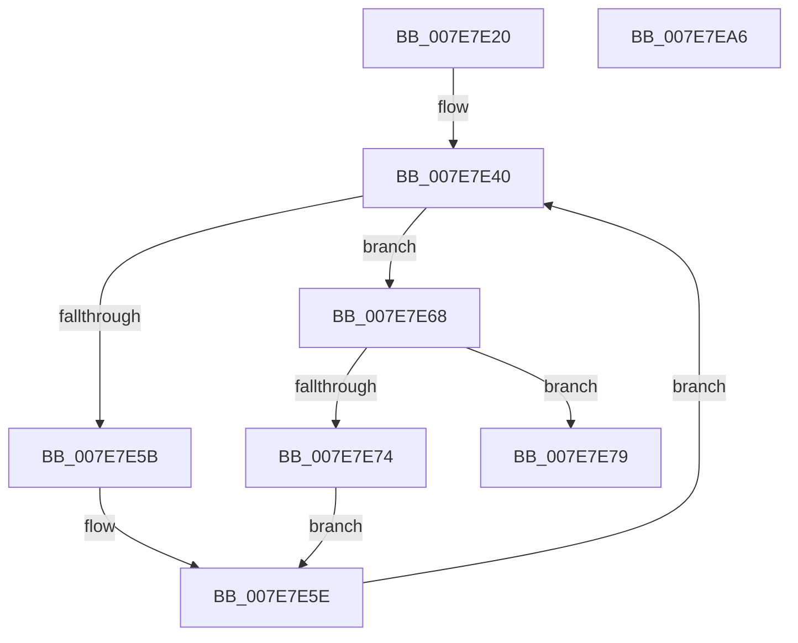

# CmpBecomeActiveFlusherAndReconciler

- RVA: `0x007E7E20`–`0x007E7EA7` (길이 `135` bytes)
- VA: `0x00000001407E7E20`
- 실행 섹션: `PAGE`
- PDB 이름 있음: `예`; PDB Function 태그: `아니요`
- unwind 정보 RVA: `0x00060BC4`
- 디코드: `38`개 명령, `135/135` bytes 표시
- 미해석 바이트: `0` (있으면 어셈블리에 `.byte`로 보존)

> 이 문서는 커널 이미지의 기계어와 PDB 기호를 분석해 생성했습니다. 4번과 5번은 함수 원형과 자료형을 바이너리 사용 방식에서 추정한 C 해석이며 원본 소스 복구 결과는 아닙니다.

## 1. Dependencies

- 직접 호출 지점: **9**; 고유 호출 대상: **7**
- 직접 호출자로 확인된 함수: **6**
- RIP 상대 이미지 참조: **0**

### Outgoing calls
- `0x007E7E42` → [CmpLockRegistryFreezeAware](../9B/CmpLockRegistryFreezeAware_function_009B4AE4.md) (function, `0x009B4AE4`)
- `0x007E7E4A` → [HvLockHiveFlusherExclusive](../../pagecmrc/BC/HvLockHiveFlusherExclusive_function_00BC9C50.md) (function, `0x00BC9C50`)
- `0x007E7E52` → [CmpIsWriteQueueActive](../../text/48/CmpIsWriteQueueActive_function_0048C7D8.md) (function, `0x0048C7D8`)
- `0x007E7E61` → [CmpWaitOnHiveWriteQueue](../AA/CmpWaitOnHiveWriteQueue_function_00AA0110.md) (function, `0x00AA0110`)
- `0x007E7E6B` → [CmpIsWriteQueueActive](../../text/48/CmpIsWriteQueueActive_function_0048C7D8.md) (function, `0x0048C7D8`)
- `0x007E7E7C` → [CmpAcquireWriteQueue](../../text/49/CmpAcquireWriteQueue_function_0049E55C.md) (function, `0x0049E55C`)
- `0x007E7E84` → [CmpAcquireWriteQueue](../../text/49/CmpAcquireWriteQueue_function_0049E55C.md) (function, `0x0049E55C`)
- `0x007E7E8C` → [HvUnlockHiveFlusherExclusive](../../pagecmrc/BC/HvUnlockHiveFlusherExclusive_function_00BC9C34.md) (function, `0x00BC9C34`)
- `0x007E7E91` → [CmpUnlockRegistry](../../pagecmrc/BC/CmpUnlockRegistry_function_00BC9A84.md) (function, `0x00BC9A84`)

### Direct callers
- [CmShutdownSystem1](../../text/66/CmShutdownSystem1_function_0066A5B0.md) at `0x0066A75D`
- [CmpLoadHiveThread](../7D/CmpLoadHiveThread_function_007DB040.md) at `0x007DB73B`
- [CmpMountPreloadedHives](../7D/CmpMountPreloadedHives_function_007DBE18.md) at `0x007DC1F3`
- [CmpRefreshHive](../7D/CmpRefreshHive_function_007DEAD0.md) at `0x007DEB6E`
- [CmpSaveKeyByFileCopy](../7D/CmpSaveKeyByFileCopy_function_007DEFC0.md) at `0x007DF017`
- [CmReplaceKey](CmReplaceKey_function_007EA1C8.md) at `0x007EA323`

### Static image references
- 디코드된 RIP-relative 메모리 참조가 없습니다.

## 2. Other-region calls and transfers

- 다른 실행 섹션으로 향하는 call: **7**
  - `0x007E7E4A` → [HvLockHiveFlusherExclusive](../../pagecmrc/BC/HvLockHiveFlusherExclusive_function_00BC9C50.md) (`PAGE` → `PAGECMRC`)
  - `0x007E7E52` → [CmpIsWriteQueueActive](../../text/48/CmpIsWriteQueueActive_function_0048C7D8.md) (`PAGE` → `.text`)
  - `0x007E7E6B` → [CmpIsWriteQueueActive](../../text/48/CmpIsWriteQueueActive_function_0048C7D8.md) (`PAGE` → `.text`)
  - `0x007E7E7C` → [CmpAcquireWriteQueue](../../text/49/CmpAcquireWriteQueue_function_0049E55C.md) (`PAGE` → `.text`)
  - `0x007E7E84` → [CmpAcquireWriteQueue](../../text/49/CmpAcquireWriteQueue_function_0049E55C.md) (`PAGE` → `.text`)
  - `0x007E7E8C` → [HvUnlockHiveFlusherExclusive](../../pagecmrc/BC/HvUnlockHiveFlusherExclusive_function_00BC9C34.md) (`PAGE` → `PAGECMRC`)
  - `0x007E7E91` → [CmpUnlockRegistry](../../pagecmrc/BC/CmpUnlockRegistry_function_00BC9A84.md) (`PAGE` → `PAGECMRC`)
- 별도 외부 분기/꼬리 이동을 확인하지 못했습니다.

## 3. Assembly (complete function range)

```asm
007E7E20  48 89 5C 24 08                  mov qword ptr [rsp + 8], rbx
007E7E25  48 89 74 24 10                  mov qword ptr [rsp + 0x10], rsi
007E7E2A  57                              push rdi
007E7E2B  48 83 EC 20                     sub rsp, 0x20
007E7E2F  48 8B D9                        mov rbx, rcx
007E7E32  48 8D B1 70 10 00 00            lea rsi, [rcx + 0x1070]
007E7E39  48 8D B9 60 10 00 00            lea rdi, [rcx + 0x1060]
007E7E40  33 C9                           xor ecx, ecx
007E7E42  E8 9D CC 1C 00                  call 0x1409b4ae4
007E7E47  48 8B CB                        mov rcx, rbx
007E7E4A  E8 01 1E 3E 00                  call 0x140bc9c50
007E7E4F  48 8B CE                        mov rcx, rsi
007E7E52  E8 81 49 CA FF                  call 0x14048c7d8
007E7E57  84 C0                           test al, al
007E7E59  74 0D                           je 0x1407e7e68
007E7E5B  48 8B D6                        mov rdx, rsi
007E7E5E  48 8B CB                        mov rcx, rbx
007E7E61  E8 AA 82 2B 00                  call 0x140aa0110
007E7E66  EB D8                           jmp 0x1407e7e40
007E7E68  48 8B CF                        mov rcx, rdi
007E7E6B  E8 68 49 CA FF                  call 0x14048c7d8
007E7E70  84 C0                           test al, al
007E7E72  74 05                           je 0x1407e7e79
007E7E74  48 8B D7                        mov rdx, rdi
007E7E77  EB E5                           jmp 0x1407e7e5e
007E7E79  48 8B CE                        mov rcx, rsi
007E7E7C  E8 DB 66 CB FF                  call 0x14049e55c
007E7E81  48 8B CF                        mov rcx, rdi
007E7E84  E8 D3 66 CB FF                  call 0x14049e55c
007E7E89  48 8B CB                        mov rcx, rbx
007E7E8C  E8 A3 1D 3E 00                  call 0x140bc9c34
007E7E91  E8 EE 1B 3E 00                  call 0x140bc9a84
007E7E96  48 8B 5C 24 30                  mov rbx, qword ptr [rsp + 0x30]
007E7E9B  48 8B 74 24 38                  mov rsi, qword ptr [rsp + 0x38]
007E7EA0  48 83 C4 20                     add rsp, 0x20
007E7EA4  5F                              pop rdi
007E7EA5  C3                              ret
007E7EA6  CC                              int3
```

## 4. C-style interpretation (structured pseudocode)

```c
__int64 __fastcall CmpBecomeActiveFlusherAndReconciler(__int64 a1)
{
    __int64 result;
    __int64 v_rsp;
    unsigned __int64 v_stack_p10;
    unsigned __int64 v_stack_p8;

    v_stack_p8 = v_rbx;
    v_stack_p10 = v_rsi;
    v_rsp = (v_rsp) - (32);
loc_007E7E40:
    a1 = 0;
    result = CmpLockRegistryFreezeAware(a1, a2, a3, a4);
    result = HvLockHiveFlusherExclusive(0, a2, a3, a4);
    result = CmpIsWriteQueueActive(a1 + 4208, a2, a3, a4);
    if ((unsigned __int8)(result) == 0) goto loc_007E7E68;
loc_007E7E5E:
    result = CmpWaitOnHiveWriteQueue(0, a1 + 4208, a3, a4);
    goto loc_007E7E40;
loc_007E7E68:
    result = CmpIsWriteQueueActive(a1 + 4192, a1 + 4208, a3, a4);
    if ((unsigned __int8)(result) == 0) goto loc_007E7E79;
    goto loc_007E7E5E;
loc_007E7E79:
    result = CmpAcquireWriteQueue(a1 + 4208, a1 + 4192, a3, a4);
    result = CmpAcquireWriteQueue(a1 + 4192, a1 + 4192, a3, a4);
    result = HvUnlockHiveFlusherExclusive(0, a1 + 4192, a3, a4);
    result = CmpUnlockRegistry(0, a1 + 4192, a3, a4);
    v_rsp = (v_rsp) + (32);
    return result;
}
```

## 5. (Beta) C Style

```c
int64_t CmpBecomeActiveFlusherAndReconciler(void *Arg1)
{
    uint8_t *arg1 = (uint8_t *)Arg1;

    int64_t result;
    int64_t local_rsp;
    uint64_t v_stack_p10;
    uint64_t v_stack_p8;

    v_stack_p8 = local_rbx;
    v_stack_p10 = local_rsi;
    local_rsp = (local_rsp) - (32);
loc_007E7E40:
    Arg1 = 0;
    result = CmpLockRegistryFreezeAware(Arg1, a2, a3, a4);
    result = HvLockHiveFlusherExclusive(0, a2, a3, a4);
    result = CmpIsWriteQueueActive(Arg1 + 4208, a2, a3, a4);
    if ((uint8_t)(result) == 0) goto loc_007E7E68;
loc_007E7E5E:
    result = CmpWaitOnHiveWriteQueue(0, Arg1 + 4208, a3, a4);
    goto loc_007E7E40;
loc_007E7E68:
    result = CmpIsWriteQueueActive(Arg1 + 4192, Arg1 + 4208, a3, a4);
    if ((uint8_t)(result) == 0) goto loc_007E7E79;
    goto loc_007E7E5E;
loc_007E7E79:
    result = CmpAcquireWriteQueue(Arg1 + 4208, Arg1 + 4192, a3, a4);
    result = CmpAcquireWriteQueue(Arg1 + 4192, Arg1 + 4192, a3, a4);
    result = HvUnlockHiveFlusherExclusive(0, Arg1 + 4192, a3, a4);
    result = CmpUnlockRegistry(0, Arg1 + 4192, a3, a4);
    local_rsp = (local_rsp) + (32);
    return result;
}
```

### 관측된 메모리 오프셋

구조체 형식이 확인되지 않은 접근은 인자 기준의 오프셋으로만 기록했습니다.

| 기준 인자 | 오프셋 표현 | 폭 (bit) | 접근 |
|---|---:|---:|---|
| `Arg1` | `+ 0x1060` | `64` | `R` |
| `Arg1` | `+ 0x1070` | `64` | `R` |

## 6. Execution-region graph

[열기: 2D/3D 그래프와 함수 탐색 컨트롤 패널](../../../control-panel.html?section=page&rva=0x007E7E20&view=graph)

- 2D 그래프는 위에서 아래로 흐르고, 3D 그래프는 빈 공간을 드래그해 회전합니다. Shift+드래그는 이동, 휠은 확대·축소, 함수 노드 선택은 대상 보고서 이동입니다.

### Static fallback


